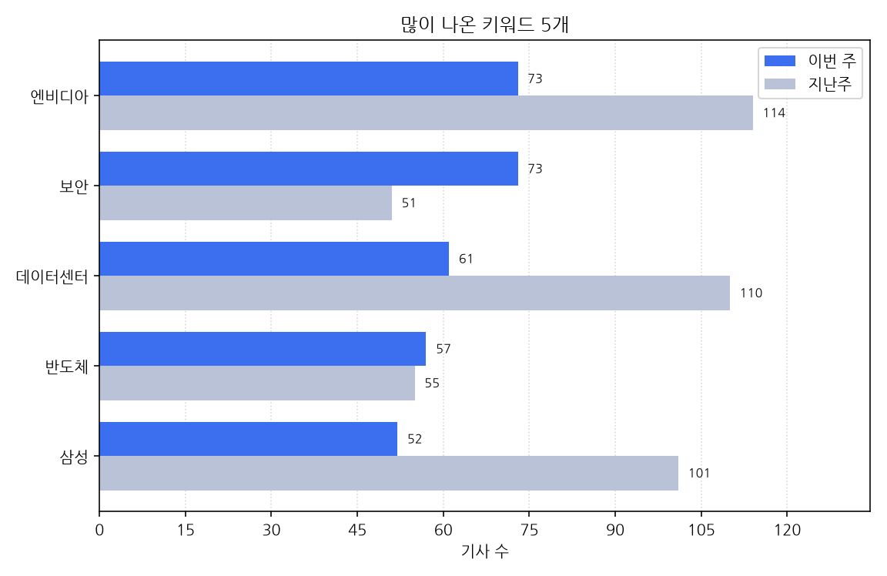

# 주간 AI 뉴스 리포트

대상 기간은 한국 시간으로 2026-10-05 월요일부터 2026-10-11 일요일까지다.
이번 주에 AI가 남긴 기사는 1340건, 지난주는 1696건이다. 356건 줄었다.

## 이번 주에 새로 나온 도구

- 10-05 '"국산 AI반도체, 실험실 넘어 전력현장으로"…K-Perf 첫 적용' 소식이 한 곳에서 나왔다 (대표 링크 https://www.edaily.co.kr/News/Read?newsId=01085686645609968&mediaCodeNo=257)
- 10-05 '"일단 내놓고 고친다? AI 재앙 부를 것"…오픈AI 안전 총괄 사임' 소식이 한 곳에서 나왔다 (대표 링크 https://www.edaily.co.kr/News/Read?newsId=01092246645609968&mediaCodeNo=257)
- 10-05 '"코딩 작업 따라 AI 조합"…깃허브, '하이드라퓨전' 적용 확대' 소식이 한 곳에서 나왔다 (대표 링크 https://zdnet.co.kr/view/?no=20261004230743)
- 10-05 '65억 들인 AI 지뢰탐지기, 군 도입 '0건'…현장 성능도 한계' 소식이 한 곳에서 나왔다 (대표 링크 https://www.newspim.com/news/view/20261005000080)
- 10-05 'LG유플러스, 해외 AI 서비스 '유독'에 들여온다…11월 첫 상품 출시' 소식이 한 곳에서 나왔다 (대표 링크 https://www.etoday.co.kr/news/view/2632419)
- 10-05 '서울 서초구, AI Agent 기능 적용한 행정 정보 안내 챗봇 '서초 AI전트' 고도화 완료' 소식이 한 곳에서 나왔다 (대표 링크 https://womannews.net/detail.php?number=456509&thread=22r12r01)
- 10-05 '잇따르는 AI發 금융권 해킹… 보안체계 전면 개편해야' 소식을 2개 매체가 다뤘다 (기사 2건, 대표 링크 https://www.segye.com/newsView/20261004507025)
- 10-05 '제미나이 무료·저가 이용자, '프로' 못쓴다…구글, 요금제 개편' 소식을 2개 매체가 다뤘다 (기사 2건, 대표 링크 https://biz.heraldcorp.com/article/10893138)
- 10-05 W컨셉, 대화형 AI 쇼핑 도입…'대화·이미지'로 상품 찾는다고 한 곳이 전했다 (대표 링크 https://www.etnews.com/20261001000413)
- 10-05 구글 제미나이 AI요금 개편…월10달러 내도 '프로' 모델 못쓴다고 한 곳이 전했다 (대표 링크 http://www.koreatimes.com/article/20261004/1632415)
- 10-06 '"AI 당직자입니다"...마포구, 서울시 최초 AI 보이스봇 도입' 소식을 2개 매체가 다뤘다 (기사 2건, 대표 링크 https://biz.heraldcorp.com/article/10893512)
- 10-06 '"로보버스·트럭 이미 달린다"…라이드플럭스, 자율주행 상용화 성과 공개' 소식이 한 곳에서 나왔다 (대표 링크 https://zdnet.co.kr/view/?no=20261006164745)
- 10-06 '"클라우드 대신 로컬서 320B 구동"…AMD, `라이젠 AI 맥스` 포트폴리오 공개' 소식이 한 곳에서 나왔다 (대표 링크 https://www.ddaily.co.kr/page/view/2026093016244925098)
- 10-06 'AI가 24시간 어르신 돌본다…NHN, 'AI 스마트홈' 공개' 소식이 한 곳에서 나왔다 (대표 링크 https://zdnet.co.kr/view/?no=20261006173429)
- 10-06 'KT, 기업용 AI 플랫폼 '에이전틱 온' 첫 공개…AX 전략 총망라' 소식이 한 곳에서 나왔다 (대표 링크 https://www.newspim.com/news/view/20261006001204)
- 10-06 'NHN클라우드, '팩토리X'로 AI 풀스택 승부…B200 408장 공개' 소식이 한 곳에서 나왔다 (대표 링크 https://www.newspim.com/news/view/20261006001230)
- 10-06 '中, 한달새 AI 모델 16개 출시⋯속도조절 대신 '가속페달' 소식이 한 곳에서 나왔다 (대표 링크 https://www.etoday.co.kr/news/view/2632903)
- 10-06 '中이 앞선 '오픈 AI'에 유럽 반격… 미스트랄, 1조 매개변수 모델 공개' 소식이 한 곳에서 나왔다 (대표 링크 https://www.newspim.com/news/view/20261006001507)
- 10-06 '강화 지혜의숲도서관, 'AI 바둑로봇' 도입…누구나 무료 이용: 연합시민의소리' 소식이 한 곳에서 나왔다 (기사 2건, 대표 링크 https://cunews.net/detail.php?number=172859&thread=22r05r03)
- 10-06 '귀뚜라미, AI 적용한 보일러·카본매트 신규 CF 2편 공개' 소식을 3개 매체가 다뤘다 (기사 3건, 대표 링크 https://www.ddaily.co.kr/page/view/2026100609431117392)
- 10-06 '금융권 AI 해킹 공격 추정…韓총리 "보안체계 전면 개편" 주문' 소식이 한 곳에서 나왔다 (대표 링크 https://www.ddaily.co.kr/page/view/2026100610164170406)
- 10-06 '남부발전, 'AI 퍼스트'경영성과 5대 혁신기술'AI 페스타 26'에 공개' 소식이 한 곳에서 나왔다 (대표 링크 https://zdnet.co.kr/view/?no=20261006175147)
- 10-06 '다온아이앤씨, AI페스타서 AI 군집드론 기술 공개…"전술 비행 혁신' 소식이 한 곳에서 나왔다 (대표 링크 https://zdnet.co.kr/view/?no=20261006164729)
- 10-06 '리플렉션AI, 첫 오픈소스 AI 모델 '빔' 공개' 소식이 한 곳에서 나왔다 (대표 링크 http://www.koreatimes.com/article/20261005/1632579)
- 10-06 '마키나락스, 포항함에 AI 참모 탑재… 함포 교범 학습' 소식이 한 곳에서 나왔다 (대표 링크 https://www.ddaily.co.kr/page/view/2026100610092401909)
- 10-06 '부산교육청, AI 서·논술형 평가지원시스템 도입…출제부터 피드백까지 한 흐름으로' 소식을 2개 매체가 다뤘다 (기사 2건, 대표 링크 https://www.etoday.co.kr/news/view/2632895)
- 10-06 '부산시교육청, 인공지능 서·논술형 평가지원 시스템 도입 추진' 소식이 한 곳에서 나왔다 (대표 링크 http://inews24.com/view/2012114)
- 10-06 '블럭스, 선제 제안 기능 탑재한 CRM 에이전트 '반자동 모드' 공개' 소식이 한 곳에서 나왔다 (대표 링크 https://www.newspim.com/news/view/20261006000994)
- 10-06 '소프트자이온, 마케팅·상담·영업 통합 AI 플랫폼 '엑티로드 비즈' 출시' 소식이 한 곳에서 나왔다 (대표 링크 https://www.newspim.com/news/view/20261006000172)
- 10-06 '솔트룩스, 국방 AI '실행' 단계로…군사 에이전트·피지컬 AI 공개' 소식이 한 곳에서 나왔다 (대표 링크 https://zdnet.co.kr/view/?no=20261006165642)
- 10-06 '야놀자넥스트, 기업용 AI 관리 솔루션 `에이먹스` 출시' 소식이 한 곳에서 나왔다 (대표 링크 https://www.ddaily.co.kr/page/view/2026100617311359958)
- 10-06 '에이에쓰아이, AI 서비스 비교·통합 구독 플랫폼 출시' 소식이 한 곳에서 나왔다 (대표 링크 https://zdnet.co.kr/view/?no=20261006110020)
- 10-06 '엔비디아가 투자한 리플렉션 AI, 첫 오픈웨이트 모델 공개…中 AI에 도전' 소식이 한 곳에서 나왔다 (대표 링크 https://biz.chosun.com/it-science/ict/2026/10/06/JFENPHFG3FGYFLIUP6OSJADJM4/)
- 10-06 '오텍캐리어, AI 데이터센터 냉각 장비 확대…2.6㎿급 CDU 도입' 소식이 한 곳에서 나왔다 (대표 링크 http://inews24.com/view/2012052)
- 10-06 '전장에 'AI 참모' 뜬다…SKT, 국방 AX 기술 공개' 소식이 한 곳에서 나왔다 (대표 링크 https://www.ddaily.co.kr/page/view/2026100610050804712)
- 10-06 '카카오모빌리티, AI 배차·관제 기술 국방에 적용…고려대와 '국방 AX' 협력' 소식이 한 곳에서 나왔다 (대표 링크 https://www.edaily.co.kr/News/Read?newsId=02915926645610296&mediaCodeNo=257)
- 10-06 '클로드 이어 챗GPT도 텍스트 워터마크 적용…EU지역 우선 적용' 소식을 2개 매체가 다뤘다 (기사 2건, 대표 링크 http://www.koreatimes.com/article/20261005/1632551)
- 10-06 '헨켈, SEDEX 2026서 AI·HBM용 첨단 패키징 소재 공개' 소식이 한 곳에서 나왔다 (대표 링크 https://www.ddaily.co.kr/page/view/2026100609313260712)
- 10-06 '홈앤쇼핑, 위조상품 AI 모니터링 도입…업계 최초' 소식이 한 곳에서 나왔다 (대표 링크 https://biz.heraldcorp.com/article/10893770)
- 10-06 LG이노텍, 美서 HBM 적용 패키지 특허 공개…AI 기판 IP 넓힌다고 한 곳이 전했다 (대표 링크 http://inews24.com/view/2012216)
- 10-06 강남구 '스마트라이프위크 2026' 참가…AI·로봇 혁신기술 선보인다고 2개 매체가 전했다 (기사 2건, 대표 링크 https://biz.heraldcorp.com/article/10893567)
- 10-06 구글 제미나이 요금제 개편... 무료·저가 이용자 '프로' 모델 못 쓴다고 한 곳이 전했다 (대표 링크 https://www.insight.co.kr/news/576548)
- 10-07 '"AI가 대답만 하는 시대는 끝났다?" Meta가 공개한 개인 AI 에이전트 'Muse' 소식이 한 곳에서 나왔다 (대표 링크 https://www.newspim.com/news/view/20261007000510)
- 10-07 '"ERP·그룹웨어 속으로 들어간 AI"…더존비즈온, 전방위 AX 포트폴리오 선보여' 소식이 한 곳에서 나왔다 (대표 링크 https://zdnet.co.kr/view/?no=20261007095716)
- 10-07 '"내년엔 몇 벌 만들까"...LF, AI로 상품 발주 첫 적용' 소식이 한 곳에서 나왔다 (대표 링크 https://www.newspim.com/news/view/20261006001108)
- 10-07 '"아마존 상품 페이지 AI가 만든다"…라인플러스, '워너블 AI' 출시' 소식이 한 곳에서 나왔다 (대표 링크 https://zdnet.co.kr/view/?no=20261007101456)
- 10-07 '"카드 잃어버렸는데 어떡해?"…토스뱅크, 30초 AI 상담 전면 도입' 소식이 한 곳에서 나왔다 (대표 링크 https://www.ddaily.co.kr/page/view/2026100709384272237)
- 10-07 '"한 가지 기술로는 부족"…현대차·기아, AI·전동화 전략 공개' 소식이 한 곳에서 나왔다 (대표 링크 https://zdnet.co.kr/view/?no=20261007093739)
- 10-07 ''갤럭시Z 폴드6·플립6' One UI 9 정식 업데이트 배포…새로운 갤럭시 AI 기능 추가' 소식이 한 곳에서 나왔다 (대표 링크 https://kbench.com/?q=node/282375)
- 10-07 ''찬바람 분다'...난방업계, AI 적용 신제품 출시 경쟁' 소식이 한 곳에서 나왔다 (대표 링크 https://www.newspim.com/news/view/20261007000976)
- 10-07 'AI 탈옥·정보 유출 막는다…아이티센클로잇, 기업용 '가드레일' 공개' 소식이 한 곳에서 나왔다 (대표 링크 https://zdnet.co.kr/view/?no=20261007171429)
- 10-07 'KB 경진대회 AI 에이전트 적용했더니…은행 민원 처리 속도 '절반' 단축' 소식이 한 곳에서 나왔다 (대표 링크 https://www.edaily.co.kr/News/Read?newsId=04211526645610624&mediaCodeNo=257)
- 10-07 'KIST, 생활 밀접 '스포츠 AI' 등 공공기술 사업화 성과 선보여' 소식이 한 곳에서 나왔다 (대표 링크 https://zdnet.co.kr/view/?no=20261007114622)
- 10-07 '佛 미스트랄, AI 모델 '라지 4' 공개⋯160개 언어로 학습' 소식이 한 곳에서 나왔다 (대표 링크 http://inews24.com/view/2012443)
- 10-07 '과천주암데이터센터, "전자파 무해, 소음·진동 기준 만족" 환경평가 결과 공개' 소식이 한 곳에서 나왔다 (대표 링크 https://www.fnnews.com/news/202610070915003994)
- 10-07 '광업공단, 'AI 기반 광산안전관리 솔루션' 도입 추진' 소식이 한 곳에서 나왔다 (대표 링크 https://zdnet.co.kr/view/?no=20261007131405)
- 10-07 '더블유닷에이아이, 초음파에 AI 더한 진단 솔루션 공개' 소식이 한 곳에서 나왔다 (대표 링크 https://zdnet.co.kr/view/?no=20261007141525)
- 10-07 '라인플러스, 아마존 특화 AI 내놨다…K-브랜드 수출 정조준' 소식이 한 곳에서 나왔다 (대표 링크 https://www.edaily.co.kr/News/Read?newsId=03752326645610624&mediaCodeNo=257)
- 10-07 '로그프레소, `챗GPT 엔터프라이즈` 연동 앱 출시' 소식이 한 곳에서 나왔다 (대표 링크 https://www.ddaily.co.kr/page/view/2026100709542135358)
- 10-07 '롯데이노베이트, 산업 현장 혁신할 '피지컬 AI' 전략 공개' 소식이 한 곳에서 나왔다 (대표 링크 https://zdnet.co.kr/view/?no=20261007132519)
- 10-07 '애플·LG전자, AI 스마트홈 기기 공동 개발…도어락·보안 카메라 등 출시 추진' 소식이 한 곳에서 나왔다 (대표 링크 https://www.etnews.com/20261007000151)
- 10-07 '인천시, '피지컬 AI 실증센터' 구축…제조·물류 산업 현장 적용 지원: 연합시민의소리' 소식이 한 곳에서 나왔다 (대표 링크 https://cunews.net/detail.php?number=172867&thread=22r12r03)
- 10-07 '임광현 국세청장, 세정외교 확대…AI 도입한 K-세정 '인기' 소식이 한 곳에서 나왔다 (대표 링크 https://www.newspim.com/news/view/20260910001233)
- 10-07 '토스뱅크, 카드 배송·분실신고 처리 대화형 'AI 에이전트' 도입' 소식이 한 곳에서 나왔다 (대표 링크 https://www.newspim.com/news/view/20261007000240)
- 10-07 '투모로로보틱스, 로봇 AI '하빌리스 브레인 0' 공개' 소식이 한 곳에서 나왔다 (대표 링크 https://www.edaily.co.kr/News/Read?newsId=03883526645610624&mediaCodeNo=257)
- 10-07 '트웰브랩스, 로봇 학습용 영상 AI 출시' 소식이 한 곳에서 나왔다 (대표 링크 https://www.ddaily.co.kr/page/view/2026100709272609763)
- 10-07 '퓨리오사AI 검증해보니…HBF 적용하면 LLM 작업시간·에너지 효율 모두 개선' 소식이 한 곳에서 나왔다 (대표 링크 https://biz.heraldcorp.com/article/10896047)
- 10-07 AMD 칩 옆에 국산 AI 칩 탑재… 리사 수 만난 딥엑스, 피지컬 AI 협업 가능성 열렸다고 한 곳이 전했다 (대표 링크 https://biz.chosun.com/it-science/ict/2026/10/07/VDLKDEZROJDFBMETG5FIZ4KEP4/)
- 10-07 에코피스, 물 위 누비는 피지컬 AI 공개…녹조 찾고 스스로 정화한다고 한 곳이 전했다 (대표 링크 https://zdnet.co.kr/view/?no=20261007125201)
- 10-08 "통신·AI 묶어 토큰경제 선점"…정재헌, SKT 새 성장전략 내놨다고 한 곳이 전했다 (대표 링크 https://zdnet.co.kr/view/?no=20261008174557)
- 10-08 '"K방산, AI·첨단기술 적용이 병목 가능성... 협력 중기와 상생 방안 마련해야"-정치ㅣ한국일보' 소식이 한 곳에서 나왔다 (대표 링크 https://www.hankookilbo.com/news/article/A2026100710510002629)
- 10-08 '"수작업 데이터 구성 AI가 대신"...미소정보기술, 기업용 '스마트빅' 공개' 소식이 한 곳에서 나왔다 (대표 링크 https://zdnet.co.kr/view/?no=20261008114731)
- 10-08 'AI 비서 '언더독' 베타 공개…데이터 외부 전송 없이 PC에서 실행' 소식이 한 곳에서 나왔다 (대표 링크 https://zdnet.co.kr/view/?no=20261008210045)
- 10-08 'AI 에이전트 도입 늘어도 실제 운영은 11%…문제는 '통제' 소식이 한 곳에서 나왔다 (대표 링크 https://zdnet.co.kr/view/?no=20261008143522)
- 10-08 'HPE, 6세대 AMD 에픽 탑재 `프로라이언트 Gen13` 서버 4종 공개…AI 추론·HPC 겨냥' 소식이 한 곳에서 나왔다 (대표 링크 https://www.ddaily.co.kr/page/view/2026100813484204004)
- 10-08 'HPE, AMD 최신 CPU 서버 4종 공개…AI 추론 시장 정조준' 소식이 한 곳에서 나왔다 (대표 링크 https://www.edaily.co.kr/News/Read?newsId=03053686645610952&mediaCodeNo=257)
- 10-08 'MS, 엔비디아 칩 얹은 서피스 공개…"애플보다 AI 두 배 빨라' 소식이 한 곳에서 나왔다 (대표 링크 https://www.newspim.com/news/view/20261008000018)
- 10-08 'SG, 'AI 균열분석' 도입해 아스콘 품질관리 고도화…시공 후 성능까지 정밀 추적' 소식을 2개 매체가 다뤘다 (기사 2건, 대표 링크 https://www.etoday.co.kr/news/view/2633930)
- 10-08 'SK하이닉스, 반도체·데이터센터 환경 문제에 AI 적용… 전담 연구소 설립 추진' 소식이 한 곳에서 나왔다 (대표 링크 https://biz.chosun.com/it-science/ict/2026/10/08/6ZBZS7QZ6FFTTOEESYLDZ45OGQ/)
- 10-08 'iOS 27.2 베타, 시리 AI 한국어 지원…헬스 앱 개편·스포츠 4개 동시 시청' 소식이 한 곳에서 나왔다 (대표 링크 https://www.wikitree.co.kr/articles/1164665)
- 10-08 '도원비즈, AI 실시간 다국어 통역 솔루션 'Lingo ON' 출시…국제행사 커뮤니케이션 혁신' 소식이 한 곳에서 나왔다 (대표 링크 https://www.etnews.com/20261007000424)
- 10-08 '모빌린트 NPU, 누리호 탑승…K-AI 반도체 최초 우주 진출' 소식을 2개 매체가 다뤘다 (기사 2건, 대표 링크 https://zdnet.co.kr/view/?no=20261008082446)
- 10-08 '문서 자산화·보안 한눈에…사이냅소프트, AI페스타서 업무 맞춤 AI 솔루션 공개' 소식이 한 곳에서 나왔다 (대표 링크 https://zdnet.co.kr/view/?no=20261008135141)
- 10-08 '미디어텍, 구글북 겨냥 3나노 AI 칩 '디멘시티 CX C10 Max' 공개' 소식이 한 곳에서 나왔다 (대표 링크 https://kbench.com/?q=node/282142)
- 10-08 '비용 최대 80% 절감... 보이스루, 부산서 AI 더빙 `폴리타` 공개' 소식이 한 곳에서 나왔다 (대표 링크 https://www.ddaily.co.kr/page/view/2026100809273130733)
- 10-08 '씨이랩, '2026 한국건설·안전박람회'서 AI·디지털 트윈 기술 공개' 소식이 한 곳에서 나왔다 (대표 링크 https://zdnet.co.kr/view/?no=20261008132359)
- 10-08 '알파코드, 기업 내 안전한 AI 활용 돕는 플랫폼 3종 공개' 소식이 한 곳에서 나왔다 (대표 링크 https://zdnet.co.kr/view/?no=20261008122942)
- 10-08 '앤트로픽, 소형 AI 모델 '하이쿠 5.5' 공개' 소식이 한 곳에서 나왔다 (대표 링크 https://www.ddaily.co.kr/page/view/2026100817252376604)
- 10-08 '오픈AI, 'GPT-6' 무료 이용자에게도 개방…앤트로픽은 소형 AI 출시' 소식이 한 곳에서 나왔다 (대표 링크 https://biz.chosun.com/it-science/ict/2026/10/08/YI5IMFLDPVH77OFJ473JRCN6DE/)
- 10-08 '오픈AI, '필즈상급' 난제 300여 개 풀이 공개… 수학계 "충격 클 것' 소식이 한 곳에서 나왔다 (대표 링크 https://biz.chosun.com/science-chosun/science/2026/10/08/SDULKVIZWRGUDFFKNXZQTN3GKM/)
- 10-08 '오픈AI, GPT-6 챗GPT 전면 적용' 소식이 한 곳에서 나왔다 (대표 링크 https://www.ddaily.co.kr/page/view/2026100809140513263)
- 10-08 '오픈AI·앤스로픽 같은 날 신모델…무료 개방 vs 가격 인하' 소식이 한 곳에서 나왔다 (대표 링크 https://www.fnnews.com/news/202610080743261362)
- 10-08 '지용구 더존비즈온 사장 "AI 도입 88% 실패, 원인은 준비 부족…DX부터 마쳐야' 소식이 한 곳에서 나왔다 (대표 링크 https://zdnet.co.kr/view/?no=20261008121710)
- 10-08 '한컴, AWS와 손잡고 美 시장 공략…12월 AI 직원 플랫폼 '노마디안' 출시' 소식을 4개 매체가 다뤘다 (기사 4건, 대표 링크 https://www.newsway.co.kr/news/view?ud=2026100808392642922)
- 10-08 '허민 국가유산청장 "경복궁에 AI 해설·순라봇 도입…'한지문화' 유네스코 등재 총력' 소식이 한 곳에서 나왔다 (대표 링크 https://zdnet.co.kr/view/?no=20261008112510)
- 10-08 KT, 한글날 서울광장서 어린이 창작물 AI 동화로 선보인다고 2개 매체가 전했다 (기사 2건, 대표 링크 https://www.newspim.com/news/view/20261008000318)
- 10-08 오픈AI, 수학 논문 722편 공개…대부분 프롬프트 한 번에 에이전트 1개가 풀었다고 한 곳이 전했다 (대표 링크 https://www.wikitree.co.kr/articles/1164669)
- 10-08 코난테크놀로지, 네팔 법무부에 법률 AI 선보였다고 한 곳이 전했다 (대표 링크 https://zdnet.co.kr/view/?no=20261008131621)
- 10-09 'MS 서피스 애플에 도전장… AI기능 강화 노트북 출시' 소식이 한 곳에서 나왔다 (대표 링크 http://www.koreatimes.com/article/20261008/1633136)
- 10-09 '구글, 기업용 '제미나이 에이전트'공개… 오픈AI'닷'에 맞불' 소식이 한 곳에서 나왔다 (대표 링크 https://www.ddaily.co.kr/page/view/2026100909440875305)
- 10-09 '오픈AI, AI의 수학 난제풀이 722편 동시 공개…"철저한 검증 있었나" 비판도' 소식이 한 곳에서 나왔다 (대표 링크 https://www.dongascience.com/ko/news/80240)
- 10-10 '韓 금융권 해킹에 쓰인 AI 도구 아르텍스, 결국 공개 중단' 소식을 4개 매체가 다뤘다 (기사 4건, 대표 링크 https://biz.chosun.com/international/international_general/2026/10/10/2KE3BHQEZFH55L4CPEL72PBCHI/)
- 10-10 '공무원 AI 플랫폼 탑재 LLM, 국산 4종·외산 6종…삼성SDS·네이버 구축' 소식이 한 곳에서 나왔다 (대표 링크 https://zdnet.co.kr/view/?no=20261010121050)
- 10-10 '대우건설, 데이터센터·도시정비 강화…안전·리스크 관리 조직 개편' 소식이 한 곳에서 나왔다 (대표 링크 http://www.newstomato.com/ReadNews.aspx?no=1316134)
- 10-10 '텍스트 대신 확률값 출력하는 AI '제브', 출시 몇 주 만에 기업가치 75억 달러 평가' 소식이 한 곳에서 나왔다 (대표 링크 https://zdnet.co.kr/view/?no=20261010105326)
- 10-11 '"SIEM 모니터링 생성AI로 확대"...로그프레소, 연동 앱 출시' 소식이 한 곳에서 나왔다 (대표 링크 https://zdnet.co.kr/view/?no=20261011101339)
- 10-11 '"이메일 계정 갖춘 AI 동료"…구글, 기업용 제미나이 에이전트 공개' 소식이 한 곳에서 나왔다 (대표 링크 https://zdnet.co.kr/view/?no=20261010221851)
- 10-11 '에이전트 OS' 오픈소스로 발표한 화웨이, 윈도우 막 내린다고 한 곳이 전했다 (기사 3건, 대표 링크 https://www.ohmynews.com/NWS_Web/Series/series_premium_pg.aspx?CNTN_CD=A0003274279&CMPT_CD=M0146)
- 10-11 '인천항만공사 공공데이터 활용, AI 선박 출항시간 예측 서비스 출시' 소식을 2개 매체가 다뤘다 (기사 2건, 대표 링크 https://womannews.net/detail.php?number=456896&thread=22r12r01%20style=)
- 10-11 2차 '모두의 창업' 사업모델 만드는 AI 솔루션 공개…창업자 작업부담 덜어준다고 한 곳이 전했다 (대표 링크 https://www.busan.com/view/busan/view.php?code=2026101119172103687)
- 10-11 HPE, AMD 차세대 CPU 품은 AI 서버 4종 공개…추론부터 보안까지 잡는다고 한 곳이 전했다 (대표 링크 https://zdnet.co.kr/view/?no=20261011115418)
- 10-11 소니뮤직 AI 사칭곡 삭제 요청 26만 건 넘었지만…실제 삭제 건수는 공개하지 않았다고 한 곳이 전했다 (대표 링크 https://www.wikitree.co.kr/articles/1165206)

## 규제와 정책

- 10-05 '"AI 진화속도 예상 밖"…정부, 독파모 지원 유지·프론티어 전략 재정비' 소식이 한 곳에서 나왔다 (대표 링크 https://www.edaily.co.kr/News/Read?newsId=01895846645609968&mediaCodeNo=257)
- 10-05 ''4조7천억' 프런티어 AI, 내년 2월 선정할 듯…정부 "시간 싸움' 소식이 한 곳에서 나왔다 (대표 링크 https://www.hani.co.kr/arti/economy/it/1281001.html)
- 10-05 'AI 에이전트 해킹에 소송 봇물…올트먼 '사면초가' 소식이 한 곳에서 나왔다 (대표 링크 https://www.edaily.co.kr/News/Read?newsId=02072966645609968&mediaCodeNo=257)
- 10-05 '국가대표 AI 지원 놓고 오락가락하는 과기정통부… "기업 끌고 갈게 아니라 뒤에서 받쳐줘야' 소식이 한 곳에서 나왔다 (대표 링크 https://biz.chosun.com/it-science/ict/2026/10/05/QCBNZ4XA5BGGNBBWVVDY7EFNYU/)
- 10-05 '독파모 계속 간다···정부, 4.7조 프론티어AI와 '투트랙' 소식이 한 곳에서 나왔다 (대표 링크 https://newsway.co.kr/news/view?ud=2026100514270856862)
- 10-05 '미토스 쇼크에 '국대 AI' 사업 선회… 정부, 프론티어AI 개발에 4.7조 투입-국민일보' 소식이 한 곳에서 나왔다 (대표 링크 https://www.kmib.co.kr/article/view.asp?arcid=9000019945&code=61141411&sid1=eco)
- 10-05 '올트먼 "AI 혜택 위해 일부 위험 감수해야"…앤트로픽 규제론과 차별화' 소식을 6개 매체가 다뤘다 (기사 6건, 대표 링크 https://biz.heraldcorp.com/article/10893168)
- 10-05 '정부 AI 챔피언 267명 키웠는데…10명 중 4명은 '일반 업무' 소식이 한 곳에서 나왔다 (대표 링크 https://www.segye.com/newsView/20261005503911)
- 10-05 '트럼프, '슈퍼지능군' 창설 발표…'금융규제통'을 AI 차르로' 소식이 한 곳에서 나왔다 (대표 링크 https://www.hani.co.kr/arti/international/america/1280905.html)
- 10-05 정부, 4.7조 '프론티어 AI' 12월 공모…내년 2월 출자 대상 뽑는다고 한 곳이 전했다 (대표 링크 https://zdnet.co.kr/view/?no=20261002195243)
- 10-06 "불법주정차 99% 감소" 놀라운 성과…단속 대신 'AI 경고' 통했다고 한 곳이 전했다 (대표 링크 https://biz.heraldcorp.com/article/10893807)
- 10-06 '"AI가 쓴 글 식별한다"⋯오픈AI, EU 규제 맞춰 워터마크 도입' 소식이 한 곳에서 나왔다 (대표 링크 http://inews24.com/view/2011917)
- 10-06 '"AI로 가격 담합"…맥도날드, 美서 집단소송 피소' 소식이 한 곳에서 나왔다 (대표 링크 https://www.edaily.co.kr/News/Read?newsId=03657206645610296&mediaCodeNo=257)
- 10-06 '"같은 AI도 나라 바뀌면 다시 만들어야"…AWS가 짚은 규제 장벽' 소식이 한 곳에서 나왔다 (대표 링크 https://zdnet.co.kr/view/?no=20261006152621)
- 10-06 '"금융권 해킹, 과기정통부 일… 책임 미루면 안된다" [AI 해킹 후폭풍]' 소식이 한 곳에서 나왔다 (대표 링크 https://www.fnnews.com/news/202610061821112707)
- 10-06 '"독파모만으론 어렵다"… 정부, 프론티어AI 개발에 4.7조 투입-국민일보' 소식이 한 곳에서 나왔다 (대표 링크 https://www.kmib.co.kr/article/view.asp?arcid=9000020021&code=11151100&sid1=eco)
- 10-06 '"통제 불능 AI, 인류 멸종 초래"...전문가들 모여 증언한 뉴욕시의회 청문회' 소식이 한 곳에서 나왔다 (대표 링크 https://www.hani.co.kr/arti/international/america/1281139.html)
- 10-06 ''AI 금융권 해킹' 일파만파…與 "방어체계 구축 시급" vs 野 "국가적 해킹에 정부 관대" [이런정치]' 소식이 한 곳에서 나왔다 (대표 링크 https://biz.heraldcorp.com/article/10893960)
- 10-06 ''망분리 완화' 취약점 뚫은 AI…2차 규제완화 전격 보류 [AI 해킹 파장]' 소식이 한 곳에서 나왔다 (대표 링크 https://biz.heraldcorp.com/article/10894072)
- 10-06 'AI 해킹 위협 점검은 자율에…징벌적 과징금 추진도 '뭉그적' 소식이 한 곳에서 나왔다 (대표 링크 https://www.edaily.co.kr/News/Read?newsId=04818326645610296&mediaCodeNo=257)
- 10-06 'AI 해킹 잇따르는데…금융권 보안 강화법 10개월째 국회 계류' 소식이 한 곳에서 나왔다 (대표 링크 https://biz.heraldcorp.com/article/10893543)
- 10-06 'AI가 독거노인 24시간 돌보는 스마트홈…정부, 400가구 대상 시범사업' 소식이 한 곳에서 나왔다 (대표 링크 https://www.hani.co.kr/arti/society/rights/1281112.html)
- 10-06 'AI가 흉내 낸 목소리도 보호 대상? 일본 유명 성우 소송 주목받은 이유' 소식이 한 곳에서 나왔다 (대표 링크 https://www.ilyo.co.kr/?ac=article_view&entry_id=513026)
- 10-06 'AWS "한국 AI 기본법, 글로벌 규제의 참고 사례' 소식이 한 곳에서 나왔다 (대표 링크 https://www.newspim.com/news/view/20261006000584)
- 10-06 '美 제재에도 특허 협력…화웨이, 퀄컴과 5G·AI·컴퓨팅 상호 사용' 소식이 한 곳에서 나왔다 (대표 링크 https://www.etnews.com/20261006000392)
- 10-06 '과기정통부 "AI 보안위협에 대응…2027년 정보보호 예산 증액' 소식이 한 곳에서 나왔다 (대표 링크 https://www.ddaily.co.kr/page/view/2026100618312684479)
- 10-06 '금감원 "금융권 AI해킹 공격 주소 28개 특정...국가 정보도 공유' 소식이 한 곳에서 나왔다 (대표 링크 https://biz.chosun.com/stock/finance/2026/10/06/B6UOSKKCZ5DGXGMCKSAGRA4TWM/)
- 10-06 '금감원, AI 에이전트 추정 해킹 공격 IP 28개 특정…"8일까지 점검 끝내라' 소식이 한 곳에서 나왔다 (기사 2건, 대표 링크 https://www.nspna.com/news/?mode=view&newsid=830722)
- 10-06 '금융권 해킹에 AX 전환 기조 바뀐다, 당국발 AI 보안 규제 현실화 전망' 소식이 한 곳에서 나왔다 (대표 링크 https://www.newspim.com/news/view/20261006000519)
- 10-06 '레버리지 ETF·대출규제·AI 해킹…금융당국 정책·감독 국감 시험대 [미리보는 금융국감]' 소식이 한 곳에서 나왔다 (대표 링크 https://www.etoday.co.kr/news/view/2632526)
- 10-06 '배경훈 "프런티어AI 내가 발제"…野, 정부 AI 정책 집중 추궁 [2026 국감]' 소식이 한 곳에서 나왔다 (대표 링크 https://www.ddaily.co.kr/page/view/2026100617023720498)
- 10-06 '엔비디아 '그록 우회 인수' 소송전…주주들 "수십억달러 손실' 소식이 한 곳에서 나왔다 (대표 링크 http://inews24.com/view/2012066)
- 10-06 '윤호중 "정부 시스템, AI 이용한 해킹 시도 아직 없었다" [2026년 국감]' 소식이 한 곳에서 나왔다 (대표 링크 https://www.fnnews.com/news/202610061843598933)
- 10-06 '윤호중 "정부망은 인터넷망과 분리…AI 해킹 시도 없어' 소식이 한 곳에서 나왔다 (대표 링크 https://www.edaily.co.kr/News/Read?newsId=05280806645610296&mediaCodeNo=257)
- 10-06 '은행 해킹에 AI 공격 우려 커지는데…정부 평가서도 "완전 차단 LLM 없어' 소식이 한 곳에서 나왔다 (대표 링크 https://www.fnnews.com/news/202610061136519192)
- 10-06 '전직 앤트로픽 연구원 "빠른 AI 개발 문화 극도로 무모"… AI '입법전' 소식이 한 곳에서 나왔다 (대표 링크 https://www.ddaily.co.kr/page/view/2026100610073566898)
- 10-06 '포티투마루, 공공행정부터 방산까지…산업별 '맞춤 AI' 공개' 소식이 한 곳에서 나왔다 (대표 링크 https://zdnet.co.kr/view/?no=20261006163436)
- 10-06 '해킹 예상됐는데… 보안강화법 10개월째 국회 표류 [금융권 AI해킹 사태]' 소식이 한 곳에서 나왔다 (대표 링크 https://www.segye.com/newsView/20261006515757)
- 10-06 국가AI전략위 "정부 AI 도입, 기술보다 제도가 발목…공공 AX 규칙 다시 짠다고 한 곳이 전했다 (대표 링크 https://zdnet.co.kr/view/?no=20261006143618)
- 10-06 금감원, AI 해킹 의심 IP 19개 12국서 특정…다국적 IP 우회해 금융망 털었다고 한 곳이 전했다 (대표 링크 https://www.kmib.co.kr/article/view.asp?arcid=9000020148&code=61141111&sid1=eco)
- 10-06 대과연·과사연, AI로 과학기술 분야 국정감사 평가 나선다고 한 곳이 전했다 (대표 링크 https://zdnet.co.kr/view/?no=20261006094607)
- 10-06 배경훈 "연내 전국민 무료 AI...데이터센터 규제 신속히 푼다고 한 곳이 전했다 (대표 링크 https://zdnet.co.kr/view/?no=20261006111937)
- 10-07 "AI 도입보다 중요한 건 신뢰"…서울형 AI 윤리 해법 찾는다고 한 곳이 전했다 (대표 링크 https://www.etnews.com/20261007000171)
- 10-07 '"AI 자동화 공격 시도"…금융發 해킹에 中企 "규제 불확실성 더 문제' 소식이 한 곳에서 나왔다 (대표 링크 https://www.fnnews.com/news/202610070601358384)
- 10-07 'GPU 보유국 넘어 '운영국'으로…한국 AI 주권의 승부처는?' 소식이 한 곳에서 나왔다 (대표 링크 https://www.ddaily.co.kr/page/view/2026100617233807908)
- 10-07 'SKAI, AI의 다음 승부처는 인프라…'AI풀스택' 강화' 소식이 한 곳에서 나왔다 (대표 링크 http://inews24.com/view/2012482)
- 10-07 '과기정통부 "AI가 찾는 취약점 급증…독자 보안 모델로 대응' 소식이 한 곳에서 나왔다 (대표 링크 https://zdnet.co.kr/view/?no=20261007145315)
- 10-07 '과기정통부, 이르면 오늘 금융권 AI 해킹 현장조사…"금융당국과 협의' 소식이 한 곳에서 나왔다 (대표 링크 http://inews24.com/view/2012588)
- 10-07 '교사 63% 수업·평가에 생성형 AI 활용…평가원, 학교 가이드라인 마련' 소식이 한 곳에서 나왔다 (대표 링크 https://www.newspim.com/news/view/20261007000416)
- 10-07 '국방부, '핵추진잠수함 특별법'·대미 협의 본격화…연내 국방인공지능법 제정' 소식이 한 곳에서 나왔다 (대표 링크 https://www.fnnews.com/news/202610070946546416)
- 10-07 '국토부, 공공공사 275곳 불법하도급 집중단속…AI로 의심 현장 선별' 소식이 한 곳에서 나왔다 (대표 링크 https://www.etoday.co.kr/news/view/2633298)
- 10-07 '그록 우회인수 엔비디아 주주권 침해로 소송당해' 소식이 한 곳에서 나왔다 (대표 링크 http://www.koreatimes.com/article/20261006/1632769)
- 10-07 '금융위, 해킹 사태에 2차 망분리 규제완화 기관 선정 보류 [AI 보안 경고]' 소식이 한 곳에서 나왔다 (대표 링크 https://www.etoday.co.kr/news/view/2633009)
- 10-07 '리사 수 AMD 회장, 韓 AI반도체 14개사와 글로벌 협력 논의' 소식을 4개 매체가 다뤘다 (기사 4건, 대표 링크 https://www.ddaily.co.kr/page/view/2026100621134228359)
- 10-07 '은행 정보유출 피해자들 집단소송 추진⋯1인당 최대 30만원 청구 검토 [AI 보안 경고]' 소식이 한 곳에서 나왔다 (대표 링크 https://www.etoday.co.kr/news/view/2633068)
- 10-07 '은행권 해킹 파장 확산⋯과징금·손해배상 어떻게 되나 [AI 보안 경고]' 소식이 한 곳에서 나왔다 (대표 링크 https://www.etoday.co.kr/news/view/2632896)
- 10-07 '장병탁 교수 "주도권 놓친 LLM...피지컬 AI가 승부처" [미리 보는 테크퀘스트]' 소식이 한 곳에서 나왔다 (대표 링크 https://www.etoday.co.kr/news/view/2633383)
- 10-07 '정부 보안특화모델은 이제야 첫발…"AI 대응 가속화 필요' 소식이 한 곳에서 나왔다 (대표 링크 https://www.ddaily.co.kr/page/view/2026100708583398844)
- 10-08 "AI 조언 따라 퇴사에 이별도"…'AI 이용 가이드라인' 나왔다고 한 곳이 전했다 (대표 링크 https://www.hani.co.kr/arti/society/rights/1281480.html)
- 10-08 '"AI 해킹·금융사고·암살자(들)"…오늘 금융위·국책은행 국감 쟁점은' 소식이 한 곳에서 나왔다 (대표 링크 https://www.fnnews.com/news/202610080501513050)
- 10-08 '"우리 동네 빅맥만 비싸네"…맥도날드, AI 활용한 담합에 줄소송' 소식이 한 곳에서 나왔다 (대표 링크 http://www.koreatimes.com/article/20261007/1632934)
- 10-08 ''삼성SDS 5종·네이버클라우드 6종'⋯정부 '공무원용 AI' LLM 모델 살펴보니' 소식이 한 곳에서 나왔다 (대표 링크 http://inews24.com/view/2013271)
- 10-08 'AI로 불법조업 단속하고 표류자 찾아낸다…해양경찰 '딥 블루 아이' 개발 착수 [세상&]' 소식이 한 곳에서 나왔다 (대표 링크 https://biz.heraldcorp.com/article/10897402)
- 10-08 'KROH, Global AI for Humanity' 국회 정책 세미나서 K-컬처 기반 AI 국제협력 제안' 소식이 한 곳에서 나왔다 (대표 링크 https://www.seoul.co.kr/news/economy/2026/10/08/20261008500222)
- 10-08 '美 대중 기술제재, 로봇·AI로... 中 로봇기업 관련 첫 제재' 소식이 한 곳에서 나왔다 (대표 링크 https://www.newspim.com/news/view/20261008000042)
- 10-08 '美, 중국 AI 기업 투자 미신고 자국 기업에 벌금 20만달러' 소식을 2개 매체가 다뤘다 (기사 2건, 대표 링크 http://inews24.com/view/2013161)
- 10-08 '과기정통부 온바이스 AI 디바이스 대상에 알파팜텍·드란비' 소식이 한 곳에서 나왔다 (대표 링크 https://www.edaily.co.kr/News/Read?newsId=04677286645610952&mediaCodeNo=257)
- 10-08 '국민 10명 중 7명, AI에 심리 상담...복지부, 안전 이용 가이드라인 마련' 소식이 한 곳에서 나왔다 (대표 링크 https://www.newspim.com/news/view/20261008001103)
- 10-08 '금감원 "AI 해킹, IP 차단만으론 한계"…금융권에 탐지 강화 주문' 소식을 2개 매체가 다뤘다 (기사 2건, 대표 링크 https://www.fnnews.com/news/202610080920396709)
- 10-08 '금융위, 레버리지 ETFㆍAI 해킹 쟁점…산은ㆍ기은 내부통제도 도마 [국감]' 소식이 한 곳에서 나왔다 (대표 링크 https://www.etoday.co.kr/news/view/2633513)
- 10-08 '금융위원장 "AI 해킹 대응 방식 굉장히 미흡…철저하게 점검할 것' 소식이 한 곳에서 나왔다 (대표 링크 https://biz.heraldcorp.com/article/10897395)
- 10-08 '금융위원장 "AI 해킹 막으려 AI 써야" 망분리 완화 강조' 소식을 2개 매체가 다뤘다 (기사 2건, 대표 링크 https://www.heraldk.com/article/2026100720014465045)
- 10-08 '의정부시, 중국 선전 첨단교육기업 투자의향서 확보…AI·드론 산업 협력 추진' 소식이 한 곳에서 나왔다 (대표 링크 https://womannews.net/detail.php?number=456849&thread=22r04r03)
- 10-08 '이억원 금융위원장 "AI 공격은 AI로 막아야"⋯망분리 완화 추진' 소식이 한 곳에서 나왔다 (대표 링크 http://inews24.com/view/2013109)
- 10-08 '이억원 금융위원장 "AI 해킹 막기 위한 망분리 규제 효과적인 방법 찾을 것' 소식이 한 곳에서 나왔다 (대표 링크 https://www.newsway.co.kr/news/view?ud=2026100811553040414)
- 10-08 '이억원 금융위원장 "AI 해킹 위협 커지는데 기본 대응 미흡' 소식이 한 곳에서 나왔다 (대표 링크 https://www.etnews.com/20261008000199)
- 10-08 '이억원 금융위원장, 금융권 AI 해킹 사태 잇단 추궁에 '진땀'(종합)' 소식이 한 곳에서 나왔다 (대표 링크 https://www.newsway.co.kr/news/view?ud=2026100817365945021)
- 10-09 '"중국 AI기업 투자 미신고"… 미, 자국기업에 첫 제재' 소식이 한 곳에서 나왔다 (대표 링크 http://www.koreatimes.com/article/20261008/1633113)
- 10-09 ''AI 악용' 사이버공격에 일본 기업들도 피해…日 정부, 보안 강화 주문' 소식을 2개 매체가 다뤘다 (기사 2건, 대표 링크 https://biz.heraldcorp.com/article/10897830)
- 10-09 'EU 고위험 AI 규제 2027년 12월로 미뤘지만…유럽 기업의 미국 추격엔 여전히 부담' 소식이 한 곳에서 나왔다 (대표 링크 https://www.wikitree.co.kr/articles/1165058)
- 10-09 '가주, 직장내 인사 결정에 AI 활용 규제 강화' 소식이 한 곳에서 나왔다 (대표 링크 http://www.koreatimes.com/article/20261008/1633139)
- 10-09 '이억원 위원장 "금융권 해킹 대응 기본도 미흡…AI 활용·망분리 규제 개선 검토" [국감]' 소식이 한 곳에서 나왔다 (대표 링크 https://www.etoday.co.kr/news/view/2634080)
- 10-09 소송 와중에도 Suno는 공연으로 확장…Songkick 콘서트 추천을 AI 플랫폼과 묶는다고 한 곳이 전했다 (대표 링크 https://www.wikitree.co.kr/articles/1164952)
- 10-10 '미국 정부, AI 사고 신고·시정 의무화… "국가안보 의무' 소식이 한 곳에서 나왔다 (대표 링크 http://www.koreatimes.com/article/20261009/1633291)
- 10-11 '"AI 악용 땐 국가 마비"…英 정보기관 수장들, 정부에 경고' 소식을 2개 매체가 다뤘다 (기사 2건, 대표 링크 https://biz.heraldcorp.com/article/10898694)
- 10-11 '23~24일 서울숲서 '국제정원박람회'와 함께 즐기는 AI 학습 축제' 소식이 한 곳에서 나왔다 (대표 링크 https://biz.heraldcorp.com/article/10898057)
- 10-11 'AI 해킹에 금융권 '비상'…정부, 9.4조 AI 투자 속 보안 강화 과제' 소식이 한 곳에서 나왔다 (대표 링크 http://m.metroseoul.co.kr/article/20261011500122)
- 10-11 'IMF "토큰화는 양날의 검⋯금융규제 재정비, AI 적극 대응 필요' 소식이 한 곳에서 나왔다 (대표 링크 http://inews24.com/view/2013546)
- 10-11 '정부 주최 AI해킹 대회 12월 열린다...'ACDC' 예선 참가자 모집' 소식이 한 곳에서 나왔다 (대표 링크 https://zdnet.co.kr/view/?no=20261010225607)

## 많이 나온 키워드

| 키워드 | 이번 주 | 지난주 | 변화 |
| --- | ---: | ---: | ---: |
| 엔비디아 | 73 | 114 | -41 |
| 보안 | 73 | 51 | +22 |
| 데이터센터 | 61 | 110 | -49 |
| 반도체 | 57 | 55 | +2 |
| 삼성 | 52 | 101 | -49 |

이번 주에 가장 많이 나온 키워드는 엔비디아로 73건이다. 지난주보다 41건 줄었다.

## 차트

## 사람 코멘트

아래 인용 블록은 비워 둔다. 리포트를 읽고 직접 채운다.

>
>

## 한계

GDELT 는 색인해 둔 매체만 훑는다. 국내 매체 가운데 빠진 곳이 있어서, 여기 없는 기사가 실제로 없었다는 뜻은 아니다.
기사는 GDELT 가 15분마다 올리는 원본 파일에서 받는다. 받지 못한 파일이 있으면 그 15분 동안의 기사가 빠진다. AI 소식인지는 제목에 AI 관련어가 있는지로 먼저 고른다.
분류와 묶기는 제목만 보고 한다. 본문을 읽지 않으니 제목이 모호한 기사는 엉뚱한 묶음에 들어가기도 한다.
키워드 건수는 제목에 그 말이 들어갔는지로 센다. 한 기사가 키워드 여러 개에 겹쳐 잡히므로 표의 숫자를 다 더해도 기사 수와 맞지 않는다.
표에 오른 기사 가운데 몇 건은 대표 링크를 눌러 원본 제목과 날짜를 직접 맞춰 본 뒤 코멘트에 적는다.

## 출처

자료는 GDELT 번역 수집 원본 파일(GKG)에서 받았고 하루 경계는 한국 시간으로 끊었다. 한국어 기사 가운데 제목에 AI 관련어가 든 것만 골랐다. 집계한 날짜는 2026-10-05 부터 2026-10-11 까지다. 제목과 링크, 매체, 시각만 들어오기 때문에 본문은 읽지 않고 제목만 보고 골랐다.
