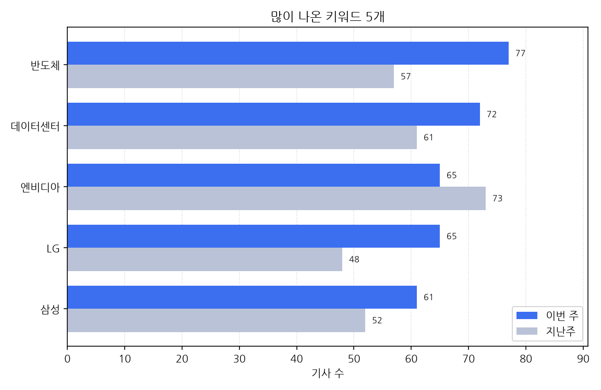

# 주간 AI 뉴스 리포트

대상 기간은 한국 시간으로 2026-10-12 월요일부터 2026-10-18 일요일까지다.
이번 주에 AI가 남긴 기사는 1651건, 지난주는 1340건이다. 311건 늘었다.

## 이번 주에 새로 나온 도구

- 10-12 '"AI 추론비용 20% 낮춰"…망고부스트, 서버리스 플랫폼 공개' 소식이 한 곳에서 나왔다 (대표 링크 https://www.edaily.co.kr/News/Read?newsId=03847446645612264&mediaCodeNo=257)
- 10-12 '"신제품 반응, 사람 대신 AI에 묻는다"…'AI 합성소비자' 시대 개막' 소식이 한 곳에서 나왔다 (대표 링크 https://www.etnews.com/20261012000258)
- 10-12 'AMD, AI 에이전트용 서버 랙 공개…CPU·GPU 필요에 따라 조합' 소식이 한 곳에서 나왔다 (대표 링크 http://inews24.com/view/2014187)
- 10-12 'AWS, 제조·물류용 '피지컬 AI 툴체인' 공개⋯엔비디아 스택 결합' 소식이 한 곳에서 나왔다 (대표 링크 http://inews24.com/view/2014103)
- 10-12 'ETRI, 코엑스서 'AI 기반 차세대 미디어 핵심기술 3종' 공개 外' 소식이 한 곳에서 나왔다 (대표 링크 https://www.dongascience.com/ko/news/80289)
- 10-12 'GS건설, 협력사 상생행사 개최..."피지컬 AI 도입·실질적 지원 강화' 소식이 한 곳에서 나왔다 (대표 링크 https://www.newspim.com/news/view/20261012001334)
- 10-12 'KT, 17개사와 '모두의 AI' 협력…12월 정식 서비스' 소식을 3개 매체가 다뤘다 (기사 3건, 대표 링크 https://www.newspim.com/news/view/20261012001176)
- 10-12 'KT컨소시엄 17개사 한자리에⋯'모두의 AI' 12월 출시 준비 속도' 소식이 한 곳에서 나왔다 (대표 링크 http://inews24.com/view/2013724)
- 10-12 'SSAFY 역대 최대 선발…AI 활용 강화로 전면 개편' 소식이 한 곳에서 나왔다 (대표 링크 https://biz.heraldcorp.com/article/10899305)
- 10-12 '中 자동차업체 BYD, 휴머노이드 로봇 공개…어떤 모습?' 소식이 한 곳에서 나왔다 (대표 링크 https://zdnet.co.kr/view/?no=20261012133446)
- 10-12 '레진엔터, 웹툰 캐릭터와 '관계 쌓는'AI챗 내놓는다…19일'티즈' 출시' 소식이 한 곳에서 나왔다 (대표 링크 https://www.edaily.co.kr/News/Read?newsId=02919206645612264&mediaCodeNo=257)
- 10-12 '설계 모델 바꾸는 AI…다쏘시스템이 본 제조업 도입 문턱은?' 소식이 한 곳에서 나왔다 (대표 링크 https://www.ddaily.co.kr/page/view/2026101213593440635)
- 10-12 '세림로보틱스 산업용 청소로봇, GS건설·포스코이앤씨 현장 도입…거친 건설현장서 자율주행 청소 입증' 소식이 한 곳에서 나왔다 (대표 링크 https://biz.heraldcorp.com/article/10899756)
- 10-12 '소진공, '피지컬AI' 도입 논의…"숙련인력 보완·제조 경쟁력 강화' 소식이 한 곳에서 나왔다 (대표 링크 https://www.newspim.com/news/view/20261012001255)
- 10-12 '쓰레기' 찍으면, AI가 폐기물 식별부터 배출 방법까지 알려준다고 2개 매체가 전했다 (기사 3건, 대표 링크 https://www.ohmynews.com/NWS_Web/View/at_pg.aspx?CNTN_CD=A0003274473&PAGE_CD=N0002&BLCK_NO=&CMPT_CD=M0147)
- 10-12 '인천항만공사 공공데이터 활용, AI 선박 출항시간 예측 서비스 출시: 연합시민의소리' 소식이 한 곳에서 나왔다 (대표 링크 https://cunews.net/detail.php?number=172927&thread=22r12r03)
- 10-12 '인피니언, 차세대 AI 서버용 27kW 3상 전원공급장치 솔루션 출시' 소식이 한 곳에서 나왔다 (대표 링크 https://www.ddaily.co.kr/page/view/2026101211275514629)
- 10-12 '충북교총, 24시간 '교권AI' 도입…"교권 침해 대응' 소식이 한 곳에서 나왔다 (대표 링크 http://inews24.com/view/2013812)
- 10-12 '포티투마루 "AI 몇 개 도입한다고 AI 네이티브 기업 되는 것 아냐' 소식이 한 곳에서 나왔다 (대표 링크 https://zdnet.co.kr/view/?no=20261012153603)
- 10-12 '현대제철, AI 데이터센터 철강 수요 공략…'H ONE' 출시' 소식이 한 곳에서 나왔다 (대표 링크 https://zdnet.co.kr/view/?no=20261012085404)
- 10-12 사우스웨스트항공, 미국 항공사 첫 챗GPT 플러그인 내놨지만 대화창 결제는 확인 안 됐다고 한 곳이 전했다 (대표 링크 https://www.wikitree.co.kr/articles/1165366)
- 10-13 "제넨셀 자료 못 준다더니"…식약처 비공개 임상자료 2672건, 챗GPT로 열렸다고 한 곳이 전했다 (대표 링크 https://biz.chosun.com/science-chosun/bio/2026/10/13/EQFPFVX4JNAYTMFZBFT3M63HPA/)
- 10-13 '"15년간 세상 연결한 카톡, AI로 확장"⋯카카오, 신규 AI 서비스·대거 공개' 소식이 한 곳에서 나왔다 (대표 링크 http://inews24.com/view/2014298)
- 10-13 '"AI 도입을 경영 성과로"…코오롱베니트, 기업 AX 실행 전략 제시' 소식을 2개 매체가 다뤘다 (기사 2건, 대표 링크 https://www.etnews.com/20261013000207)
- 10-13 '"AI 도입했다고 생산성 저절로 높아지지 않아"…코오롱베니트, AX 해법 제시' 소식이 한 곳에서 나왔다 (대표 링크 https://biz.chosun.com/it-science/ict/2026/10/13/FIV4LSHPHFHH5FEHKUT3EDNYNU/)
- 10-13 '"구독형 의료AI도 버거워"…도입·운영비 '이중 부담' 소식이 한 곳에서 나왔다 (대표 링크 https://www.etnews.com/20261013000259)
- 10-13 '"엔비디아만 믿을 순 없다"···MS, AI칩 '마이아 300' 공개' 소식이 한 곳에서 나왔다 (대표 링크 https://www.newsway.co.kr/news/view?ud=2026101309131151100)
- 10-13 '"지난주 아내가 뭐라 했더라?"…카카오, 새 AI 비서 '카나나 스페이스' 공개' 소식이 한 곳에서 나왔다 (대표 링크 https://zdnet.co.kr/view/?no=20261013111445)
- 10-13 'AI 에이전트 시대, CPU의 재부상…리사 수, AI 서버 '헬리온' 공개-경제ㅣ한국일보' 소식이 한 곳에서 나왔다 (대표 링크 https://www.hankookilbo.com/news/article/A2026101313450004918)
- 10-13 'AI가 재해석한 한국의 미학…'8인 8색' 미디어아트 공개' 소식이 한 곳에서 나왔다 (대표 링크 https://www.edaily.co.kr/News/Read?newsId=05487446645612592&mediaCodeNo=257)
- 10-13 'AMD, 랙 스케일 에이전틱 AI 컴퓨팅 솔루션 'AMD 헬리온' 공개' 소식이 한 곳에서 나왔다 (대표 링크 https://kbench.com/?q=node/282509)
- 10-13 'KT, 구글 AI 구독상품 8종 출시...커피·생활 혜택 결합' 소식이 한 곳에서 나왔다 (대표 링크 https://www.newspim.com/news/view/20261013000851)
- 10-13 'KT, 제미나이 구독상품 8종 출시...최대 5TB 저장공간 제공' 소식이 한 곳에서 나왔다 (대표 링크 https://zdnet.co.kr/view/?no=20261013091808)
- 10-13 'LG전자, KES 2026서 AI 기술력 집결…가전·로봇·AI 냉각 기술 공개' 소식을 2개 매체가 다뤘다 (기사 2건, 대표 링크 https://www.ddaily.co.kr/page/view/2026101308094451646)
- 10-13 '뉴타닉스, 라이액스 테크놀로지스 인수.. 기업의 에이전틱 AI 도입 가속화 지원' 소식이 한 곳에서 나왔다 (대표 링크 https://kbench.com/?q=node/282512)
- 10-13 '마음AI, '피지컬AI 테크 위크'서 태국 실증 4족 로봇 지뢰탐지 시스템 공개' 소식이 한 곳에서 나왔다 (대표 링크 https://zdnet.co.kr/view/?no=20261013170720)
- 10-13 '메타, 새 AI 모델 '뮤즈 원더' 공개…"개인·업무 에이전트 작업서 최첨단' 소식이 한 곳에서 나왔다 (대표 링크 https://www.newspim.com/news/view/20261013000012)
- 10-13 '메타, 새 AI 모델 `뮤즈 원더` 공개…"오픈AI·앤트로픽 모델보다 우수' 소식을 6개 매체가 다뤘다 (기사 6건, 대표 링크 https://www.edaily.co.kr/News/Read?newsId=01587526645612592&mediaCodeNo=257)
- 10-13 '메타의 새 AI모델 '뮤즈 원더' 공개....GPT 최신 모델보다 높은 지능' 소식이 한 곳에서 나왔다 (대표 링크 https://www.fnnews.com/news/202610130740367218)
- 10-13 '삼성전자, AI 메모리 '3대 전략' 공개…AMD 협력·엔비디아 칩 전시' 소식이 한 곳에서 나왔다 (대표 링크 http://inews24.com/view/2014234)
- 10-13 '삼성전자, AI 모델 대형화와 추론 과정 처리 맞춤형 새 메모리 전략 공개…속도·확장성·영속성 초점' 소식이 한 곳에서 나왔다 (대표 링크 https://www.fnnews.com/news/202610130804018945)
- 10-13 '삼성전자, OCP서 AI 메모리·스토리지 혁신 청사진 공개' 소식을 2개 매체가 다뤘다 (기사 2건, 대표 링크 https://www.etnews.com/20261013000024)
- 10-13 '삼성전자, 일상 속 AI 라이프 공개…비스포크부터 갤럭시까지' 소식이 한 곳에서 나왔다 (대표 링크 http://inews24.com/view/2014413)
- 10-13 '생성형 AI 앱 순위 공개, 챗GPT 2470만 명보다 놀라운 건 사용시간 64% 폭증' 소식이 한 곳에서 나왔다 (대표 링크 https://zdnet.co.kr/view/?no=20261013163218)
- 10-13 '씨메스, AI 팔레타이저 북미 첫선…내년 출시' 소식이 한 곳에서 나왔다 (대표 링크 https://www.edaily.co.kr/News/Read?newsId=03594886645612592&mediaCodeNo=257)
- 10-13 '씨메스로보틱스, 美 '팩 엑스포'서 AI 랜덤 팔레타이저 공개' 소식이 한 곳에서 나왔다 (대표 링크 https://zdnet.co.kr/view/?no=20261013165058)
- 10-13 '엔비디아 의존 줄인다…MS, 자체 AI칩 100만개 투입 추진' 소식을 4개 매체가 다뤘다 (기사 4건, 대표 링크 https://www.edaily.co.kr/News/Read?newsId=01515366645612592&mediaCodeNo=257)
- 10-13 '오비고, 기아 'PV5'에 AI 콘텐츠 서비스 '픽클·픽나우' 탑재' 소식이 한 곳에서 나왔다 (대표 링크 https://www.newspim.com/news/view/20261013000458)
- 10-13 '의료AI 도입보다 어려운 '지속 사용'…확산 열쇠는 '경제성' 소식이 한 곳에서 나왔다 (대표 링크 https://www.etnews.com/20261013000210)
- 10-13 '인텔, AI 추론용 GPU 'D270' 공개…HBM 대신 LPDDR5X 탑재' 소식이 한 곳에서 나왔다 (대표 링크 https://kbench.com/?q=node/282497)
- 10-13 '인텔, AI 추론용 GPU 'D시리즈' 공개…에이전틱 AI 시장 공략' 소식이 한 곳에서 나왔다 (대표 링크 http://inews24.com/view/2014308)
- 10-13 '저커버그 "메타 신제품, AI 분야 최첨단 작업 가능하게 할 것' 소식이 한 곳에서 나왔다 (대표 링크 http://www.koreatimes.com/article/20261012/1633517)
- 10-13 '정기선號 HD현대 승부수…내주 첫 휴머노이드 공개' 소식이 한 곳에서 나왔다 (대표 링크 https://www.edaily.co.kr/News/Read?newsId=04237766645612592&mediaCodeNo=257)
- 10-13 '지멘스 CTO "AI 도입 최대 걸림돌은 데이터 맥락 부족' 소식이 한 곳에서 나왔다 (대표 링크 https://www.ddaily.co.kr/page/view/2026101315033822561)
- 10-13 '지멘스, 韓 반도체·조선·배터리 AI 공략…"내년 제조 AI 도입 본격화' 소식이 한 곳에서 나왔다 (대표 링크 https://biz.chosun.com/it-science/ict/2026/10/13/PC575PEULZFTJOJSXEGGVLBVQE/)
- 10-13 '카카오, 카톡에 AI 에이전트 심는다···통합 에이전틱 AI 전략 공개' 소식이 한 곳에서 나왔다 (대표 링크 https://www.newsway.co.kr/news/view?ud=2026101309032023091)
- 10-13 '코난테크, 국방 AI 플랫폼 '아르고스' 공개…정보분석 고도화' 소식이 한 곳에서 나왔다 (대표 링크 https://zdnet.co.kr/view/?no=20261013145527)
- 10-13 '코난테크놀로지, '팔란티어형' 국방 AI 플랫폼 최초 공개…11월 서밋 개최' 소식이 한 곳에서 나왔다 (대표 링크 https://www.edaily.co.kr/News/Read?newsId=02397686645612592&mediaCodeNo=257)
- 10-13 '크래프톤, 내년 초 로봇 AI 통합 모델 공개 추진..."사람과 소통하는 능력 중요' 소식이 한 곳에서 나왔다 (대표 링크 https://www.newspim.com/news/view/20261013000476)
- 10-13 '팔레트, AI 에이전트 서비스 'Palette Agent' 출시' 소식이 한 곳에서 나왔다 (대표 링크 https://www.etoday.co.kr/news/view/2635069)
- 10-13 '펀진, 美 방산 전시회서 국방 AI 기술 공개…해외 공략 시동' 소식이 한 곳에서 나왔다 (대표 링크 https://zdnet.co.kr/view/?no=20261013175434)
- 10-13 '한화시스템, 美 AUSA서 AI 단거리 AESA 레이다 공개…초소형 드론 겨냥' 소식이 한 곳에서 나왔다 (대표 링크 https://www.insight.co.kr/news/577601)
- 10-13 AI '카나나 스페이스' 공개…'라이언'이 음성으로 비서 역할 한다고 한 곳이 전했다 (대표 링크 https://www.hani.co.kr/arti/economy/it/1282126.html)
- 10-13 엔비디아 "AI용 새 CPU '베라', 도입 결정한 한국 고객사 있다고 한 곳이 전했다 (대표 링크 https://www.newspim.com/news/view/20261013001113)
- 10-13 코스콤, 코리아 핀테크 위크 2026서 토큰증권 공동플랫폼·금융 AI 선보인다고 한 곳이 전했다 (대표 링크 https://www.ddaily.co.kr/page/view/2026101310564163185)
- 10-14 '"전 국민에 AI 에이전트 하나씩"…카카오, '모두의 AI' 청사진 공개' 소식이 한 곳에서 나왔다 (대표 링크 https://zdnet.co.kr/view/?no=20261014143204)
- 10-14 'AI 수익화 속도 내는 메타… '유료 버전' 뮤즈 원더 출시' 소식이 한 곳에서 나왔다 (대표 링크 http://www.koreatimes.com/article/20261013/1633684)
- 10-14 'AI 에이전트 시대, CPU의 재부상… AI 서버 '헬리온' 공개' 소식이 한 곳에서 나왔다 (대표 링크 http://www.koreatimes.com/article/20261013/1633687)
- 10-14 'CTA "AI, 도입 넘어 '영향' 단계로…에이전틱 AI 주목' 소식이 한 곳에서 나왔다 (대표 링크 https://www.ddaily.co.kr/page/view/2026101317144563866)
- 10-14 'LG+애플 'AI 스마트홈 기기' 7종 공개, 도어락·온도조절기' 소식이 한 곳에서 나왔다 (대표 링크 https://www.hani.co.kr/arti/economy/marketing/1282296.html)
- 10-14 'LG전자, 애플과 손잡고 AI홈 시장 공략… 공동 개발 제품 7종 공개' 소식을 2개 매체가 다뤘다 (기사 2건, 대표 링크 https://biz.chosun.com/it-science/ict/2026/10/14/7GT446PA4VAUTLDSYOREWSJCTA/)
- 10-14 'LG전자·애플 'AI홈 동맹'…IoT 기기 7종 공개' 소식을 5개 매체가 다뤘다 (기사 6건, 대표 링크 https://www.etoday.co.kr/news/view/2635437)
- 10-14 'SK스토아, AI·실시간 소통 결합 패션 방송 '패라스' 론칭' 소식이 한 곳에서 나왔다 (대표 링크 http://inews24.com/view/2014755)
- 10-14 '공공 에이전틱 AI 도입 문 넓어진다…주요 AI 플랫폼 등록 이어져' 소식이 한 곳에서 나왔다 (대표 링크 https://www.etnews.com/20261014000115)
- 10-14 '구글 "AI로 AI 데이터센터 짓는다"…지능형 인프라 비전 공개' 소식이 한 곳에서 나왔다 (대표 링크 http://www.koreatimes.com/article/20261013/1633757)
- 10-14 '구글, 고난도 업무용 AI `제미나이 4 아르곤` 공개…코딩·금융·법률 등 심층 작업 겨냥' 소식이 한 곳에서 나왔다 (대표 링크 https://www.ddaily.co.kr/page/view/2026101408171772870)
- 10-14 '구글, 최상위 모델 '제미나이 4 아르곤' 확대 출시' 소식을 3개 매체가 다뤘다 (기사 3건, 대표 링크 https://www.etnews.com/20261014000003)
- 10-14 '말 한마디로 집안 관리…애플, AI 홈 허브 '홈뷰' 공개[모닝폰]' 소식이 한 곳에서 나왔다 (대표 링크 https://www.edaily.co.kr/News/Read?newsId=01262806645612920&mediaCodeNo=257)
- 10-14 '미중 AI 경쟁 속 '공개 모델' 택한 엔비디아 협력사 LTX…"한국과 협력 기회' 소식이 한 곳에서 나왔다 (대표 링크 https://www.fnnews.com/news/202610141011011363)
- 10-14 '삼성전자, AI 반도체 '풀 라인업' 공개…360조 용인 산단 청사진도 제시' 소식이 한 곳에서 나왔다 (대표 링크 https://zdnet.co.kr/view/?no=20261014084125)
- 10-14 '애플 TV 4K 4년 만에 새 단장…A19 칩·AI 시리 탑재하고 44만9000원' 소식이 한 곳에서 나왔다 (대표 링크 https://kbench.com/?q=node/282527)
- 10-14 '애플, 6년 만에 '홈팟 미니2' 공개…S10 칩·시리 AI 탑재' 소식이 한 곳에서 나왔다 (대표 링크 https://kbench.com/?q=node/282529)
- 10-14 '앤트로픽, 깃 대신 쓰는 자체 코드 관리 시스템 '사이언' 공개' 소식이 한 곳에서 나왔다 (대표 링크 https://zdnet.co.kr/view/?no=20261014212553)
- 10-14 '에이전트 OS' 오픈소스로 발표한 화웨이, 윈도우 막 내린다고 한 곳이 전했다 (대표 링크 https://www.ohmynews.com/NWS_Web/Series/series_premium_pg.aspx?CNTN_CD=A0003274279&CMPT_CD=M0153)
- 10-14 '에이직랜드, 'SEDEX 2026'서 AI 반도체 설계·양산 솔루션 공개' 소식을 2개 매체가 다뤘다 (기사 2건, 대표 링크 https://www.newspim.com/news/view/20261014000989)
- 10-14 '엔비디아 DLSS 5 더 빨라진다, 2배 빠른 AI 모델 적용 예고' 소식이 한 곳에서 나왔다 (대표 링크 https://kbench.com/?q=node/282539)
- 10-14 '오늘 밤 공개 될 앤트로픽 실적이 '시험대'...투자자가 알아야 할 5가지 뉴스' 소식이 한 곳에서 나왔다 (대표 링크 https://www.edaily.co.kr/News/Read?newsId=02210726645612920&mediaCodeNo=257)
- 10-14 '인적분할 앞둔 카카오, 계열사 CEO 총출동…AI·테크핀·콘텐츠 성장전략 공개' 소식을 3개 매체가 다뤘다 (기사 3건, 대표 링크 https://www.edaily.co.kr/News/Read?newsId=02906086645612920&mediaCodeNo=257)
- 10-14 '최대 800Gbps 대역폭 지원⋯KT, AI 전용회선 출시' 소식을 3개 매체가 다뤘다 (기사 3건, 대표 링크 http://inews24.com/view/2014717)
- 10-14 '카카오, '모두의 AI' 연내 출시...월 이용자 500만명 목표' 소식을 2개 매체가 다뤘다 (기사 2건, 대표 링크 https://www.newspim.com/news/view/20261014000717)
- 10-14 '카카오, AI `눈` 카나나-2 비전 인코더… 가중치 이달 공개 [이프 카카오]' 소식이 한 곳에서 나왔다 (대표 링크 https://www.ddaily.co.kr/page/view/2026101317533987684)
- 10-14 '콜마, 사내 AI 에이전트 도입…생산부터 연구까지 전사 AX 가속' 소식이 한 곳에서 나왔다 (대표 링크 https://www.etnews.com/20261013000249)
- 10-14 '한미반도체, SEDEX서 차세대 AI 패키징 장비 공개' 소식이 한 곳에서 나왔다 (대표 링크 https://zdnet.co.kr/view/?no=20261014153804)
- 10-14 LG전자, 애플과 손잡고 AI홈 생태계 확장…IoT 신제품 쏟아낸다고 한 곳이 전했다 (대표 링크 https://www.fnnews.com/news/202610131725416352)
- 10-14 구글, 'AI·바이브 코딩' 제작 앱 출시 돕는다고 한 곳이 전했다 (대표 링크 https://zdnet.co.kr/view/?no=20261014085128)
- 10-14 현대차그룹, 차량·로봇 넘나드는 맞춤형 AI 공개... 미래 기술 11건 선보인다고 한 곳이 전했다 (대표 링크 https://www.insight.co.kr/news/577666)
- 10-15 '"AI 음성 강화에 25mm 캡슐 탑재"…커세어, `복사라` 마이크 공개' 소식이 한 곳에서 나왔다 (대표 링크 https://www.ddaily.co.kr/page/view/2026101511055875255)
- 10-15 '"AI로 일하는 시대, 주 52시간 족쇄보다 보상체계 개편해야' 소식이 한 곳에서 나왔다 (대표 링크 https://www.edaily.co.kr/News/Read?newsId=05480886645613248&mediaCodeNo=257)
- 10-15 '"韓 AI인재 유출 심화…개인 성과 중심 인센티브 체계 개편해야' 소식이 한 곳에서 나왔다 (대표 링크 https://www.edaily.co.kr/News/Read?newsId=05500566645613248&mediaCodeNo=257)
- 10-15 '299달러 애플 '홈뷰'의 배신…2년 전 완성해 놓고 '시리 AI 지연' 탓에 출시 연기' 소식이 한 곳에서 나왔다 (대표 링크 https://www.ddaily.co.kr/page/view/2026101511510283632)
- 10-15 'ADI, 와인 품질 리스크 감지하는 AI 센싱 기술 공개' 소식이 한 곳에서 나왔다 (대표 링크 https://www.ddaily.co.kr/page/view/2026101511084994452)
- 10-15 'AI 에이전트 6종, 앱 하나로… 제논, '제나' 출시' 소식을 2개 매체가 다뤘다 (기사 2건, 대표 링크 https://www.ddaily.co.kr/page/view/2026101514533064106)
- 10-15 'AI로 나무·암석 질감 구현…동국씨엠, 컬러강판 새 디자인 공개' 소식을 2개 매체가 다뤘다 (기사 2건, 대표 링크 https://biz.heraldcorp.com/article/10903955)
- 10-15 'BS한양, 건설 현장 맞춤형 AI 에이전트 'B-ON' 개발…기술 기준 한눈에' 소식을 2개 매체가 다뤘다 (기사 2건, 대표 링크 https://biz.heraldcorp.com/article/10903660)
- 10-15 'G마켓, 내년 셀러 지원 확대…핫딜 개편·AI 관리 도입' 소식이 한 곳에서 나왔다 (대표 링크 https://www.newspim.com/news/view/20261015000077)
- 10-15 'IHFB, AI 교육 플랫폼 엘살바도르 공교육에 적용…800개 학교서 활용' 소식이 한 곳에서 나왔다 (대표 링크 https://biz.heraldcorp.com/article/10903911)
- 10-15 '구글, 전력 소모 40% 줄인 AI칩 공개…웨어러블 기기 탑재 전망' 소식이 한 곳에서 나왔다 (대표 링크 https://biz.chosun.com/it-science/ict/2026/10/15/6ZRPMKOOOZGF5JKTGNBACJ53WQ/)
- 10-15 '구글, 차세대 저전력 AI칩 공개…웨어러블 기기 정조준' 소식이 한 곳에서 나왔다 (대표 링크 http://www.koreatimes.com/article/20261014/1633872)
- 10-15 '보건산업진흥원, AI 이용 의료 격차 해소…"현장 적용 모델 발굴' 소식이 한 곳에서 나왔다 (대표 링크 https://www.newspim.com/news/view/20261015001099)
- 10-15 '삼성전자, 동남아 테크세미나 개최…현지 맞춤 AI 가전·B2B 공조 솔루션 공개' 소식이 한 곳에서 나왔다 (대표 링크 https://www.ddaily.co.kr/page/view/2026101509160472320)
- 10-15 '삼성전자, 실리콘밸리서 통신 서밋…AI·6G 기술 공개' 소식을 3개 매체가 다뤘다 (기사 3건, 대표 링크 https://www.fnnews.com/news/202610150806246707)
- 10-15 '아이티센엔텍, 'AI 논술 코치' 출시…교육 SaaS로 사업 확장' 소식이 한 곳에서 나왔다 (대표 링크 https://www.ddaily.co.kr/page/view/2026101511434079294)
- 10-15 '앤트로픽, '페이블 5.5' 내놓나…애저 연동 설정서 포착' 소식이 한 곳에서 나왔다 (대표 링크 https://zdnet.co.kr/view/?no=20261015101303)
- 10-15 '육군, AI·로봇 결합한 미래전 시연…2040년 유무인복합부대 전환' 소식을 2개 매체가 다뤘다 (기사 2건, 대표 링크 https://biz.heraldcorp.com/article/10903379)
- 10-15 '파두, 파일 직접 처리하는 'FS-SSD' 첫 공개…AI 데이터센터 공략' 소식을 2개 매체가 다뤘다 (기사 2건, 대표 링크 http://inews24.com/view/2015179)
- 10-15 롯데이노베이트, 강릉 ITS 세계총회 참가…자율주행·AI 교통기술 선보인다고 한 곳이 전했다 (대표 링크 https://biz.chosun.com/it-science/ict/2026/10/15/WMTLZU4PUNBG3APIXHRWRENIBM/)
- 10-15 파두, 파일 시맨틱 SSD 공개…AI 데이터 이동 병목 줄인다고 한 곳이 전했다 (대표 링크 https://biz.heraldcorp.com/article/10903873)
- 10-15 프렌들리AI·올라마, 韓 기업 오픈 모델 도입 지원 나선다고 한 곳이 전했다 (대표 링크 https://zdnet.co.kr/view/?no=20261015141727)
- 10-16 '"철도 인적사고 막는다"…세이프티랩, 비접촉 AI 생체리듬체크 솔루션 공개' 소식이 한 곳에서 나왔다 (대표 링크 https://zdnet.co.kr/view/?no=20261016155142)
- 10-16 '"하루 종일 대화 듣는다"…아마존, 10만원대 AI 기기 공개' 소식이 한 곳에서 나왔다 (대표 링크 https://www.edaily.co.kr/News/Read?newsId=02584646645613576&mediaCodeNo=257)
- 10-16 ''앙숙' 애플과 손잡은 메타, 오픈웨이트 AI 모델 공개…중국 추격 나서' 소식이 한 곳에서 나왔다 (대표 링크 https://www.hani.co.kr/arti/economy/it/1282744.html)
- 10-16 'KT, 소상공인용 AI 매장음악 서비스 '래디오비즈' 출시' 소식을 2개 매체가 다뤘다 (기사 2건, 대표 링크 https://biz.chosun.com/it-science/ict/2026/10/16/PKS7WZJNUBHBFHCDLYKKIWPPPQ/)
- 10-16 'LGU+, AI로 와이파이 장애 미리 잡는다…차세대 기술 선봬' 소식을 2개 매체가 다뤘다 (기사 2건, 대표 링크 https://biz.heraldcorp.com/article/10904463)
- 10-16 'LGU+, 유럽서 AI 기반 와이파이 기술 공개' 소식을 2개 매체가 다뤘다 (기사 2건, 대표 링크 https://www.ddaily.co.kr/page/view/2026101609382084827)
- 10-16 'SKT·KT·카카오 '모두의 AI' 베타 돌입···전화·검색·카톡으로 승부수' 소식이 한 곳에서 나왔다 (대표 링크 https://www.newsway.co.kr/news/view?ud=2026101515080970946)
- 10-16 'SK하이닉스, AI 처리 속도 높일 차세대 메모리 기술 공개' 소식이 한 곳에서 나왔다 (대표 링크 https://www.newspim.com/news/view/20261016001115)
- 10-16 '건보공단, AI로 편의성 높인 '건강보험25시' 앱 출시' 소식이 한 곳에서 나왔다 (대표 링크 https://www.etnews.com/20260325000065)
- 10-16 '대화 듣고 일정·쇼핑까지… 아마존, AI 웨어러블 2종 공개' 소식이 한 곳에서 나왔다 (대표 링크 https://biz.chosun.com/it-science/ict/2026/10/16/VRAJ3OI74BGOLMIMQO373J7Q4U/)
- 10-16 '말 한마디로 영상 찾고 편집까지… 트웰브랩스, 영상 AI 에이전트 출시' 소식이 한 곳에서 나왔다 (대표 링크 https://www.ddaily.co.kr/page/view/2026101614094658691)
- 10-16 '메타, 개방형 AI 시장 승부수…8160억 매개변수 모델 공개' 소식을 4개 매체가 다뤘다 (기사 4건, 대표 링크 https://zdnet.co.kr/view/?no=20261016083135)
- 10-16 '목적지에 도착한 로봇, 이제 손을 쓴다…뉴빌리티, 하이브리드 휴머노이드 '빌리' 공개' 소식이 한 곳에서 나왔다 (대표 링크 https://kbench.com/?q=node/282249)
- 10-16 '벤츠 방배서비스센터에 AI 차량 외관 점검 시스템 도입' 소식이 한 곳에서 나왔다 (대표 링크 https://www.edaily.co.kr/News/Read?newsId=05474326645613576&mediaCodeNo=257)
- 10-16 '사내 업무부터 인프라까지···통신3사, 'AI 도입' 전방위로' 소식이 한 곳에서 나왔다 (대표 링크 https://newsway.co.kr/news/view?ud=2026101516530704657)
- 10-16 '애플·메타 AI 협업 공개…책상 위에서 돌아가는 AI 모델' 소식이 한 곳에서 나왔다 (대표 링크 https://www.newspim.com/news/view/20261016000018)
- 10-16 '애플도 중국선 알리바바 AI 쓴다...아이폰에 '중국산 두뇌' 탑재[1일IT템]' 소식이 한 곳에서 나왔다 (대표 링크 https://www.fnnews.com/news/202610160953259637)
- 10-16 '앤트로픽, AI 안전 검증에 빗장 풀다…불리한 평가도 공개' 소식이 한 곳에서 나왔다 (대표 링크 https://zdnet.co.kr/view/?no=20261016082113)
- 10-16 '엑시나, OCP 글로벌 서밋 2026서 CXL 기반 메모리 기술 공개…AI 추론 활용 시연' 소식을 2개 매체가 다뤘다 (기사 2건, 대표 링크 https://biz.heraldcorp.com/article/10904808)
- 10-16 '엔비디아, AI 직접 구동하는 'RTX 스파크' 노트북 출시' 소식을 2개 매체가 다뤘다 (기사 3건, 대표 링크 https://biz.chosun.com/it-science/ict/2026/10/16/D5UCTIHRVVBLZCKO3C7SIYHHNA/)
- 10-16 '오픈AI, GPT-라이브 1.1 적용…한국어 음성 개선' 소식이 한 곳에서 나왔다 (대표 링크 https://www.edaily.co.kr/News/Read?newsId=02768326645613576&mediaCodeNo=257)
- 10-16 '유튜브 뮤직, AI 곡 재생 화면에 라벨 단다…차단 대신 공개, 수익 창출은 그대로' 소식이 한 곳에서 나왔다 (대표 링크 https://www.wikitree.co.kr/articles/1166608)
- 10-16 '젠슨 황 "개인용 AI 에이전트까지 고려했다"…엔비디아, 블랙웰 기반 `RTX 스파크` 윈도우 PC 출시' 소식이 한 곳에서 나왔다 (대표 링크 https://www.ddaily.co.kr/page/view/2026101617555167109)
- 10-16 '챗GPT 한국어 음성 더 자연스러워진다…오픈AI, 보이스 기능 업데이트' 소식을 2개 매체가 다뤘다 (기사 2건, 대표 링크 https://zdnet.co.kr/view/?no=20261016102438)
- 10-16 '하이브랩, 베트남 K-뷰티 AI 커머스 플랫폼 '애픽' 출시' 소식이 한 곳에서 나왔다 (대표 링크 https://www.newspim.com/news/view/20261016001295)
- 10-16 '한난, 'AI 일상감사' 도입…AI 기반 예방감사 혁신 본격화' 소식이 한 곳에서 나왔다 (대표 링크 https://www.busan.com/view/busan/view.php?code=2026101519592917354)
- 10-16 LG전자·애플 'AI홈' 12월 출시… AI 매개 협업 커진다고 한 곳이 전했다 (대표 링크 http://www.koreatimes.com/article/20261015/1634029)
- 10-16 신한라이프, AI 가입설계 'LICO 2.0' 출시…설계 10건 중 7건 AI가 돕는다고 한 곳이 전했다 (기사 2건, 대표 링크 https://biz.heraldcorp.com/article/10904634)
- 10-16 퍼플렉시티, AI 에이전트 '안전 작업실' 오픈소스로 푼다고 한 곳이 전했다 (대표 링크 https://zdnet.co.kr/view/?no=20261016140626)
- 10-17 '北, AI 탑재 신형 어뢰 시험발사…"중대한 변화 예고' 소식이 한 곳에서 나왔다 (대표 링크 https://www.fnnews.com/news/202610170905321498)
- 10-17 '北, 신형 초고속 정밀유도 어뢰 발사시험…"인공지능 도입' 소식을 2개 매체가 다뤘다 (기사 3건, 대표 링크 https://www.fnnews.com/news/202610170632387603)
- 10-17 '北, 신형 초고속 정밀유도 어뢰 시험발사... "AI 기술 적용' 소식을 4개 매체가 다뤘다 (기사 4건, 대표 링크 https://biz.heraldcorp.com/article/10905695)
- 10-17 '깃허브, PHP·테라폼 코드 취약점 찾는 'AI 스캔' 정식 출시' 소식이 한 곳에서 나왔다 (대표 링크 https://zdnet.co.kr/view/?no=20261017092459)
- 10-17 '북한, "신형 어뢰 수중 발사에 AI 기술 도입' 소식을 2개 매체가 다뤘다 (기사 2건, 대표 링크 https://www.munhwa.com/article/11624137)
- 10-17 '엔비디아, 'RTX 스파크' 정식 출시 "AI 개발부터 4K 게임까지 구동' 소식이 한 곳에서 나왔다 (대표 링크 https://zdnet.co.kr/view/?no=20261017092606)
- 10-17 '현대차·기아, 파리서 신차·피지컬 AI 전략 공개' 소식이 한 곳에서 나왔다 (대표 링크 http://inews24.com/view/2016093)
- 10-18 '"데이터·AI 연결 쉽게"…데이터브릭스, 네트워크 서비스 출시' 소식이 한 곳에서 나왔다 (대표 링크 https://zdnet.co.kr/view/?no=20261018101607)
- 10-18 '"숨은 웹 자산부터 취약점까지"…스틸리언, AI 보안 솔루션 출시' 소식이 한 곳에서 나왔다 (대표 링크 https://www.etnews.com/20261016000222)
- 10-18 'LG전자, AI 가습·공기청정기 '퓨리케어 하이드로타워 맥스' 출시' 소식을 5개 매체가 다뤘다 (기사 5건, 대표 링크 https://www.ddaily.co.kr/page/view/2026101809091712450)
- 10-18 '딥시크, 신규 AI 모델 공개…"작업 빠르고 똑똑하게 답변' 소식이 한 곳에서 나왔다 (대표 링크 https://zdnet.co.kr/view/?no=20261018095657)
- 10-18 '안랩 "싱가포르 공략"...'거브웨어 2026' 참가AI SOC 등 선보여' 소식이 한 곳에서 나왔다 (대표 링크 https://zdnet.co.kr/view/?no=20261018092603)
- 10-18 '테슬라, 자동차보다 저렴한 휴머노이드 로봇 공개' 소식이 한 곳에서 나왔다 (대표 링크 https://www.dongascience.com/ko/news/56501)
- 10-18 신입 면접에 AI 고객 도입…"10분간 대화하는 능력 보고 뽑는다고 한 곳이 전했다 (대표 링크 https://www.etnews.com/20261015000418)

## 규제와 정책

- 10-12 '"챗GPT보다 2배 더 쓴다고?"…10대 빠진 AI에 규제 목소리' 소식이 한 곳에서 나왔다 (대표 링크 https://www.edaily.co.kr/News/Read?newsId=03079926645612264&mediaCodeNo=257)
- 10-12 'K-조선, 선박 넘어 공정까지 AI 전면 전환⋯2030년까지 1.4조 투입' 소식을 2개 매체가 다뤘다 (기사 2건, 대표 링크 https://www.etoday.co.kr/news/view/2634545)
- 10-12 '法 "급부는 여론조사 아닌 '정치적 조언'"…尹·명태균 항소심 무죄 판결문 보니' 소식이 한 곳에서 나왔다 (대표 링크 https://www.newspim.com/news/view/20261012000404)
- 10-12 '김앤장, 13일 '에이전틱 AI 보안·규제 대응' 세미나 개최' 소식이 한 곳에서 나왔다 (대표 링크 https://www.newspim.com/news/view/20261012000696)
- 10-12 '대전의 자부심이 흔들린다… 빵지순례 성지 성심당과 규제의 벽' 소식이 한 곳에서 나왔다 (대표 링크 https://www.newspim.com/news/view/20261012000320)
- 10-12 '말레이시아 19개 부처 공무원 22명 방한…韓과 AI 행정혁신 협력' 소식이 한 곳에서 나왔다 (대표 링크 https://www.newspim.com/news/view/20261012000549)
- 10-12 '브래드 스미스 MS 사장 "세탁기·우유 한 팩도 안전규정 적용된다…AI 규제 당장 시작해야' 소식이 한 곳에서 나왔다 (대표 링크 https://www.munhwa.com/article/11622871)
- 10-12 '빗장 풀린 '괴물 AI' 미토스…정부, 권한 획득 재추진' 소식이 한 곳에서 나왔다 (대표 링크 https://www.fnnews.com/news/202610120530490788)
- 10-12 '신현송 "AI 구독료 집계 한계 개선해야…크립토카드 규제 우회 위험 점검' 소식이 한 곳에서 나왔다 (대표 링크 https://biz.heraldcorp.com/article/10899341)
- 10-12 '이억원 금융위원장, SC그룹과 AI 금융리스크·금융허브 논의' 소식이 한 곳에서 나왔다 (대표 링크 https://biz.heraldcorp.com/article/10899929)
- 10-13 ''AI 데이터의 확보·제공 확대' AI기본법·데이터산업법 개정안 통과' 소식이 한 곳에서 나왔다 (대표 링크 https://www.fnnews.com/news/202610121553157671)
- 10-13 ''안전펜스'갇혔던 로봇, 족쇄 풀려…반복 자동화 넘어'M.AX 혁신' 신호탄[규제 풀린 휴머노이드]' 소식이 한 곳에서 나왔다 (대표 링크 https://www.etoday.co.kr/news/view/2635123)
- 10-13 'AI 스마트 공장부터 딥테크 펀드까지…정부 정책도 AI에 초점 [미리 보는 테크퀘스트]' 소식이 한 곳에서 나왔다 (대표 링크 https://www.etoday.co.kr/news/view/2635284)
- 10-13 'AI 활용 해킹에 대책 안 보인다…"예방 투자 기업엔 과징금 최대 40% 감경" [2026 국감]' 소식이 한 곳에서 나왔다 (대표 링크 https://www.ddaily.co.kr/page/view/2026101315105563271)
- 10-13 '[2026 스케일업 부울경 컨퍼런스] 김석준 교육감 "AI 경쟁의 승부처는 교육' 소식이 한 곳에서 나왔다 (대표 링크 https://www.busan.com/view/busan/view.php?code=2026101317000949757)
- 10-13 '英, AI 사전안전성 검증 강화…美 자율규제에 제동[글로벌AI브리핑]' 소식이 한 곳에서 나왔다 (대표 링크 https://www.fnnews.com/news/202610130803034451)
- 10-13 '공장 로봇 규제 고삐 푼다…휴머노이드, 사람과 같은 공간서 작업' 소식이 한 곳에서 나왔다 (대표 링크 https://www.hani.co.kr/arti/economy/marketing/1282176.html)
- 10-13 '과기부, AI기본법 개정안 통과…데이터 연계·개방 의무화' 소식이 한 곳에서 나왔다 (대표 링크 https://www.newspim.com/news/view/20261013001182)
- 10-13 '김용선 지재처장 "짝퉁 판매 라방, AI로 상시 감시…해외 플랫폼 규제' 소식이 한 곳에서 나왔다 (대표 링크 https://www.newspim.com/news/view/20261013000528)
- 10-13 '대학 논술서 잇따른 'AI 안경' 부정행위…교육부, 첫 대응 지침 배포' 소식이 한 곳에서 나왔다 (대표 링크 https://www.etoday.co.kr/news/view/2635147)
- 10-13 '도면·매뉴얼도 AI 데이터로…한국딥러닝, 정부 AX 전문기업 선정' 소식이 한 곳에서 나왔다 (대표 링크 https://zdnet.co.kr/view/?no=20261013112042)
- 10-13 '딥시크, 4억 달러 로봇 AI 시드 라운드 주도…언어 모델 다음 승부처는 로봇' 소식이 한 곳에서 나왔다 (대표 링크 https://www.wikitree.co.kr/articles/1165672)
- 10-13 '로봇이 우편물 분류하고 농사짓고…범부처 피지컬 AI 개발·실증 확대' 소식이 한 곳에서 나왔다 (대표 링크 https://www.etnews.com/20261013000255)
- 10-13 '엔비디아, 8억 달러 투자한 리플렉션AI 인수 협상…규제 피할 '어크하이어'도 거론' 소식이 한 곳에서 나왔다 (대표 링크 https://www.wikitree.co.kr/articles/1165679)
- 10-13 '정부, 내년 피지컬 AI 확 키운다…9천억→3조 1000억' 소식이 한 곳에서 나왔다 (대표 링크 https://zdnet.co.kr/view/?no=20261013140428)
- 10-13 '정부사업 AI 학습데이터, `AI허브` 연계 의무화… 내년 4월 시행' 소식이 한 곳에서 나왔다 (대표 링크 https://www.ddaily.co.kr/page/view/2026101314180842094)
- 10-13 '정부사업으로 만든 AI 데이터 개방 확대…국무회의 통과' 소식이 한 곳에서 나왔다 (대표 링크 https://zdnet.co.kr/view/?no=20261013143530)
- 10-13 '카카오 "AI 윤리, 선언만으론 부족"…서비스 전 과정 위험 관리' 소식이 한 곳에서 나왔다 (대표 링크 https://zdnet.co.kr/view/?no=20261013155733)
- 10-13 '피지컬 AI 육성부터 생활 속 AI까지… 정부, 산업·공공 확산 속도' 소식이 한 곳에서 나왔다 (대표 링크 https://www.ddaily.co.kr/page/view/2026101216115396934)
- 10-13 정부 정보시스템 2030년까지 클라우드 전환…12월 로드맵 나온다고 한 곳이 전했다 (대표 링크 https://zdnet.co.kr/view/?no=20261013092218)
- 10-13 정부 지원 끊기자 의료 AI도 멈췄다고 한 곳이 전했다 (대표 링크 https://www.etnews.com/20261013000214)
- 10-14 '"AI 반도체 전력·성능 한계 깬다"…정부, 차세대 반도체 개발 본격화' 소식이 한 곳에서 나왔다 (대표 링크 https://biz.heraldcorp.com/article/10901897)
- 10-14 '"AI 안전 주장에 보복"…앤트로픽, 美 정부와 법정 공방 재점화' 소식이 한 곳에서 나왔다 (대표 링크 https://zdnet.co.kr/view/?no=20261014092504)
- 10-14 ''AI 친구' 열풍 이끈 캐릭터AI 파산… 청소년 정신건강 소송 탓-경제ㅣ한국일보' 소식이 한 곳에서 나왔다 (대표 링크 https://www.hankookilbo.com/news/article/A2026101408510004471)
- 10-14 ''모두의 AI' 16일 정부 첫 점검…SKT·KT·카카오가 꺼낸 승부수는' 소식이 한 곳에서 나왔다 (대표 링크 https://zdnet.co.kr/view/?no=20261014143531)
- 10-14 'AI 맞춤형 'K-뷰티'키운다…화장품 규제 풀고'250억 펀드' 조성' 소식이 한 곳에서 나왔다 (대표 링크 http://www.newstomato.com/ReadNews.aspx?no=1316650)
- 10-14 'AI로 다시 기회 잡은 인텔, 다음 승부처는 '로봇·공장'… "CPU·제어 기술 강점' 소식이 한 곳에서 나왔다 (대표 링크 https://biz.chosun.com/it-science/ict/2026/10/14/JGM3EMWJNZHLHJKVQCZIVEOFLY/)
- 10-14 'SK하이닉스, 내년 1월 HBF 최종 표준 제정 목표…차세대 AI 메모리 선점 시동' 소식이 한 곳에서 나왔다 (대표 링크 https://zdnet.co.kr/view/?no=20261014132033)
- 10-14 '광해광업공단, 'AI 윤리 준수기관' 확인 마크 획득…NIA 인증' 소식이 한 곳에서 나왔다 (대표 링크 https://www.busan.com/view/busan/view.php?code=2026101321154359984)
- 10-14 '마음AI, 4족보행 로봇 보행자도로 순찰 규제특례 심의' 소식이 한 곳에서 나왔다 (대표 링크 https://zdnet.co.kr/view/?no=20261014180322)
- 10-14 '무기는 진화했지만 책임은 남았다… 'AI 살상 시대의 윤리' 소식이 한 곳에서 나왔다 (기사 2건, 대표 링크 https://www.ohmynews.com/NWS_Web/View/at_pg.aspx?CNTN_CD=A0003275275&PAGE_CD=N0002&BLCK_NO=&CMPT_CD=M0147)
- 10-14 '정부 "K뷰티, AI 피부 진단 등 고부가가치 산업으로 확장 지원' 소식이 한 곳에서 나왔다 (대표 링크 https://www.hani.co.kr/arti/economy/economy_general/1282273.html)
- 10-14 '정부, 'K-전시회' 키운다… AI 전시 통합·K뷰티 축제 연계' 소식이 한 곳에서 나왔다 (대표 링크 https://biz.chosun.com/policy/policy_sub/2026/10/14/7SGN2H3D7BGZPLM422AHTW3TSA/)
- 10-14 '정부, 1만 7000명 피부 데이터뱅크 전면 개편… AI 솔루션 개발 지원' 소식이 한 곳에서 나왔다 (대표 링크 https://biz.chosun.com/policy/policy_sub/2026/10/14/76ONRX72OFDP7JT6AV2546CFOE/)
- 10-14 '정부, AI 접목 K-뷰티에 250억 펀드…화장품 기업 대출 문턱은↓' 소식이 한 곳에서 나왔다 (대표 링크 https://www.fnnews.com/news/202610140741009821)
- 10-14 '티빙 대표 "AI 기반 해킹 추정"…개인정보위 "연내 처분 마무리' 소식이 한 곳에서 나왔다 (대표 링크 http://www.koreatimes.com/article/20261013/1633668)
- 10-14 AI가 피부 읽고 맞춤형 화장품 조제까지…정부, K뷰티 서비스 키운다고 한 곳이 전했다 (대표 링크 https://www.edaily.co.kr/News/Read?newsId=02466566645612920&mediaCodeNo=257)
- 10-14 얼굴 분석해 화장품 추천·로봇이 조제…정부, AI 뷰티 키운다고 2개 매체가 전했다 (기사 2건, 대표 링크 https://biz.heraldcorp.com/article/10901641)
- 10-15 "AI에이전트 자율성 확대"...새로운 윤리 과제 논의장 열린다고 한 곳이 전했다 (대표 링크 https://zdnet.co.kr/view/?no=20261015112018)
- 10-15 '5개 부처 AI·디지털 교육 예산 2534억원… 통합 성과관리 미흡 [2026 국감]' 소식이 한 곳에서 나왔다 (대표 링크 https://www.ddaily.co.kr/page/view/2026101515593950971)
- 10-15 '8개주, 오픈AI에 한꺼번에 소송… "청소년 자해·폭력 부추겨' 소식이 한 곳에서 나왔다 (대표 링크 http://www.koreatimes.com/article/20261014/1633865)
- 10-15 'AI 사회적 영향 조사에 노동자 배제…정부 "거버넌스 구축' 소식이 한 곳에서 나왔다 (대표 링크 https://zdnet.co.kr/view/?no=20261015145047)
- 10-15 '美 8개 주 "챗GPT 위험 행동 부추겨"… 오픈AI 상대 소송' 소식을 2개 매체가 다뤘다 (기사 2건, 대표 링크 https://www.ddaily.co.kr/page/view/2026101510025880865)
- 10-15 '김우영 "AI 정부, 시민 데이터 주권 보장해야"…블록체인 주목' 소식이 한 곳에서 나왔다 (대표 링크 https://www.edaily.co.kr/News/Read?newsId=05861366645613248&mediaCodeNo=257)
- 10-15 '네오클라우드발 쓰나미…어디까지 밀려드나' 소식이 한 곳에서 나왔다 (대표 링크 https://www.newspim.com/news/view/20261015001041)
- 10-15 '대마불사 꿈꾸던 코어위브…시장은 부실 낙인' 소식이 한 곳에서 나왔다 (대표 링크 https://www.newspim.com/news/view/20261015000500)
- 10-15 '미 8개주, 오픈AI 상대 소송…"챗GPT, 청소년에 유해 정보 제공' 소식이 한 곳에서 나왔다 (대표 링크 https://www.hani.co.kr/arti/international/international_general/1282549.html)
- 10-15 '브라질 계란 30개 수입에 4만4000원…정부 "AI 대비 소량 시범 도입' 소식이 한 곳에서 나왔다 (대표 링크 https://biz.heraldcorp.com/article/10903523)
- 10-15 '사람 대신 일하는 AI, 통제는 어떻게…카카오, 윤리 원칙 마련' 소식이 한 곳에서 나왔다 (대표 링크 https://www.fnnews.com/news/202610150910590213)
- 10-15 '애플에 피소된 오픈AI, 기밀 유출 역공…맞소송 검토' 소식이 한 곳에서 나왔다 (대표 링크 https://www.etnews.com/20261015000005)
- 10-15 '오픈AI, 애플 영업비밀 불사용 합의…맞소송 제기 예고' 소식이 한 곳에서 나왔다 (대표 링크 https://www.ddaily.co.kr/page/view/2026101509253681999)
- 10-15 '카카오, 자율형 AI 에이전트 대응 윤리 원칙 마련...연내 체크리스트 적용' 소식을 2개 매체가 다뤘다 (기사 2건, 대표 링크 https://www.newspim.com/news/view/20261015000254)
- 10-15 '코어위브 '철퍼덕'...금리 15%대로 껑충' 소식이 한 곳에서 나왔다 (대표 링크 https://www.newspim.com/news/view/20261015000070)
- 10-15 '코어위브 파산 점치는 베팅 등장…확률 하루 새 곱절' 소식이 한 곳에서 나왔다 (대표 링크 https://www.newspim.com/news/view/20261015000118)
- 10-15 오픈AI, 애플 영업비밀 소송에 반격…"우리 기밀도 유출됐다고 한 곳이 전했다 (대표 링크 https://zdnet.co.kr/view/?no=20261015165946)
- 10-15 청소년 유해 대화 생성 'AI 캐릭터 챗봇'…정부, 조치 강화한다고 한 곳이 전했다 (대표 링크 https://www.hani.co.kr/arti/society/women/1282499.html)
- 10-16 '"AI시대 사이버대학이 최적의 교육기관…정부의 사이버대 배제는 심각한 문제" 원대협, 2026년 교직원' 소식이 한 곳에서 나왔다 (대표 링크 https://www.etnews.com/20261016000250)
- 10-16 '"정부 공들이는 '모두의 AI' 수익모델 없으면 지속 어려워' 소식이 한 곳에서 나왔다 (대표 링크 https://www.edaily.co.kr/News/Read?newsId=01699046645613576&mediaCodeNo=257)
- 10-16 '美 8개 주, 오픈AI 상대 소송 제기..."챗GPT, 미성년자 안전에 위협"-Xinhua' 소식이 한 곳에서 나왔다 (대표 링크 http://kr.xinhuanet.com/20261016/db7892190e994970866c7983ddafb86c/c.html)
- 10-16 '美 중간선거 민주당 압승 땐 AI주 '조정이 폭락으로'…데이터센터 규제가 변수' 소식이 한 곳에서 나왔다 (대표 링크 https://www.newspim.com/news/view/20261016000534)
- 10-16 '與이훈기 "'AI 해킹' 위협 커지는데 정부 준비 미흡…과기부·KISA, 대응 서둘러야' 소식이 한 곳에서 나왔다 (대표 링크 https://biz.heraldcorp.com/article/10904513)
- 10-16 '미 8개주 무더기 소송에 상장 중단요구…AI 질주 잇단 제동' 소식이 한 곳에서 나왔다 (대표 링크 http://www.newstomato.com/ReadNews.aspx?no=1316966)
- 10-16 '신용시장의 AI 살생부…"네오클라우드 80% 소멸' 소식이 한 곳에서 나왔다 (대표 링크 https://www.newspim.com/news/view/20261016001111)
- 10-16 '정부, 피지컬 AI에 3조 쏟는다…SKAI, 국가대표 피지컬 AI 얼라이언스 분과 2개사 '등극' 소식이 한 곳에서 나왔다 (대표 링크 https://news.mtn.co.kr/article/2026101517312521218)
- 10-16 美 규제당국, 오픈AI·앤트로픽 AI 안전성 직접 들여다본다고 한 곳이 전했다 (대표 링크 https://zdnet.co.kr/view/?no=20261016100808)
- 10-17 ''AI발 먹구름' 美 반도체지수, 금융위기 이후 최장 하락' 소식이 한 곳에서 나왔다 (대표 링크 https://biz.heraldcorp.com/article/10905645)
- 10-17 '센스톤, 정부 피지컬AI 보안 과제서 OT 설비 보안 전담' 소식이 한 곳에서 나왔다 (대표 링크 https://zdnet.co.kr/view/?no=20261017163413)
- 10-17 '파리서 맞붙은 자율주행…유럽 규제가 변수' 소식이 한 곳에서 나왔다 (대표 링크 http://inews24.com/view/2016094)
- 10-18 '"10억불 피해·50명 사상 아니면 놔둬라"…앤트로픽, 미 AI 규제안 제안' 소식이 한 곳에서 나왔다 (대표 링크 https://www.hani.co.kr/arti/economy/it/1282882.html)
- 10-18 '"AI 가짜 투자정보, 게임으로 구별한다"…금감원 참여 한국팀, 국제대회 수상' 소식이 한 곳에서 나왔다 (대표 링크 https://www.ddaily.co.kr/page/view/2026101815252473823)
- 10-18 '美 자국 AI 기업 제재의 역설…"기술 혁신 발등 찍을 우려' 소식이 한 곳에서 나왔다 (대표 링크 https://zdnet.co.kr/view/?no=20261017213548)
- 10-18 '대만, 美 단속 발맞춰 중국 AI 칩 수출 통제 강화 추진' 소식이 한 곳에서 나왔다 (대표 링크 https://zdnet.co.kr/view/?no=20261016170803)
- 10-18 '머스크 "국가 부채, 유일한 해법은 AI와 로봇…DOGE는 실패작' 소식을 2개 매체가 다뤘다 (기사 2건, 대표 링크 https://www.fnnews.com/news/202610180616297953)
- 10-18 '머스크 "정부효율부로 재정적자 감축 못해…해결책은 AI뿐' 소식이 한 곳에서 나왔다 (대표 링크 http://www.koreatimes.com/article/20261017/1634249)
- 10-18 '머스크의 후회 "더 일찍 AI 집중했어야 했다"…'정부효율부 활동' 되짚으며 한 말' 소식이 한 곳에서 나왔다 (대표 링크 https://biz.heraldcorp.com/article/10906370)
- 10-18 '복지부, WHO 서태평양 지역총회 참석…AI 기본의료 전략 '공개' 소식을 2개 매체가 다뤘다 (기사 2건, 대표 링크 https://www.newspim.com/news/view/20261016001376)
- 10-18 '사전녹화에 감춰진 `시리 AI`…애플, 집단소송에 업계 최대 2.5억달러 배상 합의' 소식이 한 곳에서 나왔다 (대표 링크 https://www.ddaily.co.kr/page/view/2026101808534705101)
- 10-18 '앤트로픽, 美 의회에 'AI 안전 법안' 제안…"위험 임박 시 차단' 소식이 한 곳에서 나왔다 (대표 링크 https://zdnet.co.kr/view/?no=20261018093724)
- 10-18 '연세대는 불합격, 시립대는 3년 박탈… 같은 'AI안경'인데 처벌은 제각각?' 소식이 한 곳에서 나왔다 (대표 링크 https://www.segye.com/newsView/20261016512719)
- 10-18 '휴머노이드 가이드라인 마련 착수…내년 시범보급 등 확산 대응' 소식이 한 곳에서 나왔다 (대표 링크 https://www.etnews.com/20261018000058)
- 10-18 미국 최소 8개 주, 챗GPT가 아이 해치고 성인 속였다며 오픈AI 상대 소송 냈다고 한 곳이 전했다 (대표 링크 https://www.wikitree.co.kr/articles/1167049)

## 많이 나온 키워드

| 키워드 | 이번 주 | 지난주 | 변화 |
| --- | ---: | ---: | ---: |
| 반도체 | 77 | 57 | +20 |
| 데이터센터 | 72 | 61 | +11 |
| 엔비디아 | 65 | 73 | -8 |
| LG | 65 | 48 | +17 |
| 삼성 | 61 | 52 | +9 |

이번 주에 가장 많이 나온 키워드는 반도체로 77건이다. 지난주보다 20건 늘었다.

## 차트

## 사람 코멘트

아래 인용 블록은 비워 둔다. 리포트를 읽고 직접 채운다.

>
>

## 한계

GDELT 는 색인해 둔 매체만 훑는다. 국내 매체 가운데 빠진 곳이 있어서, 여기 없는 기사가 실제로 없었다는 뜻은 아니다.
기사는 GDELT 가 15분마다 올리는 원본 파일에서 받는다. 받지 못한 파일이 있으면 그 15분 동안의 기사가 빠진다. AI 소식인지는 제목에 AI 관련어가 있는지로 먼저 고른다.
분류와 묶기는 제목만 보고 한다. 본문을 읽지 않으니 제목이 모호한 기사는 엉뚱한 묶음에 들어가기도 한다.
키워드 건수는 제목에 그 말이 들어갔는지로 센다. 한 기사가 키워드 여러 개에 겹쳐 잡히므로 표의 숫자를 다 더해도 기사 수와 맞지 않는다.
표에 오른 기사 가운데 몇 건은 대표 링크를 눌러 원본 제목과 날짜를 직접 맞춰 본 뒤 코멘트에 적는다.

## 출처

자료는 GDELT 번역 수집 원본 파일(GKG)에서 받았고 하루 경계는 한국 시간으로 끊었다. 한국어 기사 가운데 제목에 AI 관련어가 든 것만 골랐다. 집계한 날짜는 2026-10-12 부터 2026-10-18 까지다. 제목과 링크, 매체, 시각만 들어오기 때문에 본문은 읽지 않고 제목만 보고 골랐다.
