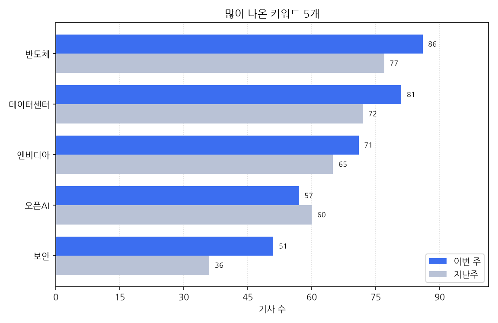

# 주간 AI 뉴스 리포트

대상 기간은 한국 시간으로 2026-10-19 월요일부터 2026-10-25 일요일까지다.
이번 주에 AI가 남긴 기사는 1665건, 지난주는 1651건이다. 14건 늘었다.

## 이번 주에 새로 나온 도구

- 10-19 '"AI 도입했더니 생산성 40%↑"…LG CNS, 글로벌 평가서 국내 첫 선정' 소식이 한 곳에서 나왔다 (대표 링크 https://www.fnnews.com/news/202610190657307567)
- 10-19 '"극한 환경서 AI 구동"…델, `프로 러기드 13·14` 공개' 소식이 한 곳에서 나왔다 (대표 링크 https://www.ddaily.co.kr/page/view/2026101909252774876)
- 10-19 'LG전자, 뉴욕 타임스스퀘어서 68년 가전 혁신·AI홈 비전 공개' 소식을 2개 매체가 다뤘다 (기사 2건, 대표 링크 http://inews24.com/view/2016242)
- 10-19 '교육부, 수능 'AI 안경' 부정행위 차단한다…적발 방법은 비공개' 소식이 한 곳에서 나왔다 (대표 링크 https://www.newspim.com/news/view/20261019001220)
- 10-19 '네이버클라우드, 기업 보안 무료 진단 서비스 출시…AI 위협까지 점검' 소식이 한 곳에서 나왔다 (대표 링크 https://zdnet.co.kr/view/?no=20261019134825)
- 10-19 '델 테크놀로지스, 산업 현장용 러기드 AI 노트북 2종 공개' 소식을 2개 매체가 다뤘다 (기사 2건, 대표 링크 https://www.etnews.com/20261019000028)
- 10-19 '두산로보틱스, 비전 AI·노코딩 적용 제품군 확대 검토' 소식이 한 곳에서 나왔다 (대표 링크 https://zdnet.co.kr/view/?no=20261019150113)
- 10-19 '벤츠코리아, 전기차 2종 출격···내년 레벨 2++ 자율주행 도입 추진' 소식이 한 곳에서 나왔다 (대표 링크 https://www.newsway.co.kr/news/view?ud=2026101915164262864)
- 10-19 '센드버드·업스테이지, 솔라 붙인 AI 에이전트 상용화 추진' 소식을 3개 매체가 다뤘다 (기사 3건, 대표 링크 https://www.ddaily.co.kr/page/view/2026101910093770545)
- 10-19 '인텔 GPU D시리즈, 메모리 480GB로 엔비디아 B300 넘었지만 가격·출시는 미정' 소식이 한 곳에서 나왔다 (대표 링크 https://www.wikitree.co.kr/articles/1167227)
- 10-19 '코리아엑스퍼트, iM라이프 FDS 고도화 완료… AI 위험평가 도입' 소식이 한 곳에서 나왔다 (대표 링크 https://www.ddaily.co.kr/page/view/2026101910320617325)
- 10-19 '코오롱베니트, 제조 AX 사업 시동…이수화학 등 3개사에 AI 도입' 소식이 한 곳에서 나왔다 (대표 링크 https://zdnet.co.kr/view/?no=20261019165340)
- 10-20 '"통화하듯 자연스럽게"…스픽, AI 전화영어 `폰 스픽` 공개' 소식이 한 곳에서 나왔다 (대표 링크 https://www.ddaily.co.kr/page/view/2026102018062125007)
- 10-20 'AI 도입했더니 업무시간 90% 줄었다…산업별 AX 성과 가시화' 소식이 한 곳에서 나왔다 (대표 링크 https://zdnet.co.kr/view/?no=20261020180309)
- 10-20 'KT, K-패스 2026 열고 AI 스타트업과 AX 협업 성과 공개' 소식이 한 곳에서 나왔다 (대표 링크 https://zdnet.co.kr/view/?no=20261020103507)
- 10-20 'MS, AI 감시하는 보안관AI '가디언' 내놨다[글로벌AI브리핑]' 소식이 한 곳에서 나왔다 (대표 링크 https://www.fnnews.com/news/202610200748539531)
- 10-20 'SAP, 韓 성장기업 100곳 육성한다…AI·ERP 도입 장벽 완화' 소식이 한 곳에서 나왔다 (대표 링크 https://zdnet.co.kr/view/?no=20261020120335)
- 10-20 '日, 데이터센터·클라우드 '국가 인증제' 도입...中기업 사실상 배제' 소식이 한 곳에서 나왔다 (대표 링크 https://www.newspim.com/news/view/20261020000076)
- 10-20 '계룡대 국감…해군 "AI 기반 전투능력 향상"·해병 "준4군체제 개편' 소식이 한 곳에서 나왔다 (대표 링크 https://biz.heraldcorp.com/article/10908282)
- 10-20 '국감장에 중국 로봇? 이번엔 국산... 문워크 선보인 카이스트 휴머노이드-경제ㅣ한국일보' 소식이 한 곳에서 나왔다 (대표 링크 https://www.hankookilbo.com/news/article/A2026102014060000452)
- 10-20 '나루씨큐리티, AI공격 막는 'AI 웹 방어'서비스'제로티카 라이트 웹' 출시' 소식이 한 곳에서 나왔다 (대표 링크 https://zdnet.co.kr/view/?no=20261020162125)
- 10-20 '네이버웹툰, AI 스토리챗 `바이어스` 日 출시…라인망가서 팬 창작 확대' 소식이 한 곳에서 나왔다 (대표 링크 https://www.ddaily.co.kr/page/view/2026102011361822600)
- 10-20 '네패스, 실리콘 커패시터ㆍ메모리 컨트롤러 초도 공급…AI 서버 등 적용 확대' 소식이 한 곳에서 나왔다 (대표 링크 https://www.etoday.co.kr/news/view/2637487)
- 10-20 '노타, 'Arm 크리에이트'서 AI 최적화 도구 공개' 소식이 한 곳에서 나왔다 (대표 링크 https://biz.chosun.com/it-science/ict/2026/10/20/XCTIWUOHCRG5HA4A7BGRGNXW7Q/)
- 10-20 '노타, Arm AI 개발 도구에 모델 경량화 기술 적용' 소식이 한 곳에서 나왔다 (대표 링크 https://zdnet.co.kr/view/?no=20261020120231)
- 10-20 '딥노이드, 의료 AI 연구 7편 학술대회 채택...영상 판독·암 진단 기술 공개' 소식이 한 곳에서 나왔다 (대표 링크 https://www.newsway.co.kr/news/view?ud=2026102009380157840)
- 10-20 '레노버-로민, AI 개인정보 비식별화 솔루션 출시…금융·공공 시장 공략' 소식이 한 곳에서 나왔다 (대표 링크 https://zdnet.co.kr/view/?no=20261020140046)
- 10-20 '루닛, ESMO서 아스트라제네카·다이이찌산쿄 참여 AI 연구 성과 공개' 소식이 한 곳에서 나왔다 (대표 링크 https://www.etoday.co.kr/news/view/2637710)
- 10-20 '세일즈포스, AI 에이전트 전문인력 'FDE' 국내 첫 도입' 소식이 한 곳에서 나왔다 (대표 링크 https://www.edaily.co.kr/News/Read?newsId=03145526645614888&mediaCodeNo=257)
- 10-20 '슈프리마, AI 순찰로봇 솔루션 공개' 소식이 한 곳에서 나왔다 (대표 링크 https://zdnet.co.kr/view/?no=20261020172330)
- 10-20 '스마일게이트 희망스튜디오, '성남시 청소년 AI 창작 워크숍' 론칭' 소식을 2개 매체가 다뤘다 (기사 2건, 대표 링크 http://inews24.com/view/2016747)
- 10-20 '씽킹AI "AI 도입해도 실적 제자리? 비즈니스 병목부터 풀어야' 소식이 한 곳에서 나왔다 (대표 링크 https://zdnet.co.kr/view/?no=20261020140225)
- 10-20 '아이디바인, 유럽종양학회서 항암제 임상성공 예측 AI 'i.Dv 1.5' 공개' 소식이 한 곳에서 나왔다 (대표 링크 https://zdnet.co.kr/view/?no=20261020104555)
- 10-20 '올림피아드교육, AI 심사 도입한 제10회 수학 말하기대회 수상자 발표' 소식이 한 곳에서 나왔다 (대표 링크 https://www.seoul.co.kr/news/economy/2026/10/20/20261020500216)
- 10-20 '옴니사, 기업 AI 사용·작업 통제하는 '엘라라' 공개…보안 관리 강화' 소식이 한 곳에서 나왔다 (대표 링크 https://zdnet.co.kr/view/?no=20261020140912)
- 10-20 '이런! 내 주식 폭락의 이유인데'…'중국 가성비 AI모델' 99%는 안전성 사전공개 안했다고 한 곳이 전했다 (대표 링크 https://www.munhwa.com/article/11624821)
- 10-20 '추미애 첫 조직개편, 30실국→25실국… AI·반도체에 역량 집중' 소식이 한 곳에서 나왔다 (대표 링크 https://www.ohmynews.com/NWS_Web/View/at_pg.aspx?CNTN_CD=A0003277052&PAGE_CD=N0002&BLCK_NO=&CMPT_CD=M0147)
- 10-20 '텐마인즈, 'AI 슬립봇' 공개…원거리 가족 수면관리 기능 강화' 소식이 한 곳에서 나왔다 (대표 링크 https://biz.heraldcorp.com/article/10908681)
- 10-21 '"북한 김정은 사망 확실... 북한이 살아있다며 공개한 건 AI 사진' 소식이 한 곳에서 나왔다 (대표 링크 https://www.wikitree.co.kr/articles/1168052)
- 10-21 '"쓰레기이자 싸구려" 5천만곡 추천목록서 삭제…'AI생성 음악' 퇴출시킨 스포티파이' 소식이 한 곳에서 나왔다 (기사 2건, 대표 링크 https://biz.heraldcorp.com/article/10910492)
- 10-21 '"제주에서 춤추는 휴머노이드"...클로봇, 리더스포럼서 피지컬 AI 선보여' 소식이 한 곳에서 나왔다 (대표 링크 https://www.newspim.com/news/view/20261021000882)
- 10-21 '"챗GPT 검색에도 우리 브랜드 뜨게"…원더스랩, AI 검색 최적화 서비스 출시' 소식이 한 곳에서 나왔다 (대표 링크 https://biz.heraldcorp.com/article/10909400)
- 10-21 'AI가 제멋대로 행동하면?…엔비디아, 강제 차단 기술 공개' 소식이 한 곳에서 나왔다 (대표 링크 https://www.edaily.co.kr/News/Read?newsId=05871206645615216&mediaCodeNo=257)
- 10-21 'HD현대로보틱스, '두 손·열 손가락 움직이는 AI 로봇' 공개 "주변 환경 인식해 스스로 동작' 소식이 한 곳에서 나왔다 (대표 링크 https://biz.chosun.com/industry/company/2026/10/21/FUZDDG2MFJDCVMGFI2NDK5XR6A/)
- 10-21 'HD현대로보틱스, 휴머노이드 상반신 공개' 소식이 한 곳에서 나왔다 (대표 링크 https://zdnet.co.kr/view/?no=20261021180225)
- 10-21 'HD현대로보틱스, 휴머노이드 시장 진출 시동…지능형 양팔로봇 공개' 소식이 한 곳에서 나왔다 (대표 링크 https://www.etoday.co.kr/news/view/2638398)
- 10-21 'KAI, 우주 궤도서 AI 기반 위성 자율운영 실증 성공' 소식을 6개 매체가 다뤘다 (기사 6건, 대표 링크 https://biz.heraldcorp.com/article/10909602)
- 10-21 'KISTI, AI 기반 과학기술사업화 플랫폼 '아폴로 2.0 런칭' 소식이 한 곳에서 나왔다 (대표 링크 https://zdnet.co.kr/view/?no=20261021114302)
- 10-21 'LG전자, HARFKO서 차세대 시스템 에어컨 공개… 데이터센터 액침냉각 기술도 전시' 소식을 2개 매체가 다뤘다 (기사 2건, 대표 링크 https://biz.chosun.com/it-science/ict/2026/10/21/PWTHKILMNZGDVC6S6DQ3WRJ3VA/)
- 10-21 'LG전자, 하프코 2026서 듀얼 AI 시스템 에어컨 '멀티 브이 7' 공개' 소식을 3개 매체가 다뤘다 (기사 3건, 대표 링크 https://www.etnews.com/20261021000139)
- 10-21 '기업 맞춤형 국가 R&D 기술, AI가 찾아준다…KISTI, '아폴로 2.0' 공개' 소식이 한 곳에서 나왔다 (대표 링크 https://biz.heraldcorp.com/article/10909630)
- 10-21 '메타 AI개인비서 '뮤즈', 출시 40일만 1000만 다운로드[글로벌AI브리핑]' 소식이 한 곳에서 나왔다 (대표 링크 https://www.fnnews.com/news/202610210739114822)
- 10-21 '세라젬, 데이터브릭스 AI 플랫폼 도입⋯'AI 웰니스 홈' 구현 가속' 소식을 2개 매체가 다뤘다 (기사 2건, 대표 링크 http://inews24.com/view/2017364)
- 10-21 '신성이엔지, '데이터센터코리아 2026' 참가…AI 데이터센터 통합 솔루션 공개' 소식을 2개 매체가 다뤘다 (기사 2건, 대표 링크 https://www.edaily.co.kr/News/Read?newsId=02906086645615216&mediaCodeNo=257)
- 10-21 '애플, 한국어 지원 '시리 AI' 이달 공개…네이버·카카오 연동' 소식이 한 곳에서 나왔다 (대표 링크 https://zdnet.co.kr/view/?no=20261021160933)
- 10-21 '오텍캐리어, 데이터센터 냉각 시장 공략…HARFKO서 통합 솔루션 공개' 소식이 한 곳에서 나왔다 (대표 링크 https://www.ddaily.co.kr/page/view/2026102115403361050)
- 10-21 '오픈AI, 챗GPT에 '대화 잠금' 기능 도입' 소식이 한 곳에서 나왔다 (대표 링크 https://biz.chosun.com/it-science/ict/2026/10/21/X2OXLPITXFGOZPQJEV6LNBPGTU/)
- 10-21 '원더스랩, 생성형 엔진 최적화 솔루션 '원더GEO' 출시' 소식이 한 곳에서 나왔다 (대표 링크 https://zdnet.co.kr/view/?no=20261021213208)
- 10-21 '전통의학에 부는 AI 바람...中 관련 특허 공개 건수 80% 차지-Xinhua' 소식이 한 곳에서 나왔다 (대표 링크 http://kr.xinhuanet.com/20261021/72da1b98ce9b483fafa33a5fbc641410/c.html)
- 10-21 '제조 AI 도입률 0.1%…박영선 "K-온톨로지 표준·플랫폼 구축 필요' 소식이 한 곳에서 나왔다 (대표 링크 https://www.etoday.co.kr/news/view/2638335)
- 10-21 '조선소 누빌 휴머노이드 만든다…HD현대로보틱스, 양팔 로봇 공개' 소식이 한 곳에서 나왔다 (대표 링크 https://www.ddaily.co.kr/page/view/2026102108293718907)
- 10-21 '직방 스마트홈, 'Soma'로 리브랜딩… 첫 AI 도어록 '소마 케어 P1' 출시' 소식을 2개 매체가 다뤘다 (기사 2건, 대표 링크 https://biz.heraldcorp.com/article/10909356)
- 10-21 '채널톡, AI 전화 상담 '보이스 알프' 출시' 소식을 2개 매체가 다뤘다 (기사 2건, 대표 링크 https://biz.chosun.com/it-science/ict/2026/10/21/MRH5CKHIDRBRTJ2DRI24IVTZOY/)
- 10-21 '카카오, 자체 개발 AI 비전 인코더 2종 오픈소스 공개' 소식을 2개 매체가 다뤘다 (기사 2건, 대표 링크 https://www.newspim.com/news/view/20261021000206)
- 10-21 '크래프톤, 독자 개발 LLM '라온-1 미니' 프리뷰 공개' 소식을 4개 매체가 다뤘다 (기사 4건, 대표 링크 http://inews24.com/view/2017390)
- 10-21 '하정우 AI전략위 "피지컬AI KPI 재설계해야…도입건수보단 체감 성과가 핵심' 소식이 한 곳에서 나왔다 (대표 링크 https://www.ddaily.co.kr/page/view/2026102116270901191)
- 10-21 '한화문화재단, 앤트로픽과 AI·예술 협업…국내 작가 5팀 신작 공개' 소식이 한 곳에서 나왔다 (대표 링크 https://www.newspim.com/news/view/20261021000190)
- 10-21 '李대통령 "중수청장 국무회의 배석불가는 억지"…AI답변 공개' 소식을 2개 매체가 다뤘다 (기사 2건, 대표 링크 https://www.segye.com/newsView/20261021508084)
- 10-21 엔비디아, 신약 설계 AI 공개…"단백질 생성 13배 빠르다고 한 곳이 전했다 (대표 링크 https://www.edaily.co.kr/News/Read?newsId=06015526645615216&mediaCodeNo=257)
- 10-22 '"10분 걸리던 일이 20초 만에"... 현대차그룹이 공개한 AI 활용법' 소식이 한 곳에서 나왔다 (대표 링크 https://www.insight.co.kr/news/578788)
- 10-22 '"AI 잘 쓰는 마케터는 뭐가 다를까"...젠스파크, 콘텐츠 마케팅 행사서 노하우 공개' 소식이 한 곳에서 나왔다 (대표 링크 https://www.insight.co.kr/news/578768)
- 10-22 '"AI, 한 번 들은 목소리 기억한다"… 다글로, 보이스매칭 기능 출시' 소식이 한 곳에서 나왔다 (대표 링크 https://www.ddaily.co.kr/page/view/2026102217040010544)
- 10-22 '"로봇·AI 결합해 차세대 치안 구현"…현대오토에버, 모베드 기반 솔루션 공개' 소식을 3개 매체가 다뤘다 (기사 3건, 대표 링크 https://www.edaily.co.kr/News/Read?newsId=02919206645615544&mediaCodeNo=257)
- 10-22 '"부장님 발언만 요약해줘"…AI노트 '다글로', 보이스매칭 출시' 소식이 한 곳에서 나왔다 (대표 링크 https://www.edaily.co.kr/News/Read?newsId=04267286645615544&mediaCodeNo=257)
- 10-22 '"인턴도 필요 없다"…AI 도입에 좁아지는 PEF 취업문' 소식이 한 곳에서 나왔다 (대표 링크 https://www.etoday.co.kr/news/view/2638245)
- 10-22 '"차가 운전하고 AI가 도와준다"... GM이 공개한 미래 자동차의 모습' 소식이 한 곳에서 나왔다 (대표 링크 https://www.insight.co.kr/news/578771)
- 10-22 '2026대한민국ESG친환경대전, 환경 분야 AI 서비스 7종 공개…누수 탐지부터 홍수 예측까지' 소식이 한 곳에서 나왔다 (대표 링크 http://www.ecomedia.co.kr/news/newsview.php?ncode=1065617739140931)
- 10-22 'AI 에이전트가 안전 장치 스스로 무력화…오픈AI, 내부 사고 보고서 공개' 소식이 한 곳에서 나왔다 (대표 링크 https://www.ddaily.co.kr/page/view/2026102205584070168)
- 10-22 'AI로 마케팅 업무 혁신…젠스파크, 차세대 협업 전략 공개' 소식이 한 곳에서 나왔다 (대표 링크 https://zdnet.co.kr/view/?no=20261022102202)
- 10-22 'GM, 美 뉴욕서 AI 기반 차량 미래 기술 비전 공개…최고경영진 한자리' 소식이 한 곳에서 나왔다 (대표 링크 https://biz.heraldcorp.com/article/10911585)
- 10-22 'LG CNS, 기업용 챗GPT 이용자 3만명 확보…공급부터 업무 적용 지원' 소식이 한 곳에서 나왔다 (대표 링크 https://zdnet.co.kr/view/?no=20261022191127)
- 10-22 'LG이노텍, 엔비디아와 로봇용 센싱 솔루션 개발' 소식을 3개 매체가 다뤘다 (기사 3건, 대표 링크 https://www.etoday.co.kr/news/view/2638646)
- 10-22 'MS도 AI 도입했다가 직원들 외면…AI 혁신의 조건은' 소식이 한 곳에서 나왔다 (대표 링크 https://www.edaily.co.kr/News/Read?newsId=03978646645615544&mediaCodeNo=257)
- 10-22 '구글,'제미나이4' 출시 고성능 최상위 AI 모델' 소식이 한 곳에서 나왔다 (대표 링크 http://www.koreatimes.com/article/20261021/1634763)
- 10-22 '김범호 인국공 사장 대행 "가장 안전한 공항 만들겠다"...조류충돌 레이더 도입·AI 관제 확대' 소식이 한 곳에서 나왔다 (대표 링크 https://www.newsway.co.kr/news/view?ud=2026102210494279615)
- 10-22 '델-엔비디아, 기업용 AI 인프라 협력 확대…차세대 서버·데이터센터 공개' 소식이 한 곳에서 나왔다 (대표 링크 https://zdnet.co.kr/view/?no=20261022101042)
- 10-22 '마우저, 일렉트로니카 2026서 휴머노이드 로봇 기술 공개' 소식이 한 곳에서 나왔다 (대표 링크 https://www.ddaily.co.kr/page/view/2026102210354489700)
- 10-22 '메리 바라 GM 회장 "2028년 고속도로 자율주행 도입"…'아이즈 오프' 주행 상용화' 소식이 한 곳에서 나왔다 (대표 링크 https://www.etnews.com/20261022000299)
- 10-22 '브레인즈컴퍼니 "에이프리카, '치타 AI Gateway' 출시' 소식이 한 곳에서 나왔다 (대표 링크 https://www.newspim.com/news/view/20261022000670)
- 10-22 '서울, 옵저버 선정 '세계 AI 도시' 종합 3위…AI 도입·활용 분야 1위' 소식을 4개 매체가 다뤘다 (기사 4건, 대표 링크 https://www.newspim.com/news/view/20261021001257)
- 10-22 '안철수 "李대통령, AI에 국정기밀 입력했나…전면 공개해야' 소식이 한 곳에서 나왔다 (대표 링크 https://biz.heraldcorp.com/article/10911480)
- 10-22 '에쓰오일, 생성형 AI로 작업 위험 분석…샤힌 공장에도 적용' 소식이 한 곳에서 나왔다 (대표 링크 https://zdnet.co.kr/view/?no=20261022101529)
- 10-22 '엔비디아 젠슨 황 CEO, GTC 베를린서 AI 팩토리부터 피지컬 AI까지 미래 전략 공개' 소식이 한 곳에서 나왔다 (대표 링크 https://kbench.com/?q=node/282707)
- 10-22 '엔비디아, 안전한 AI 에이전트 위한 오픈쉘 레퍼런스 아키텍처 공개' 소식이 한 곳에서 나왔다 (대표 링크 https://kbench.com/?q=node/282678)
- 10-22 '이수만標 AI그룹 나온다…"아담 밴드', 연말 공개' 소식이 한 곳에서 나왔다 (대표 링크 https://www.munhwa.com/article/11625341)
- 10-22 '젠슨 황 "유럽 모든 산업이 AI기업 돼야"…컨테이너형 데이터센터 공개' 소식이 한 곳에서 나왔다 (대표 링크 https://www.heraldk.com/article/2026102115325514929)
- 10-22 '출하검사부터 비행 전 점검까지 AI로…위플로 진단 SW 출시' 소식이 한 곳에서 나왔다 (대표 링크 https://www.edaily.co.kr/News/Read?newsId=07006086645615544&mediaCodeNo=257)
- 10-22 '팔로알토네트웍스 "PHP 치명적 취약점 공개…AI 기반 탐지·차단 중요' 소식이 한 곳에서 나왔다 (대표 링크 https://www.ddaily.co.kr/page/view/2026102216233643576)
- 10-22 '포스코퓨처엠, 팔란티어 AI 플랫폼 도입…영업·제조 혁신 추진' 소식을 2개 매체가 다뤘다 (기사 3건, 대표 링크 https://www.etoday.co.kr/news/view/2638803)
- 10-22 '허블, AI 뉴스 에이전트 '탭뷰 AI' 지스타 2026서 공개' 소식이 한 곳에서 나왔다 (대표 링크 https://zdnet.co.kr/view/?no=20261022215032)
- 10-22 '환경산업기술원, 출시 앞둔 환경분야 AI 서비스 '눈길' 소식이 한 곳에서 나왔다 (대표 링크 https://zdnet.co.kr/view/?no=20261022181104)
- 10-23 '"AI 판단 속도 10배↑"…오픈AI, '디시전스 API' 정식 출시' 소식이 한 곳에서 나왔다 (대표 링크 https://zdnet.co.kr/view/?no=20261023155121)
- 10-23 '"병원 데이터도 연구에"…NDS, 세계병원대회서 병원 연구환경·수술 AI 플랫폼 공개' 소식이 한 곳에서 나왔다 (대표 링크 https://www.ddaily.co.kr/page/view/2026102311135099264)
- 10-23 'AI 도입은 늘었는데 성과는 제자리…AWS가 내놓은 `정착` 해법은?' 소식이 한 곳에서 나왔다 (대표 링크 https://www.ddaily.co.kr/page/view/2026102312035046026)
- 10-23 'AI 변액연금 도입, 고객투자 성향 맞춤전략 지원[제31회 헤럴드보험대상 고객자산관리대상- iM라이프]' 소식이 한 곳에서 나왔다 (대표 링크 https://biz.heraldcorp.com/article/10912738)
- 10-23 'SK바이오사이언스, 백신 생산에 AI 적용…데이터 기반 공정 운영 혁신' 소식이 한 곳에서 나왔다 (대표 링크 https://www.newspim.com/news/view/20261023000938)
- 10-23 '英바클레이즈, AI 도입에 5000명 감원…개발자 직격탄' 소식이 한 곳에서 나왔다 (대표 링크 https://www.edaily.co.kr/News/Read?newsId=04057366645615872&mediaCodeNo=257)
- 10-23 '슈나이더, AI 데이터센터 전력 모듈 공개' 소식이 한 곳에서 나왔다 (대표 링크 https://www.ddaily.co.kr/page/view/2026102310290402367)
- 10-23 '신현송 "韓 잠재성장, AI 투자로 변곡점 맞아⋯연말 한은 추정치 공개" [국감]' 소식을 2개 매체가 다뤘다 (기사 2건, 대표 링크 https://www.etoday.co.kr/news/view/2639298)
- 10-23 '앤드리슨 호로위츠, 'a16z 프론티어'로 전면 개편…"AI·신기술 투자 확대' 소식이 한 곳에서 나왔다 (대표 링크 https://zdnet.co.kr/view/?no=20261023095941)
- 10-23 '앤트로픽, 메타·오픈AI 이어 AI에이전트 '클로드 듀엣' 공개' 소식이 한 곳에서 나왔다 (대표 링크 https://biz.heraldcorp.com/article/10912010)
- 10-23 '앤트로픽, 알아서 일하는 AI비서 '클로드 듀엣' 공개[글로벌AI브리핑]' 소식이 한 곳에서 나왔다 (대표 링크 https://www.fnnews.com/news/202610230810450725)
- 10-23 '앤트로픽도 AI 에이전트 경쟁 뛰어든다…'클로드 듀엣' 공개' 소식을 2개 매체가 다뤘다 (기사 2건, 대표 링크 https://www.etnews.com/20261023000003)
- 10-23 '엔비디아, AI 돌발 행동 막는 '개방형 안전 플랫폼' 공개' 소식이 한 곳에서 나왔다 (대표 링크 https://www.etnews.com/20260929000002)
- 10-23 '와디즈, 프로젝트 맞춤형 AI 행동 제안 서비스 '메이커 인텔리전스' 출시' 소식이 한 곳에서 나왔다 (대표 링크 https://zdnet.co.kr/view/?no=20261023110749)
- 10-23 '카카오모빌리티, 강릉 ITS 세계총회서 AI 주차 기술 공개' 소식이 한 곳에서 나왔다 (대표 링크 https://zdnet.co.kr/view/?no=20261023104239)
- 10-23 '트윈플러스, AI 애니메이션 제작 확대…역사 인물 2편 첫 공개' 소식이 한 곳에서 나왔다 (대표 링크 https://www.newspim.com/news/view/20261023001015)
- 10-23 '한컴, AI 플랫폼 '노마디안' 12월 미국 베타 공개' 소식이 한 곳에서 나왔다 (대표 링크 https://www.newspim.com/news/view/20261023001108)
- 10-23 '휴데이터스, 국제치안산업대전서 AI 안전 플랫폼 공개' 소식이 한 곳에서 나왔다 (대표 링크 https://zdnet.co.kr/view/?no=20261023153508)
- 10-23 월마트, 다음 달 '에이전트 프로필' 도입…AI가 대신 산 물건을 고객 구매와 분리한다고 한 곳이 전했다 (대표 링크 https://www.wikitree.co.kr/articles/1168683)
- 10-24 '"어중간한 사무직은 짐싼다"…英 바클레이스, AI 도입하며 5000명 감원' 소식이 한 곳에서 나왔다 (기사 2건, 대표 링크 https://biz.heraldcorp.com/article/10913570)
- 10-24 '나토가 도입한 美 군사용 AI, 독일·프랑스는 꺼리는 이유' 소식이 한 곳에서 나왔다 (대표 링크 https://biz.chosun.com/international/international_general/2026/10/24/KDWLPTPDMZGDZMAI2274SZAFNU/)
- 10-24 '오라클, 'AI 월드 2026' 개최…AI 현장 적용 전략 공개 예고' 소식이 한 곳에서 나왔다 (대표 링크 https://www.ddaily.co.kr/page/view/2026102314482152205)
- 10-24 앤트로픽, '클로드 듀엣' 공개···자리 비워도 알아서 업무 이어간다고 한 곳이 전했다 (대표 링크 https://www.newsway.co.kr/news/view?ud=2026102315041326410)
- 10-25 '"웃고 울먹이기까지"…트위터 창업자 잭 도시, 사람 닮은 음성 AI 공개' 소식이 한 곳에서 나왔다 (대표 링크 https://zdnet.co.kr/view/?no=20261025105055)
- 10-25 '금천구 '미래성장국' 'AI정책실' 신설…민선 9기 조직개편' 소식이 한 곳에서 나왔다 (대표 링크 https://biz.heraldcorp.com/article/10913735)
- 10-25 '금천구, 2027년 1월 조직개편…'미래성장국' 신설·AI 행정혁신 강화' 소식이 한 곳에서 나왔다 (기사 2건, 대표 링크 https://womannews.net/detail.php?number=457777&thread=22r03r03)
- 10-25 '카드사 '에이전트 커머스' 시대 연다…내년 에이전트 페이 출시' 소식이 한 곳에서 나왔다 (대표 링크 https://www.etnews.com/20261023000282)

## 규제와 정책

- 10-19 ''AI 포용' 메시지 강조하는 정부…글로벌 협력 키워드 전면에' 소식이 한 곳에서 나왔다 (대표 링크 https://www.ddaily.co.kr/page/view/2026101910504516464)
- 10-19 ''AI안경 주의보' 대학가, 중간·기말 내부 시험 지침 마련…AI렌즈도 골치' 소식이 한 곳에서 나왔다 (대표 링크 https://www.newspim.com/news/view/20261016001153)
- 10-19 'AI 가이드라인 다음은 제도여야 한다 [세상읽기]' 소식이 한 곳에서 나왔다 (대표 링크 https://www.hani.co.kr/arti/opinion/column/1283116.html)
- 10-19 'AI 악용 해킹 위협에…개인정보위 "미사용 계정 정리·2단계 인증' 소식이 한 곳에서 나왔다 (대표 링크 https://www.fnnews.com/news/202610191109441123)
- 10-19 'NIA, 제1회 AI 정부 포럼 개최⋯'공부원 AI 활용, 권리와 책임의 균형' 주제' 소식이 한 곳에서 나왔다 (대표 링크 http://inews24.com/view/2016332)
- 10-19 '경제계 "AI·바이오 복합규제 풀어야"…정부, 총리 주재 정기 점검 추진' 소식이 한 곳에서 나왔다 (대표 링크 https://www.etoday.co.kr/news/view/2637435)
- 10-19 '구광모, LG 전 계열사 사업보고회 돌입…AI 승부처 실행 점검' 소식을 4개 매체가 다뤘다 (기사 4건, 대표 링크 https://newsway.co.kr/news/view?ud=2026101909004427526)
- 10-19 '국회 생방송 계속 볼 필요 없다…공무원이 AI로 만든 '국정ON' 소식이 한 곳에서 나왔다 (대표 링크 https://www.newspim.com/news/view/20261019000248)
- 10-19 '국힘, 우상호 '강릉 AI센터' 고발… "4개월 만에 뒤집은 공약사기' 소식이 한 곳에서 나왔다 (대표 링크 https://biz.chosun.com/policy/politics/assembly/2026/10/19/465G6NY5INF4RBKACDIXBHT7X4/)
- 10-19 '규제만 남은 통신정책… 통신3사 설비투자 6년간 37% 감소[AI시대, 통신정책 2.0으로]' 소식이 한 곳에서 나왔다 (대표 링크 https://www.fnnews.com/news/202610191837371237)
- 10-19 '기후에너지환경부, 물산업 규제합리화 추진…AI 정수장 수출 기반 강화' 소식이 한 곳에서 나왔다 (대표 링크 https://womannews.net/detail.php?number=457357&thread=22r03r03)
- 10-19 '마음AI, 과기정통부 장관상 수상...피지컬 AI 기술 경쟁력 부각' 소식이 한 곳에서 나왔다 (대표 링크 https://zdnet.co.kr/view/?no=20261019155851)
- 10-19 '마크애니, AI 기본법 대응 돕는다…'C2PA 패키지' 지속 지원' 소식이 한 곳에서 나왔다 (대표 링크 https://zdnet.co.kr/view/?no=20261019210532)
- 10-19 '머스크의 후회 "더 일찍 AI 집중했어야 했다"…'정부효율부 활동' 되짚으며 한 말' 소식이 한 곳에서 나왔다 (대표 링크 https://www.heraldk.com/article/2026101807053500167)
- 10-19 '보험연수원 AI 합작 법인 투자 '불가' 결론… 하태경 "금융위, 입장 번복' 소식이 한 곳에서 나왔다 (대표 링크 https://biz.chosun.com/stock/finance/2026/10/19/3ZGHF7APBVEUZBO4YBFNLMUJYQ/)
- 10-19 '복지부 "의료AI 대응할 정부 데이터센터 필요"…네이버 '각 세종' 방문' 소식이 한 곳에서 나왔다 (대표 링크 https://biz.chosun.com/science-chosun/medicine-health/2026/10/19/3ZVYGTSVJBDUFLGHABKYLW5A64/)
- 10-19 '이찬진 금감원장 "AI 공격엔 AI 방어"…금융사 보안역량 강화 주문' 소식을 2개 매체가 다뤘다 (기사 2건, 대표 링크 https://www.newspim.com/news/view/20261019000038)
- 10-19 '이찬진 금감원장 "AI 해킹, AI로 대응···금융권 보안 투자 확대 유도' 소식이 한 곳에서 나왔다 (대표 링크 https://newsway.co.kr/news/view?ud=2026101910304527232)
- 10-19 '이찬진 금감원장 "해킹 보안 허점 신속 보완"…AI 모의해킹 우려 확대' 소식이 한 곳에서 나왔다 (기사 2건, 대표 링크 https://www.nspna.com/news/?mode=view&newsid=832112)
- 10-19 '입법조사처 "'모두의 AI' 오류 피해, 이용자 배상책임 입증 어려워' 소식이 한 곳에서 나왔다 (대표 링크 http://inews24.com/view/2016552)
- 10-19 '조정식 의장, 교육감 7인 접견…"교육재정·AI 리터러시 교육 국회가 뒷받침' 소식이 한 곳에서 나왔다 (대표 링크 https://www.newspim.com/news/view/20261019001159)
- 10-19 '지방정부 AX 길잡이 나왔다…KLID, 5대 공공분야 AI 서비스 가이드 발간' 소식이 한 곳에서 나왔다 (대표 링크 https://www.ddaily.co.kr/page/view/2026101912291014132)
- 10-19 '클로드, 막히면 지침 어기고 우회…지디넷 "과제 완수 압박하는 훈련이 원인' 소식이 한 곳에서 나왔다 (대표 링크 https://www.wikitree.co.kr/articles/1167207)
- 10-20 '"120조 동해 AI데이터센터 어디까지 왔나"…정부, 전력·용수 점검' 소식이 한 곳에서 나왔다 (대표 링크 https://www.edaily.co.kr/News/Read?newsId=04293526645614888&mediaCodeNo=257)
- 10-20 '2·3종 주거지역까지 규제 추진…서울 데이터센터 '탈서울' 확산하나' 소식이 한 곳에서 나왔다 (대표 링크 https://www.newspim.com/news/view/20261019001262)
- 10-20 'AI 안경 부정행위 형사처벌?…법조계 '업무방해죄 성립' 의견 갈려' 소식이 한 곳에서 나왔다 (대표 링크 https://www.etoday.co.kr/news/view/2637925)
- 10-20 'AI 안경 부정행위에 대학가 '비상'…자체 지침 만들고 서약서까지 검토' 소식이 한 곳에서 나왔다 (대표 링크 https://www.etoday.co.kr/news/view/2637851)
- 10-20 'AI 패권 전쟁, 새로운 질서…대한민국의 승부처는' 소식이 한 곳에서 나왔다 (대표 링크 http://inews24.com/view/2016676)
- 10-20 '李대통령, 23일 규제합리화회의 주재…반도체·AI·로봇 규제혁신 논의' 소식이 한 곳에서 나왔다 (대표 링크 https://www.etoday.co.kr/news/view/2637739)
- 10-20 '美 정부서 딥시크 지운다…트럼프, 中 AI에 퇴출령' 소식이 한 곳에서 나왔다 (대표 링크 https://www.etoday.co.kr/news/view/2637939)
- 10-20 '美 패트릭 J. 맥거번 재단 "AI 안전, 기업 약속만으론 부족…정부가 검증해야' 소식이 한 곳에서 나왔다 (대표 링크 https://zdnet.co.kr/view/?no=20261018201554)
- 10-20 '美, 中 딥시크 AI 정부기관서 퇴출…기술 패권 경쟁 격화' 소식이 한 곳에서 나왔다 (대표 링크 https://www.fnnews.com/news/202610201012510157)
- 10-20 '경주 자동차부품 공장에 AI 도입…60억 규모 정부과제 선정' 소식이 한 곳에서 나왔다 (대표 링크 https://www.edaily.co.kr/News/Read?newsId=05530086645614888&mediaCodeNo=257)
- 10-20 '교육부 수능 'AI 안경 감독 지침'살펴보니…결국'육안 확인' 의존' 소식이 한 곳에서 나왔다 (대표 링크 https://www.etoday.co.kr/news/view/2637832)
- 10-20 '국회 국토교통위원회, TS 자동차안전연구원 방문…자율주행차·사이버보안 점검' 소식이 한 곳에서 나왔다 (대표 링크 https://www.nspna.com/country/?mode=view&newsid=832483)
- 10-20 '수능 앞두고 'AI 안경'경계령…공통 제재 기준·감독관 보호'시험대' 소식이 한 곳에서 나왔다 (대표 링크 https://www.newspim.com/news/view/20261020000969)
- 10-20 '앤트로픽 AI의 한국어 책 대량 학습, 시급해진 저작권 보호-오피니언ㅣ한국일보' 소식이 한 곳에서 나왔다 (대표 링크 https://www.hankookilbo.com/news/article/A2026101911200003939)
- 10-20 '트럼프 행정부, 연방기관 시스템서 中 '딥시크' AI 모델 퇴출' 소식을 3개 매체가 다뤘다 (기사 3건, 대표 링크 https://www.hankookilbo.com/news/article/A2026102000340000219)
- 10-21 '"구글 AI기술 훔쳤다" 中기업 제재한 美…"딥시크 뒤꽁무니도 못 따라와" 보복 예고한 中' 소식이 한 곳에서 나왔다 (기사 2건, 대표 링크 https://biz.heraldcorp.com/article/10910486)
- 10-21 '"맨눈으로 잡아라?"…수능 'AI 안경' 단속에 뿔난 감독관들' 소식이 한 곳에서 나왔다 (대표 링크 https://www.edaily.co.kr/News/Read?newsId=06222166645614888&mediaCodeNo=257)
- 10-21 '"전기는 국가망으로 받으라더니"…AI 데이터센터 새 규제 논란' 소식이 한 곳에서 나왔다 (대표 링크 https://www.newspim.com/news/view/20261021000293)
- 10-21 'AI 법인격, '사람처럼'이 아니라 '사람을 위하여' 소식이 한 곳에서 나왔다 (대표 링크 https://zdnet.co.kr/view/?no=20261021215954)
- 10-21 'AI 채팅서 성적 대화·선정적 캐릭터 확산...11월 심의' 소식이 한 곳에서 나왔다 (대표 링크 https://zdnet.co.kr/view/?no=20261021192631)
- 10-21 '中 빅테크 3사, 美 규제 피한 엔비디아 GPU 47조원어치 주문… 내년 생산량 웃돌아' 소식이 한 곳에서 나왔다 (대표 링크 https://biz.chosun.com/it-science/ict/2026/10/21/SYXU5L45D5EN3NHP7QZ7IECCCU/)
- 10-21 '구미, 정부 AI팩토리 공모…346억원 확보' 소식이 한 곳에서 나왔다 (대표 링크 https://www.etoday.co.kr/news/view/2638099)
- 10-21 '국정자원, AI 해킹 대응 보안 강화…정부 클라우드 관리체계 개편' 소식을 2개 매체가 다뤘다 (기사 2건, 대표 링크 https://zdnet.co.kr/view/?no=20261021171359)
- 10-21 '의료 AI 혜택 공평하게... WHO와 'AI 헬스케어 서울선언' 소식을 2개 매체가 다뤘다 (기사 3건, 대표 링크 https://www.ohmynews.com/NWS_Web/View/at_pg.aspx?CNTN_CD=A0003277072&PAGE_CD=N0002&CMPT_CD=M0112)
- 10-21 '정부, AI 백신 개발 플랫폼 공개…팬데믹 대응 협력 확대' 소식이 한 곳에서 나왔다 (대표 링크 https://www.edaily.co.kr/News/Read?newsId=03972086645615216&mediaCodeNo=257)
- 10-21 '정부, 내년 500곳 이상 '피지컬AI' 실증...숙련공 노하우 데이터화' 소식이 한 곳에서 나왔다 (대표 링크 https://www.newspim.com/news/view/20261021000458)
- 10-21 '행안부, '공공 AI 대전환 챌린지' 개최…공무원 개발 AI 도구 범정부 확산' 소식이 한 곳에서 나왔다 (대표 링크 https://www.newspim.com/news/view/20261021000295)
- 10-21 '현대차·레인보우 "AI로봇 산업화, 공공수요·정부 리더십 중요' 소식이 한 곳에서 나왔다 (대표 링크 https://www.etnews.com/20261021000390)
- 10-22 'AI 간판 달면 R&D 예산 받나…정부 분류에 AI도 이견' 소식이 한 곳에서 나왔다 (대표 링크 https://www.fnnews.com/news/202610220633124950)
- 10-22 'AI 강국, 기술만으론 부족…정부 지분투자 검토·스타트업 판로 지원 [2027 테크퀘스트]' 소식이 한 곳에서 나왔다 (대표 링크 https://www.etoday.co.kr/news/view/2639084)
- 10-22 'AI 노래도 저작권료 받나…음악산업 새 기준 논쟁' 소식이 한 곳에서 나왔다 (대표 링크 https://zdnet.co.kr/view/?no=20261022094120)
- 10-22 'AI 데이터센터 승부처는 '전력'…건설 밖 인프라로 사업영역 넓히는 건설사들' 소식이 한 곳에서 나왔다 (대표 링크 https://www.etoday.co.kr/news/view/2638429)
- 10-22 'AI가 발견한 PHP 취약점에 전 세계 발칵…정부도 위기 경보' 소식이 한 곳에서 나왔다 (대표 링크 https://www.edaily.co.kr/News/Read?newsId=05129926645615544&mediaCodeNo=257)
- 10-22 'AI가 찾아낸 보안 구멍에 '발칵'…유럽 정부 웹사이트 줄줄이 폐쇄' 소식을 2개 매체가 다뤘다 (기사 2건, 대표 링크 https://www.edaily.co.kr/News/Read?newsId=01367766645615544&mediaCodeNo=257)
- 10-22 'AI가 찾은 보안 취약점에 전세계 '비상'…각국 정부·기업 웹사이트 긴급 운영 중단' 소식이 한 곳에서 나왔다 (대표 링크 https://www.dongascience.com/ko/news/80483)
- 10-22 '中 XR 산업, 하드웨어 경쟁 넘어 수익화 시험대…AI 안경·실감형 콘텐츠가 승부처' 소식이 한 곳에서 나왔다 (대표 링크 https://www.etnews.com/20261021000405)
- 10-22 '日, 변호사·세무사 업무 AI 도입 규제 완화 제도 정비 추진' 소식이 한 곳에서 나왔다 (대표 링크 http://inews24.com/view/2017894)
- 10-22 '공소청 국감서 공소취소·제미나이 공방…강제북송 판결에 고성도(종합)' 소식이 한 곳에서 나왔다 (대표 링크 https://www.fnnews.com/news/202610221709571686)
- 10-22 '연세대, 'AI 안경 수험생' 형사고발 검토…내년 응시자격도 정지' 소식이 한 곳에서 나왔다 (대표 링크 https://www.hani.co.kr/arti/society/schooling/1283636.html)
- 10-22 '연세대, 대입 논술시험 AI안경 쓴 수험생 형사고발 검토..."무관용 원칙' 소식이 한 곳에서 나왔다 (대표 링크 https://biz.heraldcorp.com/article/10911850)
- 10-22 '의정부 청소년 진로페스티벌 23일 개최…AI 미래기술·진학 상담·직업체험 한자리에' 소식이 한 곳에서 나왔다 (대표 링크 https://womannews.net/detail.php?number=457650&thread=22r12r01)
- 10-22 '전 세계 웹사이트 '해킹 비상'… AI가 치명적 PHP 보안 결함 발견' 소식을 5개 매체가 다뤘다 (기사 5건, 대표 링크 http://www.koreatimes.com/article/20261021/1634725)
- 10-22 '팔란티어 "美 정부도 나토 군사용 AI 차단 못 해"…유럽 불안 진화' 소식이 한 곳에서 나왔다 (대표 링크 https://www.edaily.co.kr/News/Read?newsId=05516966645615544&mediaCodeNo=257)
- 10-22 '팔란티어 AI 총괄 "韓 AI 승부처는 조선·제조업… AGI 개발보다 현장 적용' 소식이 한 곳에서 나왔다 (대표 링크 https://www.ddaily.co.kr/page/view/2026102213230840453)
- 10-22 단순 타이머인데 'AI 딥러닝'?…공정위, 'AI 워싱' 가이드라인 만든다고 한 곳이 전했다 (대표 링크 https://www.newspim.com/news/view/20261022000364)
- 10-23 '"AI 경쟁력 발목 잡는 데이터 규제 과감히 개선해야' 소식이 한 곳에서 나왔다 (대표 링크 https://zdnet.co.kr/view/?no=20261023182910)
- 10-23 ''AI 안경'어떻게 걸러내고'수시 먹통'은 어떻게 막나…교육위 막바지 국정감사 [세상&]' 소식이 한 곳에서 나왔다 (대표 링크 https://biz.heraldcorp.com/article/10912151)
- 10-23 ''공무원 AI' 확산 속도 내지만…주무부처 접속률 40%' 소식이 한 곳에서 나왔다 (대표 링크 https://www.edaily.co.kr/News/Read?newsId=03837606645615872&mediaCodeNo=257)
- 10-23 ''부커상 작가' 로이 "나 몰래 장기 적출당했다"…앤트로픽 강력 비판' 소식을 2개 매체가 다뤘다 (기사 2건, 대표 링크 https://www.hani.co.kr/arti/culture/book/1283875.html)
- 10-23 'AI 데이터센터 곳곳서 주민 반발…정부 "상생 가이드라인 준비중' 소식이 한 곳에서 나왔다 (대표 링크 https://www.edaily.co.kr/News/Read?newsId=06560006645615872&mediaCodeNo=257)
- 10-23 '美재무부, AI·바이오 등 '민감기술' 대중국 투자규제 강화' 소식이 한 곳에서 나왔다 (대표 링크 https://www.fnnews.com/news/202610231603563207)
- 10-23 '구글, AI로 전 세계 산림 추적…환경 규제 대응 시장도 바뀌나' 소식이 한 곳에서 나왔다 (대표 링크 https://zdnet.co.kr/view/?no=20261023105302)
- 10-23 '박정하 "李정부 프론티어 AI 사업, 3쪽 자료로 예산 4조…AI 대장동 의문' 소식이 한 곳에서 나왔다 (대표 링크 https://www.newspim.com/news/view/20261023000359)
- 10-23 '배경훈 "프런티어 모델 개발 필요성도 있다"…AI 해킹 대응·부처 협력 강화' 소식이 한 곳에서 나왔다 (대표 링크 https://www.newspim.com/news/view/20261023000510)
- 10-23 '배경훈 부총리 "AI 글래스 악용 방지 위한 범부처 대응 조속히 마련' 소식이 한 곳에서 나왔다 (대표 링크 https://biz.chosun.com/it-science/ict/2026/10/23/WROLKGREONGM5BKRFQJ7SLNOMI/)
- 10-23 '정부, AI 데이터센터 인허가 간소화…장비·기술 국산화에 2천억 투입' 소식이 한 곳에서 나왔다 (대표 링크 https://www.hani.co.kr/arti/economy/it/1283832.html)
- 10-23 '정부, 국가AI컴퓨팅센터 할인 기준·공공성 확보 장치 '비공개' 소식이 한 곳에서 나왔다 (대표 링크 https://zdnet.co.kr/view/?no=20261023144110)
- 10-23 '학습은 AWS, 서비스는 정부 GPU…카카오, `모두의 AI` 인프라 이원화' 소식이 한 곳에서 나왔다 (대표 링크 https://www.ddaily.co.kr/page/view/2026102313492606699)
- 10-23 AI 글래스 '몰카', 국감서 시연...배경훈 "범부처 대책 마련하겠다고 한 곳이 전했다 (대표 링크 https://zdnet.co.kr/view/?no=20261023103816)
- 10-25 ''전기 먹는 하마' AI 데이터센터… 정부 "소비자에 전기요금 떠넘기기 안돼' 소식이 한 곳에서 나왔다 (대표 링크 https://biz.chosun.com/policy/policy_sub/2026/10/25/23QPRCOSVFEHDIRB2I7O6F6PW4/)
- 10-25 '이찬진 금감원장 "금융권 해킹, 철저히 원인 규명⋯AI 공격엔 AI로 방어" [국감]' 소식이 한 곳에서 나왔다 (대표 링크 https://www.etoday.co.kr/news/view/2637271)

## 많이 나온 키워드

| 키워드 | 이번 주 | 지난주 | 변화 |
| --- | ---: | ---: | ---: |
| 반도체 | 86 | 77 | +9 |
| 데이터센터 | 81 | 72 | +9 |
| 엔비디아 | 71 | 65 | +6 |
| 오픈AI | 57 | 60 | -3 |
| 보안 | 51 | 36 | +15 |

이번 주에 가장 많이 나온 키워드는 반도체로 86건이다. 지난주보다 9건 늘었다.

## 차트

## 사람 코멘트

아래 인용 블록은 비워 둔다. 리포트를 읽고 직접 채운다.

>
>

## 한계

GDELT 는 색인해 둔 매체만 훑는다. 국내 매체 가운데 빠진 곳이 있어서, 여기 없는 기사가 실제로 없었다는 뜻은 아니다.
기사는 GDELT 가 15분마다 올리는 원본 파일에서 받는다. 받지 못한 파일이 있으면 그 15분 동안의 기사가 빠진다. AI 소식인지는 제목에 AI 관련어가 있는지로 먼저 고른다.
분류와 묶기는 제목만 보고 한다. 본문을 읽지 않으니 제목이 모호한 기사는 엉뚱한 묶음에 들어가기도 한다.
키워드 건수는 제목에 그 말이 들어갔는지로 센다. 한 기사가 키워드 여러 개에 겹쳐 잡히므로 표의 숫자를 다 더해도 기사 수와 맞지 않는다.
표에 오른 기사 가운데 몇 건은 대표 링크를 눌러 원본 제목과 날짜를 직접 맞춰 본 뒤 코멘트에 적는다.

## 출처

자료는 GDELT 번역 수집 원본 파일(GKG)에서 받았고 하루 경계는 한국 시간으로 끊었다. 한국어 기사 가운데 제목에 AI 관련어가 든 것만 골랐다. 집계한 날짜는 2026-10-19 부터 2026-10-25 까지다. 제목과 링크, 매체, 시각만 들어오기 때문에 본문은 읽지 않고 제목만 보고 골랐다.
