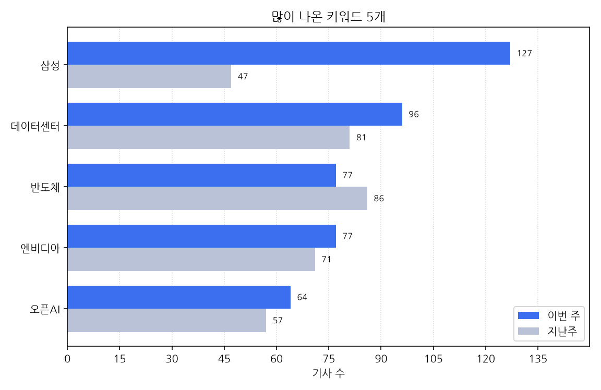

# 주간 AI 뉴스 리포트

대상 기간은 한국 시간으로 2026-10-26 월요일부터 2026-11-01 일요일까지다.
이번 주에 AI가 남긴 기사는 1747건, 지난주는 1665건이다. 82건 늘었다.

## 이번 주에 새로 나온 도구

- 10-26 '"SW 취약점 발견 8개서 0개로"…탈레스, AI 분석 차단 기능 출시' 소식이 한 곳에서 나왔다 (대표 링크 https://zdnet.co.kr/view/?no=20261026174513)
- 10-26 '"딱 필요한 기억만 조회"…ETRI, AI 에이전트 새 모델 개발' 소식이 한 곳에서 나왔다 (대표 링크 https://zdnet.co.kr/view/?no=20261026113727)
- 10-26 '"실내 온도 낮춰줘"…GM, 음성으로 제어하는 '온스타 AI' 공개' 소식이 한 곳에서 나왔다 (대표 링크 https://www.edaily.co.kr/News/Read?newsId=02145126645616856&mediaCodeNo=257)
- 10-26 'F1 레드불·세일GP, OCI로 레이스 전략 짠다…경기 운영 전반에 AI 적용' 소식이 한 곳에서 나왔다 (대표 링크 https://www.ddaily.co.kr/page/view/2026102612585562380)
- 10-26 'GM, 캐딜락 리릭부터 온스타 AI 도입…2027년 신규 앱 출시' 소식을 2개 매체가 다뤘다 (기사 2건, 대표 링크 https://biz.heraldcorp.com/article/10914187)
- 10-26 'KG스틸, 철강 생산·물류에 AI 도입…인하대와 인천공장 실증' 소식을 2개 매체가 다뤘다 (기사 2건, 대표 링크 https://biz.heraldcorp.com/article/10914465)
- 10-26 'LG전자, AI·서랍형 냉동고 기능 '디오스 AI 스템 얼음정수 냉장고' 출시' 소식을 2개 매체가 다뤘다 (기사 2건, 대표 링크 https://zdnet.co.kr/view/?no=20261026091513)
- 10-26 'SKT, 'AI 거버넌스 리포트' 첫 발간…AI 신뢰 경영 강화' 소식을 3개 매체가 다뤘다 (기사 3건, 대표 링크 https://biz.heraldcorp.com/article/10914219)
- 10-26 '與 최민희, 오세훈 무죄에 "AI 판사 도입해야' 소식을 2개 매체가 다뤘다 (기사 2건, 대표 링크 https://www.segye.com/newsView/20261026511851)
- 10-26 '디노도 "기업, AI 데이터 레이어 도입 시 운영비 68% 절감 효과' 소식이 한 곳에서 나왔다 (대표 링크 https://biz.chosun.com/it-science/ict/2026/10/26/UF3IQ7EDTFEVHG6MZTLY7E4GQM/)
- 10-26 '셀렉트스타, AI 모델 자동 선택 기술 공개…비용 28% 절감' 소식이 한 곳에서 나왔다 (대표 링크 https://zdnet.co.kr/view/?no=20261026165942)
- 10-26 '앤트로픽도 AI '클로드 듀엣' 공개' 소식이 한 곳에서 나왔다 (대표 링크 https://www.koreatimes.com/article/11629179)
- 10-26 '에스엘즈, 건설 AI 솔루션 'Build AR 2.0' 조달청 혁신제품 지정' 소식이 한 곳에서 나왔다 (대표 링크 https://www.edaily.co.kr/News/Read?newsId=02564966645616856&mediaCodeNo=257)
- 10-26 '오세훈 무죄에 與 '조희대 사법부' 총공세… 대법원 엄정 심리·AI 판사 도입 촉구까지-정치ㅣ한국일보' 소식이 한 곳에서 나왔다 (대표 링크 https://www.hankookilbo.com/news/article/A2026102615420005161)
- 10-26 '오케스트로 "GPU는 확보했는데 AI는 왜 느릴까"… 추론 최적화 전략 공개' 소식이 한 곳에서 나왔다 (대표 링크 https://www.seoul.co.kr/news/economy/2026/10/26/20261026500282)
- 10-26 '우리엔, 동물병원용 전자차트 생성형 AI 통합 '위보이스 2.0' 출시' 소식이 한 곳에서 나왔다 (대표 링크 https://www.edaily.co.kr/News/Read?newsId=04063926645616856&mediaCodeNo=257)
- 10-26 '이준석 "與의 AI판사 도입, 제미나이 쓰면 李대통령 유죄 확정' 소식이 한 곳에서 나왔다 (대표 링크 https://www.munhwa.com/article/11626308)
- 10-26 '인천시 농업기술센터, 과수원 무인 자율주행 방제기 도입…농작업 안전성 강화: 연합시민의소리' 소식을 2개 매체가 다뤘다 (기사 2건, 대표 링크 https://cunews.net/detail.php?number=173290&thread=22r12r03%20style=)
- 10-26 '제논, AI 보안 솔루션 '젠가드' 출시 外' 소식이 한 곳에서 나왔다 (대표 링크 https://zdnet.co.kr/view/?no=20261026171138)
- 10-26 '폐쇄망에서도 AI로 테스트 설계…플래티어 '엑스젠 TMS' 출시' 소식이 한 곳에서 나왔다 (대표 링크 https://www.ddaily.co.kr/page/view/2026102609444618145)
- 10-26 '허드슨에이아이, 스튜디오급 더빙 '현지화 AI 에이전트' 공개…QC 비용 90% 절감' 소식이 한 곳에서 나왔다 (대표 링크 https://www.edaily.co.kr/News/Read?newsId=02023766645616856&mediaCodeNo=257)
- 10-26 셀렉트스타, 디시전 AI '다비'공개…글로벌 모델'제브' 제쳤다고 2개 매체가 전했다 (기사 2건, 대표 링크 https://www.edaily.co.kr/News/Read?newsId=02007366645616856&mediaCodeNo=257)
- 10-27 '"500개 AI 골라서 쓰면 비용 25%↓"…KT, AI 통합 플랫폼 '토큰팩토리' 공개' 소식이 한 곳에서 나왔다 (대표 링크 https://www.edaily.co.kr/News/Read?newsId=03653926645617184&mediaCodeNo=257)
- 10-27 '"AI가 청구서 읽고 회계 입력까지"…오픈AI, 가격 절반 낮춘 'GPT-6.1 테라' 공개' 소식이 한 곳에서 나왔다 (대표 링크 https://biz.heraldcorp.com/article/10915727)
- 10-27 '"내 피부에 딱 맞춘 스킨케어"… 피엠인터내셔널코리아, 인공지능 진단 'Ai 스캐너' 전격 선보여' 소식이 한 곳에서 나왔다 (대표 링크 https://news.mtn.co.kr/article/2026102713500739100)
- 10-27 '"화면 커지고 AI 4.5배 빨라졌다"…애플, 신형 아이패드 미니 공개' 소식이 한 곳에서 나왔다 (대표 링크 https://biz.heraldcorp.com/article/10915464)
- 10-27 'AI가 결제할 때 신원·권한 검증…헥토파이낸셜, 기술 도입 추진' 소식이 한 곳에서 나왔다 (대표 링크 https://zdnet.co.kr/view/?no=20261027112934)
- 10-27 'AI로 뚝딱 만든 PPT, 수정은 한참…캔바가 내놓은 해법은' 소식이 한 곳에서 나왔다 (대표 링크 https://zdnet.co.kr/view/?no=20261027125415)
- 10-27 'AWS, 파이토치 AI 코드 그대로 돌린다⋯'토치뉴런' 공개' 소식이 한 곳에서 나왔다 (대표 링크 http://inews24.com/view/2019326)
- 10-27 'KT, 500개 AI모델이 최적의 답 제시하는 '토큰 팩토리' 공개…독자 AI 생태계 시동' 소식이 한 곳에서 나왔다 (대표 링크 https://www.etnews.com/20261027000311)
- 10-27 'KT, AI 500개 골라 쓰는 플랫폼 만든다…비용 최대 25% 절감' 소식을 2개 매체가 다뤘다 (기사 2건, 대표 링크 https://www.newspim.com/news/view/20261027000317)
- 10-27 'KT, AI 모델 통합·관리 플랫폼 '토큰팩토리' 출시' 소식을 5개 매체가 다뤘다 (기사 5건, 대표 링크 https://biz.heraldcorp.com/article/10915802)
- 10-27 'KTcs, 다이소 고객센터에 AI 상담 도입…"반복 문의 빠르게 안내' 소식이 한 곳에서 나왔다 (대표 링크 https://www.ddaily.co.kr/page/view/2026102709454352701)
- 10-27 'LG CNS, 준법경영 국제표준 인증 확보…AI·클라우드 사업 전반 적용' 소식을 2개 매체가 다뤘다 (기사 2건, 대표 링크 https://biz.heraldcorp.com/article/10915558)
- 10-27 '與, 오세훈 무죄 반발..."AI판사 도입하자' 소식이 한 곳에서 나왔다 (대표 링크 https://www.fnnews.com/news/202610271203427405)
- 10-27 '경남교육청, 직원들이 직접 개발한 AI 업무 자동화 프로그램 16개 공개' 소식이 한 곳에서 나왔다 (대표 링크 http://www.knnews.co.kr/news/articleView.php?idxno=1553735)
- 10-27 '경북도·퓨리오사AI, 국산 AI반도체 실증 협력…제조·로봇 적용 추진' 소식이 한 곳에서 나왔다 (대표 링크 https://www.edaily.co.kr/News/Read?newsId=03391526645617184&mediaCodeNo=257)
- 10-27 '고치 랩스, 소비자 AI 전략 담은 백서 공개…건강·쇼핑·생산성으로 확장' 소식이 한 곳에서 나왔다 (대표 링크 https://isplus.com/article/view/isp202610270119)
- 10-27 '깃허브 행사 직전 '맞불'…엔타이어, AI 개발 플랫폼 출시' 소식이 한 곳에서 나왔다 (대표 링크 https://zdnet.co.kr/view/?no=20261025170814)
- 10-27 '노용석 중기부 차관, 제주 AI 도입 현장 점검' 소식이 한 곳에서 나왔다 (대표 링크 https://zdnet.co.kr/view/?no=20261027160636)
- 10-27 '딜, 글로벌 인력 운영 특화 LLM '판게아'공개…AI 연구소'에멧' 신설' 소식이 한 곳에서 나왔다 (대표 링크 https://zdnet.co.kr/view/?no=20261027091113)
- 10-27 '롯데이노베이트 칼리버스, 롯데백화점 시시호시에 AI 선물 추천 기능 도입' 소식을 3개 매체가 다뤘다 (기사 3건, 대표 링크 https://www.edaily.co.kr/News/Read?newsId=02856886645617184&mediaCodeNo=257)
- 10-27 '수자원공사, 베트남에 제2호 AI 정수장 기술 수출…하노이 송둥정수장 도입' 소식이 한 곳에서 나왔다 (대표 링크 https://zdnet.co.kr/view/?no=20261027112832)
- 10-27 '시실리아 오라클 CEO "AI는 곧 비즈니스"…에이전트 런타임 `퓨전 클로` 공개' 소식이 한 곳에서 나왔다 (대표 링크 https://www.ddaily.co.kr/page/view/2026102703443289653)
- 10-27 '애플 iOS 27.2 출시…시리AI 한국어 지원·아이폰 듀오 애플 펜슬 호환' 소식이 한 곳에서 나왔다 (대표 링크 https://zdnet.co.kr/view/?no=20261027090306)
- 10-27 '애플, `시리 AI` 한국어 출시…맥·워치 등 전방위 27.2 업데이트 단행' 소식을 2개 매체가 다뤘다 (기사 2건, 대표 링크 https://www.ddaily.co.kr/page/view/2026102708471565744)
- 10-27 '애플, 한국어 '시리 AI' 출시…메시지 찾고 일정 등록' 소식이 한 곳에서 나왔다 (대표 링크 https://zdnet.co.kr/view/?no=20261027174711)
- 10-27 '앤트로픽 증권신고서 공개…상반기 매출 폭증에도 '순손실' 이유는' 소식이 한 곳에서 나왔다 (대표 링크 https://www.ddaily.co.kr/page/view/2026102713490893664)
- 10-27 '오라클, 아이스버그 지원 AI 레이크하우스 공개' 소식이 한 곳에서 나왔다 (대표 링크 https://www.ddaily.co.kr/page/view/2026102709445813314)
- 10-27 '오픈AI, API 가격 50% 낮춘 'GPT-6.1 테라' 공개' 소식을 4개 매체가 다뤘다 (기사 4건, 대표 링크 https://www.etoday.co.kr/news/view/2640439)
- 10-27 '오픈AI, 비용 효율 높인 'GPT-6.1 테라' 공개…시각·조작 강화' 소식이 한 곳에서 나왔다 (대표 링크 https://www.etnews.com/20261027000006)
- 10-27 '와이즈버즈, 'K-커머스 익스팬션 서밋'서 틱톡샵 성장 전략·AI 솔루션 공개' 소식이 한 곳에서 나왔다 (대표 링크 https://isplus.com/article/view/isp202610270091)
- 10-27 '유니티, '유니티 CLI' 누적 데이터 공개…실행 98%가 AI·자동화' 소식이 한 곳에서 나왔다 (대표 링크 https://zdnet.co.kr/view/?no=20261027171509)
- 10-27 '인천시 농업기술센터, 과수원 무인 자율주행 방제기 도입…농작업 안전성 강화: 연합시민의소리' 소식이 한 곳에서 나왔다 (대표 링크 https://cunews.net/detail.php?number=173290&thread=22r12r03)
- 10-27 '지멘스 "AI 도입 성과 높이려면 인프라·거버넌스가 먼저' 소식이 한 곳에서 나왔다 (대표 링크 https://zdnet.co.kr/view/?no=20261027095112)
- 10-27 '카페24, 'AI 리포트' 출시…"AI가 쇼핑몰 성과 분석·개선 방향 제시' 소식이 한 곳에서 나왔다 (대표 링크 https://biz.heraldcorp.com/article/10915777)
- 10-27 '카페24, 쇼핑몰 데이터 AI가 분석…문제 진단·개선안까지 리포트로' 소식을 2개 매체가 다뤘다 (기사 2건, 대표 링크 https://www.edaily.co.kr/News/Read?newsId=02873286645617184&mediaCodeNo=257)
- 10-27 '쿤텍, AI 전주기 대응 통합 보안 전략 공개' 소식이 한 곳에서 나왔다 (대표 링크 https://zdnet.co.kr/view/?no=20261027165145)
- 10-27 '크래프톤 렐루게임즈, '미메시스' 대규모 업데이트…AI 몬스터 강화' 소식이 한 곳에서 나왔다 (대표 링크 http://inews24.com/view/2019475)
- 10-27 '통신 넘어 AI 사용량 과금으로…KT, '토큰팩토리' 30일 출시' 소식이 한 곳에서 나왔다 (대표 링크 https://www.etoday.co.kr/news/view/2640606)
- 10-27 '펜타-아우토, 'AI 시대 사이버보안 3원칙' 선언문 공개' 소식이 한 곳에서 나왔다 (대표 링크 https://zdnet.co.kr/view/?no=20261027161730)
- 10-27 '한화세미텍, 中서 고속 칩마운터 공개…AI 서버·전장 시장 공략' 소식이 한 곳에서 나왔다 (대표 링크 https://www.edaily.co.kr/News/Read?newsId=04283686645617184&mediaCodeNo=257)
- 10-27 AI 도입에… 아멕스, 직원 3,500명 감원한다고 한 곳이 전했다 (대표 링크 https://www.koreatimes.com/article/11629256)
- 10-27 GPT-6.1 테라, 깃허브 코파일럿 정식 탑재…반값인데 터미널벤치는 2배 뛰었다고 한 곳이 전했다 (대표 링크 https://www.wikitree.co.kr/articles/1169653)
- 10-28 '"100주 사줘"하면 AI가 주문⋯증권사 AI 연계 API 서비스 출시 잇따라' 소식이 한 곳에서 나왔다 (대표 링크 https://www.etoday.co.kr/news/view/2641223)
- 10-28 '"AI가 내놓은 답, 공사장에서도 통할까?"... 젠스파크가 청년들과 나선 도전' 소식이 한 곳에서 나왔다 (대표 링크 https://www.insight.co.kr/news/579548)
- 10-28 '"재무 안정성 합격점에 기술 경쟁력 확보까지…"네이버 AI팩토리 사업 구조 공개' 소식이 한 곳에서 나왔다 (대표 링크 https://zdnet.co.kr/view/?no=20261028154636)
- 10-28 'DJI, 장애물 정밀 감지 AI 탑재 로봇청소기 `ROMO P2` 출시' 소식이 한 곳에서 나왔다 (대표 링크 https://www.ddaily.co.kr/page/view/2026102813393397661)
- 10-28 'ETRI, 한국어 습득 AI 에이전트 개발…"스마트글래스 탑재 추진' 소식이 한 곳에서 나왔다 (대표 링크 https://zdnet.co.kr/view/?no=20261028105922)
- 10-28 'HCG, HR 에이전트 'elizax' 공개…백승아 CPO "AI 답변-실무 연결' 소식이 한 곳에서 나왔다 (대표 링크 https://zdnet.co.kr/view/?no=20261028150031)
- 10-28 'KB라이프, 에이지테크랩 컨퍼런스 개최…AI·로봇 활용 돌봄 모델 공개' 소식이 한 곳에서 나왔다 (대표 링크 https://www.newspim.com/news/view/20261028000699)
- 10-28 'LS일렉트릭, BIXPO 2026서 HVDC·AI 데이터센터 전력 솔루션 공개' 소식이 한 곳에서 나왔다 (대표 링크 https://www.insight.co.kr/news/579495)
- 10-28 '밸류엑스, 중견기업용 폐쇄망 AI 인프라 출시…데이터 외부 전송 최소화' 소식이 한 곳에서 나왔다 (대표 링크 https://zdnet.co.kr/view/?no=20261028161655)
- 10-28 '서부발전, 국산 가스터빈에 AI·로봇 도입…공공기관 AI 혁신 대상' 소식이 한 곳에서 나왔다 (대표 링크 https://www.newspim.com/news/view/20261028001547)
- 10-28 '애플, AI 성능 25% 높인 M6 맥북 공개…배터리 최대 24시간-경제ㅣ한국일보' 소식이 한 곳에서 나왔다 (대표 링크 https://www.hankookilbo.com/news/article/A2026102808440002501)
- 10-28 '애플, M6 탑재 맥북 프로 공개…"AI·그래픽 작업 더 빠르게' 소식이 한 곳에서 나왔다 (기사 2건, 대표 링크 http://inews24.com/view/2019652)
- 10-28 '애플, M6 탑재한 신형 맥북프로·아이맥 공개… 온디바이스 AI 성능 강화' 소식이 한 곳에서 나왔다 (대표 링크 https://biz.chosun.com/it-science/ict/2026/10/28/A6ZYTOZ57ZEYVEJUKJSLUA3OZY/)
- 10-28 '애플, M6칩 탑재로 AI성능 높인 신형 맥북프로·아이맥 공개' 소식이 한 곳에서 나왔다 (대표 링크 https://www.koreatimes.com/article/11629323)
- 10-28 '오픈AI, 국내 기업과 AI 실무 해법 찾는다…'빌더 부트캠프' 개최' 소식을 4개 매체가 다뤘다 (기사 4건, 대표 링크 https://www.edaily.co.kr/News/Read?newsId=03060246645617512&mediaCodeNo=257)
- 10-28 '원프레딕트, 대구 제조설비에 AI 적용…고장 예측·공정 개선 추진' 소식이 한 곳에서 나왔다 (대표 링크 https://zdnet.co.kr/view/?no=20261028174818)
- 10-28 '원프레딕트, 대구 제조현장에 AI 예지보전 적용' 소식이 한 곳에서 나왔다 (대표 링크 https://www.edaily.co.kr/News/Read?newsId=04690406645617512&mediaCodeNo=257)
- 10-28 '웹케시, LG 'K-엑사원'으로 금융 AI 에이전트 개발…기업 자금관리 적용' 소식이 한 곳에서 나왔다 (대표 링크 https://zdnet.co.kr/view/?no=20261028115412)
- 10-28 '이지스, 산업AI 엑스포서 신기술 공개' 소식을 2개 매체가 다뤘다 (기사 2건, 대표 링크 https://www.newspim.com/news/view/20261028000482)
- 10-28 '제주관광대 앵커사업단, 첫 AI 직원 '제이·투비' 도입' 소식이 한 곳에서 나왔다 (대표 링크 https://www.seoul.co.kr/news/economy/2026/10/28/20261028500074)
- 10-28 '포항 AI 데이터센터 6000억 '속도전'…지방재정 투자심사 '면제 트랙' 적용' 소식을 2개 매체가 다뤘다 (기사 2건, 대표 링크 https://www.newspim.com/news/view/20261028000475)
- 10-28 '피처링, SNS 마케팅 특화 AI 에이전트 공개' 소식을 2개 매체가 다뤘다 (기사 2건, 대표 링크 https://www.edaily.co.kr/News/Read?newsId=04995446645617512&mediaCodeNo=257)
- 10-28 '해수부, 자율운항선박 '세계 1위' 도전…AI 항만 도입해 생산성 30%↑' 소식이 한 곳에서 나왔다 (대표 링크 https://www.newspim.com/news/view/20261028000339)
- 10-28 '휴머노이드 '아틀라스' 도입에 불안감…'로봇-노동' 갈등 새 과제로 [로봇發 임금 빅뱅]' 소식이 한 곳에서 나왔다 (대표 링크 https://www.etoday.co.kr/news/view/2641086)
- 10-29 '"바코드 없는 빵, AI가 인식·결제"…기산전자, '아이스캔' 출시' 소식이 한 곳에서 나왔다 (대표 링크 https://www.edaily.co.kr/News/Read?newsId=05835126645617840&mediaCodeNo=257)
- 10-29 '"월 40달러에 AI 직원 12명"…한컴, '노마디안' 내년 3월 글로벌 출시' 소식을 2개 매체가 다뤘다 (기사 2건, 대표 링크 https://news.mtn.co.kr/article/2026102910315172996)
- 10-29 'MS 나델라 "AI 신기술 과시보다 실무 적용"…기업용 AI 에이전트 확산' 소식이 한 곳에서 나왔다 (대표 링크 https://www.edaily.co.kr/News/Read?newsId=02965126645617840&mediaCodeNo=257)
- 10-29 'SK AX, AI 기반 채용 솔루션 출시…1800명 평가 6시간 만에' 소식을 2개 매체가 다뤘다 (기사 2건, 대표 링크 https://biz.heraldcorp.com/article/10918338)
- 10-29 '개발자 40%가 AI 초안 쓴다…깃허브, 자율 작업 '코파일럿 프로젝트' 공개-경제ㅣ한국일보' 소식이 한 곳에서 나왔다 (대표 링크 https://www.hankookilbo.com/news/article/A2026102901040000971)
- 10-29 '광진구, 공중화장실 인공지능(AI) 불법촬영탐지시스템 도입… 24시간 상시 감지' 소식이 한 곳에서 나왔다 (대표 링크 https://biz.heraldcorp.com/article/10919734)
- 10-29 '구글, 보안 역량 강화한 '제미나이 4 카본' 공개' 소식이 한 곳에서 나왔다 (대표 링크 https://biz.chosun.com/it-science/ict/2026/10/29/VVY2VDWZRJCJ7N74TWW5XYWMVA/)
- 10-29 '깃허브, AI조율 코파일럿퓨전 공개…개발 패러다임 대전환(종합)' 소식이 한 곳에서 나왔다 (대표 링크 https://www.koreatimes.com/article/11629507)
- 10-29 '미리디 미리캔버스, 챗GPT 연동 디자인 솔루션 'AI 커넥터' 선보여' 소식이 한 곳에서 나왔다 (대표 링크 https://zdnet.co.kr/view/?no=20261029111606)
- 10-29 '삼성SDS "패브릭스 2.0 이번 주 출시…기업 AI 한곳서 관리' 소식이 한 곳에서 나왔다 (대표 링크 https://zdnet.co.kr/view/?no=20261029145947)
- 10-29 '샤오펑, 휴머노이드 배터리 생산 착수…전고체 탑재 여부는 물음표' 소식이 한 곳에서 나왔다 (대표 링크 https://zdnet.co.kr/view/?no=20261029092130)
- 10-29 '엔비디아, 40개언어 음성인식AI 오픈웨이트로 공개[글로벌AI브리핑]' 소식이 한 곳에서 나왔다 (대표 링크 https://www.fnnews.com/news/202610290826150279)
- 10-29 '오 시장의 무죄에 여당 "AI 판사 도입"… AI 의원은 어떨까요' 소식이 한 곳에서 나왔다 (대표 링크 https://www.koreatimes.com/article/11629559)
- 10-29 '인재 채용도 AI로…SK AX, 지원자 역량 분석하는 `지핏 스튜디오` 출시' 소식이 한 곳에서 나왔다 (대표 링크 https://www.ddaily.co.kr/page/view/2026102912042339448)
- 10-29 '중기부, 2030년까지 제조 中企 6000곳에 AI 도입…5조원 이상 투입' 소식을 2개 매체가 다뤘다 (기사 2건, 대표 링크 https://biz.chosun.com/industry/business-venture/2026/10/29/ZUK2ASA7HVAKLFFD62DKMZQYQU/)
- 10-29 '중기부, AI 도입 중소제조업체 1%에서 10%로 늘리기로' 소식이 한 곳에서 나왔다 (대표 링크 https://www.busan.com/view/busan/view.php?code=2026102913360923663)
- 10-29 '카카오, '카나나' 임베딩 모델 공개…개인화 AI 에이전트 개발 활용 가능' 소식이 한 곳에서 나왔다 (대표 링크 https://zdnet.co.kr/view/?no=20261029100156)
- 10-29 '카카오, 한국어 특화 AI 검색 모델 2종 공개…"글로벌 모델보다 성능 우수' 소식을 2개 매체가 다뤘다 (기사 2건, 대표 링크 https://biz.heraldcorp.com/article/10919059)
- 10-29 '코딩 맡겼더니 가성비 모델 선택까지… 깃허브 '코파일럿 퓨전' 선보여' 소식이 한 곳에서 나왔다 (대표 링크 https://www.ddaily.co.kr/page/view/2026102819451470908)
- 10-29 '한총리 "중소제조 3만곳 디지털 전환…6000곳에 AI 도입' 소식이 한 곳에서 나왔다 (대표 링크 https://www.etoday.co.kr/news/view/2641790)
- 10-29 '한컴, AI 워크포스 '노마디안' 12월 美 베타 출시...김연수 "글로벌 안착 속도' 소식이 한 곳에서 나왔다 (대표 링크 https://www.newsway.co.kr/news/view?ud=2026102913402140697)
- 10-29 AI에 쓴 돈, 성과는?…앤트로픽, 도입 효과 한눈에 보여준다고 한 곳이 전했다 (대표 링크 https://zdnet.co.kr/view/?no=20261029141248)
- 10-29 KT에스테이트, 춘천에 AI 주거단지 '남춘천 센트레빌' 선보인다고 한 곳이 전했다 (대표 링크 https://biz.heraldcorp.com/article/10919281)
- 10-30 '"포크송을 댄스곡으로"…스포티파이, AI 리믹스 내년 초 출시' 소식이 한 곳에서 나왔다 (대표 링크 https://www.edaily.co.kr/News/Read?newsId=04621526645618168&mediaCodeNo=257)
- 10-30 ''우승 기운 이어간다'GS칼텍스, 챔피언 세리머니로 새 시즌 출발…새 마스코트'스파키' 공개→AI 응원가도' 소식이 한 곳에서 나왔다 (대표 링크 https://www.osen.co.kr/article/G1112900261)
- 10-30 ''주유소 기름값도 척척'…포티투닷, '글레오 AI' 첫 무선 업데이트 단행…"車 AI 이용 경험 고도화' 소식이 한 곳에서 나왔다 (대표 링크 https://biz.heraldcorp.com/article/10920680)
- 10-30 '95g에 담은 대화면…169만원 AI 안경 '아우라' 출시' 소식이 한 곳에서 나왔다 (대표 링크 https://www.edaily.co.kr/News/Read?newsId=05717046645618168&mediaCodeNo=257)
- 10-30 'AI가 상품 분석부터 등록까지…플래티어, 에이전틱 AI 플랫폼 공개' 소식이 한 곳에서 나왔다 (대표 링크 https://www.edaily.co.kr/News/Read?newsId=03726086645618168&mediaCodeNo=257)
- 10-30 'KT, AI 모델 7종 이용료 한 달간 30% 할인…토큰팩토리 출시 기념' 소식이 한 곳에서 나왔다 (대표 링크 https://www.edaily.co.kr/News/Read?newsId=03735926645618168&mediaCodeNo=257)
- 10-30 'LG CNS "금융권 AI 도입 확대…시스템 구축·운영 수요도 증가' 소식이 한 곳에서 나왔다 (대표 링크 https://zdnet.co.kr/view/?no=20261030113340)
- 10-30 '기아 "2028년 초 차세대 차량 출시 예정대로…자율주행 고도화' 소식이 한 곳에서 나왔다 (대표 링크 https://zdnet.co.kr/view/?no=20261030155346)
- 10-30 '기업 AI 비용 문턱 낮춘다…KT, '토큰팩토리' 정식 출시' 소식이 한 곳에서 나왔다 (대표 링크 https://www.ddaily.co.kr/page/view/2026103010394305232)
- 10-30 '삼성전자, 40만원대 '갤럭시 A18' 출시…AI 기능 지원' 소식을 2개 매체가 다뤘다 (기사 2건, 대표 링크 http://www.newstomato.com/ReadNews.aspx?no=1318637)
- 10-30 '서울아산병원 "최고 수준 의료 위한 AI 도입"[병원 AX현장③]' 소식이 한 곳에서 나왔다 (대표 링크 https://www.etoday.co.kr/news/view/2638469)
- 10-30 '엔비디아, 40개 언어 받아쓰는 오픈 음성인식 모델 공개' 소식이 한 곳에서 나왔다 (대표 링크 https://zdnet.co.kr/view/?no=20261030214136)
- 10-30 '영진전문대, 2026 영진 종합작품전 개막…AI·로봇 등 실무형 성과 공개' 소식이 한 곳에서 나왔다 (대표 링크 https://biz.heraldcorp.com/article/10919935)
- 10-30 '위메이드플레이, '애니팡4'에 자체 개발 AI 엔진 탑재' 소식이 한 곳에서 나왔다 (대표 링크 https://www.newspim.com/news/view/20261030001166)
- 10-30 '카카오, 한국어 특화 AI 검색 모델 2종 공개…"글로벌 모델보다 성능 우수' 소식이 한 곳에서 나왔다 (대표 링크 https://www.heraldk.com/article/2026102821060426950)
- 10-30 '현대해상, AI 보험설계 지원 시스템 'Hi-헬퍼' 공개' 소식을 2개 매체가 다뤘다 (기사 2건, 대표 링크 https://biz.heraldcorp.com/article/10920296)
- 10-30 11번가, AI 고객상담 시스템 도입…이커머스 'AI 경쟁' 판 커진다고 한 곳이 전했다 (대표 링크 https://biz.heraldcorp.com/article/10920101)
- 10-31 'Arrowmax, 나사 찍으면 맞는 비트 알려주는 AI 전동 드라이버 79달러에 선보여' 소식이 한 곳에서 나왔다 (대표 링크 https://www.wikitree.co.kr/articles/1170663)
- 10-31 'GM, 2028년 고속도로 자율주행 도입…SUV·픽업트럭까지 확대' 소식이 한 곳에서 나왔다 (대표 링크 https://www.newspim.com/news/view/20261023000279)
- 10-31 '팔란티어 ① JP모간 "AI 도입의 해에서 수익의 해로' 소식이 한 곳에서 나왔다 (대표 링크 https://www.newspim.com/news/view/20261031000001)
- 11-01 '"여러 임무를 동시에 척척"…딥시크 '슈퍼 에이전트' 발표' 소식을 2개 매체가 다뤘다 (기사 2건, 대표 링크 https://www.edaily.co.kr/News/Read?newsId=03076646645641456&mediaCodeNo=257)
- 11-01 '中, 펑윈 위성 활용한 '극단 기상' 예보 AI 모델 공개 -Xinhua' 소식이 한 곳에서 나왔다 (대표 링크 http://kr.xinhuanet.com/20261101/fe30ae9ddebc44fc80dd0206d3e94df1/c.html)
- 11-01 '무차별 인터넷 긁어가기 사라지나…빅테크, AI학습차단 표준도입' 소식이 한 곳에서 나왔다 (대표 링크 https://www.fnnews.com/news/202611011003406775)
- 11-01 '상장 앞둔 앤트로픽 노림수?…"위험한 AI모델 출시금지' 소식이 한 곳에서 나왔다 (대표 링크 http://www.newstomato.com/ReadNews.aspx?no=1318789)
- 11-01 '행안부, 공무원 업무망에 AI 웹검색 도입…12월 한글 보고서 작성 지원' 소식이 한 곳에서 나왔다 (대표 링크 https://zdnet.co.kr/view/?no=20261101130513)
- 11-01 AX 도입 2단계...SKT, 이제 '조직'이 AI로 일한다고 한 곳이 전했다 (대표 링크 https://zdnet.co.kr/view/?no=20261101100313)
- 11-01 RFP도 없이 고객사로 출근…네이버클라우드 FDE, AI 도입 공식 바꾼다고 한 곳이 전했다 (대표 링크 https://www.edaily.co.kr/News/Read?newsId=03073366645641456&mediaCodeNo=257)
- 11-01 챗GPT 공유 링크 열고 버튼 한 번 누르면 공격자 코드 실행…비공개 대화 빼낼 수 있었다고 한 곳이 전했다 (대표 링크 https://www.wikitree.co.kr/articles/1170763)

## 규제와 정책

- 10-26 '"AI가 엘비스 프레슬리 노래 무단학습"…앤트로픽 4천110만 달러 피소' 소식을 3개 매체가 다뤘다 (기사 4건, 대표 링크 http://inews24.com/view/2018727)
- 10-26 ''모두의 AI' 새 이름 국민이 짓는다…과기정통부, 브랜드명 공모' 소식을 4개 매체가 다뤘다 (기사 4건, 대표 링크 https://www.edaily.co.kr/News/Read?newsId=02604326645616856&mediaCodeNo=257)
- 10-26 'AI 주권 경쟁에 높아진 규제장벽...SKT, 국제 공동검증 강조' 소식이 한 곳에서 나왔다 (대표 링크 https://zdnet.co.kr/view/?no=20261026114538)
- 10-26 '韓 AI 전파감시 기술, 국제 지침에 반영…표준화 영향력 확대' 소식이 한 곳에서 나왔다 (대표 링크 https://www.ddaily.co.kr/page/view/2026102609180010498)
- 10-26 '국제 전파감시 지침에 韓 AI기술 반영, 16년 만에 전면 개정' 소식이 한 곳에서 나왔다 (대표 링크 https://zdnet.co.kr/view/?no=20261026091622)
- 10-26 '금감원 "AI 보안 역량 갖춘 금융사, 망분리 전면 해제 검토' 소식이 한 곳에서 나왔다 (대표 링크 https://www.newsway.co.kr/news/view?ud=2026102614034161631)
- 10-26 '스웨덴 정부, 챗GPT·클로드 막고 코파일럿은 허용…이유는' 소식이 한 곳에서 나왔다 (대표 링크 https://zdnet.co.kr/view/?no=20261026164813)
- 10-26 '임문영 의원, 여야 35인과 '국회 AI 미래전환' 출범…산업AX·사회격차 해소 입법 추진' 소식이 한 곳에서 나왔다 (대표 링크 https://zdnet.co.kr/view/?no=20261026162009)
- 10-26 '전주시, AI전략국 신설 등 조직개편 추진…입법예고 돌입' 소식이 한 곳에서 나왔다 (대표 링크 http://inews24.com/view/2019101)
- 10-26 '하정우 부위원장 "AI 대전환 성패는 지역이 좌우"…'국회 AI 미래전환' 출범' 소식이 한 곳에서 나왔다 (대표 링크 https://www.etnews.com/20261026000303)
- 10-26 정부, 내년 예산 44.2조 지출효율화…AI로 중복·낭비 찾는다고 한 곳이 전했다 (대표 링크 https://www.newspim.com/news/view/20261026000652)
- 10-27 "AI 자금조달, 닷컴·금융위기와 닮았지만 다르다고 한 곳이 전했다 (대표 링크 https://www.edaily.co.kr/News/Read?newsId=04723206645617184&mediaCodeNo=257)
- 10-27 '10명 중 6명 AI로 대학교 과제…학생들 "인공지능 활용 지침 필요' 소식이 한 곳에서 나왔다 (대표 링크 https://www.hani.co.kr/arti/society/schooling/1284371.html)
- 10-27 'AI 음악도 저작권료 받나⋯음저협 "밝히면 등록, 숨기면 제재' 소식이 한 곳에서 나왔다 (대표 링크 https://www.etoday.co.kr/news/view/2640675)
- 10-27 'KT, AI 500개 유통은 시작…승부처는 '토큰 생산' 소식을 2개 매체가 다뤘다 (기사 2건, 대표 링크 https://www.newspim.com/news/view/20261027000699)
- 10-27 '공무원 보고 단계 줄이고 AI로 성과관리…인사처, 업무 혁신 지침 첫 발간' 소식이 한 곳에서 나왔다 (대표 링크 https://www.newspim.com/news/view/20261027000698)
- 10-27 '국산 AI 기술과 세계 시장 연결하는 정부' 소식이 한 곳에서 나왔다 (대표 링크 https://seoul.co.kr/news/editOpinion/opinion/contribution/2026/10/27/20261027025002)
- 10-27 '김원기 의정부시장, 중국 린이·위해시 방문…바이오·AI 기업 투자협력 추진' 소식이 한 곳에서 나왔다 (대표 링크 https://womannews.net/detail.php?number=457983&thread=22r12r01%20style=)
- 10-27 '김재원 "AI 음악, 사람이 창작 주체였느냐가 핵심"…신탁·저작권료 분배 기준 논의' 소식이 한 곳에서 나왔다 (대표 링크 https://www.newspim.com/news/view/20261027001159)
- 10-27 '세종시 2027년 국비 건의…양성자 암치료센터·AI정부 생태계 추진' 소식이 한 곳에서 나왔다 (대표 링크 https://www.nspna.com/country/?mode=view&newsid=833479)
- 10-27 '스웨덴 정부청사, 챗GPT·클로드 접속 막고 코파일럿 안내…갈린 기준은 모델 아닌 계약' 소식이 한 곳에서 나왔다 (대표 링크 https://www.wikitree.co.kr/articles/1169337)
- 10-27 '앤트로픽 창업자 7명, 상장 후에도 의결권 50.1% 행사…후계자 최대 10명 지정' 소식이 한 곳에서 나왔다 (대표 링크 https://biz.chosun.com/it-science/ict/2026/10/27/6K4S3NWKSFH47FSRBL4CYZAUK4/)
- 10-27 '앤트로픽 창업자 7명, 상장해도 의결권 50.1% 장악' 소식을 3개 매체가 다뤘다 (기사 3건, 대표 링크 https://biz.heraldcorp.com/article/10915862)
- 10-27 '앤트로픽 클로드, 美정부 유료데이터 무단 접근[글로벌AI브리핑]' 소식이 한 곳에서 나왔다 (대표 링크 https://www.fnnews.com/news/202610270803183301)
- 10-27 '정부 정책 평가·피지컬 AI 기획 '인상적'…"용어 풀어쓰고 AI 사용 책임 가져야' 소식이 한 곳에서 나왔다 (대표 링크 https://zdnet.co.kr/view/?no=20261027144106)
- 10-27 '해커는 AI 업고 훨훨 나는데... 여전히 더딘 정부·기업 대응-오피니언ㅣ한국일보' 소식이 한 곳에서 나왔다 (대표 링크 https://www.hankookilbo.com/news/article/A2026102615010002413)
- 10-27 AI를 둘러싼 규제를 생각해 본다고 한 곳이 전했다 (대표 링크 https://zdnet.co.kr/view/?no=20261027151715)
- 10-27 딥페이크부터 보이스피싱·해킹까지…정부, AI 범죄 대응체계 만든다고 한 곳이 전했다 (대표 링크 https://news.knn.co.kr/news/article_sns/1851)
- 10-28 '과기정통부 "AI 인프라·모델·활용 경쟁력 강화로 3강 도약' 소식이 한 곳에서 나왔다 (대표 링크 https://www.etnews.com/20261028000031)
- 10-28 '교수·교재·학비 없이 AI 배운다…과기정통부, 대전에 인재양성 거점 개소' 소식이 한 곳에서 나왔다 (대표 링크 https://zdnet.co.kr/view/?no=20261028123314)
- 10-28 '국방AI법안의 현안과 과제-오피니언ㅣ한국일보' 소식이 한 곳에서 나왔다 (대표 링크 https://www.hankookilbo.com/news/article/A2026102614280001791)
- 10-28 '미 하원, AI '증류 공격'대응 법안 발의…북한'우려국' 명시' 소식이 한 곳에서 나왔다 (대표 링크 https://www.voakorea.com/a/us-ai-cyber-defense-act-102726/8215710.html)
- 10-28 '민주당 AI금융·경제추진단, 청년 기본자산 플랜 국회 토론회 진행' 소식이 한 곳에서 나왔다 (대표 링크 https://www.nspna.com/report/?mode=view&newsid=833541)
- 10-28 '바이오 강국, 다음 승부처는 AI·공급망…BIX 2026 개막' 소식을 2개 매체가 다뤘다 (기사 2건, 대표 링크 https://www.ddaily.co.kr/page/view/2026102811155748442)
- 10-28 '법무법인 대륙아주·린, 딜로이트 안진과 AI 규제 대응 업무협약' 소식이 한 곳에서 나왔다 (대표 링크 https://biz.chosun.com/topics/law_firm/2026/10/28/KRSH4BSXRBAGXKZDGNFPTC7SBA/)
- 10-28 '앤트로픽 창업자 7명 상장후 의결권 50.1%' 소식이 한 곳에서 나왔다 (대표 링크 https://www.koreatimes.com/article/11629378)
- 10-28 '앤트로픽도 차등의결권, 美혁신의 토대' 소식이 한 곳에서 나왔다 (대표 링크 https://www.mt.co.kr/opinion/2026/10/28/2026102714360441195)
- 10-28 '이트라이브·코리아리서치 공동 개발 AI 리서치 플랫폼 '앵커패널', 과기정통부 장관상 수상' 소식이 한 곳에서 나왔다 (대표 링크 https://biz.heraldcorp.com/article/10917763)
- 10-28 '인재 키우고 공공현장에 AI 심는다…정부, '국민 체감 AX' 확산' 소식이 한 곳에서 나왔다 (대표 링크 https://www.ddaily.co.kr/page/view/2026102809172002312)
- 10-28 '전 금융권 덮친 AI 해킹, 북한 IP 다수 확인… 청와대, 금융위와 긴급 회의-경제ㅣ한국일보' 소식이 한 곳에서 나왔다 (대표 링크 https://www.hankookilbo.com/news/article/A2026102816490002132)
- 10-28 '해남군, 'RE100 산업생태계 규제혁신' 맞손… 솔라시도 AI데이터센터 탄력' 소식이 한 곳에서 나왔다 (대표 링크 http://inews24.com/view/2019915)
- 10-29 '"개인정보 활용부터 재난 예방까지"…정부, AI 기반 디지털 행정 혁신 속도' 소식이 한 곳에서 나왔다 (대표 링크 https://zdnet.co.kr/view/?no=20261029174206)
- 10-29 '"테슬라에 속았다" 소송낸 차주들…법원 "FSD는 완전자율주행 의미 아냐"[세상&]' 소식이 한 곳에서 나왔다 (대표 링크 https://biz.heraldcorp.com/article/10919084)
- 10-29 ''AI 성지' 삼킨 엔비디아…미국 정부는 왜 분노했을까' 소식이 한 곳에서 나왔다 (대표 링크 https://zdnet.co.kr/view/?no=20261029140039)
- 10-29 ''모두의 AI' 어떻게 확산할까…11월 5일 국회서 AI 전략 논의' 소식이 한 곳에서 나왔다 (대표 링크 https://www.edaily.co.kr/News/Read?newsId=03778566645617840&mediaCodeNo=257)
- 10-29 'AI 시대 '원전 규제' 4대 혁신 급하다[포럼]' 소식이 한 곳에서 나왔다 (대표 링크 https://www.munhwa.com/article/11627230)
- 10-29 'BTS·싸이 노래 무단학습한 수노, 美서 소송당해…대중문화계 AI 무단학습 논란' 소식이 한 곳에서 나왔다 (대표 링크 https://www.ddaily.co.kr/page/view/2026102916253763834)
- 10-29 'MS, 코파일럿 구독에 사용량 과금 결합…승부처는 `기업 업무 정착`' 소식이 한 곳에서 나왔다 (대표 링크 https://www.ddaily.co.kr/page/view/2026102908564834845)
- 10-29 '사내용 AI까지 규제?…한경협, AI기본법 19건 손질 건의' 소식이 한 곳에서 나왔다 (대표 링크 https://www.busan.com/view/busan/view.php?code=2026102909405541682)
- 10-29 '수능 'AI 안경' 부정행위 땐 형사고발…응시 제한 1→3년 확대 추진' 소식이 한 곳에서 나왔다 (대표 링크 https://www.hani.co.kr/arti/society/schooling/1284765.html)
- 10-29 '오세훈 2심 무죄…명태균 진술 배척, 특검 위법수집증거 배제' 소식이 한 곳에서 나왔다 (대표 링크 https://www.newspim.com/news/view/20261028000918)
- 10-29 '이억원 금융위원장, 내달 AI 보안 점검…금융권 소집' 소식이 한 곳에서 나왔다 (기사 2건, 대표 링크 https://www.nspna.com/news/?mode=view&newsid=833713)
- 10-29 '정부, 국산 피지컬AI 육성 본격화...우편 현장서 실증' 소식이 한 곳에서 나왔다 (대표 링크 https://zdnet.co.kr/view/?no=20261029100749)
- 10-29 '정부, 중소 제조업 AI 전환에 5조원 투입…6000곳으로 확대' 소식이 한 곳에서 나왔다 (대표 링크 https://biz.heraldcorp.com/article/10918437)
- 10-29 '크리니티, AI정부 시대 공공메일 새 역할 제시…"메일은 AI 정부 데이터 인프라' 소식이 한 곳에서 나왔다 (대표 링크 https://zdnet.co.kr/view/?no=20261029152020)
- 10-29 '테슬라 FSD 구매자들 환불소송 패소…法 "레벨5 완전자율주행 의미 아냐' 소식이 한 곳에서 나왔다 (대표 링크 https://www.newspim.com/news/view/20261029000574)
- 10-29 '피지컬 AI 임금체계 대전환…현대차 노조, '완전월급제' 현장조사 착수 [로봇發 임금 빅뱅]' 소식이 한 곳에서 나왔다 (대표 링크 https://www.etoday.co.kr/news/view/2641085)
- 10-29 '한경협 "사내 업무용 AI 규제 명확히 해야"…19개 개선 건의' 소식이 한 곳에서 나왔다 (대표 링크 https://www.newspim.com/news/view/20261028001569)
- 10-29 '해킹은 'AI 속도전'인데 정부는 '뒷북 보안' 소식이 한 곳에서 나왔다 (대표 링크 https://biz.chosun.com/opinion/journalist/2026/10/27/A4NWOEYQCJFVNNPOQQ7UD4I4EI/)
- 10-29 GPU 몇 개 꽂으면 AI 데이터센터?…정부 '무늬만 AIDC' 막는다고 한 곳이 전했다 (대표 링크 https://www.edaily.co.kr/News/Read?newsId=04828166645617840&mediaCodeNo=257)
- 10-29 피지컬 AI도 '국산 풀스택' 구축…정부, 모델·데이터·로봇 생태계 키운다고 한 곳이 전했다 (대표 링크 https://www.fnnews.com/news/202610291401123073)
- 10-30 '"결정은 사람이, 맥락은 AI가"… 오픈AI, 행동지침 개편' 소식이 한 곳에서 나왔다 (대표 링크 https://zdnet.co.kr/view/?no=20261030094409)
- 10-30 '"몰래 AI 쓴 음원에 205억?"…멜론 2위 '꿈꾸던 어른'은 저작권료 0원' 소식이 한 곳에서 나왔다 (대표 링크 https://www.edaily.co.kr/News/Read?newsId=02338646645618168&mediaCodeNo=257)
- 10-30 '금융위, 공인회계사 인력 수급 안정화 추진…AI 영향·수습난 고려' 소식이 한 곳에서 나왔다 (대표 링크 https://www.newspim.com/news/view/20261030000421)
- 10-30 '복기왕 의원, 스마트도시법 개정안 발의..."AI 특화시범도시 뒷받침' 소식이 한 곳에서 나왔다 (대표 링크 https://www.newspim.com/news/view/20261030000816)
- 10-30 '제도 틈 노려 저작권료 챙기는 '딸깍음원' 급증… AI음악 등록 기준 시급' 소식이 한 곳에서 나왔다 (대표 링크 https://www.edaily.co.kr/News/Read?newsId=02378006645618168&mediaCodeNo=257)
- 10-30 '챗GPT 믿고 복용약 끊었는데 사망…유족들, 소송 제기[아하미국]' 소식이 한 곳에서 나왔다 (대표 링크 https://www.munhwa.com/article/11627448)
- 10-30 '한·독 AI산업 협력 확대…공동 프로젝트·EU 규제 대응' 소식이 한 곳에서 나왔다 (대표 링크 https://www.edaily.co.kr/News/Read?newsId=06333686645618168&mediaCodeNo=257)
- 10-31 '"약 끊고 버텨" 챗GPT 믿고 약 끊었는데…뇌전증女 '사망', 유족은 '소송' 소식이 한 곳에서 나왔다 (기사 2건, 대표 링크 https://biz.heraldcorp.com/article/10920947)
- 10-31 '깃허브 "올해 韓 이용자 350만 명…정부 AI 정책 영향' 소식이 한 곳에서 나왔다 (대표 링크 https://zdnet.co.kr/view/?no=20261030234712)
- 10-31 '루카 베레 ST마이크로 부사장 "피지컬 AI 승부처는 두뇌 아닌 시스템 전체' 소식이 한 곳에서 나왔다 (대표 링크 https://biz.chosun.com/it-science/ict/2026/10/31/2CXYROEBDVBHPFSBOLD6PUW27U/)
- 10-31 '천안·아산·원주 AI 도시 만든다…데이터·전력 규제 푸는 법안 발의' 소식이 한 곳에서 나왔다 (대표 링크 https://www.edaily.co.kr/News/Read?newsId=02000806645618496&mediaCodeNo=257)
- 11-01 '日 APL 찾은 이재용, AI승부처 '첨단 패키징' 챙겼다…소부장 협력 논의' 소식이 한 곳에서 나왔다 (대표 링크 https://www.etnews.com/20261101000090)
- 11-01 '美법원 "스페이스X 데이터센터의 대기오염 의혹소송 계속 진행' 소식을 2개 매체가 다뤘다 (기사 2건, 대표 링크 https://biz.heraldcorp.com/article/10921524)
- 11-01 '국민AI서비스혁신추진단장에 김세웅 전 카카오 부사장' 소식을 4개 매체가 다뤘다 (기사 4건, 대표 링크 https://www.edaily.co.kr/News/Read?newsId=01508806645641456&mediaCodeNo=257)
- 11-01 '이재용, 일본서 찾는 'AI 초격차'…승부처는 첨단 패키징' 소식을 2개 매체가 다뤘다 (기사 2건, 대표 링크 http://inews24.com/view/2021234)

## 많이 나온 키워드

| 키워드 | 이번 주 | 지난주 | 변화 |
| --- | ---: | ---: | ---: |
| 삼성 | 127 | 47 | +80 |
| 데이터센터 | 96 | 81 | +15 |
| 반도체 | 77 | 86 | -9 |
| 엔비디아 | 77 | 71 | +6 |
| 오픈AI | 64 | 57 | +7 |

이번 주에 가장 많이 나온 키워드는 삼성으로 127건이다. 지난주보다 80건 늘었다.

## 차트

## 사람 코멘트

아래 인용 블록은 비워 둔다. 리포트를 읽고 직접 채운다.

>
>

## 한계

GDELT 는 색인해 둔 매체만 훑는다. 국내 매체 가운데 빠진 곳이 있어서, 여기 없는 기사가 실제로 없었다는 뜻은 아니다.
기사는 GDELT 가 15분마다 올리는 원본 파일에서 받는다. 받지 못한 파일이 있으면 그 15분 동안의 기사가 빠진다. AI 소식인지는 제목에 AI 관련어가 있는지로 먼저 고른다.
분류와 묶기는 제목만 보고 한다. 본문을 읽지 않으니 제목이 모호한 기사는 엉뚱한 묶음에 들어가기도 한다.
키워드 건수는 제목에 그 말이 들어갔는지로 센다. 한 기사가 키워드 여러 개에 겹쳐 잡히므로 표의 숫자를 다 더해도 기사 수와 맞지 않는다.
표에 오른 기사 가운데 몇 건은 대표 링크를 눌러 원본 제목과 날짜를 직접 맞춰 본 뒤 코멘트에 적는다.

## 출처

자료는 GDELT 번역 수집 원본 파일(GKG)에서 받았고 하루 경계는 한국 시간으로 끊었다. 한국어 기사 가운데 제목에 AI 관련어가 든 것만 골랐다. 집계한 날짜는 2026-10-26 부터 2026-11-01 까지다. 제목과 링크, 매체, 시각만 들어오기 때문에 본문은 읽지 않고 제목만 보고 골랐다.
