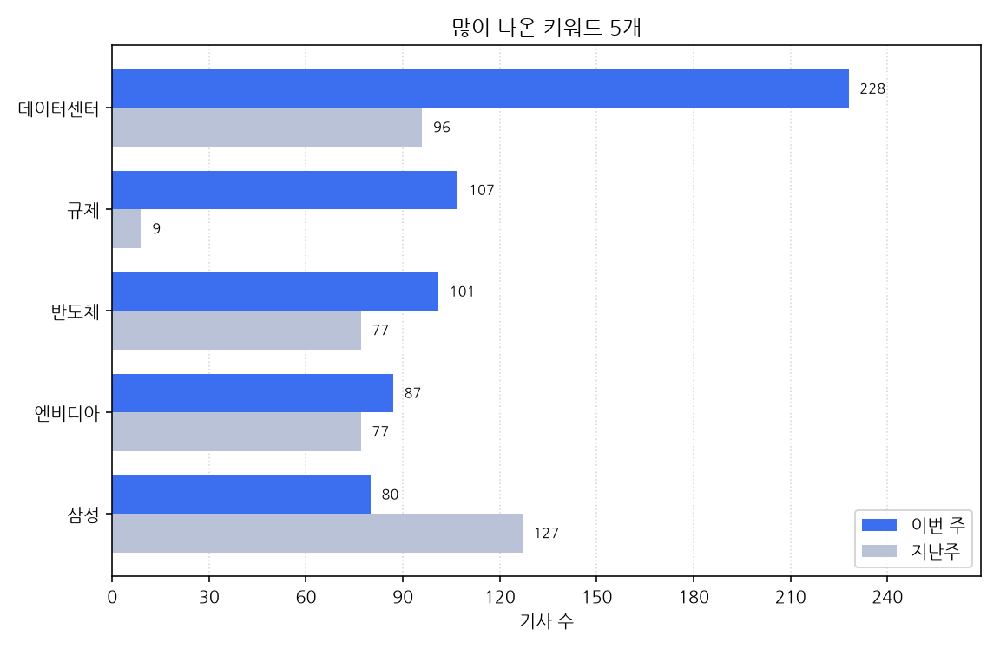

# 주간 AI 뉴스 리포트

대상 기간은 한국 시간으로 2026-11-02 월요일부터 2026-11-08 일요일까지다.
이번 주에 AI가 남긴 기사는 1636건, 지난주는 1747건이다. 111건 줄었다.

## 이번 주에 새로 나온 도구

- 11-02 '"AI 판사 도입 주장을 어떻게 생각해?" 1004명에게 물어봤다, 그랬더니' 소식이 한 곳에서 나왔다 (대표 링크 https://www.wikitree.co.kr/articles/1171089)
- 11-02 '"AI로 그린거 아냐?" 초등생 포스터 공모전서 의혹제기, 수상작 공개 중단' 소식이 한 곳에서 나왔다 (대표 링크 https://www.munhwa.com/article/11627885)
- 11-02 '"中企 71% AI 도입 필요...구체적 실행계획은 17% 뿐' 소식이 한 곳에서 나왔다 (대표 링크 https://www.newspim.com/news/view/20261102001268)
- 11-02 '"통계표 만들어줘" 말하면 AI가 분석…국가데이터처, 내년 정식 서비스' 소식이 한 곳에서 나왔다 (대표 링크 https://biz.heraldcorp.com/article/10922892)
- 11-02 '"호출 없이 대응"…딥시크, 자율형 코딩 에이전트 공개' 소식이 한 곳에서 나왔다 (대표 링크 https://zdnet.co.kr/view/?no=20261102084328)
- 11-02 'OCI, 반도체 소재·AI 전담 조직 띄운다…조직개편·10명 승진' 소식이 한 곳에서 나왔다 (대표 링크 https://zdnet.co.kr/view/?no=20261102093802)
- 11-02 'OCI그룹, 임원인사·조직개편 단행…반도체 소재·AI 역량 강화' 소식이 한 곳에서 나왔다 (대표 링크 https://www.edaily.co.kr/News/Read?newsId=02463286645641784&mediaCodeNo=257)
- 11-02 'PwC컨설팅, 'AI 에이전트 네비게이터' 출시' 소식이 한 곳에서 나왔다 (대표 링크 https://www.edaily.co.kr/News/Read?newsId=03371846645641784&mediaCodeNo=257)
- 11-02 'SK에코플랜트, 직원별 맞춤형 AI 붙인다…'1인 1 에이전트' 도입' 소식이 한 곳에서 나왔다 (대표 링크 https://biz.heraldcorp.com/article/10922369)
- 11-02 '네이버클라우드, 육군 군수사령부와 AI 군수 체계 구축 협약' 소식을 2개 매체가 다뤘다 (기사 2건, 대표 링크 https://www.ddaily.co.kr/page/view/2026110211245757323)
- 11-02 '디어비, AI 캐릭터 교감 플랫폼 '디어비' 출시…창작 생태계 구축' 소식이 한 곳에서 나왔다 (대표 링크 https://zdnet.co.kr/view/?no=20261102185350)
- 11-02 '로보티즈, 휴머노이드 'AI 사피엔스' 출시…범용 모션 데이터 무료 공개' 소식이 한 곳에서 나왔다 (대표 링크 https://zdnet.co.kr/view/?no=20261102152722)
- 11-02 '무차별 인터넷 긁어가기 사라지나…빅테크, AI학습차단 표준도입' 소식이 한 곳에서 나왔다 (대표 링크 https://www.koreatimes.com/article/11629918)
- 11-02 '바코드 없는 빵도 1초 만에 인식…기산전자, AI 결제 솔루션 출시' 소식이 한 곳에서 나왔다 (대표 링크 https://zdnet.co.kr/view/?no=20261102170927)
- 11-02 '삼성 AI 스마트글래스 출시 일정 윤곽…12월 한국·미국서 먼저 판매' 소식이 한 곳에서 나왔다 (대표 링크 https://kbench.com/?q=node/282944)
- 11-02 '생물다양성 세밀화·인공지능 이미지 공모전 수상작 41점 공개' 소식이 한 곳에서 나왔다 (대표 링크 https://biz.heraldcorp.com/article/10922883)
- 11-02 '식음료 제조업, AI 도입 서둘지만…"데이터 활용 역량 부족' 소식이 한 곳에서 나왔다 (대표 링크 https://zdnet.co.kr/view/?no=20261102153408)
- 11-02 '신한투자증권, AI 조건검색 'AI 파인더' 이달 출시' 소식이 한 곳에서 나왔다 (대표 링크 https://www.etoday.co.kr/news/view/2643155)
- 11-02 '아이엘그룹, '로보월드 2026'서 휴머노이드 공연·제조 현장 실증 공개' 소식이 한 곳에서 나왔다 (대표 링크 https://biz.heraldcorp.com/article/10922978)
- 11-02 '애플, 2027년 신형 맥북 프로에 새로운 AI 하드웨어 탑재하나' 소식이 한 곳에서 나왔다 (대표 링크 https://kbench.com/?q=node/282964)
- 11-02 '인천시의회 AI행정혁신연구회, 서울AI재단 방문…시민 체감형 AI 행정 도입 방안 모색: 연합시민의소리' 소식을 2개 매체가 다뤘다 (기사 3건, 대표 링크 https://womannews.net/detail.php?number=458386&thread=22r12r01)
- 11-02 '크래프톤 산하 루도 로보틱스, 로봇용 AI 시스템 '루디 0.2' 공개' 소식이 한 곳에서 나왔다 (대표 링크 https://zdnet.co.kr/view/?no=20261102165842)
- 11-02 '크래프톤, K팝 AI 캐릭터 챗 서비스 '키프' 출시' 소식을 3개 매체가 다뤘다 (기사 3건, 대표 링크 https://www.newspim.com/news/view/20261102001154)
- 11-02 '크래프톤, 로봇용 AI `루디 0.2` 공개…사람 의도·몸짓 인식 강화' 소식을 3개 매체가 다뤘다 (기사 3건, 대표 링크 https://www.ddaily.co.kr/page/view/2026110210565354007)
- 11-02 '통로이미지, AI 창작 플랫폼 '젠트리' 베타 출시' 소식이 한 곳에서 나왔다 (대표 링크 https://zdnet.co.kr/view/?no=20261102154858)
- 11-02 '한국앤컴퍼니그룹, 자체 AI '챗HK 2.1' 공개…업무 혁신 가속' 소식이 한 곳에서 나왔다 (대표 링크 https://www.newspim.com/news/view/20261026000994)
- 11-02 '한국에머슨, '제어부터 예지보전까지' AI 데이터센터 냉각 자동화 기술 공개' 소식이 한 곳에서 나왔다 (대표 링크 https://zdnet.co.kr/view/?no=20261102183826)
- 11-02 '허블, 뉴스 AI 에이전트 '탭뷰 AI' 지스타 2026서 공개' 소식이 한 곳에서 나왔다 (대표 링크 https://zdnet.co.kr/view/?no=20261102163302)
- 11-03 '"게임에서 배운 영어, AI와 다시 대화"…플랭귀지 '채터' 출시' 소식이 한 곳에서 나왔다 (대표 링크 https://zdnet.co.kr/view/?no=20261103181148)
- 11-03 '"자위대에 AI 심는다"…日, 팔란티어·안두릴 기술 도입 검토' 소식이 한 곳에서 나왔다 (대표 링크 https://zdnet.co.kr/view/?no=20261103161445)
- 11-03 '"장보기·식단 짜기 척척, 점점 사람처럼"…오픈AI, AI 생활력 테스트 공개' 소식이 한 곳에서 나왔다 (대표 링크 https://www.edaily.co.kr/News/Read?newsId=04155766645642112&mediaCodeNo=257)
- 11-03 '400만 토스증권 커뮤니티 AI 큐레이션 도입?…투자자 보호 과제' 소식이 한 곳에서 나왔다 (대표 링크 https://zdnet.co.kr/view/?no=20261103133940)
- 11-03 'KETI, 한국어 AI 키우고 진단하는 데이터셋 4종 공개' 소식이 한 곳에서 나왔다 (대표 링크 https://zdnet.co.kr/view/?no=20261103103216)
- 11-03 '답변 넘어 업무 실행까지…베스핀글로벌, 기업용 AI 에이전트 '헬프나우 컴퓨터' 공개' 소식이 한 곳에서 나왔다 (대표 링크 https://zdnet.co.kr/view/?no=20261103104737)
- 11-03 '대구 수성구, AI 기반 '개별공시지가 자동분석 시스템' 자체 개발…2027년 실무 적용' 소식이 한 곳에서 나왔다 (기사 2건, 대표 링크 https://womannews.net/detail.php?number=458434&thread=22r12r01)
- 11-03 '도서 구입비는 공개하는데…대학 AI 학습 지원은 '깜깜' [2026 대학진단]' 소식이 한 곳에서 나왔다 (대표 링크 https://www.etoday.co.kr/news/view/2641886)
- 11-03 '두핸즈 '품고', 물동량 60% 증가…물류 현장에 피지컬 AI 도입 속도' 소식이 한 곳에서 나왔다 (대표 링크 https://zdnet.co.kr/view/?no=20261103112145)
- 11-03 '디스플레이 소부장에 AI 도입 지원…KDIA·KOSA 협약' 소식이 한 곳에서 나왔다 (대표 링크 http://inews24.com/view/2022218)
- 11-03 '보이스아이, AI 기반 'SGA VE Code v3.0' 출시' 소식이 한 곳에서 나왔다 (대표 링크 https://www.newspim.com/news/view/20261103000415)
- 11-03 '앤스로픽, 매출 급증·순손실 급감 실적 공개⋯막대한 AI 투자 약정은 부담' 소식이 한 곳에서 나왔다 (대표 링크 https://www.etoday.co.kr/news/view/2643230)
- 11-03 '엔씨 AI, 로봇용 경량 시각 AI 모델 개발…산업 현장 적용 추진' 소식이 한 곳에서 나왔다 (대표 링크 http://inews24.com/view/2021827)
- 11-03 '예술이냐 수학이냐, 공교육의 딜레마... AI가 내놓은 답은 '융합적 평가' 소식이 한 곳에서 나왔다 (대표 링크 https://zdnet.co.kr/view/?no=20261103095844)
- 11-03 '와이즈넛, 데이터 반출 없는 AI 기술 강화…공공·제약·금융 적용' 소식이 한 곳에서 나왔다 (대표 링크 https://zdnet.co.kr/view/?no=20261103103603)
- 11-03 '유라클, 기업 AI 사용·비용 통합 관리…'오르다 API 게이트웨이' 출시' 소식이 한 곳에서 나왔다 (대표 링크 https://zdnet.co.kr/view/?no=20261103111215)
- 11-03 '일레븐랩스, 음성 에이전트 모델 공개… 한국어 등 90개 이상 언어 지원' 소식이 한 곳에서 나왔다 (대표 링크 https://www.ddaily.co.kr/page/view/2026110310275057395)
- 11-03 '중랑구, AI 주무관 '글주임' 도입' 소식이 한 곳에서 나왔다 (대표 링크 https://biz.heraldcorp.com/article/10923316)
- 11-03 '추경호 시장 3일 동성로 자율주행 셔틀 시승...미래교통 선보여' 소식이 한 곳에서 나왔다 (대표 링크 https://www.newspim.com/news/view/20261103001300)
- 11-03 '카우치베이스, 5일 시맨틱 캐시로 LLM 호출 비용 줄이는 법 웨비나 공개' 소식이 한 곳에서 나왔다 (대표 링크 https://www.ddaily.co.kr/page/view/2026110312033161934)
- 11-03 '텐마인즈, 24시간 건강 데이터 '슬립 릴레이' 공개…AI 수면 플랫폼 확장' 소식이 한 곳에서 나왔다 (대표 링크 https://zdnet.co.kr/view/?no=20261103162155)
- 11-03 '통화 버튼 먼저 누르는 AI…위버스브레인, '에이전트맥스' 공개' 소식이 한 곳에서 나왔다 (대표 링크 https://biz.chosun.com/industry/business-venture/2026/11/03/HN4R6JJ7PVFU5PSUSILXFGH5VU/)
- 11-03 '팅크웨어, 美 세마쇼 참가…AI 블랙박스 9종 공개' 소식이 한 곳에서 나왔다 (대표 링크 https://www.newspim.com/news/view/20261103001397)
- 11-03 경기신보, 24시간 AI 상담 도입… 보증 상담 문턱 낮춘다고 한 곳이 전했다 (기사 2건, 대표 링크 https://www.ohmynews.com/NWS_Web/View/at_pg.aspx?CNTN_CD=A0003281267&CMPT_CD=M0153)
- 11-04 '"RAG 지도로 시장 동선 안내"…딥파인, 전통시장 AI 플랫폼 공개' 소식이 한 곳에서 나왔다 (대표 링크 https://www.ddaily.co.kr/page/view/2026110409493407123)
- 11-04 '"韓은 극소수 선도국"…AMD, 헬리오스 랙 공개·국산 NPU 품은 이기종 AI 선언' 소식이 한 곳에서 나왔다 (기사 2건, 대표 링크 https://www.ddaily.co.kr/page/view/2026110411251666196)
- 11-04 '"내 AI 연인, 업데이트로 사라지면 어쩌나" 챗봇에 정 붙였다 오히려 불안 커져' 소식이 한 곳에서 나왔다 (대표 링크 https://biz.chosun.com/science-chosun/science/2026/11/04/HFSDGMJTGEZDINDCMI3DQOBXGA/)
- 11-04 '"내가 고른 AI가 답했나"…앤트로픽, 모델 확인 기술 공개' 소식이 한 곳에서 나왔다 (대표 링크 https://zdnet.co.kr/view/?no=20261104162646)
- 11-04 '"말투·목소리까지 분석해 보이스피싱 잡는다"…KT, AI 탐지 3.0 출시' 소식이 한 곳에서 나왔다 (대표 링크 https://www.edaily.co.kr/News/Read?newsId=04145926645642440&mediaCodeNo=257)
- 11-04 'AI·정무라인은 확대, 올림픽은 축소…전북도 조직 개편 명암-지역ㅣ한국일보' 소식이 한 곳에서 나왔다 (대표 링크 https://www.hankookilbo.com/news/article/A2026110110460004397)
- 11-04 'CJ제일제당, 35년 노하우 담은 사료 AI 컨설팅 플랫폼 출시' 소식이 한 곳에서 나왔다 (대표 링크 https://www.insight.co.kr/news/580589)
- 11-04 'DN솔루션즈 '2026 로보월드' 참가…AI·로봇 연계 스마트 제조 솔루션 선보여' 소식이 한 곳에서 나왔다 (대표 링크 http://www.knnews.co.kr/news/articleView.php?idxno=1554377)
- 11-04 'HDC랩스, 지능형 홈 기술 컨퍼런스서 AI 기반 주거 서비스 공개' 소식이 한 곳에서 나왔다 (대표 링크 https://biz.heraldcorp.com/article/10925928)
- 11-04 'KCC, 美 전시회 참가...AI 기반 컬러 솔루션 공개' 소식이 한 곳에서 나왔다 (대표 링크 https://www.newspim.com/news/view/20261104000238)
- 11-04 '대전시의회, 회의록 작성에 AI 음성인식 시범 도입' 소식이 한 곳에서 나왔다 (대표 링크 https://www.ohmynews.com/NWS_Web/View/at_pg.aspx?CNTN_CD=A0003281730&PAGE_CD=N0002&BLCK_NO=&CMPT_CD=M0147)
- 11-04 '딜랩스, 여행 데이터 MCP 서버 공개…AI 막차 정보 정확도 검증' 소식이 한 곳에서 나왔다 (대표 링크 https://www.edaily.co.kr/News/Read?newsId=03850726645642440&mediaCodeNo=257)
- 11-04 '모니터랩, 에이아이랩스 신버전 출시…"AI와 대화하듯 위협 정보 검색' 소식이 한 곳에서 나왔다 (대표 링크 https://zdnet.co.kr/view/?no=20261104185325)
- 11-04 '브릴스, '2026 로보월드' 참가해 피지컬 AI 로봇 기술 공개' 소식이 한 곳에서 나왔다 (대표 링크 https://www.newspim.com/news/view/20261104000446)
- 11-04 '블럭스 "AI가 고객 분석부터 캠페인 실행까지"…CRM 자동화 전략 공개' 소식이 한 곳에서 나왔다 (대표 링크 https://zdnet.co.kr/view/?no=20261104170146)
- 11-04 '서정진 "AI 도입 후 신입 채용 줄였다"···셀트리온, R&D 방식도 변화' 소식이 한 곳에서 나왔다 (기사 2건, 대표 링크 https://www.newsway.co.kr/news/view?ud=2026110418150464125)
- 11-04 '스노우플레이크, 로그오프해도 일하는 AI 에이전트 공개… 승인 필요할 때만 사용자 호출' 소식이 한 곳에서 나왔다 (대표 링크 https://biz.chosun.com/it-science/ict/2026/11/03/SVAAF4OV3ZCSRHOCXABLA5LEMU/)
- 11-04 '애플 iOS 27.3 베타 공개…적응형 다크모드·시리 AI 기능 강화' 소식을 2개 매체가 다뤘다 (기사 2건, 대표 링크 https://zdnet.co.kr/view/?no=20261104085953)
- 11-04 '애플, AI 기반 건강 앱 개편…한국어 지원·운동 평가 추가' 소식이 한 곳에서 나왔다 (대표 링크 https://www.ddaily.co.kr/page/view/2026110410141236238)
- 11-04 '에스피소프트, AI·양자내성암호 결합 차세대 방화벽 개발…연내 출시 추진' 소식이 한 곳에서 나왔다 (대표 링크 https://www.etoday.co.kr/news/view/2643880)
- 11-04 '크라우드스트라이크, AI 에이전트 '킬스위치' 공개[글로벌AI브리핑]' 소식이 한 곳에서 나왔다 (대표 링크 https://www.fnnews.com/news/202611040801014646)
- 11-04 '파워넷, '2026 데이터센터코리아'서 고출력 전원 솔루션 공개… AI 인프라 공략 가속' 소식이 한 곳에서 나왔다 (대표 링크 https://www.etoday.co.kr/news/view/2644019)
- 11-04 '회의록 AI 그래놀라, 무료 음성 받아쓰기 기능 출시' 소식이 한 곳에서 나왔다 (대표 링크 https://zdnet.co.kr/view/?no=20261104203804)
- 11-05 '"HBM 설계에 AI 활용"…카이스트 테라랩, AI 에이전트 공개' 소식이 한 곳에서 나왔다 (대표 링크 http://inews24.com/view/2023105)
- 11-05 '"지출 늘어난 곳 알려줘"…웹케시 AI플랫폼 '경리나라 MCP' 12월 출시' 소식이 한 곳에서 나왔다 (대표 링크 https://biz.heraldcorp.com/article/10927403)
- 11-05 'AWS, AI로 보안 취약점 찾아 수정까지…'컨티뉴엄' 출시' 소식을 2개 매체가 다뤘다 (기사 2건, 대표 링크 https://www.edaily.co.kr/News/Read?newsId=04851126645642768&mediaCodeNo=257)
- 11-05 'GM, AI 기술로 차량 개발 기간 절반으로 줄인다…4세대 EV 개발 적용' 소식이 한 곳에서 나왔다 (대표 링크 https://www.ddaily.co.kr/page/view/2026110509002375072)
- 11-05 'KT, 기업 AI 도입 길잡이 'AX 비즈 포털' 열어' 소식이 한 곳에서 나왔다 (대표 링크 https://www.sidae.com/article/2026110510024848498)
- 11-05 '車 3D 파일 올리면 1시간 만에 공기역학 최적화…에이드로, AI 플랫폼 출시' 소식이 한 곳에서 나왔다 (대표 링크 https://biz.heraldcorp.com/article/10927544)
- 11-05 '농협은행, 애자일소다 인수 후 첫 AI 협업 성과…에이전트 10종 공개' 소식이 한 곳에서 나왔다 (대표 링크 https://biz.heraldcorp.com/article/10926866)
- 11-05 '미래에셋그룹, AI·디지털 중심 조직개편 단행' 소식이 한 곳에서 나왔다 (대표 링크 https://www.newspim.com/news/view/20261105001349)
- 11-05 '삼성E&A, UAE 아디펙 2026 참가...AI·안전 기술 선보여' 소식이 한 곳에서 나왔다 (대표 링크 https://www.newspim.com/news/view/20261105000279)
- 11-05 '애플 워치 시리즈 12 AI 기능 확대…대화 요약·15초 되감기 기능 베타 출시' 소식이 한 곳에서 나왔다 (대표 링크 https://kbench.com/?q=node/283078)
- 11-05 '엑스코드 27.3 베타에 깃허브 코파일럿 합류…챗GPT·클로드·제미나이 이어 네 번째 AI' 소식이 한 곳에서 나왔다 (대표 링크 https://www.wikitree.co.kr/articles/1171919)
- 11-05 '우리은행, 해외송금 심사에 AI 도입…서류 분석부터 입력까지 자동화' 소식이 한 곳에서 나왔다 (대표 링크 https://www.newspim.com/news/view/20261105000648)
- 11-05 '웹케시, '경리나라 MCP' 12월 출시… 챗GPT·클로드로 자금·세금 조회' 소식을 2개 매체가 다뤘다 (기사 2건, 대표 링크 https://www.ddaily.co.kr/page/view/2026110509274126667)
- 11-05 '웹케시, 생성형 AI 연결 '경리나라 MCP' 12월 출시… 체험단 모집' 소식이 한 곳에서 나왔다 (대표 링크 https://biz.chosun.com/stock/finance/2026/11/05/N5HPDYIUBBEILKCB7LIDDDFNDI/)
- 11-05 '이노시뮬레이션, 2026 로보월드서 AI 검증 기술 공개' 소식이 한 곳에서 나왔다 (대표 링크 https://www.newspim.com/news/view/20261105000585)
- 11-05 '인포시즈, 한전과 협력한 전력망 AI 에이전트 공개' 소식이 한 곳에서 나왔다 (대표 링크 https://www.ddaily.co.kr/page/view/2026110509402827521)
- 11-05 '파인더스에이아이 "AI 계산대 도입 매장 1년 새 4배 증가' 소식이 한 곳에서 나왔다 (대표 링크 https://www.newspim.com/news/view/20261105000188)
- 11-05 '포티투마루, AI 인프라 구축 부담 낮춘다…통합 솔루션 '어플라이언스42' 출시' 소식이 한 곳에서 나왔다 (대표 링크 https://zdnet.co.kr/view/?no=20261105105144)
- 11-05 '李대통령 "공직사회 AI 도입 혜택 국민께 돌아가야' 소식이 한 곳에서 나왔다 (대표 링크 https://www.fnnews.com/news/202611051639265783)
- 11-05 Nothing, 12월 '화면 없는' 첫 AI 네이티브 제품 출시…"앱이 될 수 없었다고 한 곳이 전했다 (대표 링크 https://www.wikitree.co.kr/articles/1171968)
- 11-05 낫싱, 12월 첫 AI 기기 출시 예고…화면도 앱도 없다고 한 곳이 전했다 (대표 링크 https://kbench.com/?q=node/283075)
- 11-06 '"AI로 조진웅 교체까지 시도"…결국 원본 그대로 공개되는 '시그널2' 소식이 한 곳에서 나왔다 (대표 링크 https://www.fnnews.com/news/202611061500598062)
- 11-06 ''계란값 상승 주범' 고병원성 AI… 사전등록제 도입해 산란계 농장 방역 강화' 소식이 한 곳에서 나왔다 (대표 링크 https://www.segye.com/newsView/20261106512341)
- 11-06 'SK인텔릭스, AI 로봇 '나무엑스' 요양시설 도입 추진' 소식이 한 곳에서 나왔다 (대표 링크 http://inews24.com/view/2023378)
- 11-06 'ST, AI 데이터센터·로봇 제어용 MCU `STM32G5` 출시' 소식이 한 곳에서 나왔다 (대표 링크 https://www.ddaily.co.kr/page/view/2026110610053270697)
- 11-06 '동탄시티병원, 'AI EXPO MARS 2026'서 시니어 헬스케어·스마트병원 모델 공개' 소식이 한 곳에서 나왔다 (대표 링크 https://isplus.com/article/view/isp202611060010)
- 11-06 '딥엑스 "버터도 안 녹는 AI 칩"…현대차 로봇에 탑재' 소식이 한 곳에서 나왔다 (대표 링크 http://inews24.com/view/2023650)
- 11-06 '스스로 쇼핑·예약하는 AI에 권한 어디까지…모두의AI 출시 앞둔 SKT의 고민은' 소식이 한 곳에서 나왔다 (대표 링크 https://www.ddaily.co.kr/page/view/2026110516510151696)
- 11-06 '애플 'iOS 27.3' 공개 베타 배포…건강 앱 개편하고 시리 AI 기능 확대' 소식이 한 곳에서 나왔다 (대표 링크 https://kbench.com/?q=node/283127)
- 11-06 '엔비디아, 노트북용 'RTX 스파크' 시연…AI·창작·게이밍 한 번에' 소식을 2개 매체가 다뤘다 (기사 2건, 대표 링크 https://www.newspim.com/news/view/20261106000683)
- 11-06 '오픈AI, 보안 특화 'GPT-6 사이버' 공개' 소식을 5개 매체가 다뤘다 (기사 5건, 대표 링크 https://www.edaily.co.kr/News/Read?newsId=03676886645643096&mediaCodeNo=257)
- 11-06 '인스페이스, 인니 산림·농업·해양에 위성·드론·AI 적용 나서' 소식이 한 곳에서 나왔다 (대표 링크 https://zdnet.co.kr/view/?no=20261106113719)
- 11-06 '제미나이 업데이트 후 갤럭시·픽셀폰 '안드로이드 오토' 무한 루프 버그' 소식이 한 곳에서 나왔다 (대표 링크 https://kbench.com/?q=node/283131)
- 11-06 '조진중 '시그널2' 내달 7일 공개…"AI로 배우 대체 못해' 소식이 한 곳에서 나왔다 (대표 링크 https://www.etnews.com/20261106000317)
- 11-06 '카카오, AI 에이전트 '판단' 특화 모델 공개…"GPT-6 보다 43배 빨라' 소식이 한 곳에서 나왔다 (대표 링크 https://www.edaily.co.kr/News/Read?newsId=03627686645643096&mediaCodeNo=257)
- 11-06 '카카오, AI 판단 돕는 의사결정 모델 오픈소스 공개' 소식을 4개 매체가 다뤘다 (기사 4건, 대표 링크 https://www.seoul.co.kr/news/economy/IT/2026/11/06/20261106500074)
- 11-06 '카카오, 글·사진 함께 읽는 AI 의사결정 모델 공개… 상품 분류·검색에 적용' 소식이 한 곳에서 나왔다 (대표 링크 https://biz.chosun.com/it-science/ict/2026/11/06/IWAES7YJERHLBANGJYCHFDFAF4/)
- 11-06 '카카오, 문장 대신 확률·점수 내놓는 AI 공개...에이전트 판단 지원' 소식이 한 곳에서 나왔다 (대표 링크 https://www.insight.co.kr/news/580907)
- 11-06 '컴트루테크놀로지 "프롬프트 속 기밀 막는다"…스핑크스 AI·셜록홈즈 AI DLP 공개' 소식이 한 곳에서 나왔다 (대표 링크 https://www.ddaily.co.kr/page/view/2026110610184502321)
- 11-06 '팔란티어, 창신과 손잡고 신발 제조에 AI 도입…한국 기업 시장 확대' 소식이 한 곳에서 나왔다 (대표 링크 https://zdnet.co.kr/view/?no=20261106113951)
- 11-06 '플래티어, AI 테스트 관리 솔루션 'XGEN TMS' 공개' 소식이 한 곳에서 나왔다 (대표 링크 https://www.newspim.com/news/view/20261106000112)
- 11-06 '한전KDN, '빅스포 2026'서 AI·ICT기반 미래에너지 혁신기술 선보여…5대 핵심 솔루션 전시' 소식이 한 곳에서 나왔다 (대표 링크 https://www.busan.com/view/busan/view.php?code=2026110522373534183)
- 11-06 신작 연기 반복한 넷마블, 내년 13종 출시 자신…AI로 개발 속도 높인다고 한 곳이 전했다 (대표 링크 https://www.newspim.com/news/view/20261106000585)
- 11-07 'AI 글라스 쓴 '조커' 호아킨 피닉스…젠틀몬스터, 티저 공개' 소식이 한 곳에서 나왔다 (대표 링크 https://www.etnews.com/20261106000321)
- 11-07 '지멘스, 제조 데이터와 AI 업무 실행 연결하는 '인텔리전스 센터 X' 국내 공개' 소식이 한 곳에서 나왔다 (대표 링크 https://kbench.com/?q=node/282532)
- 11-07 '첨단 감시 장비 두른 4족 보행 로봇… 미국 ICE의 로봇개 도입 논란' 소식이 한 곳에서 나왔다 (대표 링크 https://www.newspim.com/news/view/20261106000326)
- 11-08 '"반도체 제조 공정에 AI 적용… 불량 원인 몇 시간이면 찾죠" [C리즈]' 소식이 한 곳에서 나왔다 (대표 링크 https://www.fnnews.com/news/202611081830158290)
- 11-08 '메타, 말하면 나만의 AI 비서 만들어준다…'뮤즈 스페이스' 공개' 소식이 한 곳에서 나왔다 (대표 링크 https://www.edaily.co.kr/News/Read?newsId=01098806645643752&mediaCodeNo=257)
- 11-08 '젠틀몬스터, 삼성·구글 AI 안경 11월 12일 예약 판매…12월 출시' 소식이 한 곳에서 나왔다 (대표 링크 https://www.edaily.co.kr/News/Read?newsId=01095526645643752&mediaCodeNo=257)
- 11-08 '李대통령 '눈과 귀'에 김태근…정무·AI 이어 靑 참모진 개편 속도' 소식이 한 곳에서 나왔다 (대표 링크 https://www.fnnews.com/news/202611081258165917)

## 규제와 정책

- 11-02 '"휴머노이드 개발해도 쓸 길 막막"⋯로봇 업계 요구에 규제 개선 탄력받나 [K로봇, 안팎의 장벽]' 소식이 한 곳에서 나왔다 (대표 링크 https://www.etoday.co.kr/news/view/2642377)
- 11-02 'NIA, 제2회 청소년 'AI윤리 ON' 캠프 개최' 소식이 한 곳에서 나왔다 (대표 링크 https://www.edaily.co.kr/News/Read?newsId=04100006645641784&mediaCodeNo=257)
- 11-02 '걸어야 하는데 울타리 치라고?⋯휴머노이드 가두는 낡은 규제 [K로봇, 안팎의 장벽]' 소식이 한 곳에서 나왔다 (대표 링크 https://www.etoday.co.kr/news/view/2642533)
- 11-02 '경기도, 정부 '글로벌 AI 허브' 승부수…유치전략 포럼 열고 광역 생태계 구축' 소식이 한 곳에서 나왔다 (대표 링크 https://www.nspna.com/country/?mode=view&newsid=834148)
- 11-02 '국회, 5~6일 입법박람회 개최…휴머노이드 로봇·누리호 모형 전시 등 '눈길' 소식이 한 곳에서 나왔다 (대표 링크 https://www.newspim.com/news/view/20261102001577)
- 11-02 '동대문구, AI·스마트도시 사업 45개 점검…행정부터 돌봄·교통까지 혁신 속도' 소식이 한 곳에서 나왔다 (대표 링크 https://biz.heraldcorp.com/article/10922927)
- 11-02 '수능 AI 안경 단속, 하루 연수면 충분?…교육부 "식별 역량 갖출 수 있어' 소식이 한 곳에서 나왔다 (대표 링크 https://biz.chosun.com/topics/topics_social/2026/11/02/JLQ7QAJ5OVCZXKEWKGXE3BN4CU/)
- 11-02 '심상치 않은 AI 회의론··· 정부도, 기업도 예의주시해야' 소식이 한 곳에서 나왔다 (대표 링크 https://www.edaily.co.kr/News/Read?newsId=01420246645641784&mediaCodeNo=257)
- 11-02 '이엠텍아이앤씨, MHS와 고발열 AI GPU 서버 냉각 기술 개발…레드빗에 액체냉각 적용 추진' 소식이 한 곳에서 나왔다 (대표 링크 https://kbench.com/?q=node/282960)
- 11-02 '정부, 피지컬 AI 예산 '3배'로…힘 실리는 현대차 로봇·자율주행' 소식이 한 곳에서 나왔다 (대표 링크 http://www.newstomato.com/ReadNews.aspx?no=1318892)
- 11-02 '중소기업 AI 도입, 3년 단위 기본계획으로 지원…김동아, 법 개정안 발의' 소식이 한 곳에서 나왔다 (대표 링크 https://www.edaily.co.kr/News/Read?newsId=01997526645641784&mediaCodeNo=257)
- 11-02 '호주 1GW AI 데이터센터 제동…환경 규제에 가동 일정 차질' 소식이 한 곳에서 나왔다 (대표 링크 https://zdnet.co.kr/view/?no=20261102103333)
- 11-03 '"AI 칩 양극화 시대, K-반도체 승부처는 어플리케이션' 소식이 한 곳에서 나왔다 (대표 링크 https://zdnet.co.kr/view/?no=20261103150743)
- 11-03 '"편리 아닌 불편"…방치된 전동킥보드, AI로 단속' 소식이 한 곳에서 나왔다 (대표 링크 https://www.dongascience.com/ko/news/71928)
- 11-03 ''합격률 50.95%' 변호사 시험마저 AI가 위협…법무부, AI 안경 관련 이달 지침 공지' 소식을 2개 매체가 다뤘다 (기사 2건, 대표 링크 https://biz.heraldcorp.com/article/10924569)
- 11-03 'GS샵, AI로 프로모션 준비시간 약 70% 단축…MD 시스템 도입' 소식을 3개 매체가 다뤘다 (기사 3건, 대표 링크 https://www.newspim.com/news/view/20261103000095)
- 11-03 '美 중간선거, 'AI 데이터센터 규제' 쟁점 부상' 소식이 한 곳에서 나왔다 (대표 링크 https://zdnet.co.kr/view/?no=20261103164240)
- 11-03 '금융위, 스테이블코인 결제 제도 검토⋯"AI 에이전트 법제화도 살필 것' 소식이 한 곳에서 나왔다 (대표 링크 https://www.etoday.co.kr/news/view/2643200)
- 11-03 '생산성 30% 올린 제조 AI 모델, 다른 공장도 쓴다⋯정부 'AI 팩토리' 확산 시동' 소식이 한 곳에서 나왔다 (대표 링크 https://www.etoday.co.kr/news/view/2643496)
- 11-03 '업스테이지 '솔라 프로 4' 범정부 AI 공통기반 탑재…행정망 국산 AI 활용' 소식이 한 곳에서 나왔다 (대표 링크 https://www.etnews.com/20261103000312)
- 11-03 '전기안전공사 'AI윤리 가치 확산 참여 기관'선정…자체'AI 윤리원칙' 제정' 소식이 한 곳에서 나왔다 (대표 링크 https://www.busan.com/view/busan/view.php?code=2026110321400261926)
- 11-03 '행안부, 에이전트형 정부 국제 논의 주도…에스토니아·OECD서 AI 정책 협력 확대' 소식이 한 곳에서 나왔다 (대표 링크 https://www.ddaily.co.kr/page/view/2026110314092116498)
- 11-04 '"매대보다 피드, 진열보다 AI 답변"…日 글리코가 본 K푸드 새 승부처' 소식이 한 곳에서 나왔다 (대표 링크 https://www.etnews.com/20261104000308)
- 11-04 '"반독점 조사 등 AI 규제로 투자 제동 우려" [美 중간선거]' 소식이 한 곳에서 나왔다 (대표 링크 https://www.fnnews.com/news/202611041831365332)
- 11-04 ''디지털 직원' 들이는 기업들…AI도 사내 규정 익혀야' 소식이 한 곳에서 나왔다 (대표 링크 https://www.edaily.co.kr/News/Read?newsId=04441126645642440&mediaCodeNo=257)
- 11-04 ''블루웨이브'에 데이터센터 규제 우려↑…"반도체 수요 당분간 견조' 소식이 한 곳에서 나왔다 (대표 링크 http://www.newstomato.com/ReadNews.aspx?no=1319224)
- 11-04 '162조 미래기금 '적립' 논란 확산…정부 "AI 투자 골든타임" 정면 방어' 소식이 한 곳에서 나왔다 (대표 링크 https://www.newspim.com/news/view/20261104001182)
- 11-04 'AI 글로벌 규제·중동 전쟁… 각국 촉각 [美 중간선거]' 소식이 한 곳에서 나왔다 (대표 링크 https://www.segye.com/newsView/20261104518109)
- 11-04 'IPA, 거세지는 AI 물결 속 '인천항만공사 AI 가이드라인' 배표' 소식이 한 곳에서 나왔다 (대표 링크 https://www.busan.com/view/busan/view.php?code=2026110323015170500)
- 11-04 '② '체크리스트'로는 못 막는 AI 해킹…"실시간 탐지 의무화해야' 소식이 한 곳에서 나왔다 (대표 링크 https://www.newspim.com/news/view/20261103000784)
- 11-04 '③ "AI 해킹, AI로 막는다"...당국 '망분리 규제 완화' 시험대' 소식이 한 곳에서 나왔다 (대표 링크 https://www.newspim.com/news/view/20261103001232)
- 11-04 '㈜유진셀랩, 과기정통부 '2026년 AI바우처 지원사업' 수요기업 선정' 소식이 한 곳에서 나왔다 (대표 링크 https://www.seoul.co.kr/news/economy/2026/11/04/20261104500303)
- 11-04 '美 민주당 의회 장악…AI 기업, 세금·저작권·안전검증 시험대' 소식이 한 곳에서 나왔다 (대표 링크 https://zdnet.co.kr/view/?no=20261104171015)
- 11-04 '美 중간선거, AI 투자 속도와 규제 향방 가른다…K-반도체 영향도 불가피' 소식이 한 곳에서 나왔다 (대표 링크 https://www.ddaily.co.kr/page/view/2026110407212961661)
- 11-04 '美정부 압박에 오라클-텐센트 AI 반도체 계약 취소' 소식이 한 곳에서 나왔다 (대표 링크 https://www.edaily.co.kr/News/Read?newsId=05172566645642440&mediaCodeNo=257)
- 11-04 '과기정통부, AMD와 AI 반도체 협력 본격화…운영위 정기 개최' 소식이 한 곳에서 나왔다 (대표 링크 https://www.etnews.com/20261104000045)
- 11-04 '민주당, 상·하원 모두 승리…AI 데이터센터 규제, 미·중 AI 경쟁 변수로' 소식이 한 곳에서 나왔다 (대표 링크 https://www.ddaily.co.kr/page/view/2026110414292635916)
- 11-04 '사내 규정 검색부터 업무용 인공지능 제작까지…현대제철 '스틸엑스' 가동' 소식이 한 곳에서 나왔다 (대표 링크 https://www.hani.co.kr/arti/economy/marketing/1285777.html)
- 11-04 '스카이월드와이드, 정부에 피지컬 AI 학습데이터 기술 공개…국산 데이터 구축 확대' 소식이 한 곳에서 나왔다 (대표 링크 https://www.etoday.co.kr/news/view/2643954)
- 11-04 '정부, 국민AI추진단에 민간 전문가 19명 추가 채용' 소식이 한 곳에서 나왔다 (대표 링크 https://zdnet.co.kr/view/?no=20261104072133)
- 11-04 전북교육청, AI 리터러시 교육 가이드라인 현장 적용 돕는다고 한 곳이 전했다 (대표 링크 https://www.anewsa.com/detail.php?number=3214395)
- 11-05 '"AI 공격은 AI로 방어"…금융위, 망분리 규제 전면해제 TF 이달 가동' 소식이 한 곳에서 나왔다 (대표 링크 https://www.newspim.com/news/view/20261105000068)
- 11-05 '"오라클, 텐센트와 맺은 9조원대 AI 칩 임대 계약 취소"… 美 정부 압박 영향' 소식을 3개 매체가 다뤘다 (기사 3건, 대표 링크 https://biz.chosun.com/it-science/ict/2026/11/05/AKOQ7KZFLNBHZHKWFH5L4YVLJU/)
- 11-05 ''AI 해킹 비상'에 日정부 긴급대책…"민관 사이버 구원대 신설' 소식이 한 곳에서 나왔다 (대표 링크 https://www.fnnews.com/news/202611051133032535)
- 11-05 ''민주당 양원 장악' 반전 셈법…美 관세 부담 속 데이터센터 규제 변수' 소식이 한 곳에서 나왔다 (대표 링크 https://www.etoday.co.kr/news/view/2644681)
- 11-05 ''삼전·닉스' 악재 되나…"AI 데이터센터 건설 멈춰라" 美 주지사 후보들 규제 요구' 소식이 한 곳에서 나왔다 (대표 링크 https://www.fnnews.com/news/202611051514149651)
- 11-05 'AI데이터센터·월가에 '한파 주의보'⋯美 의회 규제 커질 듯' 소식이 한 곳에서 나왔다 (대표 링크 http://inews24.com/view/2022792)
- 11-05 '美 AI 규제 시계 빨라질까…"韓 기업에 위기이자 기회' 소식이 한 곳에서 나왔다 (대표 링크 https://zdnet.co.kr/view/?no=20261105145555)
- 11-05 '美 주지사 당선·우세 36명 중 34명 '데이터센터 규제'…AI 투자 변수로' 소식이 한 곳에서 나왔다 (대표 링크 https://zdnet.co.kr/view/?no=20261105170003)
- 11-05 '美블루웨이브에 데이터센터 규제 우려…증권가 "AI산업 기업별 희비 전망"(종합)' 소식이 한 곳에서 나왔다 (대표 링크 https://www.fnnews.com/news/202611051545505899)
- 11-05 '美주지사 당선인 36명 중 34명 "데이터센터 규제" 입장' 소식이 한 곳에서 나왔다 (대표 링크 https://www.koreatimes.com/article/11630465)
- 11-05 '경기 연천 산란계 농장서 고병원성 AI 확진…정부, 전국 가금농장 긴급 방역 강화' 소식이 한 곳에서 나왔다 (기사 2건, 대표 링크 https://womannews.net/detail.php?number=458627&thread=22r03r03)
- 11-05 '기업 AI 주권, 규제와 성과를 동시에 푸는 기술적 해법' 소식이 한 곳에서 나왔다 (대표 링크 https://zdnet.co.kr/view/?no=20261105162815)
- 11-05 '데이터센터 등 AI 규제론 '쓰나미'…퍼렇게 질린 '반도체 한국' 소식이 한 곳에서 나왔다 (대표 링크 https://www.hani.co.kr/arti/economy/finance/1286016.html)
- 11-05 '머스크 2억달러 퍼부은 텍사스도 졌다…美 의회 'AI 규제 바람'-경제ㅣ한국일보' 소식을 2개 매체가 다뤘다 (기사 2건, 대표 링크 https://www.hankookilbo.com/news/article/A2026110509270001675)
- 11-05 '미 민주 승리·주민투표 규제 찬성에…AI 데이터센터 건설 타격 전망' 소식이 한 곳에서 나왔다 (대표 링크 https://www.hani.co.kr/arti/international/international_general/1285947.html)
- 11-05 '민주, 데이터센터 규제 강화… "AI 투자 위축·경기둔화 우려" [美 '블루 쓰나미' 후폭풍]' 소식이 한 곳에서 나왔다 (대표 링크 https://www.fnnews.com/news/202611051834268580)
- 11-05 '민주당 압승에 AI 데이터센터 제동⋯미 증설 계획 절반 '규제 위험' [美 중간선거]' 소식이 한 곳에서 나왔다 (대표 링크 https://www.etoday.co.kr/news/view/2644654)
- 11-05 '민주당, 美의회 장악에 AI·가상화폐 규제 강화하나…트럼프 정책 제동 전망' 소식을 2개 매체가 다뤘다 (기사 2건, 대표 링크 https://biz.heraldcorp.com/article/10926513)
- 11-05 '빅테크 거액 낙선운동 무색…AI 규제론자들 잇단 당선' 소식이 한 곳에서 나왔다 (대표 링크 https://www.koreatimes.com/article/11630403)
- 11-05 '빌 게이츠 "AI 생물무기, 코로나보다 위험"... 트럼프 정부 자율규제 비판' 소식이 한 곳에서 나왔다 (대표 링크 https://www.insight.co.kr/news/580838)
- 11-05 '씽크포비엘, 프랑스와 AI 신뢰성 기술 개발…정부 지원 확대 촉구' 소식이 한 곳에서 나왔다 (대표 링크 https://zdnet.co.kr/view/?no=20261105110217)
- 11-05 '정부, AI·ICT 인재 양성 연구센터 5곳 출범…최장 8년 지원' 소식이 한 곳에서 나왔다 (대표 링크 https://zdnet.co.kr/view/?no=20261105145548)
- 11-05 '정부, `AI 오디오 통합 플랫폼` 구축 추진…6억원 편성' 소식이 한 곳에서 나왔다 (대표 링크 https://www.ddaily.co.kr/page/view/2026110318144944483)
- 11-06 '"AI 에이전트, 믿지 말고 검증"…정부, 제로트러스트 안내서 발간' 소식이 한 곳에서 나왔다 (대표 링크 https://www.ddaily.co.kr/page/view/2026110515510754594)
- 11-06 '"AI로 규제 분석하고 임상은 통합 관리"…신약개발 효율화 해법은?' 소식이 한 곳에서 나왔다 (대표 링크 https://www.etoday.co.kr/news/view/2645207)
- 11-06 '"규제 강화에도 투자 강행"…구글, 美 데이터센터에 170억 달러 베팅' 소식이 한 곳에서 나왔다 (대표 링크 https://zdnet.co.kr/view/?no=20261106083443)
- 11-06 ''AI 공격, AI로 막는다'…금융권 망분리 규제 '전면 해제' 재시동' 소식이 한 곳에서 나왔다 (대표 링크 https://www.fnnews.com/news/202611060520328878)
- 11-06 ''AI 반도체' 변수 데이터센터 규제…중장기 성장 기대는 여전히 유효' 소식이 한 곳에서 나왔다 (대표 링크 https://www.hani.co.kr/arti/economy/marketing/1286137.html)
- 11-06 'AI 규제 공포에 나스닥 5.5%↓…하루만에 시총 3천400조원 증발(종합2보)' 소식이 한 곳에서 나왔다 (대표 링크 https://www.koreatimes.com/article/11630561)
- 11-06 'AI 규제 리스크에 '데이터센터 대출' 5억달러어치 급매 출현' 소식이 한 곳에서 나왔다 (대표 링크 https://www.newspim.com/news/view/20261106000270)
- 11-06 'AI 규제 우려에 시장 출렁···전문가들 "AI·반도체 성장 기대 여전' 소식이 한 곳에서 나왔다 (대표 링크 https://www.newsway.co.kr/news/view?ud=2026110617052772474)
- 11-06 'AI 데이터센터 규제 압박에 빅테크 비상…"해외이전·사막도 검토' 소식이 한 곳에서 나왔다 (대표 링크 https://www.fnnews.com/news/202611061448278481)
- 11-06 'AI 입법 중복 막는다…정부, 기본법 중심 정비' 소식이 한 곳에서 나왔다 (대표 링크 https://seoul.co.kr/news/economy/IT/2026/11/06/20261106500275)
- 11-06 'AI 입법, 기존 법률 개정 우선…국가AI전략위 3차 전체회의서 확정' 소식이 한 곳에서 나왔다 (대표 링크 https://zdnet.co.kr/view/?no=20261106111202)
- 11-06 'AI전략위, 프로젝트 중심으로 전환… 배경훈 "부처 자문 창구 마련" 제안' 소식이 한 곳에서 나왔다 (대표 링크 https://www.ddaily.co.kr/page/view/2026110616082441445)
- 11-06 '美 민주당 중간선거 승리에 AI 업계 긴장…데이터센터·AI 안전 규제 강화 전망' 소식이 한 곳에서 나왔다 (대표 링크 https://www.ddaily.co.kr/page/view/2026110607011424212)
- 11-06 '美 민주당發 AI 규제 공포… 우려 커진 韓 반도체 과잉 의존[사설]' 소식이 한 곳에서 나왔다 (대표 링크 https://www.munhwa.com/article/11629397)
- 11-06 '美민주당 AI 규제 공포에 '패닉'…나스닥 5.5% 폭락 [월스트리트in]' 소식이 한 곳에서 나왔다 (대표 링크 https://www.edaily.co.kr/News/Read?newsId=02643686645643096&mediaCodeNo=257)
- 11-06 '공포로 번진 AI 규제 우려…5000선 '턱걸이' 사수' 소식이 한 곳에서 나왔다 (대표 링크 http://www.newstomato.com/ReadNews.aspx?no=1319571)
- 11-06 '과기정통부 "바이러스토탈 이용 권장 사실 아냐"…AI 보안점검도 정보 유출 주의' 소식이 한 곳에서 나왔다 (대표 링크 https://www.edaily.co.kr/News/Read?newsId=02748646645643096&mediaCodeNo=257)
- 11-06 '기본법 우선 등 'AI 입법 프레임워크' 나왔다…국가AI전략위, 7개 TF 신설' 소식이 한 곳에서 나왔다 (대표 링크 https://www.etnews.com/20261106000224)
- 11-06 '당정, 피지컬AI 특별법 등 11개 법안 연내 처리 추진' 소식이 한 곳에서 나왔다 (대표 링크 https://www.ddaily.co.kr/page/view/2026110610111868703)
- 11-06 '미 중간선거 후 데이터센터 규제 우려 과도…2~4% 차질 예상-번스타인' 소식이 한 곳에서 나왔다 (대표 링크 https://www.edaily.co.kr/News/Read?newsId=07763766645643096&mediaCodeNo=257)
- 11-06 '배경훈 "美 AI 데이터센터 규제, 韓에 기회… 투자 멈추면 안 돼' 소식이 한 곳에서 나왔다 (대표 링크 https://www.ddaily.co.kr/page/view/2026110616544274302)
- 11-06 '성남시, 오리역 일대 AI 첨단도시로 대개조…'제4테크노밸리' 가이드라인 발표' 소식이 한 곳에서 나왔다 (대표 링크 https://www.nspna.com/country/?mode=view&newsid=835069)
- 11-06 '쏟아지는 AI 입법에... 정부, 일관된 '입법 틀' 마련' 소식이 한 곳에서 나왔다 (기사 2건, 대표 링크 https://www.ohmynews.com/NWS_Web/View/at_pg.aspx?CNTN_CD=A0003282394&PAGE_CD=N0002&BLCK_NO=&CMPT_CD=M0147)
- 11-06 '월가, AI '디리스킹'… 중간선거발 규제 공포에 베팅 흔들' 소식이 한 곳에서 나왔다 (대표 링크 https://www.newspim.com/news/view/20261106000027)
- 11-06 '정부 AI 입법, 기본법·기존법 개정 우선… 국방·안보는 별도 입법 추진' 소식이 한 곳에서 나왔다 (대표 링크 https://www.ddaily.co.kr/page/view/2026110616030780367)
- 11-06 '정부, '모두의 AI'피해 책임'이용약관'에 명시 추진⋯이용내역 공개하는 쪽으로' 소식이 한 곳에서 나왔다 (대표 링크 http://inews24.com/view/2023600)
- 11-06 '주지사 당선인 36명 중 34명 '데이터센터 규제' 소식이 한 곳에서 나왔다 (대표 링크 https://www.koreatimes.com/article/11630588)
- 11-06 '중간선거서 확인된 반(反)데이터센터 민심…규제 강화 신호탄' 소식이 한 곳에서 나왔다 (대표 링크 https://www.newspim.com/news/view/20261106000022)
- 11-06 '트럼프 "초지능은 황금. 100% 지지"…민주發 AI 규제론 견제' 소식이 한 곳에서 나왔다 (대표 링크 https://www.fnnews.com/news/202611062143494512)
- 11-06 '하정우 부위원장 "AI기본법 중심으로 부처별 입법 일관성 강화' 소식이 한 곳에서 나왔다 (대표 링크 https://www.etnews.com/20261106000298)
- 11-06 美 중간선거 후 AI 불안 확산…정부 "반도체 수요 위축 신호 없다고 한 곳이 전했다 (대표 링크 https://www.newspim.com/news/view/20261106001024)
- 11-07 'AI 규제 우려 속 세계 시총 하루 4773조원 증발' 소식이 한 곳에서 나왔다 (대표 링크 https://newsway.co.kr/news/view?ud=2026110716343823523)
- 11-07 'LA시, AI 활용 임대료 책정 규제 추진' 소식이 한 곳에서 나왔다 (대표 링크 https://www.heraldk.com/article/2026110706210387251)
- 11-07 '尹 '397억 선거법 유죄', 1·2심 모두 '이재명 파기환송' 법리 인용' 소식이 한 곳에서 나왔다 (대표 링크 https://www.newspim.com/news/view/20261106000660)
- 11-07 '美 '블루 쓰나미'에 데이터센터 규제 공포…韓美 AI주 동반 폭락' 소식이 한 곳에서 나왔다 (대표 링크 https://news.mtn.co.kr/article/2026110615562060272)
- 11-07 '美 데이터센터 규제발 반도체 쇼크, 냉정한 진단과 대책을-오피니언ㅣ한국일보' 소식이 한 곳에서 나왔다 (대표 링크 https://www.hankookilbo.com/news/article/A2026110614420003265)
- 11-07 '미국 데이터센터 규제 강화, 한국엔 기회일까?…관건은 전력·가동 시점·미계약 용량' 소식이 한 곳에서 나왔다 (대표 링크 https://www.ddaily.co.kr/page/view/2026110706210075764)
- 11-07 '민주당 규제론에… 트럼프 "AI는 황금, 어리석은 지도자만 반대"-국제ㅣ한국일보' 소식이 한 곳에서 나왔다 (대표 링크 https://www.hankookilbo.com/news/article/A2026110623160004022)
- 11-07 '정부 AI 입법, 기본법·기존법 개정 우선… AI전략위, 초지능·글로벌 협력 등 TF 7개 구성 (종합)' 소식이 한 곳에서 나왔다 (대표 링크 https://www.ddaily.co.kr/page/view/2026110616331138429)
- 11-07 '트럼프 "AI 100% 지지"…데이터센터 규제 우려 속 주정부 협력 시사' 소식이 한 곳에서 나왔다 (대표 링크 https://www.ddaily.co.kr/page/view/2026110707043683590)
- 11-07 '트럼프 "초지능은 황금"… '데이터센터 규제' 민주당에 반격' 소식이 한 곳에서 나왔다 (대표 링크 https://www.ohmynews.com/NWS_Web/View/at_pg.aspx?CNTN_CD=A0003282657&PAGE_CD=N0002&CMPT_CD=M0112)
- 11-07 '트럼프, 美민주 AI규제 겨냥 "어리석은 지도부나 황금 거부' 소식이 한 곳에서 나왔다 (대표 링크 https://www.koreatimes.com/article/11630672)
- 11-07 美 데이터센터 규제 봇물…백악관 "AI 투자 차질 없다고 한 곳이 전했다 (대표 링크 https://www.fnnews.com/news/202611070300224522)
- 11-08 '"국민 아이디어를 법으로"…AI·민생안전 해법 국회에 모였다 [입법 정책 제안대회]' 소식이 한 곳에서 나왔다 (기사 2건, 대표 링크 https://www.fnnews.com/news/202611051459538614)
- 11-08 '"황금 같은 기회"…트럼프, 민주당 AI 데이터센터 규제에 정면 대응' 소식이 한 곳에서 나왔다 (대표 링크 https://www.fnnews.com/news/202611080808131994)
- 11-08 'HBM '완판'에도 커지는 불안…美 데이터센터 규제 여파 2028년 본격화 우려' 소식이 한 곳에서 나왔다 (대표 링크 https://www.fnnews.com/news/202611061944263681)
- 11-08 '美 데이터센터 규제 공포 과도, 韓 반도체 "장기 수요 이상 無…차세대 R&D 다질 기회로' 소식이 한 곳에서 나왔다 (대표 링크 https://www.etnews.com/20261108000051)
- 11-08 '데이터센터 건설 제동 우려에…코어위브, 美민주 텍사스 주지사에 협력 요청' 소식을 3개 매체가 다뤘다 (기사 3건, 대표 링크 https://www.etoday.co.kr/news/view/2645350)
- 11-08 '미 중간선거 '데이터센터 규제파'약진…빅테크'로비·상생' 총력 대응' 소식이 한 곳에서 나왔다 (대표 링크 https://www.hani.co.kr/arti/international/international_general/1286329.html)
- 11-08 '미국발 데이터센터 규제 쇼크…삼전·닉스, 장기계약이 방어막 될까' 소식이 한 곳에서 나왔다 (대표 링크 https://www.hani.co.kr/arti/economy/marketing/1286347.html)
- 11-08 '파이낸셜뉴스회장상(최우수상) 양해령 피지컬 인공지능 실증 표준특약 도입 [2026 입법 및 정책 제안대회]' 소식이 한 곳에서 나왔다 (대표 링크 https://www.fnnews.com/news/202611081806458548)
- 11-08 '피지컬 AI 실증 '표준특약' 제안…데이터 활용·사고 책임 명시[입법 정책 제안대회]' 소식이 한 곳에서 나왔다 (대표 링크 https://www.fnnews.com/news/202611060122162808)
- 11-08 LG·네이버 이어 삼성·카카오까지…정부, AI 직접 개발 나선다고 한 곳이 전했다 (대표 링크 https://www.edaily.co.kr/News/Read?newsId=01853206645643752&mediaCodeNo=257)

## 많이 나온 키워드

| 키워드 | 이번 주 | 지난주 | 변화 |
| --- | ---: | ---: | ---: |
| 데이터센터 | 228 | 96 | +132 |
| 규제 | 107 | 9 | +98 |
| 반도체 | 101 | 77 | +24 |
| 엔비디아 | 87 | 77 | +10 |
| 삼성 | 80 | 127 | -47 |

이번 주에 가장 많이 나온 키워드는 데이터센터로 228건이다. 지난주보다 132건 늘었다.

## 차트

## 사람 코멘트

아래 인용 블록은 비워 둔다. 리포트를 읽고 직접 채운다.

>
>

## 한계

GDELT 는 색인해 둔 매체만 훑는다. 국내 매체 가운데 빠진 곳이 있어서, 여기 없는 기사가 실제로 없었다는 뜻은 아니다.
기사는 GDELT 가 15분마다 올리는 원본 파일에서 받는다. 받지 못한 파일이 있으면 그 15분 동안의 기사가 빠진다. AI 소식인지는 제목에 AI 관련어가 있는지로 먼저 고른다.
분류와 묶기는 제목만 보고 한다. 본문을 읽지 않으니 제목이 모호한 기사는 엉뚱한 묶음에 들어가기도 한다.
키워드 건수는 제목에 그 말이 들어갔는지로 센다. 한 기사가 키워드 여러 개에 겹쳐 잡히므로 표의 숫자를 다 더해도 기사 수와 맞지 않는다.
표에 오른 기사 가운데 몇 건은 대표 링크를 눌러 원본 제목과 날짜를 직접 맞춰 본 뒤 코멘트에 적는다.

## 출처

자료는 GDELT 번역 수집 원본 파일(GKG)에서 받았고 하루 경계는 한국 시간으로 끊었다. 한국어 기사 가운데 제목에 AI 관련어가 든 것만 골랐다. 집계한 날짜는 2026-11-02 부터 2026-11-08 까지다. 제목과 링크, 매체, 시각만 들어오기 때문에 본문은 읽지 않고 제목만 보고 골랐다.
