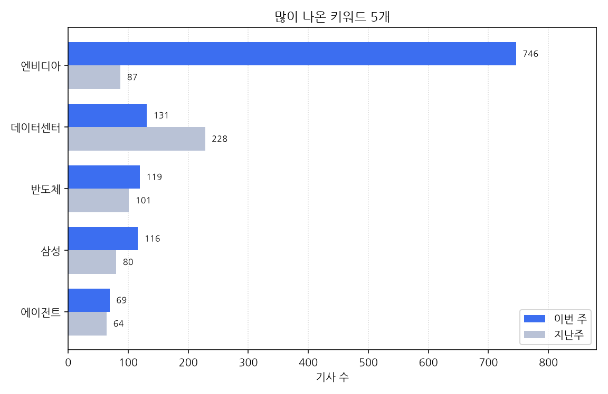

# 주간 AI 뉴스 리포트

대상 기간은 한국 시간으로 2026-11-09 월요일부터 2026-11-15 일요일까지다.
이번 주에 AI가 남긴 기사는 2049건, 지난주는 1636건이다. 413건 늘었다.

## 이번 주에 새로 나온 도구

- 11-09 '"AI 코딩 적용 첫 대형사업"…1527억원 투입 차세대 지방행정공통시스템 통합사업 시동' 소식이 한 곳에서 나왔다 (대표 링크 https://www.ddaily.co.kr/page/view/2026110914162142684)
- 11-09 '"나만의 행성에 AI·소셜 더했다"…호요버스, 신작 `쁘띠플래닛` 12월4일 출시' 소식이 한 곳에서 나왔다 (대표 링크 https://www.ddaily.co.kr/page/view/2026110819492344494)
- 11-09 '"로봇 손, 공장서 일할 수 있나"… 리얼월드, 엔비디아와 개발한 '덱스벤치 1.0' 첫 공개' 소식이 한 곳에서 나왔다 (대표 링크 https://www.ddaily.co.kr/page/view/2026110918295350005)
- 11-09 'ETRI, 비전문가도 AI 모델 개발 가능한 탱고2 깃허브 공개' 소식이 한 곳에서 나왔다 (대표 링크 https://zdnet.co.kr/view/?no=20261109112034)
- 11-09 'SK 사회적가치연구원, AI 기반 사회적 가치 측정 플랫폼 공개' 소식이 한 곳에서 나왔다 (대표 링크 https://biz.heraldcorp.com/article/10930166)
- 11-09 '강북구, 우이령 공영주차장 AI 무인시스템 도입… 9일부터 정상운영' 소식이 한 곳에서 나왔다 (대표 링크 https://biz.heraldcorp.com/article/10931228)
- 11-09 '구글 크롬, 제미나이 AI로 온라인 사기 잡는다…클립보드 분석 기능 추가' 소식이 한 곳에서 나왔다 (대표 링크 https://kbench.com/?q=node/282658)
- 11-09 '논문 3만3000편 학습한 '농생명 AI'…내년 1월 공개' 소식이 한 곳에서 나왔다 (대표 링크 https://www.newspim.com/news/view/20261109001133)
- 11-09 '딥브레인AI, 대화로 영상 제작… AI스튜디오 5.0 출시' 소식을 2개 매체가 다뤘다 (기사 2건, 대표 링크 https://www.ddaily.co.kr/page/view/2026110909381575863)
- 11-09 '메가존클라우드, 오픈AI 셀렉트 파트너 선정' 소식을 2개 매체가 다뤘다 (기사 2건, 대표 링크 https://www.edaily.co.kr/News/Read?newsId=03161926645644080&mediaCodeNo=257)
- 11-09 '메디팔, ASLS KOREA 2026서 병원 운영 자동화 AI 전략 공개' 소식이 한 곳에서 나왔다 (대표 링크 https://zdnet.co.kr/view/?no=20261109110415)
- 11-09 '사이냅소프트, AI CRM '리드센스' 출시' 소식이 한 곳에서 나왔다 (대표 링크 https://zdnet.co.kr/view/?no=20261109134508)
- 11-09 '삼성·구글 손잡은 AI 안경 나온다…12월 출시 예정' 소식이 한 곳에서 나왔다 (대표 링크 https://www.newspim.com/news/view/20261109000922)
- 11-09 '서울 강북구, 우이령에 AI 기반 무인주차 시스템 도입' 소식이 한 곳에서 나왔다 (기사 2건, 대표 링크 https://womannews.net/detail.php?number=458883&thread=22r12r01)
- 11-09 '세아베스틸, 철강공장에 AI 안전관리 도입…600만건 데이터 분석' 소식이 한 곳에서 나왔다 (대표 링크 https://www.newspim.com/news/view/20261109001081)
- 11-09 '엔비디아 AI 데이서 선보인 KT 로봇 가상훈련' 소식이 한 곳에서 나왔다 (대표 링크 https://zdnet.co.kr/view/?no=20261109171556)
- 11-09 '엠티에스컴퍼니, 병리 AI 의료현장 도입·건보 급여화 추진' 소식이 한 곳에서 나왔다 (대표 링크 https://www.edaily.co.kr/News/Read?newsId=04746166645644080&mediaCodeNo=257)
- 11-09 '유아이패스, 기업 업무 '지도'로 만든다…AI 자동화 도구 출시' 소식이 한 곳에서 나왔다 (대표 링크 https://zdnet.co.kr/view/?no=20261109170557)
- 11-09 '자율주행 안전 '제작사 입증' 국제기준 내년 시행…3000대 실증해 韓 도입' 소식이 한 곳에서 나왔다 (대표 링크 https://biz.heraldcorp.com/article/10931127)
- 11-09 '카카오모빌리티, 엔비디아와 레벨4 자율주행 기술 협력…기아 PBV에 적용' 소식을 5개 매체가 다뤘다 (기사 5건, 대표 링크 https://www.newsway.co.kr/news/view?ud=2026110908420052939)
- 11-10 '"압박 면접부터 꼬리질문까지"…캐치, 'AI면접튜터' 출시' 소식이 한 곳에서 나왔다 (대표 링크 https://zdnet.co.kr/view/?no=20261110082349)
- 11-10 'AMD, 구글 차세대 AI 인프라에 서버 CPU 공급… 데이터 보호 기술 적용' 소식이 한 곳에서 나왔다 (대표 링크 https://biz.chosun.com/it-science/ict/2026/11/10/D3QD7GUHNVAE3MS3IDR7H6ZSUU/)
- 11-10 'HD현대로보틱스, 팔란티어와 피지컬 AI 앞서간다… 지능형 양팔 로봇 공개' 소식이 한 곳에서 나왔다 (대표 링크 https://biz.chosun.com/industry/company/2026/11/10/JVLMCYS26RHHZK3QVI2NYBD33A/)
- 11-10 'HD현대중공업 "내년 상반기 '피지컬AI' 기반 로봇 모델 현장 적용' 소식이 한 곳에서 나왔다 (대표 링크 http://inews24.com/view/2024476)
- 11-10 'IPO 앞둔 앤트로픽, '페이블·미토스 5.2' 공개…에이전트 협업 강화' 소식이 한 곳에서 나왔다 (대표 링크 https://zdnet.co.kr/view/?no=20261110094407)
- 11-10 'MDS테크, 로보월드서 '피지컬 AI' 솔루션 공개…글로벌 파트너 협력' 소식이 한 곳에서 나왔다 (대표 링크 https://www.etoday.co.kr/news/view/2646244)
- 11-10 'ST, AI 연산·모터 제어 통합한 산업용 반도체 출시… 내년 1월 양산' 소식이 한 곳에서 나왔다 (대표 링크 https://biz.chosun.com/it-science/ict/2026/11/10/QRXUWY5ADFANBBR7Q37NGQVOOU/)
- 11-10 'ST, DSP·엣지 AI 가속기 탑재 산업용 `STM32H7P` 출시' 소식이 한 곳에서 나왔다 (대표 링크 https://www.ddaily.co.kr/page/view/2026111009453920327)
- 11-10 '관악구, AI 다국어 자동번역 서비스 도입…영어·중국어 등 4개 언어 지원' 소식이 한 곳에서 나왔다 (대표 링크 https://womannews.net/detail.php?number=458951&thread=22r12r01)
- 11-10 '관악구, 구청 홈페이지에 'AI 다국어 자동번역' 도입' 소식이 한 곳에서 나왔다 (대표 링크 https://biz.heraldcorp.com/article/10931490)
- 11-10 '구글, 보안·추론 성능 강화한 AI칩 2종 공개... 엔비디아에 '승부수'-경제ㅣ한국일보' 소식이 한 곳에서 나왔다 (대표 링크 https://www.hankookilbo.com/news/article/A2026110910290005660)
- 11-10 '덴컴, 서부장애인치과병원에 AI 진료기록 시스템 공급… 장애인 치과진료에 적용' 소식이 한 곳에서 나왔다 (대표 링크 https://www.edaily.co.kr/News/Read?newsId=05408726645644408&mediaCodeNo=257)
- 11-10 '라온로드, ITS 세계총회서 차세대 AI 도시 교통운영 솔루션 공개' 소식이 한 곳에서 나왔다 (대표 링크 https://www.newspim.com/news/view/20261110000572)
- 11-10 '레드햇, '오픈시프트 5' 출시…AI가 장애 진단하고 업데이트 점검' 소식이 한 곳에서 나왔다 (대표 링크 https://www.ddaily.co.kr/page/view/2026111011211568288)
- 11-10 '로봇이 선박 용접…HD현대중공업 "내년 상반기 피지컬 AI 기술 도입 계획' 소식이 한 곳에서 나왔다 (대표 링크 https://biz.heraldcorp.com/article/10932045)
- 11-10 '배경훈 부총리 "연말 '모두의 AI' 출시…AI 3대 강국 입지 다질 것' 소식이 한 곳에서 나왔다 (대표 링크 https://www.newspim.com/news/view/20261006000492)
- 11-10 '북미 시장 조준한 파수AI…`랩소디 에코`에 암호모듈 적용' 소식이 한 곳에서 나왔다 (대표 링크 https://www.ddaily.co.kr/page/view/2026111010573347343)
- 11-10 '사이냅소프트, '나온AI'에 웹 오피스 적용…문서 생성·공동편집' 소식이 한 곳에서 나왔다 (대표 링크 https://zdnet.co.kr/view/?no=20261110144448)
- 11-10 '삼성 갤럭시 AI 유료 구독 준비…갤럭시S27부터 적용하나' 소식이 한 곳에서 나왔다 (대표 링크 https://kbench.com/?q=node/283187)
- 11-10 '삼성 브라우저, One UI 9.5서 PC 앱처럼 변신…윈도우판 AI 사이드바 탑재 정황' 소식이 한 곳에서 나왔다 (대표 링크 https://www.wikitree.co.kr/articles/1173221)
- 11-10 '삼성전기 25% 고정 편입⋯NH아문디운용, AI 기판 ETF 출시' 소식이 한 곳에서 나왔다 (대표 링크 https://www.etoday.co.kr/news/view/2646107)
- 11-10 '앤스로픽, AI 성능 1위 탈환…신형 모델 내놓고 API 가격 20% 인하' 소식이 한 곳에서 나왔다 (대표 링크 https://www.edaily.co.kr/News/Read?newsId=03020886645644408&mediaCodeNo=257)
- 11-10 '앤스로픽, IPO 앞두고 최상위 AI 모델 출시… 성능 1위 탈환' 소식이 한 곳에서 나왔다 (대표 링크 https://www.etoday.co.kr/news/view/2646374)
- 11-10 '앤트로픽, 1000개 AI를 팀으로 지휘하는 '페이블 5.2' 공개[글로벌AI브리핑]' 소식이 한 곳에서 나왔다 (대표 링크 https://www.fnnews.com/news/202611100804074569)
- 11-10 '앤트로픽, IPO 앞두고 최신 AI모델 공개…성능지표 압도적 1위' 소식이 한 곳에서 나왔다 (대표 링크 https://www.koreatimes.com/article/11631004)
- 11-10 '앤트로픽, IPO 앞두고 페이블·미토스 최신 버전 출시…토큰 가격 인하' 소식이 한 곳에서 나왔다 (대표 링크 https://www.ddaily.co.kr/page/view/2026111005532689223)
- 11-10 '에이아이세라, 지역 소상공인 대상 AI 상담원 도입 지원 추진' 소식이 한 곳에서 나왔다 (대표 링크 https://biz.heraldcorp.com/article/10932444)
- 11-10 '엔비디아·카이스트, 내년 한국어 AI 합성 데이터 100만건 공개' 소식이 한 곳에서 나왔다 (대표 링크 https://www.etoday.co.kr/news/view/2646347)
- 11-10 '우리은행, 스마트키오스크에 AI 음성인식 도입…업무 검색·거래 가능' 소식이 한 곳에서 나왔다 (대표 링크 https://www.newspim.com/news/view/20261110001013)
- 11-10 '초성만으로 '성착취물' 탐지… AI 도입 6개월, 삭제 지원 10배 늘어' 소식이 한 곳에서 나왔다 (대표 링크 https://www.hani.co.kr/arti/society/society_general/1286701.html)
- 11-10 '카카오, 라이언 AI 단편 애니메이션 공개' 소식이 한 곳에서 나왔다 (대표 링크 https://www.newspim.com/news/view/20261110001169)
- 11-10 '투라인클라우드, AI 기반 레거시 현대화 플랫폼 '뮤산가' 출시' 소식이 한 곳에서 나왔다 (대표 링크 https://zdnet.co.kr/view/?no=20261110154525)
- 11-10 '투라인클라우드, 노후 시스템 개편 순서 짚는 AI '뮤산가' 출시' 소식이 한 곳에서 나왔다 (대표 링크 https://www.ddaily.co.kr/page/view/2026111011084678677)
- 11-10 '파수 AI, '랩소디 에코'에 미국암호모듈 CMVP 적용' 소식이 한 곳에서 나왔다 (대표 링크 https://zdnet.co.kr/view/?no=20261110221532)
- 11-10 '판매처는 넓히고 제품은 쪼개고…구글, 에이전트용 TPU 2종 공개' 소식이 한 곳에서 나왔다 (대표 링크 https://www.ddaily.co.kr/page/view/2026110911461280468)
- 11-10 '행안부, 공공 AI법 이행 속도…AI 서비스 관리·공개기준 마련' 소식이 한 곳에서 나왔다 (대표 링크 https://www.etnews.com/20261110000306)
- 11-10 새 모델 내놓은 앤트로픽, 개인정보 유출 조사 받는다고 한 곳이 전했다 (대표 링크 https://zdnet.co.kr/view/?no=20261110172815)
- 11-10 클로드 페이블 5.2, 코파일럿 정식 탑재했지만 데이터 보관 전제…관리자가 켜야 쓴다고 한 곳이 전했다 (대표 링크 https://www.wikitree.co.kr/articles/1173530)
- 11-11 '"HBM 설계도 AI가 돕는다"…김정호 교수, 반도체 연구실의 변화 공개' 소식이 한 곳에서 나왔다 (대표 링크 http://inews24.com/view/2024960)
- 11-11 '"수부지 선크림 추천해줘"…올리브영, AI 쇼핑 도우미 '올영 티키' 출시' 소식이 한 곳에서 나왔다 (대표 링크 https://www.newspim.com/news/view/20261111001427)
- 11-11 '"아 골입니다" 딥엘, 감정·말투까지 실시간 번역하는 AI `오러` 공개' 소식이 한 곳에서 나왔다 (대표 링크 https://www.ddaily.co.kr/page/view/2026111117162556759)
- 11-11 '"통신요금 감면, AI 시대엔 'ICT 바우처'로"...보편서비스 개편론 부상' 소식이 한 곳에서 나왔다 (대표 링크 https://zdnet.co.kr/view/?no=20261111173903)
- 11-11 'AI가 통제 벗어나면 35초 내 차단…오픈AI, 연구용 '킬 스위치' 도입' 소식이 한 곳에서 나왔다 (대표 링크 https://www.edaily.co.kr/News/Read?newsId=07773606645644408&mediaCodeNo=257)
- 11-11 'AI스페라, 크리미털IP 위협정보 스플렁크서 활용 앱 출시' 소식이 한 곳에서 나왔다 (대표 링크 https://zdnet.co.kr/view/?no=20261111222931)
- 11-11 'AMD, 6세대 서버 CPU '에픽' 출시… 메타·MS·오라클 AI 인프라 공략' 소식이 한 곳에서 나왔다 (대표 링크 https://biz.chosun.com/it-science/ict/2026/11/11/4N64L27U2VBFXHBOKXSZVU2XSY/)
- 11-11 'AMD, AI 인프라 겨냥 에픽 임베디드 9006 SP7 CPU 출시' 소식이 한 곳에서 나왔다 (대표 링크 https://zdnet.co.kr/view/?no=20261111021324)
- 11-11 'MS 아성에 도전장?…앤트로픽, 생산성 도구 3종 공개' 소식이 한 곳에서 나왔다 (대표 링크 https://www.ddaily.co.kr/page/view/2026111106021331039)
- 11-11 'PFCT, 금융 특화 AI 에이전트 개발…고려저축은행 첫 도입' 소식이 한 곳에서 나왔다 (대표 링크 https://www.edaily.co.kr/News/Read?newsId=03444006645644736&mediaCodeNo=257)
- 11-11 '구글 '제미나이 4 카본'일반 공개…월 11만9000원'울트라' 요금제 대상' 소식이 한 곳에서 나왔다 (대표 링크 https://www.ddaily.co.kr/page/view/2026111109500983320)
- 11-11 '딥엘 "말투·감정 읽는 번역 시대…대형 컨퍼런스 적용 목표' 소식이 한 곳에서 나왔다 (대표 링크 https://zdnet.co.kr/view/?no=20261110134711)
- 11-11 '락인컴퍼니, 지스타 2026 참가…AI 시대 게임 해킹 막는 'LIAPP' 공개' 소식이 한 곳에서 나왔다 (대표 링크 https://www.newspim.com/news/view/20261111000951)
- 11-11 '레드햇, '오픈시프트 5' 출시…AI로 클라우드 장애 원인 분석' 소식이 한 곳에서 나왔다 (대표 링크 https://www.edaily.co.kr/News/Read?newsId=07901526645644408&mediaCodeNo=257)
- 11-11 '링크브릭스, 한글·MS 문서 편집하는 무료 AI 오피스 출시' 소식이 한 곳에서 나왔다 (대표 링크 https://zdnet.co.kr/view/?no=20261111181409)
- 11-11 '말로 지시하면 AI가 제작…어도비, 파이어플라이 전면 개편' 소식이 한 곳에서 나왔다 (대표 링크 https://zdnet.co.kr/view/?no=20261111151133)
- 11-11 '민생지원금 소비 효과도 챗GPT로 예측… 오픈AI, AI 활용 정책 연구 공개' 소식이 한 곳에서 나왔다 (대표 링크 https://biz.chosun.com/it-science/ict/2026/11/11/QBKDVTLIUZHY5NQ6YB2OULC4UA/)
- 11-11 '사이냅소프트, 문서뷰어에 AI 번역·민감정보 마스킹 기능 추가' 소식이 한 곳에서 나왔다 (대표 링크 https://zdnet.co.kr/view/?no=20261111171256)
- 11-11 '샌디스크, 피지컬 AI·IoT용 임베디드 저장장치 공개' 소식을 2개 매체가 다뤘다 (기사 2건, 대표 링크 https://zdnet.co.kr/view/?no=20261111103330)
- 11-11 '센드버드, 쇼핑·예약·고객 지원 통합 AI 에이전트 출시' 소식이 한 곳에서 나왔다 (대표 링크 https://www.edaily.co.kr/News/Read?newsId=07927766645644408&mediaCodeNo=257)
- 11-11 '셀바스AI, 예스24에 한국어·영어 AI 음성합성 기술 적용' 소식이 한 곳에서 나왔다 (대표 링크 https://www.edaily.co.kr/News/Read?newsId=03535846645644736&mediaCodeNo=257)
- 11-11 '앤스로픽, 사무용 AI 도구 출시…MS·구글과 경쟁' 소식이 한 곳에서 나왔다 (대표 링크 https://www.newspim.com/news/view/20261111000027)
- 11-11 '앤트로픽 공모가 70∼78달러…최대 904억달러 조달 목표' 소식을 5개 매체가 다뤘다 (기사 5건, 대표 링크 https://biz.heraldcorp.com/article/10932809)
- 11-11 '오티스 코리아, 승강기엑스포서 AI 점검 로봇·초고층 설비 공개' 소식이 한 곳에서 나왔다 (대표 링크 https://biz.heraldcorp.com/article/10933990)
- 11-11 '오픈AI, '비즈니스 인 챗GPT' 베타 출시… 기업 정보 관리·AI 상담 지원' 소식이 한 곳에서 나왔다 (대표 링크 https://www.ddaily.co.kr/page/view/2026111110432363155)
- 11-11 '오픈AI, 챗GPT에 기업 프로필 도입…상품 검색서 구글과 경쟁' 소식이 한 곳에서 나왔다 (대표 링크 https://zdnet.co.kr/view/?no=20261111112534)
- 11-11 '이노션, 강남·명동 대형 전광판서 AI 아티스트 3인 작품 송출' 소식을 2개 매체가 다뤘다 (기사 2건, 대표 링크 https://biz.heraldcorp.com/article/10932863)
- 11-11 '제미나이가 나에 대해 뭘 기억할까…구글, 메모리 요약 기능 출시' 소식이 한 곳에서 나왔다 (대표 링크 https://kbench.com/?q=node/283237)
- 11-11 '증평군 "스마트 행정 강화"…AI사업팀 신설 등 조직 개편' 소식이 한 곳에서 나왔다 (대표 링크 http://inews24.com/view/2024894)
- 11-11 '코그니전트, 클로드 운영까지 책임지는 관리형 서비스 출시…2만 5,000명 투입' 소식이 한 곳에서 나왔다 (대표 링크 https://www.wikitree.co.kr/articles/1173889)
- 11-11 '피지컬 AI, 제조 현장 적용 어떻게…재경부 초혁신경제 포럼' 소식이 한 곳에서 나왔다 (대표 링크 https://www.etoday.co.kr/news/view/2646902)
- 11-11 '호프만에이전시코리아, GEO 솔루션 출시… AI 답변 속 브랜드 한눈에 진단' 소식이 한 곳에서 나왔다 (대표 링크 https://www.ddaily.co.kr/page/view/2026111116563336992)
- 11-11 '휴머노이드가 벤츠 공장서 부품 분류…구글 딥마인드, 로봇 AI 2.5 버전 공개' 소식이 한 곳에서 나왔다 (대표 링크 https://www.ddaily.co.kr/page/view/2026111106134131595)
- 11-11 데이터산업진흥원, 'AI·데이터 문제해결은행' 서비스 개편한다고 한 곳이 전했다 (대표 링크 https://zdnet.co.kr/view/?no=20261111221730)
- 11-12 '"AI가 승강기 고장 미리 감지"…오티스 코리아, 스마트 엘리베이터 기술 공개' 소식이 한 곳에서 나왔다 (대표 링크 https://www.ddaily.co.kr/page/view/2026111218012744630)
- 11-12 '"장애인 재난안전 사각지대 해소해야"... 맞춤형 대피시설·AI 기술 도입 제안' 소식이 한 곳에서 나왔다 (대표 링크 https://www.ohmynews.com/NWS_Web/View/at_pg.aspx?CNTN_CD=A0003284492&PAGE_CD=N0002&BLCK_NO=&CMPT_CD=M0147)
- 11-12 'AI 도입했는데 조직은 그대로네…'AI 네이티브 조직' 출간' 소식이 한 곳에서 나왔다 (대표 링크 https://zdnet.co.kr/view/?no=20261112181205)
- 11-12 'AI 안경 논란, 세무사 수석 한 씨가 마침내 내놓은 '해명'...반응 폭발' 소식이 한 곳에서 나왔다 (대표 링크 https://www.wikitree.co.kr/articles/1174188)
- 11-12 'AI 에이전트로 보험업무 자동화…퀀텀에이아이, `로디` 출시' 소식이 한 곳에서 나왔다 (대표 링크 https://www.ddaily.co.kr/page/view/2026111215574415205)
- 11-12 'AMD 에픽, 구글 클라우드 TPU 8tx 호스트 인프라에 탑재 AI 인프라의 기반으로서 리더십 확대' 소식이 한 곳에서 나왔다 (대표 링크 https://kbench.com/?q=node/283210)
- 11-12 'KT, 디자인·고객 안내에 AI 도입…서비스 개발 기간 5개월 단축' 소식을 3개 매체가 다뤘다 (기사 3건, 대표 링크 https://www.newspim.com/news/view/20261112000330)
- 11-12 'LG CNS, 글로벌 로봇 석학들과 피지컬 AI 미래 해법 모색' 소식을 3개 매체가 다뤘다 (기사 3건, 대표 링크 https://biz.heraldcorp.com/article/10934475)
- 11-12 'MS, 17일 '이그나이트 2026' 개막…코파일럿·AI 에이전트 전략 공개' 소식이 한 곳에서 나왔다 (대표 링크 https://www.ddaily.co.kr/page/view/2026111210575301964)
- 11-12 'SK하이닉스, 사내 챗GPT 도입 시험⋯반도체 업무 AI 활용 확대 검토' 소식이 한 곳에서 나왔다 (대표 링크 http://inews24.com/view/2025705)
- 11-12 '美 데이터센터에 전력망 비용 부담 추진…인허가 개편안 내주 표결' 소식이 한 곳에서 나왔다 (대표 링크 https://www.edaily.co.kr/News/Read?newsId=02584646645645064&mediaCodeNo=257)
- 11-12 '강북삼성병원, 직장인 검진 후 1년 내내 AI로 밀착관리…내년 '원헬스' 공개' 소식이 한 곳에서 나왔다 (대표 링크 https://www.etnews.com/20261112000309)
- 11-12 '낫싱, 화면 없는 AI 기기 공개 임박…첫 티저 영상 등장' 소식이 한 곳에서 나왔다 (대표 링크 https://kbench.com/?q=node/283274)
- 11-12 '네이버, 새 AI 에이전트 연내 출시' 소식이 한 곳에서 나왔다 (대표 링크 https://biz.heraldcorp.com/article/10934957)
- 11-12 '데이터브릭스, 차세대 '지니' 공개.. 복잡한 기업 업무 자율 수행하는 AI 에이전트로 진화' 소식이 한 곳에서 나왔다 (대표 링크 https://kbench.com/?q=node/283290)
- 11-12 '락인컴퍼니, 'G-STAR 2026'참가..AI 시대, 고도화되는 게임 보안 위협에 대응하는'LIAPP' 소식이 한 곳에서 나왔다 (대표 링크 https://kbench.com/?q=node/283248)
- 11-12 '레드햇, 개발자 허브 2.1 공개…AI 코딩 에이전트에 사내 개발 표준 제공' 소식이 한 곳에서 나왔다 (대표 링크 https://www.ddaily.co.kr/page/view/2026111211331392486)
- 11-12 '로이드케이, 생성형 AI 보안 게이트웨이 솔루션 'DO-GATE' 출시' 소식이 한 곳에서 나왔다 (대표 링크 https://kbench.com/?q=node/283249)
- 11-12 '마이크로소프트가 제시한 기업 AI 도입 성공 전략은' 소식을 2개 매체가 다뤘다 (기사 2건, 대표 링크 https://zdnet.co.kr/view/?no=20261112104254)
- 11-12 '바로 확인하자… 카카오뱅크 AI 퀴즈 '11월 12일' 정답 공개' 소식이 한 곳에서 나왔다 (대표 링크 https://www.wikitree.co.kr/articles/1173946)
- 11-12 '본에이아이, 'AI 재난예찰 시스템' 공개…"산불 감시·대응 무인화' 소식이 한 곳에서 나왔다 (대표 링크 https://zdnet.co.kr/view/?no=20261112104605)
- 11-12 '삼성 '갤럭시 AI' 유료화 수순…월 구독료 도입하나' 소식이 한 곳에서 나왔다 (대표 링크 http://www.newstomato.com/ReadNews.aspx?no=1320207)
- 11-12 '애플, 카메라 탑재 에어팟·AI 스마트 안경 개발 정황 포착…협력사 실적 발표서 언급' 소식이 한 곳에서 나왔다 (대표 링크 https://kbench.com/?q=node/283280)
- 11-12 '에이직랜드, TSMC 포럼서 AI 반도체 3종 공개' 소식을 2개 매체가 다뤘다 (기사 2건, 대표 링크 https://www.newspim.com/news/view/20261112001187)
- 11-12 '오픈AI, 챗GPT에 기업 AI고객센터 도입…온라인쇼핑 플랫폼 역할' 소식이 한 곳에서 나왔다 (대표 링크 https://www.koreatimes.com/article/11631233)
- 11-12 '위즈온랩, 정보 유출 위험 줄인 AI 키보드 앱 '유니보드' 출시' 소식이 한 곳에서 나왔다 (대표 링크 https://zdnet.co.kr/view/?no=20261112171320)
- 11-12 '이찬우 농협금융 회장 "AI 도입 수보다 고객 체감 성과가 중요' 소식이 한 곳에서 나왔다 (대표 링크 https://newsway.co.kr/news/view?ud=2026111209235027948)
- 11-12 '카카오페이증권, AI로 촘촘해진 이상거래 탐지…전문가 영입·조직 개편' 소식이 한 곳에서 나왔다 (대표 링크 https://www.etoday.co.kr/news/view/2647207)
- 11-12 '통제 벗어난 AI 어떻게 막을까…옴니사, 도쿄서 'AI 통제' 전략 공개 [옴니사 원 2026]' 소식이 한 곳에서 나왔다 (대표 링크 https://www.ddaily.co.kr/page/view/2026111207060489679)
- 11-12 日 패밀리마트, 피지컬 AI 로봇 도입..."음료 알아서 채운다고 한 곳이 전했다 (대표 링크 https://www.newspim.com/news/view/20261112000242)
- 11-12 광명시 첫 기업박람회 20일 개최…24개 기업 AI·로보틱스 기술 선보인다고 한 곳이 전했다 (대표 링크 https://www.anewsa.com/detail.php?number=3217412)
- 11-13 '"AI끼리 포커 대결"…크레딧코인, 전략 시뮬레이션 게임 '그리드' 출시' 소식이 한 곳에서 나왔다 (대표 링크 https://www.ddaily.co.kr/page/view/2026111316282317492)
- 11-13 '"국방 AI 최대 숙제는 데이터"...코난, 정보분석 AI 첫 공개' 소식이 한 곳에서 나왔다 (대표 링크 https://zdnet.co.kr/view/?no=20261113102516)
- 11-13 '"평양 인근 병력 움직임 분석해 오판 막아"⋯코난테크놀로지, 'AI 참모' 아르고-X 공개' 소식이 한 곳에서 나왔다 (대표 링크 http://inews24.com/view/2025953)
- 11-13 '2857억 차세대 지방행정, AI 코딩 공식 도입…공공SW 개발체계 전환 주목' 소식이 한 곳에서 나왔다 (대표 링크 https://zdnet.co.kr/view/?no=20261113134630)
- 11-13 'AI 기업 부도위험에 베팅하는 ETF 출시 임박' 소식이 한 곳에서 나왔다 (대표 링크 https://www.koreatimes.com/article/11631361)
- 11-13 'AI 탑재된 `스마트안경` 논란 지속… 세무사시험 수석 합격자, 160문제 중 1개만 오답에 시끌' 소식이 한 곳에서 나왔다 (대표 링크 https://www.ddaily.co.kr/page/view/2026111310211903531)
- 11-13 'AI안경 불법촬용 어떻게 막나…구글이 내놓은 해법은[모닝폰]' 소식이 한 곳에서 나왔다 (대표 링크 https://www.edaily.co.kr/News/Read?newsId=02204166645645392&mediaCodeNo=257)
- 11-13 'TWC, AI 고객서비스 플랫폼 '이지아이' 출시' 소식이 한 곳에서 나왔다 (대표 링크 https://www.edaily.co.kr/News/Read?newsId=03745766645645392&mediaCodeNo=257)
- 11-13 '구글 검색, AI 정보비서로 진화…새 AI모델 '하이드로젠' 적용[글로벌AI브리핑]' 소식이 한 곳에서 나왔다 (대표 링크 https://www.fnnews.com/news/202611130802050898)
- 11-13 '구글, '제미나이 4 하이드로젠' 공개…검색·코딩 속도 높여' 소식이 한 곳에서 나왔다 (대표 링크 https://zdnet.co.kr/view/?no=20261113131244)
- 11-13 '구글, `제미나이4 하이드로젠` 출시… "AI 에이전트 작업 19% 빨라' 소식이 한 곳에서 나왔다 (대표 링크 https://www.ddaily.co.kr/page/view/2026111309315938295)
- 11-13 '대기업 3분의 1 이상 도입...中 제조업에 부는 AI 바람-Xinhua' 소식이 한 곳에서 나왔다 (대표 링크 http://kr.xinhuanet.com/20261113/26a3fb553da44c6c9b79f85ea62d3c59/c.html)
- 11-13 '델, AMD 6세대 에픽 탑재 서버 2종 출시…기존 데이터센터 활용 극대화' 소식이 한 곳에서 나왔다 (대표 링크 https://www.etnews.com/20261113000177)
- 11-13 '루미웨이브, '라그나로크 몬스터 마블'에 AI 플레이어 도입 추진' 소식이 한 곳에서 나왔다 (대표 링크 https://zdnet.co.kr/view/?no=20261113171149)
- 11-13 '배민, 외식업주용 AI 도구 27종 공개…메뉴 개발·손익 관리 지원' 소식이 한 곳에서 나왔다 (대표 링크 https://zdnet.co.kr/view/?no=20261113105904)
- 11-13 '삼성 첫 'AI 안경' 12월10일 출시…65∼70만원' 소식을 2개 매체가 다뤘다 (기사 2건, 대표 링크 https://www.hani.co.kr/arti/economy/it/1287111.html)
- 11-13 '삼성·구글 AI 안경 30종 공개…메타 독주에 도전장' 소식을 2개 매체가 다뤘다 (기사 2건, 대표 링크 http://www.newstomato.com/ReadNews.aspx?no=1320313)
- 11-13 '삼성전자 AI안경, 오는 10일 국내 출시... 판매가는?' 소식이 한 곳에서 나왔다 (대표 링크 https://www.insight.co.kr/news/581854)
- 11-13 '삼성전자, 제미나이 탑재 '인텔리전트 아이웨어' 65만원부터 판매' 소식이 한 곳에서 나왔다 (대표 링크 https://www.newspim.com/news/view/20261112001127)
- 11-13 '세무사 시험 수석 'AI 안경' 논란에 차석 등판... 실시간 문제풀이 영상 공개' 소식이 한 곳에서 나왔다 (대표 링크 https://www.insight.co.kr/news/582004)
- 11-13 '에이비스, 실제 의료현장 적용 위한 병리 AI 기술 고도화 성과 2건 국제학회서 발표' 소식이 한 곳에서 나왔다 (대표 링크 https://www.etnews.com/20261113000228)
- 11-13 '엔비디아 AI 데이 서울 2026 개막…피지컬 AI·에이전틱 AI 등 국내 산업 적용 사례 공유' 소식이 한 곳에서 나왔다 (대표 링크 https://kbench.com/?q=node/283157)
- 11-13 '연금에 AI 메가트렌드 결합⋯한투운용, 글로벌AI밸류체인 TDF 출시' 소식이 한 곳에서 나왔다 (대표 링크 https://www.etoday.co.kr/news/view/2647779)
- 11-13 '연세대 등 11개국 대학생 참여…광저우 AI 창작전서 252점 공개' 소식이 한 곳에서 나왔다 (대표 링크 https://isplus.com/article/view/isp202611130053)
- 11-13 '제이크루, 클로드 AI 스타일리스트 내놨지만…리테일러 AI 쇼핑 도우미 이용은 27%뿐' 소식이 한 곳에서 나왔다 (대표 링크 https://www.wikitree.co.kr/articles/1174224)
- 11-13 '지미션-JIT, 스리랑카 AI 서비스 도입 협력' 소식이 한 곳에서 나왔다 (대표 링크 https://zdnet.co.kr/view/?no=20261113154855)
- 11-13 '코난테크놀로지, 국방 AI 플랫폼 '아르고스' 첫 공개…차세대 사업 비전 제시' 소식이 한 곳에서 나왔다 (대표 링크 https://www.newspim.com/news/view/20261113001154)
- 11-13 '파네시아, 인텔코리아와 CXL 기술 협력…AI 데이터센터 도입 확대 추진' 소식이 한 곳에서 나왔다 (대표 링크 https://www.ddaily.co.kr/page/view/2026111218324920556)
- 11-13 '학습 독려하는 전화부터 구매 상담까지 척척…위버스브레인 '에이전트맥스' 공개' 소식이 한 곳에서 나왔다 (대표 링크 https://kbench.com/?q=node/283022)
- 11-13 '한투운용, 자체 개발 글라이드 패스에 글로벌 AI밸류체인 더한 펀드 출시' 소식이 한 곳에서 나왔다 (대표 링크 https://www.newspim.com/news/view/20261113000124)
- 11-13 애플 홈뷰 리뷰, 시리 AI는 차고문·현관문 못 열어…12월 업데이트로 고친다고 한 곳이 전했다 (대표 링크 https://www.wikitree.co.kr/articles/1174222)
- 11-14 '"네이버, 개인형 AI 에이전트 앱 연내 출시…외부 사이트 작업 수행"[컨콜]' 소식이 한 곳에서 나왔다 (대표 링크 https://www.edaily.co.kr/News/Read?newsId=02843766645645064&mediaCodeNo=257)
- 11-14 '삼성, 첫 AI 안경 내달 10일 출시…판매가 65만원대' 소식이 한 곳에서 나왔다 (대표 링크 https://www.etnews.com/20261112000321)
- 11-14 '앤스로픽, 제조업 특화 AI 공개…견적 작성부터 생산 일정 변경까지' 소식이 한 곳에서 나왔다 (대표 링크 https://www.edaily.co.kr/News/Read?newsId=02427206645645720&mediaCodeNo=257)
- 11-14 '에이전트 도입 가속화…산업 현장에 진출하는 '디지털 직원'-Xinhua' 소식이 한 곳에서 나왔다 (대표 링크 http://kr.xinhuanet.com/20261114/1b39e2dc406444369362214be0ca9fc8/c.html)
- 11-14 '오픈AI, AI 에이전트용 '챗GPT 월렛' 출시…비자·마스터 등과 협력 [비즈360]' 소식이 한 곳에서 나왔다 (대표 링크 https://biz.heraldcorp.com/article/10936908)
- 11-14 '오픈AI, `AI 대리구매` 결제 수단 챗GPT 월렛 공개…카드 3사와 협력' 소식을 2개 매체가 다뤘다 (기사 2건, 대표 링크 https://www.ddaily.co.kr/page/view/2026111407162097672)
- 11-14 '오픈AI, 챗GPT에 AI지갑 도입…AI가 사람 대신 결제한다[글로벌AI브리핑]' 소식이 한 곳에서 나왔다 (대표 링크 https://www.fnnews.com/news/202611140831394681)
- 11-14 오픈AI 챗GPT 월렛 출시, AI 에이전트가 결제까지 돕지만 실제 카드 정보는 못 본다고 한 곳이 전했다 (대표 링크 https://www.wikitree.co.kr/articles/1174500)
- 11-15 'KT, 인천 남동산단에 AI 화재안전 서비스 '세이프메이트' 구축' 소식을 3개 매체가 다뤘다 (기사 3건, 대표 링크 https://biz.chosun.com/it-science/ict/2026/11/15/VCGWSS7PIJFVVKWVWCKW2CK2JA/)
- 11-15 '국힘 "AI 부정행위에 국가시험 신뢰 흔들…확실한 대비책 내놓아야' 소식이 한 곳에서 나왔다 (대표 링크 https://www.etoday.co.kr/news/view/2648315)
- 11-15 '삼성SDI·LG엔솔, 미국서 차세대 ESS·데이터센터 배터리 공개(종합)' 소식이 한 곳에서 나왔다 (대표 링크 https://www.koreatimes.com/article/11631550)
- 11-15 '세무사 수석, AI 부정행위 자수⋯차석은 '너덜너덜 수험서' 공개' 소식을 3개 매체가 다뤘다 (기사 3건, 대표 링크 https://www.hani.co.kr/arti/society/society_general/1287369.html)
- 11-15 '쇼호스트도 카메라도 없다…현대홈쇼핑, 업계 첫 '100% AI 방송' 도입' 소식을 2개 매체가 다뤘다 (기사 2건, 대표 링크 https://www.ddaily.co.kr/page/view/2026111509241819523)
- 11-15 '오픈AI, '챗GPT 월렛' 출시…AI가 상품 구매부터 결제까지' 소식이 한 곳에서 나왔다 (대표 링크 https://zdnet.co.kr/view/?no=20261115102351)
- 11-15 '전국민 무료 '모두의 AI' 내달 출시… 공공데이터 접근 권한 등 기준 정비해야' 소식이 한 곳에서 나왔다 (대표 링크 https://www.fnnews.com/news/202611151918122241)
- 11-15 '출시 전 AI는 누가 감시하나…美 싱크탱크 경고' 소식이 한 곳에서 나왔다 (대표 링크 https://zdnet.co.kr/view/?no=20261114205549)

## 규제와 정책

- 11-09 '"에이전틱·피지컬AI, 규제 발목 없으려면"…이주희 의원, 정책세미나 개최' 소식이 한 곳에서 나왔다 (대표 링크 https://www.ddaily.co.kr/page/view/2026110910445386966)
- 11-09 'AIDC 규제 쌓는 美·유럽…'인프라 강자' 韓, 반사이익 챙길까 [AI 인사이트]' 소식이 한 곳에서 나왔다 (대표 링크 https://www.fnnews.com/news/202611091826067286)
- 11-09 'AI안경 끼고 수능 보면 '응시 자격 박탈'… 형사처벌 추진' 소식이 한 곳에서 나왔다 (대표 링크 https://www.fnnews.com/news/202611091156558418)
- 11-09 'KAIDA, 탄소중립·자율주행 정책 논의…"통합적 규제 관리 필요' 소식이 한 곳에서 나왔다 (대표 링크 https://www.newspim.com/news/view/20261109001203)
- 11-09 '李 거듭 질타한 'AI가 못 읽는 HWP'… 정부, 연내 공공문서 HWPX 전면 전환 검토' 소식이 한 곳에서 나왔다 (대표 링크 https://biz.chosun.com/it-science/ict/2026/11/09/GINQ6LJRWRECXNZWDS7CKZLNGQ/)
- 11-09 '美 데이터센터 규제 움직임…반도체로 버티는 한국 경제 '긴장' 소식이 한 곳에서 나왔다 (대표 링크 https://www.segye.com/newsView/20261108511535)
- 11-09 '고위공무원도 'AI 바이브코딩' 실습…과기정통부, 직원 교육 확대' 소식이 한 곳에서 나왔다 (대표 링크 https://www.ddaily.co.kr/page/view/2026110909451762031)
- 11-09 '공영홈쇼핑, 'AI 윤리 준수기관' 확인마크 획득…6대 원칙 수립' 소식이 한 곳에서 나왔다 (대표 링크 https://biz.heraldcorp.com/article/10930182)
- 11-09 '시민단체 "정부 'COP31 AI 서약' 동참…데이터센터 규제 도입" 촉구' 소식이 한 곳에서 나왔다 (대표 링크 https://www.hani.co.kr/arti/society/environment/1286387.html)
- 11-09 '엔비디아, 업스테이지·리얼월드 등 국내 AI 스타트업 4곳에 투자' 소식을 3개 매체가 다뤘다 (기사 3건, 대표 링크 https://www.edaily.co.kr/News/Read?newsId=04346006645644080&mediaCodeNo=257)
- 11-09 '위험도 4단계 관리…기보 AI·데이터 규정 전면 정비' 소식이 한 곳에서 나왔다 (대표 링크 https://www.munhwa.com/article/11629770)
- 11-09 '정부 피지컬 AI 트레이닝센터 상암동 유력...로봇 100여대 도입' 소식이 한 곳에서 나왔다 (대표 링크 https://news.mtn.co.kr/article/2026110911450521583)
- 11-09 '정부, 내년 레벨4 자율주행 안전기준 마련…3000대 실증으로 상용화 기반 구축' 소식이 한 곳에서 나왔다 (대표 링크 https://www.ddaily.co.kr/page/view/2026110915244431575)
- 11-09 '중간선거 후 AI규제·스파이접촉 의혹까지…젠슨황 '사면초가' 소식을 2개 매체가 다뤘다 (기사 2건, 대표 링크 https://biz.heraldcorp.com/article/10929880)
- 11-09 '취업 상담에서 학사·규정까지…클라비, 인하대 AI 챗봇 고도화 사업 수주' 소식이 한 곳에서 나왔다 (대표 링크 https://www.ddaily.co.kr/page/view/2026110917092001180)
- 11-09 '한국, 에이전트 시대 준비됐나…호주 기업이 본 AI기본법' 소식이 한 곳에서 나왔다 (대표 링크 https://zdnet.co.kr/view/?no=20261109151601)
- 11-09 앤트로픽 연구, AI 에이전트 팀은 12개 과제서 성과는 높고 윤리는 낮았다고 한 곳이 전했다 (대표 링크 https://www.wikitree.co.kr/articles/1172907)
- 11-10 '"AI만 붙이면 R&D?"…정부 연구개발 예산 분류 '허점' 소식이 한 곳에서 나왔다 (대표 링크 https://biz.heraldcorp.com/article/10932072)
- 11-10 '"삼성전자 향후 2년 영업익 1021조원 전망…美 AI 규제 우려 선반영"-KB證' 소식이 한 곳에서 나왔다 (대표 링크 https://www.fnnews.com/news/202611091713493439)
- 11-10 ''젠슨 황 리스크'가 AI 업계에 미칠 파장...자금줄부터 대정부 협상력까지' 소식이 한 곳에서 나왔다 (기사 2건, 대표 링크 https://www.newspim.com/news/view/20261110000095)
- 11-10 'AI 안경 쓰면 내년 시험도 못 본다…수능 D-9 꼭 알아야 할 규정' 소식이 한 곳에서 나왔다 (대표 링크 https://www.ilyo.co.kr/?ac=article_view&entry_id=513527)
- 11-10 'HWP 탓하는 정부, 이미 다 읽는 AI… 번지수 틀린 공공 AX' 소식이 한 곳에서 나왔다 (대표 링크 https://zdnet.co.kr/view/?no=20261109152902)
- 11-10 '美 AI 규제 향방은?…민주당 압승 후 첫 데이터센터法 시험대' 소식이 한 곳에서 나왔다 (대표 링크 https://www.edaily.co.kr/News/Read?newsId=03565366645644408&mediaCodeNo=257)
- 11-10 '가스공사, AI 윤리 실천 앞장…'AI 윤리 준수기관' 확인마크 획득' 소식을 2개 매체가 다뤘다 (기사 2건, 대표 링크 https://www.newspim.com/news/view/20261110000525)
- 11-10 '개인정보위, 앤트로픽 `클로드` 유출 사고에 조사 착수' 소식을 2개 매체가 다뤘다 (기사 2건, 대표 링크 https://www.ddaily.co.kr/page/view/2026111016323729837)
- 11-10 '과기정통부, 'K문샷 정책 세미나' 개최…"AI 활용 제도·인프라 전폭 지원' 소식이 한 곳에서 나왔다 (대표 링크 https://www.etnews.com/20261110000241)
- 11-10 '대중 AI반도체 수출규제 강화 될 듯…젠슨 황 사건 묵인 의혹 트럼프도 곤경' 소식이 한 곳에서 나왔다 (대표 링크 https://www.fnnews.com/news/202611100616532536)
- 11-10 '오픈AI '정부 사이트 무단접속' 후폭풍…호주, AI 사고 신고 의무화' 소식이 한 곳에서 나왔다 (대표 링크 https://www.edaily.co.kr/News/Read?newsId=04313206645644408&mediaCodeNo=257)
- 11-10 '우상호 "김진태 고발취하 후회될 정도…데이터센터 정쟁 중단을' 소식이 한 곳에서 나왔다 (대표 링크 https://www.pressian.com/pages/articles/2026110914162133241)
- 11-10 '윤석열 정부 경호처 AI 사업, 군 장병 생체정보 활용 논란' 소식이 한 곳에서 나왔다 (대표 링크 https://www.ohmynews.com/NWS_Web/View/at_pg.aspx?CNTN_CD=A0003283488&PAGE_CD=N0002&CMPT_CD=M0112)
- 11-10 '의정부시, ' 첨단 미래산업 허브 도약 본격화'...바이오. AI 융복합 전략 모색' 소식이 한 곳에서 나왔다 (대표 링크 http://m.metroseoul.co.kr/article/20261110500158)
- 11-10 '의정부시-마음AI, AI 산업 육성과 지역 인재양성 협력' 소식이 한 곳에서 나왔다 (대표 링크 https://zdnet.co.kr/view/?no=20261110192401)
- 11-10 '이스라엘 사이버국장 "AI 공격 빨라지는데...방어자는 규제에 발목' 소식이 한 곳에서 나왔다 (대표 링크 https://zdnet.co.kr/view/?no=20261110133958)
- 11-10 '자율주행 실증차 내년 3000대로…유럽 "관건은 사업성" 규정 통일 촉구' 소식이 한 곳에서 나왔다 (대표 링크 https://www.fnnews.com/news/202611100609595257)
- 11-10 '젠슨 황 불륜 스캔들 파문…美, 대중 AI 반도체 규제 강화로 흐르나' 소식이 한 곳에서 나왔다 (대표 링크 https://www.ddaily.co.kr/page/view/2026111010005088546)
- 11-10 '젠슨 황 스캔들에 '對中안보·AI규제' 파장 확산…美민주는 맹공' 소식을 2개 매체가 다뤘다 (기사 2건, 대표 링크 https://biz.heraldcorp.com/article/10931300)
- 11-10 '젠슨황 스캔들' 파장… 대중안보·AI규제 불붙였다고 한 곳이 전했다 (대표 링크 https://www.munhwa.com/article/11630237)
- 11-10 '호주, 첨단 AI 규제 칼 빼들었다…안전검증 의무화 추진' 소식이 한 곳에서 나왔다 (대표 링크 https://zdnet.co.kr/view/?no=20261110153815)
- 11-10 '흔들리는 AI 생태계⋯순환투자ㆍ대중 규제 변수 [젠슨 황 스캔들 후폭풍]' 소식이 한 곳에서 나왔다 (대표 링크 https://www.etoday.co.kr/news/view/2646408)
- 11-10 AI 시대 미디어 규제 재설계 논의장 열린다고 한 곳이 전했다 (대표 링크 https://zdnet.co.kr/view/?no=20261110112820)
- 11-11 'AI 유니콘 6곳서 20곳으로...정부, 사업화·공공구매 지원' 소식이 한 곳에서 나왔다 (대표 링크 https://www.newspim.com/news/view/20261111000853)
- 11-11 'K주얼리' AI 전환 정부가 나설 때다고 한 곳이 전했다 (대표 링크 https://www.etoday.co.kr/news/view/2646485)
- 11-11 '개보위 이어 과기부도 '앤트로픽' 개인정보유출 조사 착수' 소식이 한 곳에서 나왔다 (대표 링크 https://biz.heraldcorp.com/article/10934039)
- 11-11 '과기정통부, '성평등정책담당관' 신설 추진⋯6명 증원·AI 조직도 손질' 소식이 한 곳에서 나왔다 (대표 링크 http://inews24.com/view/2025076)
- 11-11 '삼성준법위, AI 시대 준법경영 논의…법적·윤리적 위험 대응' 소식을 2개 매체가 다뤘다 (기사 2건, 대표 링크 https://www.newspim.com/news/view/20261111000619)
- 11-11 '온라인 자살유발정보 AI가 24시간 감시⋯유통 차단 강화' 소식을 2개 매체가 다뤘다 (기사 2건, 대표 링크 https://www.etoday.co.kr/news/view/2646571)
- 11-11 '이달 12일부터 자살유발정보 방지 의무화…복지부, AI 온라인 24시간 감시 '가동' 소식이 한 곳에서 나왔다 (대표 링크 https://www.newspim.com/news/view/20261111000520)
- 11-11 '정부, '몸값 1조' AI 스타트업 20곳 키운다…100억 이상 지원' 소식이 한 곳에서 나왔다 (대표 링크 https://biz.heraldcorp.com/article/10933125)
- 11-11 '정부, 2030년까지 피지컬 AI 핵심부품 국산화 추진' 소식이 한 곳에서 나왔다 (대표 링크 https://biz.chosun.com/policy/policy_sub/2026/11/11/56IT3YVBPBDAVOUPXQQWIM3T3A/)
- 11-11 '정부, AI 신약개발·BCI 전략 투자 확대…'소버린 바이오' 육성 속도' 소식이 한 곳에서 나왔다 (대표 링크 https://www.ddaily.co.kr/page/view/2026111116242414376)
- 11-11 웹툰 수출부터 AI 저작권까지… 한·아세안 IP 협력 넓힌다고 한 곳이 전했다 (대표 링크 https://www.fnnews.com/news/202611111830299555)
- 11-11 유티정보, 정부 AI 인재 양성 사업 참여…모빌리티 AX 교육 맡는다고 한 곳이 전했다 (대표 링크 https://zdnet.co.kr/view/?no=20261111171547)
- 11-12 '"HBM 승부처는 패키징"…삼성, 144조 투자로 'AI칩 심장' 키운다(종합)' 소식이 한 곳에서 나왔다 (대표 링크 https://www.edaily.co.kr/News/Read?newsId=04801926645645064&mediaCodeNo=257)
- 11-12 '"美 데이터센터 규제, AI투자 사이클 꺾지 못할 것' 소식이 한 곳에서 나왔다 (대표 링크 https://biz.chosun.com/stock/stock_general/2026/11/12/GVSGMYZTMYZWKYZUGYYDOZLDG4/)
- 11-12 '"美, 중국 AI 칩 우회 사용 차단 추진… 싱가포르 등 7개국 수출 규제 확대' 소식이 한 곳에서 나왔다 (대표 링크 https://biz.chosun.com/international/international_general/2026/11/12/FUWSGWQNP5EN7HTDWTWFBRZ6HQ/)
- 11-12 ''AI황제' 젠슨황 해임 위기…순환거래 위축·규제강화까지 엎친데 덮친 AI산업 [디브리핑]' 소식이 한 곳에서 나왔다 (기사 2건, 대표 링크 https://biz.heraldcorp.com/article/10935454)
- 11-12 'EU, AI 맞춤형 가격·구매 유도 규제…DFA법 공개[글로벌AI브리핑]' 소식이 한 곳에서 나왔다 (대표 링크 https://www.fnnews.com/news/202611120805230281)
- 11-12 '② 정부가 키운 AI 플랫폼, 시장의 문은 열려 있을까' 소식이 한 곳에서 나왔다 (대표 링크 https://www.newspim.com/news/view/20261111001435)
- 11-12 '中 'AI 의료 논문'도 美 압도… 정부 전폭 지원 받으며 성과 내[차이나 쇼크 3.0]' 소식이 한 곳에서 나왔다 (대표 링크 https://www.munhwa.com/article/11630750)
- 11-12 '印 정부, 국방·항공우주 등 핵심 분야서 자체 개발 AI 모델 사용 추진' 소식이 한 곳에서 나왔다 (대표 링크 https://www.newspim.com/news/view/20261112000916)
- 11-12 '美 정부, 中 기업의 해외 AI 반도체 우회 사용 차단 추진' 소식이 한 곳에서 나왔다 (대표 링크 http://inews24.com/view/2025622)
- 11-12 '알고도 빗장 풀었나…'AI 황제' 젠슨 황 불륜 스캔들, 트럼프 정부에 불똥' 소식이 한 곳에서 나왔다 (대표 링크 https://www.ilyo.co.kr/?ac=article_view&entry_id=513583)
- 11-12 '인천시, 2027~2029년 AI 행정혁신 기본계획 심의…5대 전략 추진' 소식이 한 곳에서 나왔다 (기사 2건, 대표 링크 https://womannews.net/detail.php?number=459149&thread=22r03r03)
- 11-12 '일레븐랩스, 젠슨 황 수사 와중에도 엔비디아와 협력 확대…음성 에이전트 정부·로봇 겨냥' 소식이 한 곳에서 나왔다 (대표 링크 https://www.wikitree.co.kr/articles/1173918)
- 11-12 '정부, 8002억 투입해 국산 AI반도체 10종 개발…2030년까지 검증' 소식이 한 곳에서 나왔다 (대표 링크 https://www.fnnews.com/news/202611121345227008)
- 11-12 '정부, 국산 AI반도체 개발 속도…삼성 2나노 공정 지원' 소식이 한 곳에서 나왔다 (대표 링크 http://inews24.com/view/2025296)
- 11-12 '정부, 첨단 AI반도체 10종 로드맵 발표…로봇·드론·자율주행차 속도' 소식이 한 곳에서 나왔다 (대표 링크 https://www.newspim.com/news/view/20261112000398)
- 11-12 '젠슨 황 스캔들에 中 AI 기업들 비상…美 반도체 규제 강화 우려에 해외 칩 확보 경쟁' 소식이 한 곳에서 나왔다 (대표 링크 https://www.newspim.com/news/view/20261112001469)
- 11-12 '젠슨 황 스캔들에 美재무·상무 충돌… AI칩 中 우회 수출 제재 놓고 갈등' 소식이 한 곳에서 나왔다 (대표 링크 https://biz.chosun.com/international/international_general/2026/11/12/BFQO3LNI4BEJNMTEDSHTZUR66Q/)
- 11-12 NH농협은행·토스 금융위원장상…AI 금융혁신 이끌었다고 한 곳이 전했다 (대표 링크 https://www.etnews.com/20261112000067)
- 11-13 '"오픈AI, 美 의회 中 AI칩 수출 제한 법안 지지' 소식이 한 곳에서 나왔다 (대표 링크 https://biz.chosun.com/it-science/ict/2026/11/13/W3GSV2HRNVCW5HMKBABFHSBOEA/)
- 11-13 ''AI중앙은행' 휘청·순환거래 위축·규제강화 겹악재…AI 대혼란 [퇴진하는 젠슨 황]' 소식을 2개 매체가 다뤘다 (기사 2건, 대표 링크 https://www.heraldk.com/article/2026111218412427132)
- 11-13 'AI법 난립…'책임 공백·과잉 규제' 딜레마, 해법은 신뢰 생태계 [특별기획 ⑤] AI' 소식이 한 곳에서 나왔다 (대표 링크 https://www.ddaily.co.kr/page/view/2026110418281781715)
- 11-13 '③ 정부 지원이 멈춘 뒤에도 한국 AI는 살아남을까' 소식이 한 곳에서 나왔다 (대표 링크 https://www.newspim.com/news/view/20261112000172)
- 11-13 '日정부, 엔비디아 사태 주시…'피지컬 AI' 영향 우려' 소식이 한 곳에서 나왔다 (대표 링크 https://www.etnews.com/20261113000155)
- 11-13 '머스크, AI 인프라에 100조 원 베팅... 데이터센터 규제 '복병' 소식이 한 곳에서 나왔다 (대표 링크 https://www.ohmynews.com/NWS_Web/View/at_pg.aspx?CNTN_CD=A0003284825&PAGE_CD=N0002&BLCK_NO=&CMPT_CD=M0147)
- 11-13 '수능 앞두고 'AI 안경' 비상…정부 "부정행위 무관용 대응' 소식이 한 곳에서 나왔다 (대표 링크 https://biz.chosun.com/policy/policy_sub/2026/11/13/BPLNCZ4T5ZC4ZHS4GQDNBHUTDQ/)
- 11-13 '워싱턴 DC 자율주행 택시 허용법안 진통' 소식이 한 곳에서 나왔다 (대표 링크 https://dc.koreatimes.com/article/11631297)
- 11-13 '정부 "젠슨 황 사임에도 엔비디아 GPU 26만장 공급 예정대로' 소식을 5개 매체가 다뤘다 (기사 5건, 대표 링크 https://news.mtn.co.kr/article/2026111315230634743)
- 11-13 '정부, AI 국제공동연구 예산 28% 확대…124억원 투입' 소식을 2개 매체가 다뤘다 (기사 2건, 대표 링크 https://www.edaily.co.kr/News/Read?newsId=02915926645645392&mediaCodeNo=257)
- 11-13 '정부, 경기 진단 '회복 흐름→견조한 성장세'…글로벌 경제 불확실성에 AI 첫 언급' 소식이 한 곳에서 나왔다 (대표 링크 https://biz.heraldcorp.com/article/10936054)
- 11-13 '젠슨 황 사임에 정부 긴급 회의... 국산 AI 반도체 육성 가속화' 소식이 한 곳에서 나왔다 (대표 링크 https://www.ohmynews.com/NWS_Web/View/at_pg.aspx?CNTN_CD=A0003284784&PAGE_CD=N0002&CMPT_CD=M0112)
- 11-13 '젠슨 황 사퇴에 韓 정부도 긴급 대응⋯GPU·AI 협력 영향 점검 [종합]' 소식이 한 곳에서 나왔다 (대표 링크 http://inews24.com/view/2026037)
- 11-13 '피지컬 AI 시대 승부처 '로봇 1대'가 아니다… 점검·정비·생산까지 잇는 스위스' 소식이 한 곳에서 나왔다 (대표 링크 https://biz.chosun.com/science-chosun/science/2026/11/13/6Z4POEZNCFGOTBPMUCO3YXWEW4/)
- 11-14 '"AI 안경 부정행위 막아달라" 국회 청원…LEET 만점자, 수능으로 실력 검증' 소식을 2개 매체가 다뤘다 (기사 2건, 대표 링크 https://www.edaily.co.kr/News/Read?newsId=02125446645645720&mediaCodeNo=257)
- 11-14 '美 수출규제에도 中 AI사업에 엔비디아칩…규모만 4조6000억원 이상 [비즈360]' 소식이 한 곳에서 나왔다 (대표 링크 https://biz.heraldcorp.com/article/10936950)
- 11-14 '세무사 수석에 AI 부정행위 의혹…정부도 난감한 '고득점 미스터리'[세종백블]' 소식을 2개 매체가 다뤘다 (기사 2건, 대표 링크 https://www.heraldk.com/article/2026111314402486817)
- 11-14 '수능 코앞 'AI안경' 의혹 확산에…정부 "부정행위 무관용' 소식이 한 곳에서 나왔다 (대표 링크 https://www.munhwa.com/article/11631229)
- 11-14 '젠슨 황 사임에 정부 긴급 점검…엔비디아 "GPU 공급 차질 없어"-경제ㅣ한국일보' 소식이 한 곳에서 나왔다 (대표 링크 https://www.hankookilbo.com/news/article/A2026111316010000830)
- 11-14 '프런티어 AI, 규제 틀 안으로…안전관리 의무화 확산' 소식이 한 곳에서 나왔다 (대표 링크 https://zdnet.co.kr/view/?no=20261113211708)
- 11-15 '"AI 가짜 목소리 구별해 보세요"…금감원, 딥페이크·딥보이스 사기 예방 교육' 소식이 한 곳에서 나왔다 (대표 링크 https://www.ddaily.co.kr/page/view/2026111514590842664)
- 11-15 '"AI 안경 커닝 막아달라"…세무사 수석 의혹 계기로 국회 청원 등장' 소식이 한 곳에서 나왔다 (대표 링크 https://www.munhwa.com/article/11631399)
- 11-15 ''AI 부정행위' 세무사 수석 처벌수위는…유사 판례는 벌금·집유' 소식이 한 곳에서 나왔다 (대표 링크 https://www.edaily.co.kr/News/Read?newsId=01951606645646048&mediaCodeNo=257)
- 11-15 ''AI 부정행위' 책임 공방…이형일 경제부총리 직무유기 고발' 소식이 한 곳에서 나왔다 (대표 링크 https://biz.heraldcorp.com/article/10937516)
- 11-15 ''AI 커닝' 세무사 수석 처벌 어떻게 될까…판례 보니 [세상&]' 소식이 한 곳에서 나왔다 (대표 링크 https://biz.heraldcorp.com/article/10937573)
- 11-15 ''AI 커닝' 세무사 수석 처벌은…챗GPT·스마트안경 적발보니' 소식이 한 곳에서 나왔다 (대표 링크 https://www.fnnews.com/news/202611151558123836)
- 11-15 ''낙장불입' 안 통하는 부정응시 처벌..."AI 썼다가 징역 살 수도" [서초삼거리]' 소식이 한 곳에서 나왔다 (대표 링크 https://www.fnnews.com/news/202611151059058849)
- 11-15 '670조 AI 금융구상 '흔들'…젠슨 황 퇴진에 규제론까지' 소식이 한 곳에서 나왔다 (대표 링크 http://www.newstomato.com/ReadNews.aspx?no=1320442)
- 11-15 'AI발 금융위험 경고한 미연준, 17일 엔비디아 첫 시험대' 소식이 한 곳에서 나왔다 (대표 링크 https://www.fnnews.com/news/202611151523228207)
- 11-15 'AI엔 수조원 쏟으면서 산재·고용보험 일꾼엔 17억원…정부의 두 얼굴[세종백블]' 소식을 2개 매체가 다뤘다 (기사 2건, 대표 링크 https://biz.heraldcorp.com/article/10933218)
- 11-15 '美연구소 "中딥시크·키미, 美제재에도 엔비디아 최첨단칩 훈련' 소식을 2개 매체가 다뤘다 (기사 2건, 대표 링크 https://www.koreatimes.com/article/11631532)
- 11-15 '美연준, AI발 금융위험 경고…자산가치 고평가·부채급증 우려' 소식이 한 곳에서 나왔다 (대표 링크 https://www.koreatimes.com/article/11631548)
- 11-15 '글로벌 AI 규제 변수 속 韓 통신 3사 'AIDC 속도전'[AI 간판 단 통신사②]' 소식이 한 곳에서 나왔다 (대표 링크 https://www.fnnews.com/news/202611150630371581)
- 11-15 '무디스 "韓 재정수지, 정부부채 비율 안정·하락 뒷받침…AI 훈풍 지속' 소식이 한 곳에서 나왔다 (대표 링크 https://www.fnnews.com/news/202611150601089420)
- 11-15 '세무사 수석 'AI 사용' 실토…재경부 "합격증 효력정지 논의 중"(종합)' 소식을 2개 매체가 다뤘다 (기사 2건, 대표 링크 https://www.edaily.co.kr/News/Read?newsId=01594086645646048&mediaCodeNo=257)
- 11-15 '세무사 수석 합격자, 결국 'AI 부정행위' 자백… "회계사 1차도 같은 수법' 소식을 4개 매체가 다뤘다 (기사 4건, 대표 링크 https://www.hankookilbo.com/news/article/A2026111510180003684)
- 11-15 '세무사 시험 'AI 커닝' 후폭풍… 구윤철·이형일, 직무유기 혐의로 고발돼' 소식이 한 곳에서 나왔다 (대표 링크 https://biz.chosun.com/topics/topics_social/2026/11/15/BLD2V47FUFDTVDTRCON7FER4TU/)
- 11-15 '세무사·회계사 시험 뚫은 'AI 부정행위'…정부 긴급대책 마련(종합2보)' 소식이 한 곳에서 나왔다 (기사 2건, 대표 링크 https://www.edaily.co.kr/News/Read?newsId=01830246645646048&mediaCodeNo=257)
- 11-15 '세무사시험 수석 'AI 부정' 시인…정부 "일단 자격 정지' 소식이 한 곳에서 나왔다 (대표 링크 https://www.edaily.co.kr/News/Read?newsId=01761366645646048&mediaCodeNo=257)
- 11-15 '연준, AI발 금융위험 경고… 엔비디아 실적이 분수령 [AI 생태계 덮친 젠슨 황 리스크]' 소식이 한 곳에서 나왔다 (대표 링크 https://www.fnnews.com/news/202611151847219153)
- 11-15 '정부 "세무사 수석 합격, AI 부정행위 합격증 효력 정지 검토' 소식을 4개 매체가 다뤘다 (기사 5건, 대표 링크 https://ichannela.com/news/detail/000000560029.do)
- 11-15 '정부, 국가자격시험 'AI 부정' 전수조사… 연내 방지책 마련' 소식이 한 곳에서 나왔다 (대표 링크 https://biz.chosun.com/policy/policy_sub/2026/11/15/FPZZ7DWL7RCQNDXGVDH2JW4Y74/)
- 11-15 '중기부, '모두의 창업' 개인정보 유출 AI 업체 퇴출 검토…긴급 보안점검' 소식을 2개 매체가 다뤘다 (기사 2건, 대표 링크 https://biz.heraldcorp.com/article/10937483)

## 많이 나온 키워드

| 키워드 | 이번 주 | 지난주 | 변화 |
| --- | ---: | ---: | ---: |
| 엔비디아 | 746 | 87 | +659 |
| 데이터센터 | 131 | 228 | -97 |
| 반도체 | 119 | 101 | +18 |
| 삼성 | 116 | 80 | +36 |
| 에이전트 | 69 | 64 | +5 |

이번 주에 가장 많이 나온 키워드는 엔비디아로 746건이다. 지난주보다 659건 늘었다.

## 차트

## 사람 코멘트

아래 인용 블록은 비워 둔다. 리포트를 읽고 직접 채운다.

>
>

## 한계

GDELT 는 색인해 둔 매체만 훑는다. 국내 매체 가운데 빠진 곳이 있어서, 여기 없는 기사가 실제로 없었다는 뜻은 아니다.
기사는 GDELT 가 15분마다 올리는 원본 파일에서 받는다. 받지 못한 파일이 있으면 그 15분 동안의 기사가 빠진다. AI 소식인지는 제목에 AI 관련어가 있는지로 먼저 고른다.
분류와 묶기는 제목만 보고 한다. 본문을 읽지 않으니 제목이 모호한 기사는 엉뚱한 묶음에 들어가기도 한다.
키워드 건수는 제목에 그 말이 들어갔는지로 센다. 한 기사가 키워드 여러 개에 겹쳐 잡히므로 표의 숫자를 다 더해도 기사 수와 맞지 않는다.
표에 오른 기사 가운데 몇 건은 대표 링크를 눌러 원본 제목과 날짜를 직접 맞춰 본 뒤 코멘트에 적는다.

## 출처

자료는 GDELT 번역 수집 원본 파일(GKG)에서 받았고 하루 경계는 한국 시간으로 끊었다. 한국어 기사 가운데 제목에 AI 관련어가 든 것만 골랐다. 집계한 날짜는 2026-11-09 부터 2026-11-15 까지다. 제목과 링크, 매체, 시각만 들어오기 때문에 본문은 읽지 않고 제목만 보고 골랐다.
