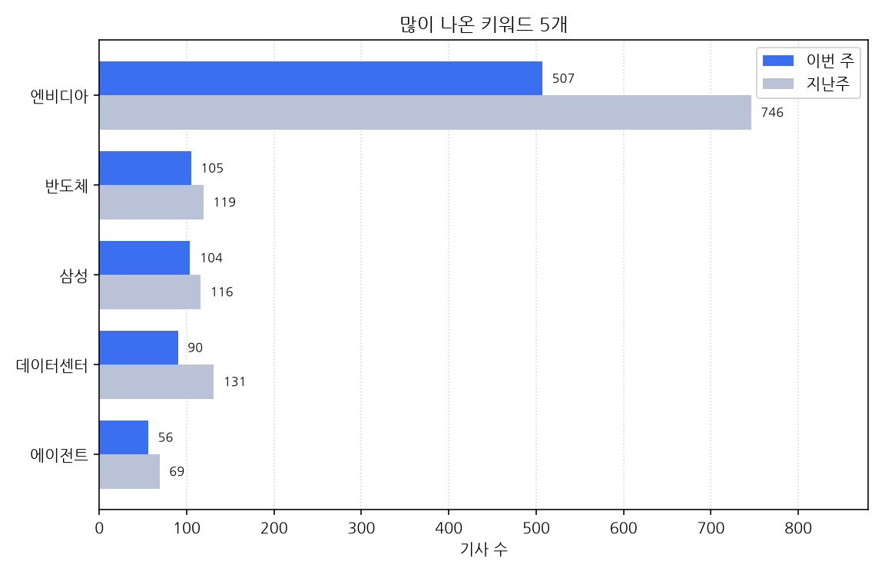

# 주간 AI 뉴스 리포트

대상 기간은 한국 시간으로 2026-11-16 월요일부터 2026-11-22 일요일까지다.
이번 주에 AI가 남긴 기사는 2746건, 지난주는 2049건이다. 697건 늘었다.

## 이번 주에 새로 나온 도구

- 11-16 '"로봇, 현장 도입 박차" 피지컬AI 밸리 만들고 신기술 사업화 [AI 인사이트]' 소식이 한 곳에서 나왔다 (대표 링크 https://www.fnnews.com/news/202611161814210713)
- 11-16 '교보문고, 대화형 AI 도서 추천 서비스 'Picks 에이전트' 선보여' 소식이 한 곳에서 나왔다 (대표 링크 https://www.segye.com/newsView/20261116501933)
- 11-16 '금호타이어, 서울 자율주행버스에 '스마트 타이어' 적용… 전국 확대 추진' 소식을 2개 매체가 다뤘다 (기사 2건, 대표 링크 https://biz.chosun.com/industry/company/2026/11/16/3Z4BYEDZXJDTLGAUKTIQC23POY/)
- 11-16 '여야, 'AI 수능 커닝' 우려 교육부 질타…"원스트라이크 아웃제 적용해야' 소식이 한 곳에서 나왔다 (대표 링크 https://biz.chosun.com/policy/politics/assembly/2026/11/16/WTD6ROZMC5EFFOIO53MY5JXYAQ/)
- 11-16 '차 사고 업데이트하면 자율주행 될까…FSD 승인은 불투명' 소식이 한 곳에서 나왔다 (대표 링크 https://www.hani.co.kr/arti/economy/economy_general/1287596.html)
- 11-16 '플리토, 관광공사 'AI 관광집사'에 다국어 통번역 공급…전통시장 4곳 적용' 소식이 한 곳에서 나왔다 (대표 링크 https://www.wikitree.co.kr/articles/1174898)
- 11-17 '"AI가 내놓은 95점짜리 답안…기업 경쟁력 되레 약화' 소식이 한 곳에서 나왔다 (대표 링크 https://zdnet.co.kr/view/?no=20261117093806)
- 11-17 '"AI로 삶에 맞춰 진화하는 집 만든다"…GS건설, 자이 미래 주거 비전 공개' 소식이 한 곳에서 나왔다 (대표 링크 https://www.etoday.co.kr/news/view/2648942)
- 11-17 '"살수록 맞춰지는 집"...GS건설, 2027년 하반기부터 자이에 'AI Home' 적용' 소식이 한 곳에서 나왔다 (대표 링크 https://newsway.co.kr/news/view?ud=2026111620543145273)
- 11-17 '"일회용 앞치마 착용·시험지 QR 도입하라"... 수능 앞두고 AI 부정행위 막는 방안도 온라인서 확산' 소식이 한 곳에서 나왔다 (대표 링크 https://www.insight.co.kr/news/582426)
- 11-17 '"집이 알아서 척척"…GS건설, AI홈 내년 처음 선보여' 소식이 한 곳에서 나왔다 (대표 링크 https://www.kmib.co.kr/article/20261117500180)
- 11-17 '"함께 문제 풀자" 수능 만점자, AI 의혹 리트 만점자에 공개 대결 신청' 소식이 한 곳에서 나왔다 (대표 링크 https://ichannela.com/news/detail/000000560351.do)
- 11-17 ''AI 커닝'이 불러온 대입 개편론 外' 소식이 한 곳에서 나왔다 (대표 링크 https://www.newspim.com/news/view/20261117001010)
- 11-17 '0.1초 만에 정답 내놓는 AI, 이제 '시험'의 시대는 끝났는가' 소식이 한 곳에서 나왔다 (대표 링크 https://zdnet.co.kr/view/?no=20261117111641)
- 11-17 'AI 부정행위 논란 속 티빙 '대리수능' 공개 임박⋯23일 첫선' 소식이 한 곳에서 나왔다 (대표 링크 https://www.etoday.co.kr/news/view/2649413)
- 11-17 'AI, 도입 넘어 가치 발굴로…델·구글 클라우드 등 총출동' 소식이 한 곳에서 나왔다 (대표 링크 https://zdnet.co.kr/view/?no=20261117085606)
- 11-17 'AMD, SC26서 슈퍼컴퓨팅·양자·AI 과학 인프라 전략 공개' 소식이 한 곳에서 나왔다 (대표 링크 https://www.ddaily.co.kr/page/view/2026111715454159496)
- 11-17 'AWS, 개발 프로세스까지 맡는 AI 에이전트 '키로 봇' 공개' 소식이 한 곳에서 나왔다 (대표 링크 https://zdnet.co.kr/view/?no=20261117110627)
- 11-17 'CJ대한통운, AI 물류 기술 브랜드 'TESIV' 출시…공급망 지능화 가속' 소식이 한 곳에서 나왔다 (대표 링크 https://www.etoday.co.kr/news/view/2649013)
- 11-17 'GS건설 새 주거상품 '비욘드 리빙' 공개…AI·플랫폼 평면·기후환경 대응 기술 접목' 소식이 한 곳에서 나왔다 (대표 링크 https://www.hani.co.kr/arti/economy/property/1287678.html)
- 11-17 'LG전자, AI·서랍형 냉동고 적용한 '스템 냉장고' 출시' 소식이 한 곳에서 나왔다 (대표 링크 https://www.newspim.com/news/view/20261026000079)
- 11-17 '美, 中 AI칩 우회접근 통제 강화…5개국 선적 허가제 도입' 소식이 한 곳에서 나왔다 (대표 링크 https://zdnet.co.kr/view/?no=20261117095135)
- 11-17 '與 "AI 부정행위 응시 제한 강화, 올해 수능 소급 적용 여부도 논의 중' 소식이 한 곳에서 나왔다 (대표 링크 https://biz.chosun.com/policy/politics/assembly/2026/11/17/UQDH7KJ6Q5DF7PNSRCDTPPFQYQ/)
- 11-17 '靑, 수능 앞두고 'AI 악용 부정행위 비상대책 TF' 가동' 소식을 3개 매체가 다뤘다 (기사 3건, 대표 링크 https://biz.chosun.com/policy/politics/president_office/2026/11/17/OFYG2NE4QNF5FOMG6N6IHESA7A/)
- 11-17 '갤럭시S27에 AI 비서 '갤럭시 클로' 탑재되나' 소식이 한 곳에서 나왔다 (대표 링크 https://zdnet.co.kr/view/?no=20261117091812)
- 11-17 '긴 상품 설명, AI가 핵심만…KT알파, AI 기반 방송·앱 개편' 소식이 한 곳에서 나왔다 (대표 링크 https://www.ddaily.co.kr/page/view/2026111709433616213)
- 11-17 '대입 개편론 대두…"'한탕주의'식 경쟁 벗어나야' 소식이 한 곳에서 나왔다 (대표 링크 https://www.newspim.com/news/view/20261117000797)
- 11-17 '래블업, 美 SC26 4년 연속 참가…AI 인프라 통합 운영 기술 공개' 소식이 한 곳에서 나왔다 (대표 링크 https://zdnet.co.kr/view/?no=20261117141617)
- 11-17 '벤츠, 내년 하반기 도심 자율주행 '레벨2++' 한국 도입…선탑재 차량은 OTA로 업그레이드' 소식이 한 곳에서 나왔다 (대표 링크 https://www.etnews.com/20261116000124)
- 11-17 '삼성 HR·HE 휴머노이드, 내년 CES서 공개…고성능·기본형 '투트랙' 소식이 한 곳에서 나왔다 (대표 링크 https://www.hani.co.kr/arti/economy/marketing/1287815.html)
- 11-17 '삼성전자, 반도체 미세결함 검사에 자체개발 AI 도입' 소식이 한 곳에서 나왔다 (대표 링크 https://biz.heraldcorp.com/article/10939402)
- 11-17 '수노 브리지, Ableton Live 템포·키 읽어 AI 곡 만든다…Mac 전용 베타' 소식이 한 곳에서 나왔다 (대표 링크 https://www.wikitree.co.kr/articles/1175114)
- 11-17 '수능만점자, AI의혹 '리트만점자'에 "같이 풀자"…공개 제안' 소식이 한 곳에서 나왔다 (대표 링크 http://inews24.com/view/2027368)
- 11-17 '슬래브부터 AI까지…GS건설, 신기술 담은 '자이' 미래전략 공개' 소식이 한 곳에서 나왔다 (대표 링크 https://news.mtn.co.kr/article/2026111709540470314)
- 11-17 '안철수 "AI 부정행위자 수법 공개해야, 李대통령은 입장 없나' 소식이 한 곳에서 나왔다 (대표 링크 https://www.fnnews.com/news/202611171555053108)
- 11-17 '알리바바 그룹, 차세대 AI 모델 큐웬4-Max 공개' 소식이 한 곳에서 나왔다 (대표 링크 https://kbench.com/?q=node/283380)
- 11-17 '애플 AI 스마트 글래스 'N50' 개발 중…2027년 WWDC 공개 전망' 소식이 한 곳에서 나왔다 (대표 링크 https://kbench.com/?q=node/283367)
- 11-17 '오픈AI, 병원 행정 처리하는 에이전트 공개...진료기록 읽고 보험신청까지[글로벌AI브리핑]' 소식이 한 곳에서 나왔다 (대표 링크 https://www.fnnews.com/news/202611170756368840)
- 11-17 '웨인힐스브라이언트 AI 토큰 비용 부담 없앤다… 월 74억개 토큰 무료연동 소스코드 공개' 소식이 한 곳에서 나왔다 (대표 링크 https://www.seoul.co.kr/news/economy/2026/11/17/20261117500286)
- 11-17 '인텔, AI 추론·HPC 겸용 가속기 `GPU D270` 공개' 소식이 한 곳에서 나왔다 (대표 링크 https://www.ddaily.co.kr/page/view/2026111715395334556)
- 11-17 '지그재그, AI 에이전트 도입…"맞춤형 쇼핑 강화' 소식이 한 곳에서 나왔다 (대표 링크 https://news.mtn.co.kr/article/2026111711091899840)
- 11-17 삼성 AI안경, '몰카' 차단 설계부터 적용…메타보다 한발 앞섰다고 한 곳이 전했다 (대표 링크 https://www.newspim.com/news/view/20261117000344)
- 11-18 '"AI 에이전트가 자산 탐색하고 담당자도 찾아줘"...AI스페라, 'AITEM' 출시' 소식이 한 곳에서 나왔다 (대표 링크 https://zdnet.co.kr/view/?no=20261118115003)
- 11-18 '"AI가 AI를 감시한다"…삼성전자, 무단 행동 차단하는 보안 특허 공개' 소식이 한 곳에서 나왔다 (대표 링크 https://www.newspim.com/news/view/20261118000577)
- 11-18 '"AI가 만점 받는 시험평가 방식 전면개편해야' 소식이 한 곳에서 나왔다 (대표 링크 https://www.etnews.com/20261118000364)
- 11-18 '"내가 죽으면 내 카톡은 누구 것?"... AI 패널들이 내놓은 엇갈린 결론' 소식이 한 곳에서 나왔다 (대표 링크 https://zdnet.co.kr/view/?no=20261118094817)
- 11-18 '"위협 분석부터 모의해킹까지"AI스페라, 보안 플랫폼 'AITEM' 출시' 소식이 한 곳에서 나왔다 (대표 링크 https://www.edaily.co.kr/News/Read?newsId=02509206645647032&mediaCodeNo=257)
- 11-18 ''10년 응시 제한'초강수…법 개정·현장 적용'과제' 소식이 한 곳에서 나왔다 (대표 링크 https://www.newspim.com/news/view/20261118000495)
- 11-18 'AWS, 수천 개 AI 에이전트가 개발한 'AWS 에뮬레이터' 출시' 소식이 한 곳에서 나왔다 (대표 링크 https://www.ddaily.co.kr/page/view/2026111814570361406)
- 11-18 'Daum "검색제휴 언론사와 AI 데이터 수익 함께 나눈다"...MY피드 공개' 소식이 한 곳에서 나왔다 (대표 링크 https://www.insight.co.kr/news/582571)
- 11-18 'KAIST, 화면 보고 일하는 AI 공개…4B 소형 모델' 소식이 한 곳에서 나왔다 (대표 링크 https://www.newspim.com/news/view/20261118001355)
- 11-18 'LGU+, AI로 IPTV 장애 사전 차단...420만대 적용' 소식이 한 곳에서 나왔다 (대표 링크 https://zdnet.co.kr/view/?no=20261118152038)
- 11-18 'LG유플러스, IPTV 셋톱박스 420만대에 AI 선제조치 시스템 적용' 소식이 한 곳에서 나왔다 (대표 링크 https://www.newspim.com/news/view/20261118000259)
- 11-18 'MS "클로드급 코딩AI를 10분의 1 가격으로"...신모델 AI 7종 공개[글로벌AI브리핑]' 소식이 한 곳에서 나왔다 (대표 링크 https://www.fnnews.com/news/202611180759315296)
- 11-18 'MS, AI 에이전트로 기업 혁신 가속…이그나이트서 '프런티어 생태계' 공개' 소식이 한 곳에서 나왔다 (대표 링크 https://www.etnews.com/20261118000329)
- 11-18 'MS, 디시전 1.1 공개…"기존 LLM보다 10배 빠르고 비용은 200분의 1' 소식이 한 곳에서 나왔다 (대표 링크 https://zdnet.co.kr/view/?no=20261118060848)
- 11-18 'MS, 인간ㆍAI 공동 작업공간 공개⋯"멀티플레이어 시대' 소식을 2개 매체가 다뤘다 (기사 2건, 대표 링크 https://www.etoday.co.kr/news/view/2649514)
- 11-18 'MS, 자체 코딩 AI 'MAI 코드 2' 공개…"오픈AI·앤트로픽보다 60~95% 저렴' 소식이 한 곳에서 나왔다 (대표 링크 https://www.ddaily.co.kr/page/view/2026111808335912507)
- 11-18 '李대통령, AI 활용 입시부정에 '전시 수준 대응' 지시…1억원 포상제 도입 검토' 소식이 한 곳에서 나왔다 (대표 링크 https://biz.heraldcorp.com/article/10940524)
- 11-18 '과제 마감 챙겨주는 AI…튜링, 학업 비서 '파이' 공개' 소식이 한 곳에서 나왔다 (대표 링크 https://www.edaily.co.kr/News/Read?newsId=04759286645647032&mediaCodeNo=257)
- 11-18 '대만 선정 '우수 AI 제품'에 韓 딥엑스 NPU 2개 탑재' 소식을 2개 매체가 다뤘다 (기사 2건, 대표 링크 https://biz.heraldcorp.com/article/10941336)
- 11-18 '마크비전, 중소 브랜드 위한 AI 위조상품 탐지 서비스 출시' 소식이 한 곳에서 나왔다 (대표 링크 https://zdnet.co.kr/view/?no=20261118164337)
- 11-18 '모빌린트, 日 AI 엑스포서 NPU 기반 솔루션 공개…현지 기업 협력 확대' 소식이 한 곳에서 나왔다 (대표 링크 https://www.ddaily.co.kr/page/view/2026111810031284206)
- 11-18 '모빌린트, 日 AI 전시회서 엣지 AI 솔루션 공개' 소식이 한 곳에서 나왔다 (대표 링크 https://zdnet.co.kr/view/?no=20261118095704)
- 11-18 '벤큐, 교육용 AI 전자칠판 `RE05A` 시리즈 국내 출시' 소식이 한 곳에서 나왔다 (대표 링크 https://www.ddaily.co.kr/page/view/2026111811372262768)
- 11-18 '뷰노, 매출 87% 책임지는 '딥카스' 3분기 28% 감소… 신규 도입·매출 다변화 과제' 소식이 한 곳에서 나왔다 (대표 링크 https://www.ddaily.co.kr/page/view/2026111717494723136)
- 11-18 '삼성SDI, AI 데이터센터용 차세대 배터리 솔루션 공개…美 RE+서 ESS·UPS·BBU 전시' 소식이 한 곳에서 나왔다 (대표 링크 https://www.ddaily.co.kr/page/view/2026111809573745515)
- 11-18 '삼성전기, 630V급 전기차용 MLCC 신제품 양산…AI 부품도 확대' 소식이 한 곳에서 나왔다 (대표 링크 https://www.newspim.com/news/view/20261118001103)
- 11-18 '세무사 최연소 합격자, AI 커닝 의심 받자 얼굴 공개하면서 '당당한' 인증' 소식이 한 곳에서 나왔다 (대표 링크 https://www.wikitree.co.kr/articles/1175636)
- 11-18 '수능 D-1, AI부정사건 후 고득점 불신 80%..탐지장비 도입해야' 소식이 한 곳에서 나왔다 (대표 링크 https://biz.heraldcorp.com/article/10941464)
- 11-18 '아웃시스템즈, 보험 사고 접수 자동화 AI 솔루션 출시' 소식이 한 곳에서 나왔다 (대표 링크 https://zdnet.co.kr/view/?no=20261118161042)
- 11-18 '아크릴, AI 스토리지 솔루션 첫 공개…"GPU부터 데이터 저장까지 최적화' 소식이 한 곳에서 나왔다 (대표 링크 https://www.edaily.co.kr/News/Read?newsId=03398086645647032&mediaCodeNo=257)
- 11-18 '안전 우려에 출시 접었던 오픈AI, 2개월 만에 신모델' 소식이 한 곳에서 나왔다 (대표 링크 https://zdnet.co.kr/view/?no=20261118172959)
- 11-18 '오픈AI, `GPT-6.2 아스트라·솔` 출시… AI 연구·보안 역량 강화' 소식이 한 곳에서 나왔다 (대표 링크 https://www.ddaily.co.kr/page/view/2026111809500749502)
- 11-18 '오픈AI, 새 '아스트라' 모델 공개…앤스로픽 상장 앞두고 맞불' 소식이 한 곳에서 나왔다 (대표 링크 https://www.edaily.co.kr/News/Read?newsId=02082806645647032&mediaCodeNo=257)
- 11-18 '이준석, 비행기서 직접 만든 'AI커닝 탐지 앱' 공개 "감독관 휴대폰으로 신호 포착' 소식이 한 곳에서 나왔다 (대표 링크 https://www.munhwa.com/article/11632062)
- 11-18 '이준석, 수능 AI 부정행위 막을 '전파 탐지 앱' 직접 개발해 공개' 소식이 한 곳에서 나왔다 (대표 링크 https://www.insight.co.kr/news/582611)
- 11-18 '인천 영종구, 어린이 통학로 안전 강화 위해 용인시 AI 스마트 횡단보도 시찰' 소식을 2개 매체가 다뤘다 (기사 2건, 대표 링크 https://womannews.net/detail.php?number=459615&thread=22r12r01)
- 11-18 '중국 휴머노이드 로봇 APEC서 주목… 한국 산업 현장 적용 추진' 소식이 한 곳에서 나왔다 (대표 링크 https://www.ohmynews.com/NWS_Web/View/at_pg.aspx?CNTN_CD=A0003286117&PAGE_CD=N0002&BLCK_NO=&CMPT_CD=M0147)
- 11-18 '중랑구, 류경기 구청장도 배우는 AI 활용법 영상 공개…행정 혁신 확산' 소식이 한 곳에서 나왔다 (대표 링크 https://biz.heraldcorp.com/article/10940498)
- 11-18 '지슨, 연내 시험장 부정행위 감시 장비 출시…AI 활용 부정행위 차단' 소식이 한 곳에서 나왔다 (대표 링크 https://www.etoday.co.kr/news/view/2649827)
- 11-18 '코드 전부 AI가 짰다…AWS, 로컬 에뮬레이터 출시' 소식을 2개 매체가 다뤘다 (기사 2건, 대표 링크 https://www.edaily.co.kr/News/Read?newsId=03161926645647032&mediaCodeNo=257)
- 11-18 '하이브랩 그룹 3사, 지스타 2026서 AI 기반 글로벌 마케팅 전략 공개' 소식이 한 곳에서 나왔다 (대표 링크 https://www.newspim.com/news/view/20261118000504)
- 11-18 '홍정화 다올티에스 대표 "HW·SW·서비스 풀스택…기업 AI 도입, 선택 부담 줄여' 소식이 한 곳에서 나왔다 (대표 링크 https://www.etnews.com/20261118000192)
- 11-18 KT, 서울대병원서 AI 로봇 실증…어린이 환자 돌봄 돕는다고 2개 매체가 전했다 (기사 2건, 대표 링크 https://www.ddaily.co.kr/page/view/2026111809380045012)
- 11-18 MS, 실시간 위험 분석·격리 기능 공개…"폭주하는 AI 에이전트 막는다고 한 곳이 전했다 (대표 링크 https://zdnet.co.kr/view/?no=20261118105406)
- 11-18 전북도, 동부권 자율주행 교통서비스 도입 특례 해법 찾는다고 한 곳이 전했다 (대표 링크 http://inews24.com/view/2027504)
- 11-19 '"AI 도입하니 검사시간 86% 단축"…中企 AI 전환 성과 한자리에' 소식이 한 곳에서 나왔다 (대표 링크 https://biz.heraldcorp.com/article/10942106)
- 11-19 '"AI 투자 성패, 운영에 달렸다"…델, 인프라 자동화 전략 공개' 소식이 한 곳에서 나왔다 (대표 링크 https://zdnet.co.kr/view/?no=20261119100455)
- 11-19 '"ESS 화재 징후 사흘 전 감지"⋯삼성SDI, AI 안전 기술 확대' 소식을 2개 매체가 다뤘다 (기사 2건, 대표 링크 http://inews24.com/view/2027969)
- 11-19 '"배터리 화재 사흘 전 경고"…삼성SDI, ESS에 AI 안전기술 탑재' 소식이 한 곳에서 나왔다 (대표 링크 https://www.etoday.co.kr/news/view/2650131)
- 11-19 ''AI 부정행위 의혹' 리트 만점자 심정지⋯미미미누·백지연 영상 비공개' 소식이 한 곳에서 나왔다 (대표 링크 https://www.etoday.co.kr/news/view/2650598)
- 11-19 'AI 검사 도입에 불량률 77.5%↓…중기부, 지역 혁신사례 확산' 소식이 한 곳에서 나왔다 (대표 링크 https://www.etoday.co.kr/news/view/2650278)
- 11-19 'AI가 설계하고 사람이 검증…넥센타이어, 차세대 타이어 개발 방식 공개' 소식이 한 곳에서 나왔다 (대표 링크 https://www.ddaily.co.kr/page/view/2026111908373966573)
- 11-19 'AI가 읽고 움직이는 쇼핑몰…NHN커머스, 고도몰에 GEO·WebMCP 적용' 소식이 한 곳에서 나왔다 (대표 링크 https://www.ddaily.co.kr/page/view/2026111909154820725)
- 11-19 'MS도 저가 모델 공개⋯ AI '가성비 경쟁' 소식이 한 곳에서 나왔다 (대표 링크 https://www.kmib.co.kr/article/20261118502410)
- 11-19 'NHN커머스, 고도몰에 AI 검색 최적화·쇼핑 에이전트 기능 도입' 소식이 한 곳에서 나왔다 (대표 링크 https://zdnet.co.kr/view/?no=20261119103917)
- 11-19 '`AI 부정행위` 의혹 해소 기대했는데…`LEET 만점` 이진우, 공개 검증 불참' 소식이 한 곳에서 나왔다 (대표 링크 https://www.ddaily.co.kr/page/view/2026111909381760698)
- 11-19 '美 연쇄 전산마비는 'AI발 패치 대란'…해킹 아닌 업데이트 오류' 소식이 한 곳에서 나왔다 (대표 링크 https://www.koreatimes.com/article/11632016)
- 11-19 '구글, AI 에이전트 특화 `제미나이4 네온` 출시… 작업 비용 32% 절감' 소식이 한 곳에서 나왔다 (대표 링크 https://www.ddaily.co.kr/page/view/2026111917190446186)
- 11-19 '구글, 제미나이 4 '네온' 공개…아르곤·카본 이어 또 내놓은 이유는' 소식이 한 곳에서 나왔다 (대표 링크 https://zdnet.co.kr/view/?no=20261119143244)
- 11-19 '넥센타이어, 유럽서 AI 기반 타이어 개발 기술 공개 "설계안 수천 개 탐색' 소식이 한 곳에서 나왔다 (대표 링크 https://www.etoday.co.kr/news/view/2650122)
- 11-19 '디노티시아, AI 검색 반도체 'VDPU' ASIC 구동 첫 공개' 소식을 2개 매체가 다뤘다 (기사 3건, 대표 링크 https://zdnet.co.kr/view/?no=20261119095429)
- 11-19 '라온피플 '오딘 AI 엣지' 출시…AI 분석·관제·영상저장 통합' 소식이 한 곳에서 나왔다 (대표 링크 https://www.edaily.co.kr/News/Read?newsId=02489526645647360&mediaCodeNo=257)
- 11-19 '라온피플, GPU 서버 없이 영상관제 가능한 '오딘 AI 엣지' 출시' 소식이 한 곳에서 나왔다 (대표 링크 https://www.newspim.com/news/view/20261119000620)
- 11-19 '배차 넘어 라이더 수익성까지…바로고, AI 지능형 관제 도입' 소식이 한 곳에서 나왔다 (대표 링크 https://www.ddaily.co.kr/page/view/2026111909260895242)
- 11-19 '북한, AI 챗봇 '지혜의 샘' 공개…"사회·정치 질문 말라' 소식이 한 곳에서 나왔다 (대표 링크 https://www.segye.com/newsView/20261119507451)
- 11-19 '북한판 챗GPT '지혜의 샘' 공개⋯정치 질문은 차단' 소식이 한 곳에서 나왔다 (대표 링크 https://www.kmib.co.kr/article/20261119501837)
- 11-19 '블룸에이아이 '해피톡 AI 어시스턴트', 상담 답변 기능 업데이트' 소식이 한 곳에서 나왔다 (대표 링크 https://www.newspim.com/news/view/20261119000288)
- 11-19 '삼성SDI, ESS 배터리에 AI 화재 예방 SW 적용…"이상 징후 최소 3일 전 감지' 소식이 한 곳에서 나왔다 (대표 링크 https://www.wikitree.co.kr/articles/1175854)
- 11-19 '삼쩜삼, 첫 화면 '환급'으로 개편…월세 계약서 AI로 점검' 소식이 한 곳에서 나왔다 (대표 링크 https://www.edaily.co.kr/News/Read?newsId=02027046645647360&mediaCodeNo=257)
- 11-19 '수능 다음 임용고시, 국가시험 줄줄이 남았는데…'AI 안경 탐지기' 내년에야 도입' 소식이 한 곳에서 나왔다 (기사 2건, 대표 링크 https://biz.heraldcorp.com/article/10943031)
- 11-19 '심평원, AI로 진료비 심사 개편…"올해 도수치료 '풍선효과' 대책 마련' 소식이 한 곳에서 나왔다 (대표 링크 https://www.hani.co.kr/arti/society/health/1288198.html)
- 11-19 '엔비디아 GPU 도입한 심평원…"AI 심사 체계 구축' 소식이 한 곳에서 나왔다 (대표 링크 https://biz.chosun.com/science-chosun/bio/2026/11/19/VOS6K2OOTNDLBDH5LNCCTH2ZWE/)
- 11-19 '여러 명 목소리 구분해 텍스트로…일레븐랩스, 음성 AI 출시' 소식이 한 곳에서 나왔다 (대표 링크 https://zdnet.co.kr/view/?no=20261119111443)
- 11-19 '연이은 美전산 먹통에…MS부사장 "노후시스템 AI로 개편해야' 소식이 한 곳에서 나왔다 (대표 링크 https://www.koreatimes.com/article/11631982)
- 11-19 '칩·부품 통제론 모자라… 美, 중국산 AI 사용 내역 공개 방안 논의' 소식이 한 곳에서 나왔다 (대표 링크 https://www.edaily.co.kr/News/Read?newsId=04500166645647360&mediaCodeNo=257)
- 11-19 '파네시아, 글로벌 AI 데이터센터 시장 공략…CXL 차세대 칩 내년 공개' 소식이 한 곳에서 나왔다 (대표 링크 https://www.etnews.com/20261119000263)
- 11-19 '평촌에 웰니스 호텔 '마티에 노블' 19일 개관…AI 헬스케어 서비스 도입' 소식이 한 곳에서 나왔다 (대표 링크 https://biz.heraldcorp.com/article/10941693)
- 11-19 '핀테크 지원사업, AI로 한 번에 찾는다…'핀톡24' 출시' 소식이 한 곳에서 나왔다 (대표 링크 https://www.hani.co.kr/arti/economy/finance/1288102.html)
- 11-19 '헤세드릿지, 상담 전용 AI '달램톡' 정식 출시' 소식이 한 곳에서 나왔다 (대표 링크 https://zdnet.co.kr/view/?no=20261119101427)
- 11-19 제미나이 4 네온, 깃허브 코파일럿 탑재…단가 25% 내렸지만 출력 토큰은 15% 더 쓴다고 한 곳이 전했다 (대표 링크 https://www.wikitree.co.kr/articles/1176127)
- 11-20 ''MDEET 전국 1위' 치전원생이 "AI 커닝 안 했다"라며 공개한 증거' 소식이 한 곳에서 나왔다 (대표 링크 https://www.wikitree.co.kr/articles/1176300)
- 11-20 ''미트 수석도 AI 커닝?' 의혹에…"난 아냐" 협성대→건대→연대→치전원 이력, 6년치 성적 공개하며' 소식이 한 곳에서 나왔다 (대표 링크 https://biz.heraldcorp.com/article/10944446)
- 11-20 ''북한판 챗GPT' 공개? "사회 정치 질문은 제기 말라" AI도 통제하는 北' 소식이 한 곳에서 나왔다 (대표 링크 https://ichannela.com/news/detail/000000560868.do)
- 11-20 'AI 에이전트도 돈 받고 일한다… CROO, 클로드 코드·코덱스용 '크루 스킬' 출시' 소식이 한 곳에서 나왔다 (대표 링크 https://www.edaily.co.kr/News/Read?newsId=02181206645647688&mediaCodeNo=257)
- 11-20 'AWS, 미래에셋증권 금융 AI 구축 지원…상품 검색에 AI 에이전트 적용' 소식이 한 곳에서 나왔다 (대표 링크 https://zdnet.co.kr/view/?no=20261120140503)
- 11-20 'SK하이닉스, HBM 넘어 AI 시스템까지…차세대 메모리 기술 공개' 소식이 한 곳에서 나왔다 (대표 링크 https://www.newspim.com/news/view/20261120000432)
- 11-20 '李 대통령 "AI 첨단 장비 악용한 부정행위, 기존 방법으론 못막아"… 국가시험 전면 개편 예고' 소식이 한 곳에서 나왔다 (대표 링크 https://www.ddaily.co.kr/page/view/2026112016215076990)
- 11-20 '구로구 누리집 인공지능 기반 자동 번역 기능 도입' 소식을 2개 매체가 다뤘다 (기사 2건, 대표 링크 https://biz.heraldcorp.com/article/10943474)
- 11-20 '더존비즈온, 공공기관 AX 공략…행정 AI 에이전트 선보여' 소식이 한 곳에서 나왔다 (대표 링크 https://zdnet.co.kr/view/?no=20261120094756)
- 11-20 '뤼튼 "크랙, 모든 서비스 권역서 이용연령 상향"…AI 모델 별도 모니터링·기술 적용' 소식이 한 곳에서 나왔다 (대표 링크 https://www.ddaily.co.kr/page/view/2026112010322686077)
- 11-20 '메타, 스마트폰 없이 쓰는 AI 비서 '뮤즈 참' 12월 출시' 소식이 한 곳에서 나왔다 (대표 링크 https://zdnet.co.kr/view/?no=20261120103034)
- 11-20 '모레, SC26서 AI 추론 최적화 기술 'TIDE' 공개 "GPU 처리량 1.66배 향상' 소식이 한 곳에서 나왔다 (대표 링크 https://www.ddaily.co.kr/page/view/2026112016453866399)
- 11-20 '모레, 美 'SC26'서 차세대 AI 추론 프레임워크 'TIDE' 첫 공개' 소식이 한 곳에서 나왔다 (대표 링크 https://www.edaily.co.kr/News/Read?newsId=02266486645647688&mediaCodeNo=257)
- 11-20 '수노, 가사 맞춰 립싱크하는 15초 AI 영상 '비주얼스' 출시…오디오부터 고치라는 반응도' 소식이 한 곳에서 나왔다 (대표 링크 https://www.wikitree.co.kr/articles/1176146)
- 11-20 '앤트로픽, 공개 이틀째 첫 개장전 거래서 6% ↓' 소식이 한 곳에서 나왔다 (대표 링크 https://www.fnnews.com/news/202611201837422421)
- 11-20 '올리브영, 첫 테크 콘퍼런스 개최…AI·글로벌 플랫폼 전략 공개' 소식이 한 곳에서 나왔다 (대표 링크 http://inews24.com/view/2028476)
- 11-20 '위세아이텍, 공공 데이터 분석에 AI 에이전트 적용 확대' 소식이 한 곳에서 나왔다 (대표 링크 https://zdnet.co.kr/view/?no=20261120145440)
- 11-20 '의·치의학 수석, 'AI 부정행위 의혹'에 성적표·시험지 공개하고 반박' 소식이 한 곳에서 나왔다 (대표 링크 https://biz.chosun.com/topics/topics_social/2026/11/20/BVDK62HJTZDBTI4RZBHCGI4WXM/)
- 11-20 '인천 검단구의회 나선희 의원, 공공수영장 AI 안전관리시스템 도입 제안' 소식을 2개 매체가 다뤘다 (기사 4건, 대표 링크 https://womannews.net/detail.php?number=459801&thread=22r03r01)
- 11-20 '인천 옹진군, 섬 지역 어르신 돌봄에 AI 바둑로봇 도입…덕적면 복지시설 설치' 소식이 한 곳에서 나왔다 (기사 2건, 대표 링크 https://womannews.net/detail.php?number=459821&thread=22r12r01)
- 11-20 '전장 학습하는 AI 개발 논의…국기연, 무인자율체계 적용 모색' 소식이 한 곳에서 나왔다 (대표 링크 http://www.newstomato.com/ReadNews.aspx?no=1321208)
- 11-20 '중랑구, 'AI 행정혁신' 2030 청사진 첫 공개…공공 AX 기준도시 도전' 소식이 한 곳에서 나왔다 (대표 링크 https://biz.heraldcorp.com/article/10943349)
- 11-20 '쿤텍, 디지엑스 B300 도입해 AI 검증 자체 수행' 소식이 한 곳에서 나왔다 (대표 링크 https://zdnet.co.kr/view/?no=20261120110611)
- 11-20 '트럼프, 선전 출국하자마자 美 기업에 중국 AI 사용 의무 공개 추진' 소식이 한 곳에서 나왔다 (대표 링크 https://www.fnnews.com/news/202611201047231964)
- 11-20 '현대차, LA 오토쇼서 '디 올 뉴 아반떼' 공개…차체 키우고 AI 탑재' 소식이 한 곳에서 나왔다 (대표 링크 https://www.newspim.com/news/view/20261120000281)
- 11-20 '李 "국가시험제도, AI 부정행위 등 환경 변화 맞춰 전면 개편' 소식을 5개 매체가 다뤘다 (기사 6건, 대표 링크 https://biz.chosun.com/policy/politics/president_office/2026/11/20/SA7N3OBVBZH6FICPCSUNIPBKCA/)
- 11-21 '李대통령 "AI 부정 등 환경변화…국가시험 A부터 Z까지 개편' 소식이 한 곳에서 나왔다 (대표 링크 https://www.koreatimes.com/article/11632354)
- 11-21 '게임사 못지않은 존재감…뤼튼이 선보인 AI 엔터테인먼트' 소식이 한 곳에서 나왔다 (대표 링크 https://zdnet.co.kr/view/?no=20261119144615)
- 11-21 '삼성전자, 메타 독주 'AI 안경' 시장에 도전…다음 달 첫 제품 출시' 소식이 한 곳에서 나왔다 (대표 링크 http://inews24.com/view/2028766)
- 11-22 ''누구 대신 일했나' 남긴다⋯AWS, 기업용 AI 에이전트에 업무 과정 기록 기능 도입' 소식이 한 곳에서 나왔다 (대표 링크 http://inews24.com/view/2028855)
- 11-22 'AI 커닝에 수능 개편론 급부상…서·논술형·자격고사 거론' 소식이 한 곳에서 나왔다 (대표 링크 https://www.koreatimes.com/article/11632387)
- 11-22 'AI 커닝에 수능 개편론 재부상…"시험 관리와 제도 개편은 별개' 소식이 한 곳에서 나왔다 (대표 링크 https://www.newspim.com/news/view/20261122000056)
- 11-22 'AI시대에 맞게 수능을 비롯한 각종 국가시험 평가 방식을 개편해야' 소식이 한 곳에서 나왔다 (대표 링크 https://www.ddaily.co.kr/page/view/2026112017453552458)
- 11-22 'LGU+ 조직개편...AI 조직 재편으로 성과 속도전' 소식이 한 곳에서 나왔다 (대표 링크 https://zdnet.co.kr/view/?no=20261122085359)
- 11-22 'LG유플러스, AI 성과 창출에 방점···2027년 조직개편 단행' 소식이 한 곳에서 나왔다 (대표 링크 https://www.newsway.co.kr/news/view?ud=2026112022253779841)
- 11-22 '국힘, AI 유급 일자리 2만개 마련 등 청년 정책 발표…"미래세대 영향평가 도입' 소식이 한 곳에서 나왔다 (대표 링크 https://www.etoday.co.kr/news/view/2651346)
- 11-22 '반려동물과의 추억이 AI 아트로…이윰, 참여형 갈라 콘서트 선보여' 소식이 한 곳에서 나왔다 (대표 링크 https://www.edaily.co.kr/News/Read?newsId=01954886645648344&mediaCodeNo=257)
- 11-22 '벤츠 vs BMW '레벨2++ 자율주행' 정면승부…하드웨어 선탑재 여부와 기술 성숙도 봐야' 소식이 한 곳에서 나왔다 (대표 링크 https://www.etnews.com/20261121000037)
- 11-22 '수능 개편론 확산⋯서·논술형 도입 넘어 폐지론까지 [AI커닝 후폭풍]' 소식이 한 곳에서 나왔다 (대표 링크 https://www.etoday.co.kr/news/view/2651320)

## 규제와 정책

- 11-16 '"AI 개발해 내부서만 쓰면 규제 제외?"…AI 기본법 사각지대 우려' 소식이 한 곳에서 나왔다 (대표 링크 https://www.newspim.com/news/view/20261116001304)
- 11-16 '"AI 연구 확산에 윤리도 중요"…연구재단·생명윤리정책원 맞손' 소식이 한 곳에서 나왔다 (대표 링크 https://biz.heraldcorp.com/article/10938830)
- 11-16 '"수험생은 스마트 안경 소지만 해도 부정행위 간주"…대학가, AI 안경 지침 확산' 소식이 한 곳에서 나왔다 (대표 링크 https://www.newspim.com/news/view/20261110001349)
- 11-16 ''AI 커닝' 못 막은 정부…국가자격시험 법적 책임 어디까지' 소식이 한 곳에서 나왔다 (대표 링크 https://www.edaily.co.kr/News/Read?newsId=02837206645646376&mediaCodeNo=257)
- 11-16 ''AI 커닝' 세무사 수석 처벌은…챗GPT·스마트안경 적발보니' 소식이 한 곳에서 나왔다 (대표 링크 https://www.koreatimes.com/article/11631567)
- 11-16 ''AI 커닝'갈수록 고도화되는데…처벌·양형은 아직도'아날로그' 소식이 한 곳에서 나왔다 (대표 링크 https://www.fnnews.com/news/202611161456114026)
- 11-16 ''AI 커닝'또 있나…정부, 5년치 세무사 합격자'특이 점수' 들여다본다-경제ㅣ한국일보' 소식을 2개 매체가 다뤘다 (기사 2건, 대표 링크 https://www.hankookilbo.com/news/article/A2026111615490000857)
- 11-16 ''수능 D-3' AI부정행위 비상…정부 "전수조사·전담팀 수사로 끝까지 엄단' 소식이 한 곳에서 나왔다 (대표 링크 https://www.fnnews.com/news/202611160505557033)
- 11-16 ''수능 D-3' 감독 교사들 "AI커닝, 구체적 지침 달라…시험제도 근본적 개선도 필요' 소식이 한 곳에서 나왔다 (대표 링크 https://www.pressian.com/pages/articles/2026111609330008042)
- 11-16 'AI 법안 477건 중 커닝 대책 '0'…사태 터지자 '늑장 입법' 소식이 한 곳에서 나왔다 (대표 링크 http://www.newstomato.com/ReadNews.aspx?no=1320601)
- 11-16 'AI 부정행위 논란에…금감원, 보험계리사·손해사정사 시험도 점검' 소식이 한 곳에서 나왔다 (대표 링크 https://www.newspim.com/news/view/20261116001055)
- 11-16 'AI 부정행위에 뚫린 세무사시험…정부, 최근 3~5년 합격자 재검점' 소식이 한 곳에서 나왔다 (대표 링크 https://www.newspim.com/news/view/20261116001111)
- 11-16 'AI 안경 금지만으론 못 막는다…국내 시험장도 '판별 역량' 시험대 [안경 쓴 AI, 시험대 오른 공정성]' 소식이 한 곳에서 나왔다 (기사 2건, 대표 링크 https://www.etoday.co.kr/news/view/2648628)
- 11-16 'AI가 사람 죽일지 결정하는 무기…美·러, 국제 규제 제동' 소식이 한 곳에서 나왔다 (대표 링크 https://www.edaily.co.kr/News/Read?newsId=01984406645646376&mediaCodeNo=257)
- 11-16 '美 백악관, AI 사고 자진신고 기업에 규제 책임 완화 권고' 소식이 한 곳에서 나왔다 (대표 링크 https://www.etnews.com/20261116000016)
- 11-16 '경찰, AI 안경 악용한 시험 부정행위 집중 단속…온라인 자백글도 추적' 소식이 한 곳에서 나왔다 (대표 링크 https://www.ddaily.co.kr/page/view/2026111617042408949)
- 11-16 '국회 교육위, 수능 사흘 앞 'AI안경 부정행위 대책' 현안보고' 소식을 2개 매체가 다뤘다 (기사 3건, 대표 링크 https://www.fnnews.com/news/202611160500532589)
- 11-16 '국회 교육위원회, 2027년도 교육부 예산안 및 AI 스마트안경 대응방안 논의' 소식이 한 곳에서 나왔다 (기사 2건, 대표 링크 https://womannews.net/detail.php?number=459447&thread=22r03r01)
- 11-16 '금감원, 세계투자자주간 맞아 AI 금융사기 예방 교육 확대' 소식이 한 곳에서 나왔다 (대표 링크 https://www.newspim.com/news/view/20261115000146)
- 11-16 '미 상무장관, 가족기업과 거래 데이터센터 '수출규제 완화' 시도 의혹' 소식이 한 곳에서 나왔다 (대표 링크 https://www.hani.co.kr/arti/international/america/1287538.html)
- 11-16 '보훈공단, 'AI 윤리 준수기관 확인마크' 획득' 소식을 2개 매체가 다뤘다 (기사 2건, 대표 링크 http://www.newstomato.com/ReadNews.aspx?no=1320520)
- 11-16 '사흘 뒤 수능인데…'AI 커닝' 실토에 정부·업계 초비상' 소식이 한 곳에서 나왔다 (대표 링크 https://www.fnnews.com/news/202611160600589445)
- 11-16 '세무사 수석 'AI 부정행위'실토에 정부도'비상'···재경부 "효력정지 논의' 소식이 한 곳에서 나왔다 (대표 링크 https://www.newsway.co.kr/news/view?ud=2026111514475627648)
- 11-16 '세무사 수석 부정행위에 '너도 AI로?' 의심 확산…줄고발 우려도' 소식이 한 곳에서 나왔다 (대표 링크 https://www.fnnews.com/news/202611160625339340)
- 11-16 '세무사 시험 부정행위자 처벌은?…합격은 취소돼도 실형은 피할 수도 [AI 커닝 후폭풍]' 소식이 한 곳에서 나왔다 (대표 링크 https://www.busan.com/view/busan/view.php?code=2026111618232318611)
- 11-16 '수능 AI 부정행위 막을 '전파 차단' 실효성 있나…전파법 규제·통신 장애 우려' 소식이 한 곳에서 나왔다 (대표 링크 https://www.newspim.com/news/view/20261116001185)
- 11-16 '수능 D-3, AI 부정행위 막는다... 한 총리 "범정부 긴급대응팀 구성"-정치ㅣ한국일보' 소식을 5개 매체가 다뤘다 (기사 5건, 대표 링크 https://www.edaily.co.kr/News/Read?newsId=01485846645646376&mediaCodeNo=257)
- 11-16 '수능 스마트기기 전면 차단...정부 'AI 커닝'종합대책 착수,'늑장조치' 비판' 소식이 한 곳에서 나왔다 (대표 링크 https://www.fnnews.com/news/202611161612256692)
- 11-16 '수능 코앞인데 AI 부정행위 파문…청와대, 국가자격시험 전수조사' 소식을 2개 매체가 다뤘다 (기사 2건, 대표 링크 https://zdnet.co.kr/view/?no=20261115205153)
- 11-16 '앤트로픽 IPO, 중국·홍콩 기관투자자에 `빗장`… 美 방산규제 영향' 소식이 한 곳에서 나왔다 (대표 링크 https://www.ddaily.co.kr/page/view/2026111610100542475)
- 11-16 '어디까지 고영향 AI인가…AI기본법 적용 현장서 혼선' 소식이 한 곳에서 나왔다 (대표 링크 https://zdnet.co.kr/view/?no=20261116162921)
- 11-16 '정부, AI 부정행위 '세무사 수석' 시험 무효·5년 응시자격 정지' 소식이 한 곳에서 나왔다 (대표 링크 https://www.hani.co.kr/arti/politics/politics_general/1287534.html)
- 11-16 '정부, 수능 AI 부정 막으려 전파차단 검토' 소식이 한 곳에서 나왔다 (대표 링크 https://zdnet.co.kr/view/?no=20261116150738)
- 11-16 '정부, 수능 시험장 공공 와이파이 차단 검토…AI 부정행위 대응 총력' 소식이 한 곳에서 나왔다 (대표 링크 https://www.ddaily.co.kr/page/view/2026111615102902723)
- 11-16 '정부, 수능시험장 '와이파이 차단' 추진⋯범정부 TF 구성' 소식이 한 곳에서 나왔다 (기사 2건, 대표 링크 http://inews24.com/view/2026677)
- 11-16 '젠슨 황 불명예 퇴진에 美 `RASA 법안` 급물살… K-반도체·데이터센터 파장은' 소식이 한 곳에서 나왔다 (대표 링크 https://www.ddaily.co.kr/page/view/2026111616145237663)
- 11-16 '초소형 카메라·AI로 뚫린 세무사 시험…범정부 TF 꾸려 대책 논의' 소식이 한 곳에서 나왔다 (대표 링크 https://www.newspim.com/news/view/20261116000662)
- 11-16 '최교진 "수능 감독관, 'AI 커닝' 단속 중 소송당하면 보호' 소식이 한 곳에서 나왔다 (대표 링크 https://www.edaily.co.kr/News/Read?newsId=02168086645646376&mediaCodeNo=257)
- 11-16 '한 총리 "AI 악용 시험 부정행위 심각…수능 코앞, 범정부 역량 총동원' 소식이 한 곳에서 나왔다 (대표 링크 https://www.fnnews.com/news/202611160909269239)
- 11-16 '한 총리 주재 'AI 부정행위 대응' 후속회의…범정부 총력 대응' 소식이 한 곳에서 나왔다 (대표 링크 https://www.fnnews.com/news/202611160501318928)
- 11-16 '한국 국가 자격시험 '컨닝' 사태 이후 AI 기반 부정행위 단속 확대' 소식이 한 곳에서 나왔다 (대표 링크 https://www.voakorea.com/a/8223926.html)
- 11-16 '한성숙 총리 "AI 수능 컨닝 차단 총력"…범정부 긴급 대응팀 구성' 소식이 한 곳에서 나왔다 (대표 링크 https://www.ddaily.co.kr/page/view/2026111609255331621)
- 11-16 입시 유튜버 미미미누, 수능 연기 주장⋯"AI 기능으로 문제 풀어, 윤리성 찾아볼 수 없다고 한 곳이 전했다 (대표 링크 http://inews24.com/view/2026380)
- 11-16 정부 "AI 부정 세무사 수석 합격 취소"... 올해 실시된 전체 국가시험 전수조사한다고 한 곳이 전했다 (대표 링크 https://www.insight.co.kr/news/582178)
- 11-17 '"AI로 9급 합격했다" 공무원시험 부정 합격 자백글까지... 정부 입장은?' 소식이 한 곳에서 나왔다 (대표 링크 https://www.insight.co.kr/news/582462)
- 11-17 '"나이 때문에 AI부정행위 못잡아" 최교진, 직무유기 고발 당해' 소식이 한 곳에서 나왔다 (대표 링크 https://ichannela.com/news/detail/000000560329.do)
- 11-17 '"나이가 있어서 어렵다" AI 커닝 불안감 더 키우는 정부[사설]' 소식이 한 곳에서 나왔다 (대표 링크 https://www.munhwa.com/article/11631928)
- 11-17 '"먼저 출시했다가 매 맞을라…韓 AI 에이전트 서비스, 규제 위기감 고조' 소식이 한 곳에서 나왔다 (대표 링크 https://www.ddaily.co.kr/page/view/2026111616282134962)
- 11-17 '"원고의 주장에 의하더라도"…이용철 5·18 보상 소송, 왜 기각됐나' 소식이 한 곳에서 나왔다 (대표 링크 https://www.newspim.com/news/view/20261116001162)
- 11-17 ''19금' 캐릭터챗 심의 초읽기…업계, 청소년 보호 고삐' 소식이 한 곳에서 나왔다 (대표 링크 https://zdnet.co.kr/view/?no=20261117154347)
- 11-17 ''AI 커닝' 세무사 수석 합격자 처벌 실형도 가능?… 법원 판례 봤더니-사회ㅣ한국일보' 소식이 한 곳에서 나왔다 (대표 링크 https://www.hankookilbo.com/news/article/A2026111613090003261)
- 11-17 ''AI커닝' 정부 대책은 "원천 차단"... 안경·시계 전수조사' 소식이 한 곳에서 나왔다 (대표 링크 https://www.ohmynews.com/NWS_Web/View/at_pg.aspx?CNTN_CD=A0003285702&PAGE_CD=N0002&CMPT_CD=M0112)
- 11-17 'AI 부정행위, 의심만으로 재시험 요구할 수 있을까…23년 전 토익 판결은' 소식이 한 곳에서 나왔다 (대표 링크 https://biz.chosun.com/topics/law_firm/2026/11/17/DWMFSMZ7IVCQBFOIRV2WS4RGY4/)
- 11-17 'AI 커닝에 "와이파이 차단"⋯ 우왕좌왕 정부' 소식을 2개 매체가 다뤘다 (기사 2건, 대표 링크 https://www.kmib.co.kr/article/20261116501771)
- 11-17 'IFAC "AI 활용하되 악용은 막아야…회계사 윤리가 근간' 소식이 한 곳에서 나왔다 (대표 링크 https://www.etoday.co.kr/news/view/2649240)
- 11-17 '李대통령 "수능 AI 부정행위 기록 제출 의무화·신고 포상금 1억" 지시' 소식이 한 곳에서 나왔다 (대표 링크 https://www.edaily.co.kr/News/Read?newsId=05280806645646704&mediaCodeNo=257)
- 11-17 '美, 대중국 AI 반도체 수출 규제 이어 '데이터센터 원격 접속'도 차단-국제ㅣ한국일보' 소식이 한 곳에서 나왔다 (대표 링크 https://www.hankookilbo.com/news/article/A2026111709580000396)
- 11-17 '美, 엔비디아 AI칩 '우회 사용' 봉쇄⋯동남아 등 5개국 수출 통제' 소식이 한 곳에서 나왔다 (대표 링크 https://www.etoday.co.kr/news/view/2649333)
- 11-17 '美, 제3국 데이터센터 통한 中의 AI칩 접근 차단…5개국 규제 강화' 소식이 한 곳에서 나왔다 (대표 링크 https://www.newspim.com/news/view/20261117000053)
- 11-17 '강화된 'AI 커닝' 대책 내놓은 정부, 철저히 시행하길' 소식이 한 곳에서 나왔다 (대표 링크 https://www.hani.co.kr/arti/opinion/editorial/1287799.html)
- 11-17 '경기교사노조 "AI 부정행위 단속 책임 떠넘기지 말아야' 소식이 한 곳에서 나왔다 (대표 링크 https://biz.heraldcorp.com/article/10940341)
- 11-17 '국민의힘 "한성숙·최교진 해임건의안 낼 것"…'AI 부정행위' 처벌법 추진' 소식이 한 곳에서 나왔다 (대표 링크 https://ichannela.com/news/detail/000000560383.do)
- 11-17 '김민석 "AI 부정행위 적발 시 10년 응시 제한 입법 추진' 소식을 6개 매체가 다뤘다 (기사 6건, 대표 링크 https://biz.chosun.com/policy/politics/assembly/2026/11/17/IHA2IVBRNNFLRKDYHEFT4WP6PA/)
- 11-17 '대규모 커닝 우려에 과거 '몰카' 대응 법안 재주목…국회 문턱 못넘은 이유는' 소식이 한 곳에서 나왔다 (대표 링크 https://www.ddaily.co.kr/page/view/2026111710320383079)
- 11-17 '민주당 "'AI 부정행위 강력제재 특별법' 즉시 제정 착수' 소식이 한 곳에서 나왔다 (대표 링크 https://www.pressian.com/pages/articles/2026111713505323542)
- 11-17 '박무영 서울시의원 "266억 규모 청년 AI 지원, 윤리 대책 강화해야' 소식이 한 곳에서 나왔다 (대표 링크 https://www.edaily.co.kr/News/Read?newsId=04897046645646704&mediaCodeNo=257)
- 11-17 '사람과 일하는 휴머노이드 로봇, 안전성 입증이 승부처' 소식이 한 곳에서 나왔다 (대표 링크 https://www.kmib.co.kr/article/20261116501941)
- 11-17 '산업은 쇠퇴기인데 규제는 그대로…콘텐츠 AI 지원 판 바꿔야' 소식이 한 곳에서 나왔다 (대표 링크 https://zdnet.co.kr/view/?no=20261117181321)
- 11-17 '서강대, 편입시험 'AI 부정행위' 의혹…자체 조사 착수' 소식을 2개 매체가 다뤘다 (기사 2건, 대표 링크 https://www.newspim.com/news/view/20261117001056)
- 11-17 '서지영 의원 "AI 입시 부정, 5년 응시 제한으론 부족…강력한 제재 필요' 소식이 한 곳에서 나왔다 (대표 링크 https://www.newspim.com/news/view/20261117000343)
- 11-17 '세무사 시험 AI 부정행위 파문 확산…전·현직 경제부총리까지 고발' 소식이 한 곳에서 나왔다 (대표 링크 https://www.newspim.com/news/view/20261117001030)
- 11-17 '수능 앞두고 'AI 커닝' 집중단속…경찰, 온라인 부정행위 게시글 9건 확인 중' 소식이 한 곳에서 나왔다 (대표 링크 https://www.fnnews.com/news/202611171557441567)
- 11-17 '수능 이틀 앞두고 나온 AI 부정행위 대책… 정부 "과잉 대응 필요' 소식이 한 곳에서 나왔다 (대표 링크 https://biz.chosun.com/topics/topics_social/2026/11/17/57QG6IW7KZGA3PR2GGVOEAR5JM/)
- 11-17 '수능서 'AI 부정행위' 적발되면?…김정철 "국가 상대 소송 가능' 소식이 한 곳에서 나왔다 (대표 링크 https://www.edaily.co.kr/News/Read?newsId=03079926645646704&mediaCodeNo=257)
- 11-17 '엔비디아, 中에 AI칩 절반 이상 빌려주는 고객에 판매 중단…美 규제 강화에 선제 대응' 소식이 한 곳에서 나왔다 (대표 링크 https://www.newspim.com/news/view/20261117001344)
- 11-17 '여당, AI 부정행위 특별법 제정 착수 "수능 10년 제한 올해부터 적용' 소식이 한 곳에서 나왔다 (대표 링크 https://news.knn.co.kr/news/article_sns/1894)
- 11-17 '예고된 'AI 부정행위'…수능 코앞에 두고 정부 대책 우왕좌왕' 소식이 한 곳에서 나왔다 (대표 링크 https://www.fnnews.com/news/202611171134280254)
- 11-17 '오수정 용인시의원, '시민 중심 AI 기본 조례' 제정 본격화' 소식이 한 곳에서 나왔다 (대표 링크 https://www.nspna.com/country/?mode=view&newsid=836448)
- 11-17 '인천 제물포구, AI 시대 대응 적극행정·규제혁신 직무교육 실시: 연합시민의소리' 소식이 한 곳에서 나왔다 (기사 2건, 대표 링크 https://cunews.net/detail.php?number=173910&thread=22r12r03)
- 11-17 '정부 "수능 AI 커닝 적발시 대학 퇴학... 10년간 입학금지' 소식이 한 곳에서 나왔다 (대표 링크 https://www.insight.co.kr/news/582424)
- 11-17 '정부, '10년 응시 제한' 올해부터 추진 검토' 소식이 한 곳에서 나왔다 (대표 링크 https://www.newspim.com/news/view/20261117001046)
- 11-17 '정부, 'AI 커닝' 조장 게시물 삭제키로…긴급심의 활용' 소식이 한 곳에서 나왔다 (대표 링크 http://inews24.com/view/2027076)
- 11-17 '정부, '국가지식정보' 활용 확대 추진…AI 데이터 연계 강화' 소식이 한 곳에서 나왔다 (대표 링크 https://www.ddaily.co.kr/page/view/2026111709290996757)
- 11-17 '정부, 최근 3~5년 세무사 합격자 성적 재점검…AI 부정행위 색출' 소식이 한 곳에서 나왔다 (대표 링크 https://www.etnews.com/20261116000519)
- 11-17 '정부가 수능 AI부정행위 막겠다며 내놓은 '최강 대책'... 네티즌 상당수도 호응' 소식이 한 곳에서 나왔다 (대표 링크 https://www.wikitree.co.kr/articles/1175361)
- 11-17 '정부만 몰랐던 'AI커닝 방'… "입장료 1만달러, 덤팁 新기술 전수' 소식이 한 곳에서 나왔다 (대표 링크 https://www.munhwa.com/article/11631903)
- 11-17 '젠슨황 파문·對中 반도체 규제 '이중 충격'… AI 투심 '경고음' 소식이 한 곳에서 나왔다 (대표 링크 https://www.munhwa.com/article/11631906)
- 11-17 '조용술 "'AI 커닝' 학생끼리 감시하라는 與, 제정신인가' 소식이 한 곳에서 나왔다 (대표 링크 http://inews24.com/view/2027204)
- 11-17 '중국, 이제 칩 빌려 쓰는 것도 어렵다…美, 해외 데이터센터 규제' 소식이 한 곳에서 나왔다 (대표 링크 https://www.edaily.co.kr/News/Read?newsId=01321846645646704&mediaCodeNo=257)
- 11-17 '챗GPT로 수능 풀면 사후 적발?…정부 "빅테크들 협력 약속' 소식이 한 곳에서 나왔다 (대표 링크 https://www.edaily.co.kr/News/Read?newsId=04710086645646704&mediaCodeNo=257)
- 11-17 '최교진, 'AI 커닝' 잡을 수 있냐에 "나이가 있어서 못 할 것 같다" 답변 논란…직무유기 피고발까지' 소식이 한 곳에서 나왔다 (대표 링크 https://biz.heraldcorp.com/article/10939858)
- 11-17 '코히어 CEO, 韓·日·싱가포르 정부 고위층 잇단 접촉…亞 소버린 AI 공략 가속' 소식이 한 곳에서 나왔다 (대표 링크 https://zdnet.co.kr/view/?no=20261117152912)
- 11-17 '한병도 "AI 악용 국가시험 부정행위 용납 못 해… 수능 범정부 대응태세 총력' 소식이 한 곳에서 나왔다 (대표 링크 https://www.newspim.com/news/view/20261117000489)
- 11-17 AI 커닝 장비 구매처까지 SNS 확산…정부, 유통 방지 나선다고 3개 매체가 전했다 (기사 3건, 대표 링크 https://www.fnnews.com/news/202611170645270623)
- 11-17 AI 해킹 위협 커지는데…행안부, 지방정부 사이버 보안 예산 줄였다고 한 곳이 전했다 (대표 링크 https://www.edaily.co.kr/News/Read?newsId=03755606645646704&mediaCodeNo=257)
- 11-17 김민석 "AI 부정행위 10년 제재 입법화…한덕수 재판 지켜보겠다고 한 곳이 전했다 (대표 링크 http://www.newstomato.com/ReadNews.aspx?no=1320687)
- 11-17 세무사시험 'AI 부정행위' 부실 관리 논란 산인공, 과거 배상 판결 뒤집었다고 한 곳이 전했다 (대표 링크 https://www.ilyo.co.kr/?ac=article_view&entry_id=513646)
- 11-17 정부 "수능 AI 부정행위 막기 위해 단추에 스티커 부착한다고 한 곳이 전했다 (대표 링크 https://www.insight.co.kr/news/582456)
- 11-17 李, AI 부정에 "처벌 수위 지금까지와 차원이 달라…반드시 잡는다고 한 곳이 전했다 (대표 링크 http://inews24.com/view/2027389)
- 11-18 '"19일 수능, 25일 자정까지 중단해달라"…고3, AI 부정행위 우려에 행정소송도 제기' 소식이 한 곳에서 나왔다 (대표 링크 https://www.newspim.com/news/view/20261118000407)
- 11-18 '"AI 딥페이크 규제하라"… 연방의회서 성착취 방지법 통과 촉구' 소식이 한 곳에서 나왔다 (대표 링크 https://www.koreatimes.com/article/11631892)
- 11-18 '"LEET 만점자 AI 접속기록 수사해야"…고발장 보니' 소식이 한 곳에서 나왔다 (대표 링크 https://ichannela.com/news/detail/000000560507.do)
- 11-18 '"걸으니 머리가"…'리트 만점'이진우,'AI 커닝' 의혹 피고발' 소식이 한 곳에서 나왔다 (대표 링크 https://www.edaily.co.kr/News/Read?newsId=02902806645647032&mediaCodeNo=257)
- 11-18 '"국가공인시험 총괄 컨트롤타워 필요… 강력한 처벌도 병행" [공정 흔드는 'AI 커닝' 3<끝>]' 소식이 한 곳에서 나왔다 (대표 링크 https://www.fnnews.com/news/202611181830262142)
- 11-18 '"설계도·함정 도면 지켜라"…산업현장, '구멍 난 규정'이 기밀 유출 키운다 [AI가 훔쳐보는 대한민국]' 소식이 한 곳에서 나왔다 (대표 링크 https://www.etoday.co.kr/news/view/2649119)
- 11-18 '"속도·생태계·신뢰가 다음 승부처"⋯혁신 기업들, 기회·협력 다졌다(종합)' 소식이 한 곳에서 나왔다 (대표 링크 http://inews24.com/view/2027587)
- 11-18 '"수능날 단추 달린 옷 입으면 연행?"…정부 AI 커닝 대책 비웃는 '풍자 밈' 확산' 소식이 한 곳에서 나왔다 (대표 링크 https://www.etnews.com/20261118000446)
- 11-18 '"지우개 달린 연필, 고무그립은?"…헷갈리는 수능 필기구 규정' 소식이 한 곳에서 나왔다 (대표 링크 https://www.newspim.com/news/view/20261118001347)
- 11-18 '"초소형 기기 사각지대 차단"⋯정부, 산업현장 보안점검 강화[AI가 훔쳐보는 대한민국]' 소식이 한 곳에서 나왔다 (대표 링크 https://www.etoday.co.kr/news/view/2649113)
- 11-18 ''AI 커닝 의혹' 리트 만점자, 현직 변호사들에게 고발당해' 소식이 한 곳에서 나왔다 (대표 링크 https://www.newspim.com/news/view/20261118000795)
- 11-18 ''AI 커닝' 논란에…정부·국회, 감시 예산 182억 증액 추진-정치ㅣ한국일보' 소식이 한 곳에서 나왔다 (대표 링크 https://www.hankookilbo.com/news/article/A2026111718500004676)
- 11-18 ''AI 커닝' 시험 전엔 처벌 못하고 처벌해도 벌금형…"규정 정비 시급' 소식이 한 곳에서 나왔다 (대표 링크 https://www.fnnews.com/news/202611180550480975)
- 11-18 ''AI 커닝해 수능 부실 밝히겠다'…경찰, 조사 착수 [세상&]' 소식이 한 곳에서 나왔다 (대표 링크 https://biz.heraldcorp.com/article/10941712)
- 11-18 ''리트 만점·수능 고득점자' AI부정 의혹 고발 줄이어' 소식이 한 곳에서 나왔다 (대표 링크 https://www.hani.co.kr/arti/society/society_general/1288036.html)
- 11-18 ''부정행위' 초범도 정식재판...처벌 수위는' 소식이 한 곳에서 나왔다 (대표 링크 https://www.newspim.com/news/view/20261118000706)
- 11-18 'AI 부정행위에 수능 관리 비상…여 "처벌 강화" 야 "정부 무대책' 소식이 한 곳에서 나왔다 (대표 링크 http://www.newstomato.com/ReadNews.aspx?no=1320893)
- 11-18 'AI가 '쿠키 도둑' 누명…포드 11년 차 직원의 씁쓸한 소송전' 소식이 한 곳에서 나왔다 (대표 링크 https://zdnet.co.kr/view/?no=20261118142249)
- 11-18 'AI가 농사짓고 로봇이 수확·배송…정부, 피지컬 AI 테스트베드 4곳 구축' 소식이 한 곳에서 나왔다 (대표 링크 https://biz.heraldcorp.com/article/10940932)
- 11-18 '갤럭시 기본 검색에 '챗GPT'까지? 삼성전자가 영국 규제에 반발한 이유' 소식이 한 곳에서 나왔다 (대표 링크 https://www.ilyo.co.kr/?ac=article_view&entry_id=513673)
- 11-18 '경찰청장 청문회서도 'AI 부정행위' 화두…중립성도 도마에(종합)' 소식이 한 곳에서 나왔다 (대표 링크 https://www.edaily.co.kr/News/Read?newsId=04175446645647032&mediaCodeNo=257)
- 11-18 '국회, AI 커닝 특별법 착수..."부정행위 꿈도 꾸지 말라' 소식이 한 곳에서 나왔다 (대표 링크 https://zdnet.co.kr/view/?no=20261117231318)
- 11-18 '근로복지공단, 'AI 윤리준수기관' 확인마크 획득…임직원 99.5% 윤리교육 이수' 소식이 한 곳에서 나왔다 (대표 링크 https://biz.heraldcorp.com/article/10940861)
- 11-18 '금융권 AI 해킹에 뚫린 외곽망…IT자산 관리 의무화' 소식이 한 곳에서 나왔다 (대표 링크 https://www.etoday.co.kr/news/view/2649643)
- 11-18 '김종철 경찰청장 후보자 "AI 시험 부정행위 신고 14건 접수…8건 수사 중' 소식을 3개 매체가 다뤘다 (기사 3건, 대표 링크 https://www.fnnews.com/news/202611181149283545)
- 11-18 '당·정 "올 수능부터 AI 부정행위자 10년 응시 제한"…법 개정 추진' 소식을 2개 매체가 다뤘다 (기사 2건, 대표 링크 http://www.newstomato.com/ReadNews.aspx?no=1320891)
- 11-18 '당정 "AI 기업에 '시험 부정행위 사례 제출' 의무화법 추진' 소식이 한 곳에서 나왔다 (대표 링크 https://biz.chosun.com/policy/politics/assembly/2026/11/18/HYKLK4N7QVENVODSW56LNUZAQU/)
- 11-18 '당정 "수능서 AI커닝 시 형사 처벌, 입학 취소, 응시제한 10년' 소식이 한 곳에서 나왔다 (대표 링크 https://www.segye.com/newsView/20261118505986)
- 11-18 '당정, '수능 AI 부정행위' 대책 협의회…입법 과제 등 논의' 소식을 2개 매체가 다뤘다 (기사 2건, 대표 링크 https://www.fnnews.com/news/202611180501022581)
- 11-18 '당정, 수능 AI 부정행위 무관용 처벌 강화…응시 제한 10년·대학 퇴학 추진' 소식을 2개 매체가 다뤘다 (기사 2건, 대표 링크 https://www.newspim.com/news/view/20261118000499)
- 11-18 '뒷북 AI커닝 대책 쏟아낸 당정..."자칭 AI 정부라더니, 재래식 대응' 소식이 한 곳에서 나왔다 (대표 링크 https://www.edaily.co.kr/News/Read?newsId=04100006645647032&mediaCodeNo=257)
- 11-18 '말·사진으로 올리면 AI가 정책 제안…범정부 국민소통 플랫폼 개편' 소식이 한 곳에서 나왔다 (대표 링크 https://www.etoday.co.kr/news/view/2649625)
- 11-18 '민주당 'AI 부정행위시 응시정지 10년' 법안 발의' 소식이 한 곳에서 나왔다 (대표 링크 https://www.fnnews.com/news/202611182029016365)
- 11-18 '변호사들, 'AI커닝' 의혹 LEET 만점자 고발…"강제수사 필요' 소식이 한 곳에서 나왔다 (대표 링크 https://www.pressian.com/pages/articles/2026111816351918535)
- 11-18 '서울경찰청, 'AI 커닝 의혹' 리트 만점자 고발 사건 직접 수사' 소식이 한 곳에서 나왔다 (대표 링크 https://www.newspim.com/news/view/20261118001384)
- 11-18 '수능 'AI 스마트안경'단속 강화… 가장 많이 걸리는 부정행위는'종료령 후 마킹' 소식이 한 곳에서 나왔다 (대표 링크 https://www.fnnews.com/news/202611181456358435)
- 11-18 '수능 AI 부정행위 막는다…정부, 전국에 '위급재난문자' 발송' 소식을 2개 매체가 다뤘다 (기사 2건, 대표 링크 https://zdnet.co.kr/view/?no=20261118110856)
- 11-18 '수능 하루 앞두고 지침 변경…현장은 '스티커 확보·감독관 충원' 분주' 소식이 한 곳에서 나왔다 (대표 링크 https://www.newspim.com/news/view/20261118000783)
- 11-18 '앵커노드, NIA 'AI 윤리 확인마크' 획득…"윤리적 AI 게임 개발' 소식을 2개 매체가 다뤘다 (기사 2건, 대표 링크 https://www.edaily.co.kr/News/Read?newsId=03011046645647032&mediaCodeNo=257)
- 11-18 '엄열 과기정통부 실장 "AI 선도국 따라잡을 마지막 골든타임' 소식이 한 곳에서 나왔다 (대표 링크 http://inews24.com/view/2027537)
- 11-18 '엔비디아, 美정부 승인한 AI칩도 中 판매 중단' 소식이 한 곳에서 나왔다 (대표 링크 https://www.edaily.co.kr/News/Read?newsId=03611286645647032&mediaCodeNo=257)
- 11-18 '이 대통령 "AI 활용 입시부정, 반드시 잡혀…모든 위반 사례 예외 없이 처벌' 소식이 한 곳에서 나왔다 (대표 링크 http://www.newstomato.com/ReadNews.aspx?no=1320857)
- 11-18 '정부 "그 기록까지 뒤져서 AI 커닝 끝까지 추적' 소식이 한 곳에서 나왔다 (대표 링크 https://www.wikitree.co.kr/articles/1175390)
- 11-18 '정부, D-2 '뒷북' 대책 발표…감독관들 "이미 늦었다, 경각심이라도 높여야' 소식이 한 곳에서 나왔다 (대표 링크 https://www.newspim.com/news/view/20261117000260)
- 11-18 '정부는 '뒷북 대책', 국회는 '감독 신고'…학교 현장만 아수라장' 소식이 한 곳에서 나왔다 (대표 링크 https://www.newspim.com/news/view/20261118000587)
- 11-18 '첨단 AI 해킹'막을'사이버 차르', 부처간 벽부터 넘어야 한다고 한 곳이 전했다 (대표 링크 https://www.hani.co.kr/arti/economy/it/1287847.html)
- 11-18 '현직 변호사, '리트 만점자' AI 부정행위 의혹 고발…수능 성적도 수사할 듯' 소식이 한 곳에서 나왔다 (대표 링크 https://www.hani.co.kr/arti/society/society_general/1287898.html)
- 11-18 美 데이터센터 육상 규제 확산…韓 조선업계 '바다'서 기회 찾는다고 한 곳이 전했다 (대표 링크 https://www.etoday.co.kr/news/view/2648730)
- 11-18 리트 만점자, 수능도 AI 부정 의혹... 결국 경찰 고발당했다고 한 곳이 전했다 (대표 링크 https://www.insight.co.kr/news/582585)
- 11-19 '"내년 순찰로봇 도입하는데 근거 법령 없어"… 국회서 AI 기본법 보완 요구' 소식이 한 곳에서 나왔다 (대표 링크 https://www.ddaily.co.kr/page/view/2026111816561787656)
- 11-19 '"시험장 빠져나가면 끝? AI 기록은 안 지워진다"…AI커닝 사후 추적 칼 빼든 정부' 소식이 한 곳에서 나왔다 (대표 링크 https://www.fnnews.com/news/202611190607457240)
- 11-19 '"옷소매 검사 때..." 인공지능 악용 단속 긴장 속 수능 마친 수험생들이 털어놓은 속내' 소식이 한 곳에서 나왔다 (대표 링크 https://www.wikitree.co.kr/articles/1176101)
- 11-19 ''AI 부정행위' 불안 속 수능…현장단속서 사후추적까지 李정부 대응 시험대' 소식이 한 곳에서 나왔다 (대표 링크 https://www.fnnews.com/news/202611190506217235)
- 11-19 ''AI 커닝 의혹' LEET 만점자 사망…고발인 "수사 계속해야' 소식이 한 곳에서 나왔다 (대표 링크 https://www.radioseoul1650.com/archives/163128)
- 11-19 'AI 부정행위 수법 공유, 방조범 처벌 가능…범죄 연관성 핵심' 소식이 한 곳에서 나왔다 (대표 링크 https://www.fnnews.com/news/202611190531226019)
- 11-19 'AI 스마트안경·초소형 카메라 이용한 시험 부정행위 근절 기술 주목… 정부기관도 관심' 소식이 한 곳에서 나왔다 (대표 링크 https://biz.heraldcorp.com/article/10943039)
- 11-19 'AI 커닝' 세무사 시험 부정행위…집단소송 나선다고 2개 매체가 전했다 (기사 2건, 대표 링크 https://www.edaily.co.kr/News/Read?newsId=03312806645647360&mediaCodeNo=257)
- 11-19 'KB證 "AI 규제, 메모리 수요 못 꺾는다⋯삼전·SK하닉 최선호' 소식이 한 곳에서 나왔다 (대표 링크 https://www.etoday.co.kr/news/view/2650079)
- 11-19 'YK, '세무사 시험 AI 부정행위' 손해배상 단체소송…원고인단 모집' 소식이 한 곳에서 나왔다 (대표 링크 https://www.newspim.com/news/view/20261119001176)
- 11-19 '美, '중국산 AI 사용 공개' 의무화 검토⋯ 中 기술 확산 견제' 소식이 한 곳에서 나왔다 (기사 2건, 대표 링크 https://www.kmib.co.kr/article/20261119501664)
- 11-19 '국회서 K-FAST 해외 진출 논의…AI 더빙·수익화에 초점' 소식이 한 곳에서 나왔다 (대표 링크 https://zdnet.co.kr/view/?no=20261119172530)
- 11-19 '금융위, 핀테크 지원사업 850개 한곳에…AI 맞춤 추천' 소식이 한 곳에서 나왔다 (대표 링크 https://www.etoday.co.kr/news/view/2650179)
- 11-19 '김종인 "AI에 도취돼 있던 정부… '부작용 방지' 경주 시작될 것"-정치ㅣ한국일보' 소식이 한 곳에서 나왔다 (대표 링크 https://www.hankookilbo.com/news/article/A2026111909350000586)
- 11-19 '데이터센터 환경규제 흐름에 홀로 역행하는 한국' 소식이 한 곳에서 나왔다 (대표 링크 https://www.pressian.com/pages/articles/2026111911073074430)
- 11-19 '메타, AI 투자 위한 C종 주식 발행 보류…"주주 소송 탓' 소식이 한 곳에서 나왔다 (대표 링크 https://zdnet.co.kr/view/?no=20261119091127)
- 11-19 '블랙록 CEO "美, AI 규제 강화하면 경기 침체에 빠지게 될 것' 소식이 한 곳에서 나왔다 (대표 링크 https://www.newspim.com/news/view/20261119001082)
- 11-19 '수능시험 중, 유네스코도 AI 윤리 대책 마련..알고리즘 공정성, 민주주의 침해가능성 등' 소식이 한 곳에서 나왔다 (대표 링크 https://biz.heraldcorp.com/article/10942664)
- 11-19 '재난안전 대응 인공지능 사업 건수, 지방정부 간 4배 차이' 소식이 한 곳에서 나왔다 (대표 링크 https://biz.heraldcorp.com/article/10942301)
- 11-19 '정부 엄포에도…AI 안경·초소형 카메라 적발' 소식이 한 곳에서 나왔다 (대표 링크 https://www.newspim.com/news/view/20261119001401)
- 11-19 '정부 엄포에도⋯ AI 커닝 의혹 속출' 소식이 한 곳에서 나왔다 (대표 링크 https://www.kmib.co.kr/article/20261119502201)
- 11-19 '정부, AI 커닝 반년 전 경고에도 이제서야 예산 증액' 소식이 한 곳에서 나왔다 (대표 링크 https://www.kmib.co.kr/article/20261118502363)
- 11-19 '정부, 고병원성 AI 확산 차단 위해 총력 대응' 소식이 한 곳에서 나왔다 (대표 링크 https://www.edaily.co.kr/News/Read?newsId=02797846645647360&mediaCodeNo=257)
- 11-19 '총리, 'AI 부정' 관계부처 회의' 소식이 한 곳에서 나왔다 (대표 링크 https://www.fnnews.com/news/202611161109180224)
- 11-19 '트럼프 "AI 산업 위축시키는 규제 허용 안 해"…미중러 정상회담 기대감' 소식을 2개 매체가 다뤘다 (기사 2건, 대표 링크 https://biz.heraldcorp.com/article/10942656)
- 11-19 '트럼프 "AI 위험은 관리하되 성장 막는 규제는 반대' 소식이 한 곳에서 나왔다 (대표 링크 http://inews24.com/view/2028124)
- 11-19 '트럼프 "AI 잠재력 파괴할 국제 규제 반대"…글로벌 규제 움직임에 제동[1일1트]' 소식을 2개 매체가 다뤘다 (기사 2건, 대표 링크 https://biz.heraldcorp.com/article/10942680)
- 11-19 '트럼프 "AI산업 위축시키는 규제 허용 안해…미중러 회담 기대' 소식이 한 곳에서 나왔다 (대표 링크 https://www.koreatimes.com/article/11632019)
- 11-19 '트럼프, APEC서 "AI 글로벌 규제 반대"⋯알래스카 LNG 투자 언급도' 소식이 한 곳에서 나왔다 (대표 링크 https://www.etoday.co.kr/news/view/2650347)
- 11-19 '피지컬 AI 승부처는 '두뇌'가 아니라 '시스템 전체' 소식이 한 곳에서 나왔다 (대표 링크 https://zdnet.co.kr/view/?no=20261118090735)
- 11-19 교육부, 지난해 수능 시험지 전체 보관 지시…AI 부정행위 사례 잡는다고 한 곳이 전했다 (기사 2건, 대표 링크 https://www.kmib.co.kr/article/20261119500732)
- 11-20 '"AI 부정행위에 총력전"…외신도 韓정부대응 조명' 소식이 한 곳에서 나왔다 (대표 링크 https://www.koreatimes.com/article/11632145)
- 11-20 '"美 데이터센터 규제, 韓 영향 적어" "주정부 규제, 亞 반도체 기업 영향' 소식이 한 곳에서 나왔다 (대표 링크 https://biz.chosun.com/stock/stock_general/2026/11/20/GMYGIYZSGEZGEMJUGZSDOZRYG4/)
- 11-20 ''AI 커닝' 걸려도 응시 제한 없다?…'고무줄 제재'에 형평성 논란' 소식이 한 곳에서 나왔다 (대표 링크 https://www.edaily.co.kr/News/Read?newsId=03358726645647688&mediaCodeNo=257)
- 11-20 ''AI 커닝' 비상인데, 수능 문제로 출제 된 AI…윤석열 정부도 등장' 소식이 한 곳에서 나왔다 (대표 링크 https://www.hani.co.kr/arti/society/schooling/1288390.html)
- 11-20 ''수능 끝' 與, AI 부정시험 방지 입법 본격화…응시 제한부터 징역까지' 소식이 한 곳에서 나왔다 (대표 링크 https://www.fnnews.com/news/202611200610571250)
- 11-20 'AI 클라우드 잘나가는데…알리바바, 美 반도체 규제·주주 소송에 '발목' 소식이 한 곳에서 나왔다 (대표 링크 https://zdnet.co.kr/view/?no=20261120172908)
- 11-20 'AI 해킹 고도화에…금감원, 코인사업자에 "사고 발생 시 엄정 대응' 소식이 한 곳에서 나왔다 (대표 링크 https://zdnet.co.kr/view/?no=20261120134402)
- 11-20 '美 대중 반도체 규제에 반도체株 조정…반등 버팀목은 'AI 수요' 소식이 한 곳에서 나왔다 (대표 링크 https://www.fnnews.com/news/202611201802392678)
- 11-20 '美 반도체 우회 규제에…中 문샷AI, 엔비디아 첨단칩 2000억원 계약 취소' 소식이 한 곳에서 나왔다 (대표 링크 https://www.kmib.co.kr/article/20261120500134)
- 11-20 '美, 6개월간 中 기업에 AI 반도체 약 88만개 수출 허가…수출 통제 논란' 소식이 한 곳에서 나왔다 (대표 링크 https://www.newspim.com/news/view/20261120000302)
- 11-20 '금감원, 'AI 커닝' 세무사 수석합격자 고소… CPA 시험 부정행위 혐의-사회ㅣ한국일보' 소식을 2개 매체가 다뤘다 (기사 2건, 대표 링크 https://www.hankookilbo.com/news/article/A2026112019000004494)
- 11-20 '대학 논술고사도 'AI 커닝' 우려…교육부, 대학에 부정행위 제재 강화 주문' 소식이 한 곳에서 나왔다 (대표 링크 https://biz.chosun.com/topics/topics_social/2026/11/20/6B2TPET5ENGETM2YIRPNKZU5FA/)
- 11-20 '리트 만점자 고발 변호사 "AI 부정행위 흔적 찾아달라"…경찰에 적극 수사 촉구' 소식을 2개 매체가 다뤘다 (기사 2건, 대표 링크 https://biz.heraldcorp.com/article/10944453)
- 11-20 '바커, 차세대 AI 인프라 기술 CPO용 소재 개발 정부 과제 선정' 소식이 한 곳에서 나왔다 (대표 링크 https://zdnet.co.kr/view/?no=20261120162844)
- 11-20 '세무사 시험 뚫은 AI 커닝… 현행 형법상 '업무방해죄'로 어디까지 처벌되나' 소식이 한 곳에서 나왔다 (대표 링크 https://www.newspim.com/news/view/20261119000344)
- 11-20 '앤트로픽 쏠림·AI과잉투자 공포·중국 규제 리스크… 반도체주 '와르르' 소식이 한 곳에서 나왔다 (대표 링크 https://www.munhwa.com/article/11632896)
- 11-20 '이재명 "韓 전자정부 1위론 부족…국민 체감 'AI 민주정부' 구축' 소식이 한 곳에서 나왔다 (대표 링크 https://zdnet.co.kr/view/?no=20261120132358)
- 11-20 '통신망도 `자율주행` 시대…정부, 6G NW AI 에이전트 개발 추진' 소식이 한 곳에서 나왔다 (대표 링크 https://www.ddaily.co.kr/page/view/2026112002301345469)
- 11-20 '트럼프 "시진핑·푸틴과 '매우 중대한' 회담…중국과 AI 규제 논의' 소식이 한 곳에서 나왔다 (대표 링크 https://www.fnnews.com/news/202611200643078587)
- 11-20 '트럼프 행정부, 기업들에 중국산 AI 사용 공개 의무화 검토' 소식이 한 곳에서 나왔다 (대표 링크 https://www.newspim.com/news/view/20261120000084)
- 11-20 '한국, 12년만에 UN 전자정부 평가 '세계 1위'…"AI 민주정부 도약' 소식이 한 곳에서 나왔다 (대표 링크 https://biz.chosun.com/topics/topics_social/2026/11/20/FELYBADZ75BJVEGFXN2JJS65KU/)
- 11-21 ''AI 부정행위' 원천 봉쇄할 수 있는 해법은?… 업계 "정부·모델사 협의가 관건" [AI 클로즈업]' 소식이 한 곳에서 나왔다 (대표 링크 https://www.ddaily.co.kr/page/view/2026112115432866856)
- 11-21 ''AI 커닝' 후폭풍 공무원 시험에도…첨단기기 대응 지침·종합대책 보완키로' 소식이 한 곳에서 나왔다 (대표 링크 https://biz.heraldcorp.com/article/10944246)
- 11-21 'AI 시대 미래 사회 논의한다…과기정통부, 'AI 인사이트 페스티벌' 개최' 소식이 한 곳에서 나왔다 (대표 링크 https://zdnet.co.kr/view/?no=20261121084337)
- 11-21 'AI 안경 쓰고 시험…어떤 형사처벌을 받을 수 있나요?' 소식이 한 곳에서 나왔다 (대표 링크 https://www.etoday.co.kr/news/view/2649568)
- 11-21 '美 AI 규제에도 꺾이지 않는 반도체⋯"2030년까지 슈퍼사이클' 소식이 한 곳에서 나왔다 (대표 링크 https://www.etoday.co.kr/news/view/2650948)
- 11-21 '이만희 의원, AI 부정행위 대응 의료인 국가시험 제재 강화 3법 발의' 소식이 한 곳에서 나왔다 (대표 링크 https://biz.heraldcorp.com/article/10944768)
- 11-21 '트럼프 행정부, '중국 군사 기업'에 AI 칩 27만 개 수출 승인' 소식이 한 곳에서 나왔다 (대표 링크 https://www.ohmynews.com/NWS_Web/View/at_pg.aspx?CNTN_CD=A0003286923&PAGE_CD=N0002&BLCK_NO=&CMPT_CD=M0147)
- 11-22 '"공무원 AI 개발 실험 넘어 행정 현장으로"…정부, 확산 체계 마련' 소식이 한 곳에서 나왔다 (대표 링크 https://www.etnews.com/20261120000143)
- 11-22 ''AI 투매' 검은 월요일 공포…정부, 증안펀드 가동 준비 착수' 소식이 한 곳에서 나왔다 (대표 링크 https://www.hani.co.kr/arti/economy/finance/1288551.html)
- 11-22 'AI 수능 부정 '10년 응시 제한'3주 내 입법해야 가능?… 소급입법·고의성 입증'산 넘어 산' 소식이 한 곳에서 나왔다 (대표 링크 https://www.segye.com/newsView/20261120512203)
- 11-22 '금감원, '불법사채 무효확인서' 발급에 AI 판독시스템 도입' 소식이 한 곳에서 나왔다 (대표 링크 https://www.hani.co.kr/arti/economy/finance/1288473.html)
- 11-22 '금감원, 불법사채 무효 확인에 AI 투입⋯증빙 심사 10배 빨라져' 소식을 2개 매체가 다뤘다 (기사 2건, 대표 링크 https://www.etoday.co.kr/news/view/2651282)
- 11-22 '삼성, 이번주 임원인사·조직개편...국회서 AI글래스 악용 방지 논의' 소식이 한 곳에서 나왔다 (대표 링크 https://zdnet.co.kr/view/?no=20261122143759)
- 11-22 '세무사·리트·수능 등 잇단 'AI 커닝'… 법적 처벌 수위는? [이슈+]' 소식이 한 곳에서 나왔다 (대표 링크 https://www.segye.com/newsView/20261120512146)
- 11-22 '李 대통령 "AI 악용 부정행위 원천 차단…전 부처 시험 관리실태 점검' 소식이 한 곳에서 나왔다 (대표 링크 https://www.newspim.com/news/view/20261122000057)
- 11-22 AI가 무효확인서 판독…금감원, 피해자 구제 속도 10배 높인다고 한 곳이 전했다 (대표 링크 https://www.edaily.co.kr/News/Read?newsId=01528486645648344&mediaCodeNo=257)

## 많이 나온 키워드

| 키워드 | 이번 주 | 지난주 | 변화 |
| --- | ---: | ---: | ---: |
| 엔비디아 | 507 | 746 | -239 |
| 반도체 | 105 | 119 | -14 |
| 삼성 | 104 | 116 | -12 |
| 데이터센터 | 90 | 131 | -41 |
| 에이전트 | 56 | 69 | -13 |

이번 주에 가장 많이 나온 키워드는 엔비디아로 507건이다. 지난주보다 239건 줄었다.

## 차트

## 사람 코멘트

아래 인용 블록은 비워 둔다. 리포트를 읽고 직접 채운다.

>
>

## 한계

GDELT 는 색인해 둔 매체만 훑는다. 국내 매체 가운데 빠진 곳이 있어서, 여기 없는 기사가 실제로 없었다는 뜻은 아니다.
기사는 GDELT 가 15분마다 올리는 원본 파일에서 받는다. 받지 못한 파일이 있으면 그 15분 동안의 기사가 빠진다. AI 소식인지는 제목에 AI 관련어가 있는지로 먼저 고른다.
분류와 묶기는 제목만 보고 한다. 본문을 읽지 않으니 제목이 모호한 기사는 엉뚱한 묶음에 들어가기도 한다.
키워드 건수는 제목에 그 말이 들어갔는지로 센다. 한 기사가 키워드 여러 개에 겹쳐 잡히므로 표의 숫자를 다 더해도 기사 수와 맞지 않는다.
표에 오른 기사 가운데 몇 건은 대표 링크를 눌러 원본 제목과 날짜를 직접 맞춰 본 뒤 코멘트에 적는다.

## 출처

자료는 GDELT 번역 수집 원본 파일(GKG)에서 받았고 하루 경계는 한국 시간으로 끊었다. 한국어 기사 가운데 제목에 AI 관련어가 든 것만 골랐다. 집계한 날짜는 2026-11-16 부터 2026-11-22 까지다. 제목과 링크, 매체, 시각만 들어오기 때문에 본문은 읽지 않고 제목만 보고 골랐다.
